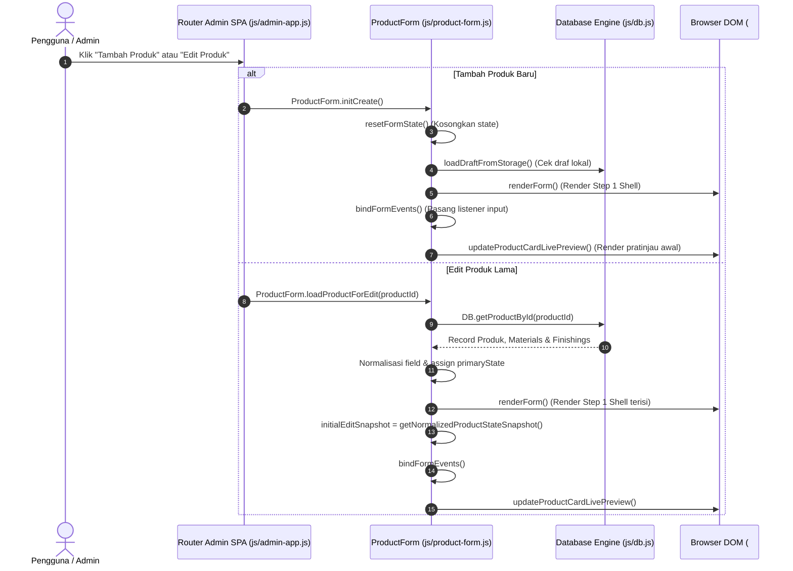
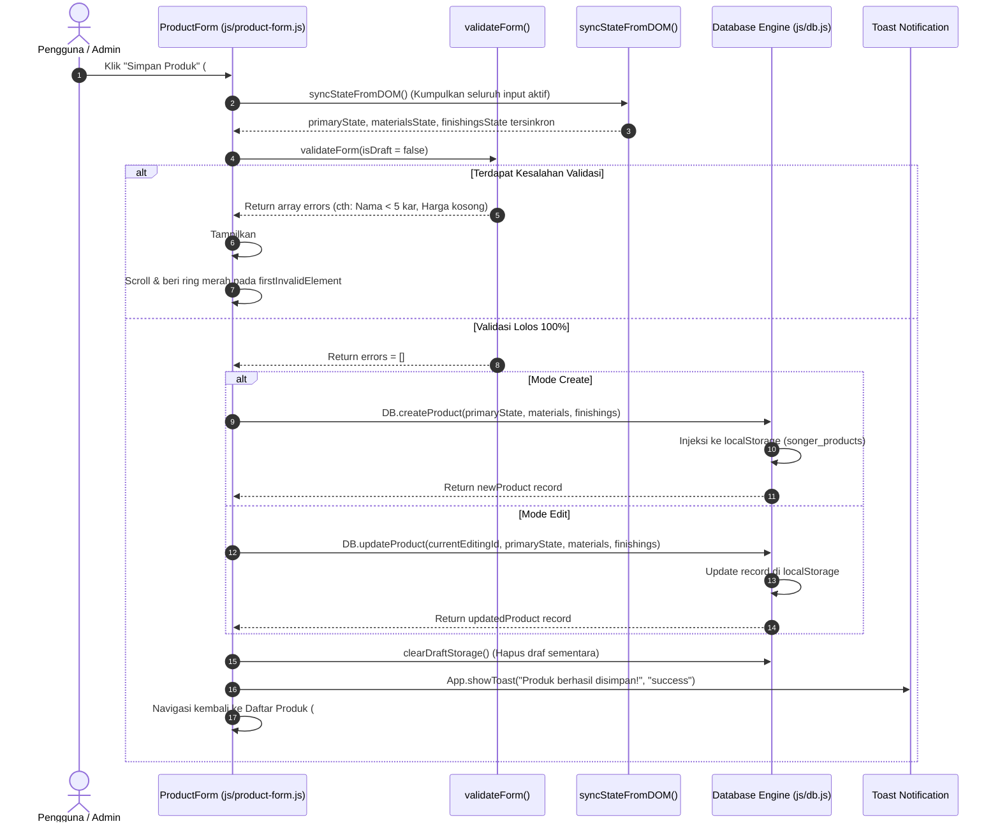

# PRODUCT MASTER — PRD & TECHNICAL DOCUMENTATION SONGER CREATIVE
**Single Source of Truth (SSOT) & Technical Architecture Compass: Modul Produk Terpadu**
**Dokumen Acuan**: `docs/PRD_PRODUCT_MASTER.md`
**Sistem**: Songer Creative Admin Panel, Buyer Store, POS Kasir, dan Ekosistem Multi-Tenant
**Status Audit**: Selesai Diverifikasi Berdasarkan Kode Aktual (Code Freeze / Audit Only)
**Terakhir Diperbarui**: 08 November 2026 (WIB)
**File Acuan Utama**: `js/product-form.js`, `js/db.js`, `admin.html`, `js/admin-app.js`, `js/buyer-store.js`, `js/pdp.js`, `js/pricing-calculator.js`, `js/category-manager.js`, `js/promo-manager.js`, `js/utils.js`, `prisma/schema.prisma`

---

> [!IMPORTANT]
> **STATUS AUDIT & KEBIJAKAN ARSITEKTUR:**
> Dokumen ini disusun sebagai hasil audit teknis mendalam terhadap implementasi kode aktual sistem produk Songer Creative. Dokumen ini menjadi **acuan mutlak (Master Reference)** bagi standardisasi, eliminasi duplikasi kode, integrasi modul, dan persiapan migrasi arsitektur di masa mendatang.
> **Tahap Saat Ini:** Audit, Dokumentasi, dan Pemetaan Arsitektur. Dilarang mengubah kode aplikasi, merefaktor, atau menggabungkan fungsi sebelum rencana konsolidasi disetujui.

---

> [!NOTE]
> ### DOKUMEN LAMPIRAN TEKNIS ARSITEKTUR LENGKAP (MASTER APPENDICES)
> Untuk pendalaman detail teknis tingkat kode, telah disusun 5 dokumen lampiran spesifik yang saling terhubung:
> 1. **[PRD_PRODUCT_MASTER_DATA_DICTIONARY.md](PRD_PRODUCT_MASTER_DATA_DICTIONARY.md)**: Kamus Data Lengkap 134 properti deklarasi awal, ~40 properti dinamis runtime, 10 objek bersarang, state variasi (`materialsState`, `finishingsState`), state transien, dan matriks redundansi alias.
> 2. **[PRD_PRODUCT_MASTER_FUNCTION_CATALOG.md](PRD_PRODUCT_MASTER_FUNCTION_CATALOG.md)**: Katalog Lengkap 447 fungsi `product-form.js`, 120 metode `db.js`, 3 metode inti `pricing-calculator.js`, signature parameter, return values, callers/callees, side effects, bukti baris kloning fungsi internal dan lintas modul, serta sequence call graphs.
> 3. **[PRD_PRODUCT_MASTER_UI_DOM_MAP.md](PRD_PRODUCT_MASTER_UI_DOM_MAP.md)**: Peta Arsitektur UI & DOM 832 selector ID, komponen Step 1 & 7 kartu Step 2, drawer mobile, modal sandbox PxL, popover combobox saran, container error, serta analisis kritis siklus hidup penghancuran & rekonstruksi `#step-pane-2.innerHTML = ''`.
> 4. **[PRD_PRODUCT_MASTER_INTEGRATION_CONTRACTS.md](PRD_PRODUCT_MASTER_INTEGRATION_CONTRACTS.md)**: Kontrak Integrasi 14 Modul Konsumen Data Produk (Admin Panel, Daftar Produk, Storefront, PDP, Kasir POS, Pricing Engine, Dashboard, Afiliasi, Promo, Gudang/Stok, CRM Pelanggan, Review Moderasi, DB Engine, dan Prisma ORM Multi-Tenant).
> 5. **[PRD_PRODUCT_MASTER_ARCHITECTURE_GAPS.md](PRD_PRODUCT_MASTER_ARCHITECTURE_GAPS.md)**: Analisis Gap Arsitektur AS-IS vs TO-BE, bukti empiris nomor baris duplikasi kode, celah alur inventaris (ketiadaan auto-decrement stok pada order/POS), dan roadmap standardisasi 5 fase.

---


## DAFTAR ISI
0. [DOKUMEN LAMPIRAN TEKNIS ARSITEKTUR LENGKAP](#dokumen-lampiran-teknis-arsitektur-lengkap-master-appendices)
1. [1. TUJUAN DAN RUANG LINGKUP](#1-tujuan-dan-ruang-lingkup)
2. [2. ARSITEKTUR SISTEM PRODUK](#2-arsitektur-sistem-produk)
3. [3. ALUR LENGKAP STEP 1 (IDENTITAS & KARAKTER PRODUK)](#3-alur-lengkap-step-1-identitas--karakter-produk)
4. [4. DETAIL FITUR STEP 1](#4-detail-fitur-step-1)
5. [5. ALUR LENGKAP STEP 2 (KONFIGURASI MENYELURUH PRODUK)](#5-alur-lengkap-step-2-konfigurasi-menyeluruh-produk)
6. [6. DETAIL SELURUH FITUR STEP 2](#6-detail-seluruh-fitur-step-2)
   - [6.A. Informasi Produk](#6a-informasi-produk)
   - [6.B. Harga dan HPP (Pricing Engine)](#6b-harga-dan-hpp-pricing-engine)
   - [6.C. Variasi Produk](#6c-variasi-produk)
   - [6.D. Ukuran dan Pemesanan (PxL & Panduan Ukuran)](#6d-ukuran-dan-pemesanan-pxl--panduan-ukuran)
   - [6.E. Stok dan Inventaris](#6e-stok-dan-inventaris)
   - [6.F. Konfigurasi Web](#6f-konfigurasi-web)
   - [6.G. Konfigurasi POS](#6g-konfigurasi-pos)
7. [7. SPESIFIKASI UI/UX SECARA DETAIL](#7-spesifikasi-uiux-secara-detail)
8. [8. KAMUS VARIABEL DAN STATE](#8-kamus-variabel-dan-state)
9. [9. KAMUS FUNGSI](#9-kamus-fungsi)
10. [10. PETA PEMANGGILAN FUNGSI (CALL GRAPHS)](#10-peta-pemanggilan-fungsi-call-graphs)
11. [11. EVENT LISTENER DAN MEKANISME INTERAKSI](#11-event-listener-dan-mekanisme-interaksi)
12. [12. STRUKTUR DATA PRODUK](#12-struktur-data-produk)
13. [13. DATABASE DAN PERSISTENSI](#13-database-dan-persistensi)
14. [14. VALIDASI DAN ATURAN BISNIS](#14-validasi-dan-aturan-bisnis)
15. [15. KONTRAK INTEGRASI ADMIN PANEL](#15-kontrak-integrasi-admin-panel)
16. [16. KONTRAK INTEGRASI BUYER STORE (STOREFRONT)](#16-kontrak-integrasi-buyer-store-storefront)
17. [17. KONTRAK INTEGRASI POS KASIR](#17-kontrak-integrasi-pos-kasir)
18. [18. KONTRAK INTEGRASI DASHBOARD](#18-kontrak-integrasi-dashboard)
19. [19. KONTRAK INTEGRASI AFILIASI](#19-kontrak-integrasi-afiliasi)
20. [20. KONTRAK INTEGRASI PROMO DAN DISKON](#20-kontrak-integrasi-promo-dan-diskon)
21. [21. KONTRAK INTEGRASI INVENTARIS DAN TRANSAKSI](#21-kontrak-integrasi-inventaris-dan-transaksi)
22. [22. MODUL LAINNYA YANG TERKAIT](#22-modul-lainnya-yang-terkait)
23. [23. AUDIT DUPLIKASI VARIABEL DAN FUNGSI](#23-audit-duplikasi-variabel-dan-fungsi)
24. [24. KETIDAKSESUAIAN ARSITEKTUR](#24-ketidaksesuaian-arsitektur)
25. [25. RISIKO TEKNIS](#25-risiko-teknis)
26. [26. REKOMENDASI STANDARDISASI](#26-rekomendasi-standardisasi)
27. [27. SUMBER DATA UTAMA (SINGLE SOURCE OF TRUTH)](#27-sumber-data-utama-single-source-of-truth)
28. [28. HAL YANG BELUM TERSEDIA ATAU BELUM TERVERIFIKASI](#28-hal-yang-belum-tersedia-atau-belum-terverifikasi)

---

## 1. TUJUAN DAN RUANG LINGKUP

### 1.1. Latar Belakang & Tujuan
Modul produk merupakan organ sentral dari seluruh ekosistem aplikasi Songer Creative. Data produk yang dikonfigurasi melalui Seller Center / Admin Panel tidak hanya dikonsumsi untuk etalase katalog, namun menjadi dasar kalkulasi harga produksi, pemotongan stok kasir fisik, pelacakan afiliasi, promosi belanja, hingga percetakan struk transaksi di toko fisik.

Tujuan penyusunan dokumen ini adalah:
1. **Memetakan 100% Arsitektur Berjalan**: Menyajikan kondisi nyata dari implementasi `js/product-form.js` (31.521 baris), `js/db.js` (5.221 baris), `admin.html`, `js/buyer-store.js` (6.709 baris), `js/admin-app.js` (6.887 baris), `js/pdp.js` (1.718 baris), dan `js/pricing-calculator.js` (489 baris).
2. **Menyediakan Inventaris Lengkap**: Mencatat setiap variabel state, fungsi pengendali, selector DOM, relasi database, dan kontrak antarmuka secara presisi dengan nomor baris aktual.
3. **Mengidentifikasi Fragmentasi & Duplikasi**: Menemukan redundansi state, fungsi ganda, event listener liar, alias variabel, dan ketidaksesuaian kontrak data antar-modul.
4. **Menjadi Kompas Standardisasi**: Menetapkan batas-batas tegas (*Single Source of Truth*) agar pengembangan modul baru (POS, CRM, Web Checkout, Afiliasi) tidak membuat aturan perhitungan atau struktur data tandingan.

### 1.2. Ruang Lingkup Audit
Audit teknis ini mencakup:
- **Alur Form Admin**: Tambah Produk Baru (`formMode = 'create'`) dan Edit Produk (`formMode = 'edit'`) yang terbagi dalam **Step 1 (Identitas & Karakter Produk)** dan **Step 2 (Konfigurasi Menyeluruh)**.
- **Komponen Interaktif Form**: 10-Slot Foto Grid, AI Description Generator, 7-Card Gated Step 2, Sticky Subnavbar dengan ScrollSpy, Custom Dimension ($P \times L$) Simulator, Panduan Ukuran Drawer, Tabel Spesifikasi, Komisi Afiliasi Grosir, dan Pengaturan Desain Kartu (Model A, B, C).
- **Konsumsi Data Eksternal**: Storefront Pembeli (`index.html` & `js/buyer-store.js`), Halaman Produk PDP (`product.html` & `js/pdp.js`), Kasir POS (`js/admin-app.js`), Manajemen Kategori (`js/category-manager.js`), Manajemen Promo (`js/promo-manager.js`), dan Skema Prisma PostgreSQL (`prisma/schema.prisma`).

---

## 2. ARSITEKTUR SISTEM PRODUK

### 2.1. Pola Desain (Design Pattern)
Sistem produk beroperasi di atas pola **Client-Side Reactive Monolith with LocalStorage Persistence**:
1. **In-Memory Reactive State Engine**: State form dikelola secara terpusat oleh closure `ProductForm` (`js/product-form.js` baris 11–31520) menggunakan 3 objek state primer:
   - `primaryState`: Menyimpan seluruh metadata produk, pengaturan kartu, diskon promo, afiliasi, dimensi paket, dan footer.
   - `materialsState`: Menyimpan daftar variasi tingkat 1 (Bahan Dasar / Varian Utama) beserta harga jual, modal HPP, dan kuota stok.
   - `finishingsState`: Objek bertingkat (`main`, `extra_1`, `extra_2`, `extra_3`) untuk variasi pendukung tingkat 2–4 dan layanan ekstra.
2. **DOM-Driven Dynamic Mounting**: Berbeda dengan SPA berbasis Virtual DOM, `ProductForm` me-render template HTML string secara langsung ke dalam wadah `<div id="form-container"></div>` pada `admin.html` (baris 507).
3. **Progressive Gating Mechanism**:
   - **Step 1 Sequential Gating**: Pilihan kontrol dibuka secara berjenjang (Jenis Produk $\rightarrow$ Toggle Etalase $\rightarrow$ Model Kartu $\rightarrow$ Foto, Nama & Label).
   - **Step 2 Card Gating**: 7 kartu utama dirender secara mandiri dan dapat diakses cepat menggunakan subnavbar sticky ber-anchoring.
4. **Two-Way Dual Dock Live Preview**:
   - **Desktop Preview**: Sidebar dock tetap di sisi kanan (`#desktop-preview-sidebar`, lebar 320–340px) dengan tab switcher *Pratinjau* dan *Desain Kartu*.
   - **Mobile Drawer Preview**: Bottom-sheet drawer (`#mobile-preview-drawer`) yang dapat dibuka via Floating Action Button (FAB) di layar `<1024px`.

### 2.2. Diagram Arsitektur Tingkat Tinggi

```mermaid
flowchart TD
    subgraph UI_Layer ["Lapisan Antarmuka (DOM Shell)"]
        AdminShell["admin.html (#view-product-form)"]
        FormContainer["#form-container"]
        Step1Pane["#step-pane-1 (Identitas & Karakter)"]
        Step2Pane["#step-pane-2 (7 Kartu Konfigurasi)"]
        SubnavSticky["#step2-subnav-fixed (Sticky Subnavbar)"]
        PreviewDock["#desktop-preview-sidebar (Live Preview Dock)"]
        MobileDrawer["#mobile-preview-drawer (Mobile Bottom Sheet)"]
    end

    subgraph State_Engine ["ProductForm Closure (js/product-form.js)"]
        Primary["primaryState (134 properties)"]
        Materials["materialsState (Variasi 1 / Bahan)"]
        Finishings["finishingsState (Variasi 2-4 & Extras)"]
        LivePreviewFn["updateProductCardLivePreview()"]
        PricingCalc["PricingCalculator.calculateProductPrice()"]
        SyncDOM["syncStateFromDOM()"]
        ValidateFn["validateForm()"]
    end

    subgraph Storage_Layer ["Persistensi Lokal (js/db.js)"]
        DBModule["DB Engine (localStorage)"]
        ProductsTable["songer_products"]
        MaterialsTable["songer_materials"]
        FinishingsTable["songer_finishings"]
        DraftKey["songer_add_product_draft"]
    end

    subgraph Downstream_Consumers ["Modul Konsumen Data Produk"]
        BuyerStore["Storefront Katalog (js/buyer-store.js)"]
        PDP["Detail Produk & Cart (js/pdp.js)"]
        POSCashier["Kasir POS (js/admin-app.js)"]
        ProductList["Tabel Admin Produk (js/product-list.js)"]
        PromoMgr["Promo & Diskon (js/promo-manager.js)"]
        Affiliate["Afiliasi & Komisi"]
    end

    AdminShell --> FormContainer
    FormContainer --> Step1Pane
    FormContainer --> Step2Pane
    FormContainer --> SubnavSticky
    FormContainer --> PreviewDock
    FormContainer --> MobileDrawer

    Step1Pane -- "Input & Selection" --> SyncDOM
    Step2Pane -- "Input & Repeaters" --> SyncDOM
    SyncDOM --> Primary
    SyncDOM --> Materials
    SyncDOM --> Finishings

    Primary -- "Reactive Trigger" --> LivePreviewFn
    Materials -- "Reactive Trigger" --> LivePreviewFn
    Finishings -- "Reactive Trigger" --> LivePreviewFn
    LivePreviewFn --> PricingCalc
    LivePreviewFn --> PreviewDock
    LivePreviewFn --> MobileDrawer

    ValidateFn -- "Lolos Validasi" --> DBModule
    Primary --> DBModule
    Materials --> DBModule
    Finishings --> DBModule

    DBModule --> ProductsTable
    DBModule --> MaterialsTable
    DBModule --> FinishingsTable
    Primary -. "Auto Save Draft" .-> DraftKey

    ProductsTable --> BuyerStore
    ProductsTable --> PDP
    ProductsTable --> POSCashier
    ProductsTable --> ProductList
    ProductsTable --> PromoMgr
    ProductsTable --> Affiliate
```


---

## 3. ALUR LENGKAP STEP 1 (IDENTITAS & KARAKTER PRODUK)

### 3.1. Inisialisasi & Pembukaan Form
Step 1 dimulai ketika admin membuka menu Tambah Produk atau Edit Produk:
1. **Router Invocation** (`js/admin-app.js` baris 729–744):
   - Jika route `create-product` atau `create`: memanggil `ProductForm.initCreate()` atau `ProductForm.init()`.
   - Jika route `edit-product` atau `edit`: memanggil `ProductForm.loadProductForEdit(productId)`.
2. **Pembersihan / Pengisian State Awal**:
   - **Mode Tambah (`create`)**:
     * `formMode = 'create'`; `currentEditingId = null`.
     * `resetFormState()` (`js/product-form.js` baris 1497): Mengosongkan seluruh properti `primaryState`, `materialsState`, dan `finishingsState`. Menetapkan default `order_category: 'Ctk'`, `is_active: true`, `min_order: 1`, `has_shipping: true`, dan `product_type: ''` (wajib dipilih seller).
     * `loadDraftFromStorage()` (`js/product-form.js` baris 2311): Memeriksa apakah ada draf tersimpan di `songer_add_product_draft`. Jika ada, menyalin isi draf ke `primaryState` dan mengembalikan posisi form.
     * `renderForm()` (`js/product-form.js` baris 2422): Menghasilkan markup Step 1 ke dalam `#form-container`.
   - **Mode Edit (`edit`)**:
     * `formMode = 'edit'`; `currentEditingId = id`.
     * Membaca produk dari database via `DB.getProductById(id)`.
     * Mengisi `primaryState` dengan seluruh field produk yang tersimpan, menormalkan format kurir ekspedisi, mendeteksi opsi garansi, memuat `materialsState` dari tabel `materials` dan `finishingsState` dari tabel `finishings`.
     * Mengambil snapshot pembanding: `initialEditSnapshot = getNormalizedProductStateSnapshot()` untuk mendeteksi perubahan data saat pembatalan.

### 3.2. Gerbang Sekuensial Step 1 (Sequential Gating Workflow)
Step 1 menerapkan pembukaan field bertahap (*progressive disclosure*) yang dikendalikan oleh fungsi `updateStep1SequentialGatingDOM()` (`js/product-form.js` baris 21933):
```mermaid
graph TD
    Start([Buka Form Step 1]) --> Step1_1[Pilih Jenis Produk / Layanan: Fisik vs Non Fisik]
    Step1_1 -- Belum Dipilih --> Gate1_Lock[Placeholder Terkunci: step1-gated-placeholder Aktif]
    Step1_1 -- Terpilih: physical / non_physical --> Step1_2[Buka Kontainer: step1-unlocked-fields]

    Step1_2 --> Step1_3[Pilihan: Tampilkan di Etalase Toko ON / OFF]
    Step1_3 -- Toggle ON (is_active: true) --> Step1_4[Wajib Memilih Model Kartu Produk: A, B, atau C]
    Step1_3 -- Toggle OFF (is_active: false) --> BypassCard[Bypass Pemilihan Model Kartu]

    Step1_4 -- Belum Dipilih --> Gate2_Lock[Placeholder Terkunci: step1-cardmodel-gated-placeholder Aktif]
    Step1_4 -- Model Terpilih (A / B / C) --> Step1_5[Buka Kontainer: step1-cardmodel-unlocked-fields]
    BypassCard --> Step1_5

    Step1_5 --> Step1_6[Upload Foto Produk: Minimal 1 Cover Image]
    Step1_5 --> Step1_7[Input Nama Produk: 5 s/d 150 Karakter]
    Step1_5 --> Step1_8[Konfigurasi Label Khusus 1 & 2: Datalist Combobox]

    Step1_6 & Step1_7 & Step1_8 --> S1_Next{Klik Tombol 'Lanjut ke Step 2'}
    S1_Next -- Ada Error Validasi --> ShowS1Errors[Tampilkan form-error-banner & Highlight Ring Merah]
    S1_Next -- Validasi Lolos --> GoStep2[Pindah ke Step 2 via goToStep(2)]
```

### 3.3. Transisi Step 1 ke Step 2
Ketika tombol `#btn-step-1-next` diklik:
1. Memanggil `goToStep(2)` (`js/product-form.js` baris 21736).
2. Mengeksekusi `syncStateFromDOM()` untuk memastikan nilai yang tertulis di input sinkron dengan `primaryState`.
3. Menjalankan validasi prasyarat Step 1:
   - `primaryState.product_type` wajib bernilai `'physical'` atau `'non_physical'`.
   - Jika `primaryState.is_active === true`, maka `primaryState.card_variant` tidak boleh kosong.
   - Jika `primaryState.is_active === true`, maka `primaryState.images` atau `image_url` wajib berisi minimal 1 foto.
   - `primaryState.name` wajib diisi minimal 5 karakter (whitespace diabaikan).
   - Jika Model Kartu bukan 'B' dan label khusus diaktifkan: Label 1 wajib diisi, dan Label 1 tidak boleh sama dengan Label 2.
4. Jika terdapat pelanggaran: memicu `showWizardErrorBanner(s1Errors)` dan melakukan *smooth scroll* serta *focus ring* merah pada elemen yang tidak valid.
5. Jika valid: menyembunyikan banner error, menetapkan `currentStep = 2`, memanggil `updateStepVisibility()`, me-render markup Step 2 ke dalam `#step-pane-2`, menginisialisasi listener interaktif Step 2 via `bindStep2InteractiveEvents()`, dan mengaktifkan `initStep2SubnavObserver()`.

---

## 4. DETAIL FITUR STEP 1

| No | Nama Fitur | Tujuan & Kegunaan | UI / UX Komponen | Selector ID / Class | Variabel State Terikat | Fungsi Pengelola | Event Pemicu | Validasi & Aturan Bisnis | Persistensi Data | Modul Dependensi |
|---|---|---|---|---|---|---|---|---|---|---|
| 1 | Jenis Produk / Layanan | Membedakan alur barang fisik (memerlukan pengiriman) vs non-fisik (jasa/digital tanpa ekspedisi). | 2 Tombol Radio Card interaktif (*Fisik* & *Non Fisik*) dengan ikon Lucide. | `#product-type-selector-group`, `.btn-select-product-type` | `primaryState.product_type` | `bindFormEvents()` (L21846) | `click` pada button | Wajib dipilih salah satu (`'physical'` / `'non_physical'`). Default kosong saat buat baru. | Kolom `product_type` di tabel `products`. | Pengiriman Step 2, Storefront, POS Kasir. |
| 2 | Tampilkan di Etalase | Mengatur visibilitas produk di katalog pembeli (Storefront). Jika nonaktif, produk hanya untuk kasir POS. | Toggle switch modern dengan warna brand primer. | `#toggle-is-active-form` | `primaryState.is_active` | `bindFormEvents()` (L21846) | `change` pada checkbox | Boolean. Jika OFF, pemilihan model kartu dan upload foto cover tidak diwajibkan. | Kolom `is_active` di tabel `products`. | `buyer-store.js`, POS Kasir, PDP. |
| 3 | Model Kartu Produk | Memilih layout pratinjau dan kartu etalase: Model A (Klasik/Cetak), Model B (Minimalis/Jasa), Model C (Detail/Retail). | 3 Radio Cards dengan preview thumbnail mini dan radio mark warna dinamis. | `#card-model-selector-group`, `input[name="card_variant_radio"]` | `primaryState.card_variant`, `primaryState.card_variant_override` | `bindFormEvents()`, `updateStep1DynamicDescriptions()` | `change` pada radio input | Wajib dipilih jika `is_active: true`. Model B otomatis menonaktifkan fitur label khusus. | Kolom `card_variant` di tabel `products`. | `buyer-store.js` (`renderCardVariantA/B/C`), Step 1 Live Preview. |
| 4 | Galeri Foto Produk (10 Slot) | Upload gambar produk dengan auto kompresi Canvas dan rasio adaptif. | 10 slot grid foto responsif (3 kolom mobile, 5 desktop) dengan badge Cover & aksi geser/hapus. | `#gallery-slots-container`, `#input-prod-images-hidden`, `#input-prod-image` | `primaryState.images` (array), `primaryState.image_url` | `compressProductImage()` (L94), `refreshGalleryDOM()` | `change` pada file input, drag-and-drop | Maksimal 10 foto (sebelumnya 9). Kompresi senyap canvas ke WebP/JPEG kualitas 0.8 (max 1200px). Minimal 1 foto jika etalase ON. | Kolom `images` (array JSON) dan `image_url` di tabel `products`. | PDP gallery, Storefront card preview, Kasir POS thumbnail. |
| 5 | Rasio Aspek Foto | Mengatur proporsi crop tampilan foto (1:1 Persegi, 4:3 Lanskap, atau 3:4 Potret). | Badge indikator rasio dinamis di atas slot foto. | `#gallery-ratio-badge`, `input[name="photo_aspect_ratio"]` | `primaryState.image_aspect_ratio` | `getActiveCardRatioInfo()` | `change` pada radio rasio | Model A: 1:1, Model B: 3:4, Model C: 4:3. Menyesuaikan CSS aspect ratio kontainer gambar. | Kolom `image_aspect_ratio` di tabel `products`. | `buyer-store.js`, Live Preview. |
| 6 | Nama Produk | Identitas utama judul produk dagang. | Input teks dengan indikator counter panjang karakter `(0 / 150)`. | `#input-prod-name`, `#name-char-count`, `#name-min-length-error` | `primaryState.name` | `handleProductNameValidation()` (L21710) | `input`, `blur` pada input teks | Wajib diisi. Minimal 5 karakter, maksimal 150 karakter. Whitespace awal/akhir dibersihkan. | Kolom `name` di tabel `products`. | Seluruh modul (POS, PDP, Invoice, SEO, Search). |
| 7 | Toggle Label Khusus | Mengaktifkan/menonaktifkan pita label promo pada kartu (cth: "Best Seller", "Free Ongkir"). | Toggle switch ON/OFF. Otomatis disabled dan terkunci jika memilih Model Kartu B. | `#toggle-enable-custom-labels`, `#label-custom-disabled-notice` | `primaryState.show_badge`, `primaryState.has_custom_labels` | `bindFormEvents()` | `change` pada checkbox | Boolean. Disabled permanen pada Model B karena kartu minimalis tidak memiliki badge banner. | Kolom `has_custom_labels` dan `show_badge` di `products`. | Storefront badges (`buyer-store.js`), Live Preview. |
| 8 | Preset Label Khusus (Ditiadakan) | Bagian tombol pill chip preset instan (`#custom-labels-preset-group`, `.btn-preset-label-step1`) ditiadakan karena styling, radius, dan warna label khusus telah dikelola via Accordion Desain Kartu (Promo & Diskon), sedangkan saran teks label dikelola langsung melalui dropdown riwayat Combobox Datalist (`custom-labels-history-list`). | Dihapus / Tidak Diperlukan | - | `primaryState.custom_labels` | `updateCustomLabelsLockState()` | - | Pengisian teks label khusus dilakukan via input slot combobox 1 & 2. | Tersimpan ke dalam array `custom_labels` & riwayat datalist. | Accordion Desain Kartu, Live Preview badge. |
| 9 | Input Label Khusus 1 | Teks badge banner kiri atas kartu etalase. | Input/Pilih Combobox (`.clean-datalist-popover`) dengan panah dropdown dan tombol bersihkan (✕). | `#input-custom-label-1`, `#char-count-label-1`, `#error-custom-label-1` | `primaryState.custom_labels[0]` | `bindCleanDatalistPopovers()` (L787) | `focus`, `input`, `click`, `blur` | Maksimal 15 karakter grapheme. Wajib jika toggle label aktif. Tidak boleh sama dengan Label 2. | Disimpan ke array `custom_labels` & riwayat datalist. | Storefront badge 1. |
| 10 | Input Label Khusus 2 | Teks badge banner kedua di samping Label 1. | Input/Pilih Combobox (`.clean-datalist-popover`) kondisional (hanya muncul jika ruang kartu cukup). | `#input-custom-label-2`, `#wrapper-custom-label-2`, `#error-custom-label-2` | `primaryState.custom_labels[1]` | `bindCleanDatalistPopovers()`, `updateLabelCustomCapacityInfo()` | `focus`, `input`, `click`, `blur` | Maksimal 15 karakter. Opsional. Otomatis disembunyikan jika panjang teks Label 1 melebihi kapasitas baris. | Disimpan ke array `custom_labels` & riwayat datalist. | Storefront badge 2. |
| 11 | Tombol Batal Step 1 | Membatalkan pembuatan atau perubahan produk dan kembali ke menu sebelumnya. | Tombol sekunder berbingkai (*Kembali* / *Batal*). | `#btn-step-1-cancel` | Membaca `hasAnyNewProductData()` atau `hasEditProductChanged()` | `handleFormCancel()` (L1889) | `click` pada tombol | Jika ada data yang telah diubah/diisi, memunculkan modal konfirmasi `#modal-cancel-form-confirm`. | Tidak ada (membersihkan draft jika disetujui). | Router Admin SPA. |
| 12 | Tombol Lanjut Step 2 | Memvalidasi seluruh data Step 1 dan berpindah ke konfigurasi harga Step 2. | Tombol primer brand bertuliskan *Lanjut ke Step 2* dengan ikon panah. | `#btn-step-1-next` | `currentStep = 2` | `goToStep(2)` (L21736) | `click` pada tombol | Menjalankan validasi ketat prasyarat Step 1. Memblokir navigasi jika ada field wajib yang belum tuntas. | Memperbarui DOM form dan inisialisasi Step 2. | Step 2 Content & Subnav. |

---

## 5. ALUR LENGKAP STEP 2 (KONFIGURASI MENYELURUH PRODUK)

### 5.1. Mekanisme Render & Mount Step 2
Ketika user berpindah ke Step 2, terjadi proses rekonstruksi DOM dinamis:
1. **Destruksi & Render Ulang** (`js/product-form.js` baris 21672–21684):
   - Elemen `#step-pane-1` disembunyikan (`hidden`).
   - Elemen `#step-pane-2` dibuka (`block`) dan isinya di-generate ulang secara penuh melalui pemanggilan fungsi `renderStep2Content()` (`js/product-form.js` baris 14594).
   - **Catatan Kritis**: Jika user kembali ke Step 1, `#step-pane-2.innerHTML` dikosongkan (`p2.innerHTML = ''`). Oleh karena itu, seluruh nilai formulir wajib sudah tersinkronisasi ke dalam `primaryState`, `materialsState`, dan `finishingsState` via `syncStateFromDOM()`.
2. **Inisialisasi Event Interaktif Step 2**:
   - Menjalankan `bindStep2InteractiveEvents()` (`js/product-form.js` baris 22508) untuk mengikat listener harga, toggle variasi, input ukuran, kalkulator HPP, modal simulator, dan pengaturan pengiriman.
   - Mengaktifkan `initStep2SubnavObserver()` (`js/product-form.js` baris 21612) untuk mengikat mekanisme ScrollSpy pada subnavbar.

### 5.2. Navigasi Sticky Subnavbar (7 Seksi)
Di bagian atas Step 2, terpasang bilah subnav navigasi yang menempel rapat (*sticky*) persis di bawah topbar admin (`#step2-subnav-fixed`, baris 14636):
- **7 Tab Navigasi Horizontal**:
  1. `card-step2-info`: **Informasi Produk** (Kategori, Sub-Kategori, Media).
  2. `card-step2-sales`: **Informasi Penjualan** (Variasi 1–4, Extras, Harga, HPP, Stok, Wholesale, Kelipatan).
  3. `card-step2-shipping`: **Pengiriman** (Berat, Dimensi Paket, Kurir Toko & Ekspedisi).
  4. `card-step2-promo`: **Program Promo** (Diskon Harian & Auto Promo Bulanan).
  5. `card-step2-description`: **Deskripsi Produk** (AI Generator & Textarea).
  6. `card-step2-specs`: **Spesifikasi** (Tabel Spesifikasi Dinamis & Garansi).
  7. `card-step2-others`: **Lainnya** (Kondisi, Pre-Order, Footer Kartu Detail, Timer, Afiliasi).
- **Mekanisme ScrollSpy**: Menggunakan event listener scroll pada viewport `#admin-main-viewport` yang membandingkan koordinat vertikal (`getBoundingClientRect().top`) setiap kartu seksi dan memberikan class `.subnav-tab-active` (warna primer brand dan border-b-2) pada tab yang sedang aktif di layar.

---

## 6. DETAIL SELURUH FITUR STEP 2

### 6.A. Informasi Produk
- **Komponen**: Kartu putih mandiri `#card-step2-info` (baris 14673).
- **Fitur di dalamnya**:
  1. *Nama Produk*: Input teks duplikat tersinkronisasi (`#step2-input-name`) yang terikat dua arah dengan `#input-prod-name` Step 1.
  2. *Kategori Utama Etalase*: Dropdown select `#select-step2-cat` (atau `#select-prod-cat`), membaca daftar kategori dari `DB.getCategories()`. Terikat pada `primaryState.category_id`.
  3. *Sub-Kategori Etalase*: Dropdown select `#select-step2-sub-cat` yang memuat sub-kategori relasional berdasarkan kategori terpilih via `DB.getSubCategories(catId)`. Terikat pada `primaryState.sub_category_id`.
  4. *Kategori Operasional Kasir*: Terikat pada `primaryState.order_category` (default `'Ctk'` untuk percetakan atau `'Non-Ctk'` untuk produk umum).

### 6.B. Harga dan HPP (Pricing Engine)
Kalkulasi harga dan modal HPP produk dikendalikan oleh formula pada modul `js/pricing-calculator.js` (489 baris) dan konfigurasi di kartu `#card-step2-sales` (baris 14787):
- **Struktur Formula (`price_type` 1 s/d 7)**:
  - **Tipe 1 (`Meter` / $P \times L$)**:
    * Perhitungan berbasis luas meter persegi: $\text{Luas } (\text{m}^2) = (\text{Panjang cm} \times \text{Lebar cm}) \div 10.000$.
    * Berlaku aturan **Minimal 1.0 m²**: Jika hasil luas riil $< 1.0\text{ m}^2$, maka luas tagihan dibulatkan ke $1.0\text{ m}^2$ (`billedAreaM2 = 1.0`).
    * Rumus Harga: $\text{Harga Jual} = (\text{Luas Billed} \times \text{Harga V1}) + \sum \text{Harga Varian Pendukung}$.
    * Rumus Modal HPP: $\text{HPP} = (\text{Luas Billed} \times \text{HPP V1}) + \sum \text{HPP Varian Pendukung}$.
  - **Tipe 2 (`KombF` / Normal Kombinasi Tetap)**:
    * Penjumlahan langsung nilai seluruh varian yang dipilih: $\text{Harga} = \text{Harga V1} + \text{Harga V2} + \text{Harga V3} + \text{Harga V4}$.
    * HPP: $\text{HPP} = \text{HPP V1} + \text{HPP V2} + \text{HPP V3} + \text{HPP V4}$.
  - **Tipe 3 (`Fixed` / Harga Flat Tunggal)**:
    * Harga tetap terlepas dari kombinasi variasi (legacy fallback).
  - **Tipe 4 (`Paket` / Bundle Promo)**:
    * Harga dasar mengacu pada paket terpilih (V1). Opsi pendukung yang ditandai gratis (`is_included === true` atau `is_free === true`) tidak menambah harga jual pembeli, namun biaya HPP (`cost_price`) tetap dihitung ke dalam beban toko.
  - **Tipe 5 (`Kg` / Bobot Berat Riil)**:
    * Multiplier berbasis bobot kilogram: $\text{Harga} = (\text{Bobot Kg} \times \text{Harga V1}) + \text{Varian Pendukung}$. Mendukung konversi unit gram dan ons.
  - **Tipe 6 (`Lt` / Volume Cairan)**:
    * Multiplier berbasis volume liter: $\text{Harga} = (\text{Volume Liter} \times \text{Harga V1}) + \text{Varian Pendukung}$. Mendukung konversi ml dan galon.
  - **Tipe 7 (`KombStep` / Wajib Kelipatan Kuantitas)**:
    * Perhitungan berjenjang berdasarkan batch kelipatan (`stepQuantity` / `step_multiplier`).
    * Jumlah batch dihitung: $\text{Batches} = \lceil \text{Kuantitas} \div \text{StepQty} \rceil$.
    * Subtotal V1 dihitung per-batch, sedangkan variasi pendukung dihitung per-pcs kuantitas.
- **Harga Grosir Bertingkat (Wholesale Tiers)**:
  - Diatur pada seksi `#section-wholesale` (baris 14881).
  - Terikat pada array `primaryState.wholesale_tiers` dengan struktur: `[{ id, min_qty, max_qty, price }]`.
  - Mendukung dua mode: Mode Normal (berlaku seragam untuk seluruh produk) dan Mode Spesifik Per-Varian (`primaryState.wholesale_by_variant`).
- **Kelipatan Pesanan (Order Multiple)**:
  - Diatur pada seksi `#section-order-multiple` (baris 14933).
  - Mengunci pembelian pembeli agar wajib kelipatan tertentu (contoh: kelipatan 50 pcs untuk kartu nama). Terikat pada `primaryState.order_multiple_value` dan `primaryState.order_multiples_by_variant`.

### 6.C. Variasi Produk
Struktur variasi pada Songer Creative mengadopsi sistem hirarki 4 tingkat + 1 seksi layanan independen:
1. **Variasi 1 (Varian Utama / Bahan Dasar)**:
   - Dikelola melalui array `materialsState` (`js/product-form.js` baris 577).
   - Label default: *"Jenis"* atau *"Bahan"*, dapat dikustomisasi melalui `primaryState.variation_labels.label_tier_1`.
   - Menampung opsi varian dengan properti: `id`, `name`, `price`, `cost_price`, `stock`, `step_multiplier`, dan status grosir.
2. **Variasi 2 (Finishing Utama)**:
   - Diaktifkan via tombol `#btn-trigger-variasi-2` $\rightarrow$ `primaryState.has_variation_2 = true`.
   - Dikelola melalui array `finishingsState.main`.
   - Terikat label `primaryState.variation_labels.label_tier_2`.
3. **Variasi 3 (Finishing Tambahan 1)**:
   - Diaktifkan via tombol `#btn-trigger-variasi-3` $\rightarrow$ `primaryState.has_variation_3 = true`.
   - Dikelola melalui array `finishingsState.extra_1`.
4. **Variasi 4 (Finishing Tambahan 2)**:
   - Diaktifkan via tombol `#btn-trigger-variasi-4` $\rightarrow$ `primaryState.has_variation_4 = true`.
   - Dikelola melalui array `finishingsState.extra_2`.
5. **Layanan Ekstra (Extra Services / Finishing Ekstra 3)**:
   - Diaktifkan via toggle `#toggle-extra-service` $\rightarrow$ `primaryState.has_extra_service = true`.
   - Dikelola melalui array `finishingsState.extra_3`.
   - Karakteristik khusus: Tidak mengikuti kombinasi perkalian matriks kuantitas utama. Mendukung tipe:
     * `direct` (Langsung proses / otomatis terhitung 1x flat).
     * `pilihan_ganda` (Checklist opsional oleh pembeli di PDP).
     * `qty` (Memiliki input kuantitas mandiri di luar kuantitas pesanan produk utama).
- **Cakupan Opsi (Scopes)**: Setiap variasi tingkat 2, 3, dan 4 dapat diatur cakupannya:
  - `umum`: Opsi berlaku untuk semua pilihan pada variasi sebelumnya.
  - `spesifik`: Opsi hanya muncul jika pembeli memilih varian bahan tertentu (pemetaan disimpan dalam objek `primaryState.specific_options_map`).

### 6.D. Ukuran dan Pemesanan (PxL & Panduan Ukuran)
- **Input Ukuran Kustom ($P \times L$)**:
  - Diatur pada seksi `#card-custom-dimension-pxl` dan modal simulator `#modal-sandbox-simulator` (baris 15970–16950).
  - Terikat pada flag `primaryState.has_custom_dimension`.
  - Dilengkapi kontrol:
    * `dimension_unit`: Pilihan satuan ukuran (`Cm`, `M`, `Dm`, `Mm`).
    * `custom_dimension_label`: Label input pada PDP (cth: *"Ukuran Spanduk"*).
    * `dim_min_one_price` & `dim_min_one_cost`: Pengaturan batas minimum tagihan per unit (luas minimal meter persegi) dan ambang batas modal HPP.
- **Panduan Ukuran (Size Guide)**:
  - Diatur pada drawer `#drawer-product-size-guide` dan seksi `#section-size-guide-wrapper` (baris 18788–19800).
  - Terikat pada objek `primaryState.size_guide` dengan dua tipe mode:
    * `table`: Menampilkan tabel dimensi ukuran (template bawaan: pakaian/kaos, sepatu, atau tabel manual custom) dengan baris & kolom yang dapat diedit bebas oleh penjual.
    * `image`: Upload gambar bagan ukuran (*size chart image*).
  - Dilengkapi fitur pengaitan ke variasi produk (*Linked Variation Tier*): menghubungkan baris ukuran pada tabel secara langsung dengan opsi pada Variasi 1 atau 2.

### 6.E. Stok dan Inventaris
- **Model Stok**:
  - Diatur melalui toggle `#toggle-unlimited-stock` dan input `#input-stock-qty`.
  - Jika `primaryState.is_unlimited_stock === true`: nilai `stock` diset `null` (di etalase dan kasir ditampilkan sebagai *"Tanpa Batas"* / *"Unlimited"*).
  - Jika stok terbatas aktif: nilai kuantitas fisik disimpan dalam integer `primaryState.stock`.
  - Pada produk dengan variasi bertingkat (`has_variants: true`), stok diatur per baris variasi pada `materialsState[i].stock`.
- **Status Alur Pengurangan Stok**:
  - **Temuan Kritis**: Berdasarkan penelusuran fungsi `DB.saveOrder()` (`js/db.js` baris 4736) dan transaksi kasir `handlePosCheckout()` (`js/admin-app.js` baris 2196), **TIDAK DITEMUKAN** fungsi pemotongan kuantitas stok otomatis saat pesanan disimpan atau dibayar. Stok saat ini berstatus statis dan hanya termutasi secara manual melalui form edit produk.

### 6.F. Konfigurasi Web (Storefront Presentation)
- **Model Kartu Etalase**:
  - `Model A` (Standard Cetak): Menampilkan rasio foto 1:1, badge kategori, kalkulator PxL cepat, tombol "+ Keranjang", dan harga mulai dari.
  - `Model B` (Portofolio & Jasa): Menampilkan rasio foto 3:4, tampilan minimalis tanpa badge label khusus, tombol aksi langsung, dan harga fixed/mulai dari.
  - `Model C` (Retail Shopee-Style): Menampilkan rasio foto 4:3, dual-footer badge strip di bagian bawah, countdown timer promo berjalan, dan badge penjualan terintegrasi.
- **Konfigurasi Desain Kartu & Dual Footer (Model A/B/C)**:
  - *Outline & Radius Sudut (Step 1 → Desain Kartu, SC-ADMIN-CARD-PRESET-DROPDOWNS-13B & 13B-R1)*: Kontrol `border_width` (`None 0 px`, `Tipis 1 px`, `Sedang 2 px`, `Tebal 3 px`), `border_radius` (`0/8/16/24 px`), serta `badge_radius`, `discount_badge_radius`, dan `countdown_radius` (`0/4/6/8/12 px`) menggunakan dropdown pilihan `role="listbox"` ber-portal (`document.body`, `z-index: 98` di atas drawer `95` namun di bawah modal `100`) tanpa input angka manual/spinner. Portal otomatis menutup saat klik luar, `Escape`, `Tab`, scroll luar, pindah tab, pindah step (`goToStep`), buka modal `Batal`, atau tutup drawer. Opsi `None (0 px)` menonaktifkan picker warna outline tanpa menghapus nilai warnanya. Nilai valid legacy di luar daftar (mis. `10px`) dipertahankan per-produk sebagai `${n} px (Tersimpan)` tanpa pembulatan diam-diam.
  - *Footer 1 (Model C)*: Wajib diisi untuk simpan desain & simpan produk final (kecuali draf/pengecualian legacy). Teks tersimpan di `primaryState.card_footer_text` dan `primaryState.custom_footer_1.text` (maksimal 32 karakter grapheme). Bila kosong di Pratinjau Step 1, ditampilkan teks contoh lokal `"Tersedia berbagai Variasi"` **tanpa ikon** disertai penanda `#preview-footer-sample-badge(-mob)` bertuliskan `"Label Footer 1 belum diisi; pratinjau menggunakan contoh."`. Pilihan ikon dari `FOOTER_ICONS_CATALOG` termasuk `'none'` (*Tanpa Ikon*).
  - *Footer 2 (Model C)*: Opsional. Nilai `null`/`undefined`/kosong/whitespace dianggap tanpa teks sehingga tidak diisi otomatis teks bawaan, dan pada **Pratinjau Step 1 Admin maupun etalase pembeli (`buyer-store.js`)** strip Footer 2, ikon, divider `border-b`, serta ruang kosongnya disembunyikan total (strip terbawah aktif mewarisi `border_radius` kartu); warna & ID ikon tersimpan tetap dipertahankan di `primaryState`.
  - *Keterikatan Ikon-Teks & Validasi Keunikan Antarfooter (`13B-R1`)*: Ikon hanya aktif saat teks footer bersangkutan terisi valid; saat teks kosong/invalid, kontrol picker Step 1 & `<select>` Step 2 dinonaktifkan dan divisualkan `'none'` tanpa menimpa state tersimpan. Jika kedua footer memiliki teks valid: teks yang identik setelah normalisasi (trim, collapse spasi, lowercase) memblokir simpan dengan error `"Label Footer 2 harus berbeda dari Label Footer 1."`; ikon aktif non-`'none'` milik footer lain dinonaktifkan (`"Digunakan pada footer lainnya."`), `'none'` diizinkan di kedua footer, dan data legacy berikon kembar memunculkan peringatan `"Pilih ikon berbeda atau gunakan Tanpa Ikon."` (hanya memblokir setelah `isFooterTouched`). Tombol `Batal` memulihkan teks, ikon, `isFooterTouched`, dan validasi dari `cardDesignSnapshot`.
  - *Persistensi & Warna Strip*: `DB.createProduct()` & `DB.updateProduct()` menyimpan `use_default_card_design`, `card_config`, dan `countdown_radius`. Warna default Footer 1/2 mengikuti `--color-primary` dan `--color-secondary`.
  - *Stabilitas Layer Drawer Preview Mobile (`13B-R2`)*: `#mobile-preview-sheet` tetap menjaga klip sudut atas 13A dengan `overflow: hidden !important; overflow: clip !important;`, membebaskan layer `transform` setelah animasi buka selesai via `.mobile-preview-settled:not(.translate-y-full)` (`transform: none !important`), menyingkirkan `-webkit-overflow-scrolling: touch` serta `transition-colors` pada `#mobile-preview-body` (dengan `min-height: 0`, `overflow-x: hidden`, `z-index: 2`/`1` antara header dan body), mengecualikan frame terluar `#mobile-preview-sheet` dari `scrollSelectors`, dan memakai `focus({ preventScroll: true })` pada pemulihan fokus dropdown/validasi footer.
- **Generator Deskripsi AI Interaktif**:
  - Terletak pada seksi `#card-step2-description` (baris 15401).
  - Membaca konteks nama produk, kategori, keunggulan bahan dari Variasi 1, dan finishing. Membangun draft deskripsi terstruktur (Keunggulan, Spesifikasi Bahan, Catatan Pemesanan) secara lokal di browser tanpa ketergantungan API eksternal yang lambat.

### 6.G. Konfigurasi POS Kasir
- **Parameter Transaksi Kasir**:
  - `order_category`: Kategori order kasir (`'Ctk'` untuk Cetak Antrean Mesin atau `'Non-Ctk'` untuk barang retail langsung jadi).
  - `barcode`: Barcode produk untuk pemindaian scanner barcode kasir (`primaryState.barcode`).
  - `sku`: Nomor identitas stok toko (`primaryState.sku`).
  - **Kalkulator Kasir Cepat**: Jika produk bertipe Meter ($P \times L$) dibuka di POS Kasir, kasir otomatis disajikan modal pop-up kalkulator PxL (`#modal-pos-calculator` pada `admin.html` baris 549) untuk menginput panjang dan lebar sebelum masuk ke keranjang belanja kasir (`posCart`).

---

## 7. SPESIFIKASI UI/UX SECARA DETAIL

### 7.1. Breakpoint Responsif & Layout Grid
- **Mobile (< 640px)**:
  - Form Wizard membentang 100% penuh tanpa nested card berbingkai ganda.
  - Slot galeri foto tersusun dalam 3 kolom (`grid-cols-3 gap-2.5`).
  - Tombol-tombol kontrol berukuran sentuh nyaman ($\ge 44 \times 44\text{ px}$).
  - Live Preview disajikan melalui bottom-sheet drawer (`#mobile-preview-drawer`) yang meluncur dari bawah.
- **Tablet (640px – 1023px)**:
  - Slot galeri foto berubah menjadi 5 kolom (`sm:grid-cols-5`).
  - Form input beralih ke grid 2 kolom pada seksi dimensi dan harga.
- **Desktop ( $\ge 1024$px / Layar Lebar)**:
  - Kolom Wizard form memberikan ruang padding kanan (`lg:pr-[320px] xl:pr-[340px]`) saat Desktop Preview Sidebar aktif.
  - Desktop Preview Sidebar (`#desktop-preview-sidebar`) mengunci posisi di dock kanan sejajar dengan topbar admin (`fixed right-0 top-16 h-[calc(100vh-4rem)]`).

### 7.2. Sistem Desain, Radius & Variabel Warna
- **Radius Border Tegas**:
  - Seluruh kartu seksi Step 2: `border-radius: 0.5rem !important;` (`rounded-lg` / 8px).
  - Seluruh elemen kontrol input, tombol, select, chip pill: `border-radius: 0.375rem !important;` (`rounded-md` / 6px).
  - Menghilangkan *nested double borders* di seluruh panel.
- **Variabel Warna Dinamis (Sistem Dual-Color Branding)**:
  - Warna Primer (`var(--color-primary)`): Navbar, tab subnav aktif, tombol aksi utama (#btn-step-1-next, #btn-submit-product), focus ring, dan background footer 1.
  - Warna Sekunder (`var(--color-secondary)`): Badge promo, bintang rating, background footer 2, tombol aksi beli cepat.
  - Warna Hover & Subtle: `var(--color-primary-hover)`, `var(--color-primary-subtle)` (background lembut elemen aktif/terpilih).
- **Tipografi Tools Desain Kartu (SC-ADMIN-CARD-TOOLS-UI-12A)**:
  - Seluruh teks antarmuka tools desain kartu pada panel desktop dan drawer mobile (judul accordion, label input, HEX code, counter karakter, petunjuk) dikunci menggunakan ketebalan normal: `font-weight: 400 !important;` (tanpa bold/semibold liar).
  - Ukuran teks label mobile dikunci pada 11px dengan line-height 16px.

---

## 8. KAMUS VARIABEL DAN STATE

Berikut adalah inventaris teknis seluruh variabel state yang bekerja pada formulir produk:

| Nama Variabel / Properti | File & Lokasi Deklarasi | Jenis Data | Nilai Awal / Default | Tujuan & Fungsi | Sumber Nilai | Pembaruan Oleh | Modul Pembaca | Karakter Persistensi |
|---|---|---|---|---|---|---|---|---|
| `formMode` | `js/product-form.js` (L12) | String | `'create'` | Menentukan mode form: pembuatan produk baru atau penyuntingan produk lama. | Router Admin / Parameter panggilan | `initCreate()`, `loadProductForEdit()` | `handleFormSubmit()`, `handleFormCancel()`, UI Titles | Sementara (In-Memory) |
| `currentEditingId` | `js/product-form.js` (L13) | String / UUID | `null` | Menyimpan ID produk yang sedang disunting dalam mode edit. | Parameter route edit | `loadProductForEdit(id)` | `handleFormSubmit()` (`DB.updateProduct`) | Sementara (In-Memory) |
| `currentStep` | `js/product-form.js` (L14) | Integer | `1` | Melacak langkah aktif formulir (1 = Identitas, 2 = Konfigurasi Lengkap). | Alur wizard internal | `goToStep(step)`, `updateStepVisibility()` | `renderForm()`, `updateStepVisibility()` | Disimpan di Draf (`songer_add_product_draft`) |
| `primaryState` | `js/product-form.js` (L408) | Object (134 properti) | Objek konfigurasi lengkap | State utama penampung seluruh data produk tingkat atas (master metadata). | Default form / Database record | `syncStateFromDOM()`, event handlers input | Live preview, validasi, save pipeline | Disimpan ke tabel `products` di `js/db.js` |
| `materialsState` | `js/product-form.js` (L577) | Array of Objects | `[{ id, name: 'Produk Standar', price: '', cost_price: '', step_multiplier: 1 }]` | Menyimpan daftar varian tingkat 1 (Bahan Dasar) beserta harga dan stok. | Input pengguna / Database materials | `syncStateFromDOM()`, row actions | Pricing calculator, combination matrix, save | Disimpan ke tabel `materials` di `js/db.js` |
| `finishingsState` | `js/product-form.js` (L578) | Object (`main`, `extra_1`, `extra_2`, `extra_3`) | `{ main: [], extra_1: [], extra_2: [], extra_3: [] }` | Menyimpan daftar varian tingkat 2–4 dan opsi layanan ekstra. | Input pengguna / Database finishings | `syncStateFromDOM()`, finishing rows | Pricing calculator, live preview drawer, save | Disimpan ke tabel `finishings` di `js/db.js` |
| `previewStep1Tab` | `js/product-form.js` (L27) | String | `'preview'` | Tab aktif pada sidebar preview dock Step 1 (`'preview'` atau `'design'`). | Klik pengguna pada tab dock | Klik header `#btn-tab-preview` / `#btn-tab-design` | `getPreviewHeaderHtml()`, `updateProductCardLivePreview()` | Sementara (In-Memory) |
| `cardDesignSnapshot` | `js/product-form.js` (L30) | Object | `null` | Snapshot backup konfigurasi desain kartu untuk fitur Batal Desain Kartu. | Konfigurasi aktif saat tab Desain dibuka | `captureCardDesignSnapshot()`, `handleCancelCardDesign()` | `handleCancelCardDesign()` | Sementara (In-Memory) |
| `cardLegacyOptionValues` | `js/product-form.js` (L32) | Object | `{}` | Peta nilai outline/radius legacy di luar preset untuk menampilkan opsi `(Tersimpan)` terisolasi per produk aktif. | `loadCardConfigInputs()` saat edit/restore | `loadCardConfigInputs()`, `resetFormState()` | `getCardPresetOptions()`, `syncCardPresetDropdownUI()` | Sementara (In-Memory) |
| `activeCardPresetDropdown` | `js/product-form.js` (L33) | String / `null` | `null` | ID kontrol dropdown preset (`border-width`, `border-radius`, dll.) yang menu portalnya sedang terbuka. | Interaksi buka dropdown Step 1 | `openCardPresetDropdown()`, `closeAllCardPresetDropdowns()` | Global keyboard/click/scroll/drawer close | Sementara (In-Memory) |
| `cardAccordionState` | `js/product-form.js` (L4166) | Object | `{ frame: true, 'text-info': false, badge: false, promo: false, footer: false }` | Status buka/tutup accordion panel tools Desain Kartu. | Interaksi klik pengguna | `toggleCardAccordion()` | `syncCardAccordionDOM()` | Sementara (In-Memory) |
| `sandboxPxlState` | `js/product-form.js` (L1745) | Object | `{ selectedMainOptionId: '', selectedFinishingIds: [], simLength: '', simWidth: '' }` | State sementara untuk simulasi perhitungan ukuran PxL di Step 2. | Input modal simulator | `updateSandboxCalculation()` | `renderSandboxCalculationResultsHtml()` | Sementara (In-Memory) |
| `initialEditSnapshot` | `js/product-form.js` (L1753) | String (Hash/JSON) | `null` | Snapshot serialized seluruh state saat produk pertama kali dimuat di mode edit. | `getNormalizedProductStateSnapshot()` | `loadProductForEdit()` | `hasEditProductChanged()` | Sementara (In-Memory) |
| `previewTestState` | `js/product-form.js` (L160) | Object | `{ selectedTier1Id, selectedTier2Id, qty: 1, ... }` | State pilihan simulasi interaktif pembeli saat menguji klik varian di pratinjau. | Klik pada chip pratinjau | Handler chip pratinjau live card | Drawer & PDP live simulation | Sementara (In-Memory) |

---

## 9. KAMUS FUNGSI

Berikut adalah fungsi-fungsi kunci yang membentuk alur kerja modul produk:

| Nama Fungsi | File & Nomor Baris | Parameter | Return Value | Tujuan & Tanggung Jawab | Pemanggil Utama | Fungsi yang Dipanggil |
|---|---|---|---|---|---|---|
| `initCreate()` | `js/product-form.js` (L31345) | Tidak ada | `void` | Menginisialisasi form dalam mode Tambah Produk Baru, mereset state, dan memuat draf jika ada. | `AdminApp.navigateTo('create-product')` | `resetFormState()`, `loadDraftFromStorage()`, `renderForm()` |
| `loadProductForEdit()` | `js/product-form.js` (L1924) | `idOrProduct` (String/Obj) | Boolean | Memuat data produk lama dari database, menormalkan format data, dan mengisi state formulir untuk disunting. | `AdminApp.navigateTo('edit-product', id)` | `syncThemeCSSVariables()`, `DB.getProductById()`, `renderForm()` |
| `renderForm()` | `js/product-form.js` (L2422) | Tidak ada | `void` | Menghasilkan seluruh struktur HTML shell Step 1, Step 2 placeholder, dan Desktop Preview Dock ke `#form-container`. | `initCreate()`, `loadProductForEdit()` | `renderFormErrorBannerHtml()`, `bindFormEvents()`, `updateProductCardLivePreview()` |
| `goToStep()` | `js/product-form.js` (L21736) | `step` (Integer: 1 / 2) | `void` | Mengendalikan perpindahan langkah wizard, memvalidasi prasyarat Step 1, dan mengatur visibilitas DOM. | Tombol `#btn-step-1-next`, tombol wizard bar | `syncStateFromDOM()`, `showWizardErrorBanner()`, `updateStepVisibility()` |
| `updateStepVisibility()` | `js/product-form.js` (L21640) | Tidak ada | `void` | Menampilkan atau menyembunyikan kontainer `#step-pane-1` dan `#step-pane-2` serta me-render ulang konten Step 2. | `goToStep()` | `renderStep2Content()`, `bindStep2InteractiveEvents()`, `initStep2SubnavObserver()` |
| `renderStep2Content()` | `js/product-form.js` (L14594) | Tidak ada | String (HTML) | Menghasilkan template HTML lengkap 7 kartu seksi Step 2 dan Sticky Subnavbar. | `updateStepVisibility()` saat masuk Step 2 | Fungsi-fungsi renderer seksi Step 2 |
| `syncStateFromDOM()` | `js/product-form.js` (L29875) | Tidak ada | `void` | Membaca seluruh nilai input aktif pada form DOM dan menyalinnya ke dalam `primaryState`, `materialsState`, dan `finishingsState`. | `goToStep()`, `handleFormCancel()`, `handleFormSubmit()` | Berbagai DOM query selectors |
| `validateForm()` | `js/product-form.js` (L30504) | `isDraft` (Boolean) | Array of Strings (Errors) | Memvalidasi seluruh aturan bisnis produk (nama, foto, variasi, harga, HPP, stok, footer) sebelum penyimpanan. | `handleFormSubmit()` | `checkAllVariationsSelected()`, query selectors |
| `handleFormSubmit()` | `js/product-form.js` (L31106) | `isDraft` (Boolean) | `void` | Mengeksekusi pipeline penyimpanan: validasi, normalisasi data, pemanggilan `DB.createProduct()` atau `DB.updateProduct()`, dan navigasi kembali. | Tombol `#btn-submit-product`, `#btn-save-draft` | `validateForm()`, `DB.createProduct()`, `DB.updateProduct()`, `clearDraftStorage()` |
| `handleFormCancel()` | `js/product-form.js` (L1889) | Tidak ada | `void` | Mengelola aksi pembatalan form dengan memeriksa perubahan data dan memunculkan modal konfirmasi jika diperlukan. | Tombol `#btn-step-1-cancel`, tombol header cancel | `hasAnyNewProductData()`, `hasEditProductChanged()`, `showCancelConfirmationModal()` |
| `updateProductCardLivePreview()` | `js/product-form.js` (L8893) | Tidak ada | `void` | Me-render ulang live preview kartu produk secara real-time pada dock desktop dan drawer mobile sesuai model kartu terpilih. | Seluruh event listener input form | `PricingCalculator.calculateProductPrice()`, `formatIDR()`, `formatSalesCount()` |
| `calculateProductPrice()` | `js/pricing-calculator.js` (L85) | `product` (Obj), `options` (Obj) | Object (Result) | Engine kalkulasi sentral: menghitung harga jual, modal HPP, margin keuntungan, subtotal, dan diskon untuk seluruh formula 1–7. | `updateProductCardLivePreview()`, `pdp.js`, `admin-app.js` (POS) | `calculateBilledArea()`, `formatIDR()` |
| `createProduct()` | `js/db.js` (L2685) | `productData`, `materialsList`, `finishingsList` | Object (New Product) | Menyimpan data produk baru ke dalam tabel localStorage `songer_products`, `songer_materials`, dan `songer_finishings`. | `ProductForm.handleFormSubmit()` | `generateUUID()`, `saveCustomLabelToHistory()`, `saveFooterTextToHistory()` |
| `updateProduct()` | `js/db.js` (L2903) | `id`, `productData`, `materialsList`, `finishingsList` | Object (Updated Product) | Memperbarui data produk lama yang ada di tabel localStorage secara menyeluruh. | `ProductForm.handleFormSubmit()` | `saveCustomLabelToHistory()`, `saveFooterTextToHistory()` |

---

## 10. PETA PEMANGGILAN FUNGSI (CALL GRAPHS)

### 10.1. Siklus Hidup Pembukaan & Penyuntingan Produk


### 10.2. Siklus Hidup Validasi & Penyimpanan Data


---

## 11. EVENT LISTENER DAN MEKANISME INTERAKSI

Audit terhadap `js/product-form.js` mencatat sebanyak **172 titik penanganan event listener**. Pola penanganan event terbagi ke dalam 3 mekanisme:

1. **Global Delegation Listener (`document.addEventListener`)**:
   - *Tooltip Popover*: Dipasang pada `document` untuk `pointerover`, `focusin`, dan `click` (baris 402–404) untuk mendeteksi elemen ber-atribut `data-tooltip`.
   - *Clean Datalist Combobox*: Listener `click` global pada `document` (baris 816) dan `scroll` (baris 804–809) untuk menutup popover saran saat pengguna mengklik di luar area input.
   - *Variation Label Mirroring*: Listener delegasi `document.addEventListener('input')` (baris 23043) yang dilindungi oleh flag `window._variationLabelInputListenerBound` agar tidak terpasang berulang kali saat Step 2 dirender ulang.
2. **Direct Element Event Handler (`.oninput`, `.onchange`, `.onclick`)**:
   - Sebagian besar interaksi kartu seksi Step 2 diikat menggunakan penetapan properti langsung (`element.oninput = ...` atau `element.onclick = ...`) pada fungsi `bindStep2InteractiveEvents()` (baris 22508).
   - **Keuntungan**: Pola ini secara inheren mencegah duplikasi listener ketika fungsi `bindStep2InteractiveEvents()` dieksekusi berulang kali (karena handler lama otomatis tertimpa oleh handler baru).
3. **ScrollSpy & Intersection Monitoring**:
   - Bilah subnavbar sticky Step 2 (`#step2-subnav-fixed`) memonitor posisi gulir melalui event listener scroll pada viewport `#admin-main-viewport` (baris 21626).

---

## 12. STRUKTUR DATA PRODUK

Objek produk final yang tersimpan ke dalam tabel database lokal (`songer_products`) memiliki struktur JSON komprehensif berikut:

```json
{
  "id": "e4f8b2a1-0000-4000-8000-000000000001",
  "name": "Spanduk Banner Fleksi 280gr Outdoor",
  "product_type": "physical",
  "status": "published",
  "is_active": true,
  "order_category": "Ctk",
  "category_id": "c1000000-0000-0000-0000-000000000001",
  "sub_category_id": "s1000000-0000-0000-0000-000000000001",
  "card_variant": "C",
  "card_variant_override": true,
  "price_type": 1,
  "pricing_model": "normal",
  "has_variants": true,
  "size_pricing_type": "custom",
  "size_unit": "Cm",
  "fixed_size_value": "S",
  "weight_unit": "Kg",
  "volume_unit": "Liter",
  "price": 25000,
  "cost_price": 15000,
  "stock": null,
  "is_unlimited_stock": true,
  "min_order": 1,
  "max_order": null,
  "max_order_type": "unlimited",
  "max_order_qty": null,
  "max_order_period": null,
  "has_wholesale": false,
  "wholesale_mode": "normal",
  "wholesale_tiers": [],
  "has_order_multiple": false,
  "order_multiple_type": "all",
  "order_multiple_value": 1,
  "order_multiples_by_variant": {},
  "has_variation_2": true,
  "has_variation_3": false,
  "has_variation_4": false,
  "has_extra_service": true,
  "variation_labels": {
    "label_product": "Produk",
    "label_tier_1": "Pilihan Bahan",
    "label_tier_2": "Finishing Pinggir",
    "label_extra_1": "",
    "label_extra_2": "",
    "label_extra_3": "Layanan Kilat"
  },
  "variation_scopes": {
    "main": "umum",
    "extra_1": "umum",
    "extra_2": "umum",
    "extra_3": "umum"
  },
  "specific_options_map": {},
  "variation_dependencies": null,
  "has_custom_dimension": true,
  "custom_dimension_label": "Ukuran Spanduk (P x L)",
  "dimension_main_component": "",
  "dimension_unit": "meter",
  "custom_dimension_unit": "meter",
  "dim_min_one_price": true,
  "min_area_threshold": 1.0,
  "min_area_charge_value": 1.0,
  "dim_min_one_cost": true,
  "min_cost_area_threshold": 1.0,
  "min_cost_area_charge_value": 1.0,
  "custom_dimension_suggestions": ["1 x 1 m", "2 x 1 m", "3 x 1 m"],
  "has_custom_labels": true,
  "custom_labels": ["Free Ongkir", "Siap 1 Jam"],
  "show_badge": true,
  "image_url": "data:image/webp;base64,UklGRi...",
  "images": [
    "data:image/webp;base64,UklGRi...",
    "data:image/webp;base64,UklGRj..."
  ],
  "image_aspect_ratio": "4:3",
  "description": "Spanduk outdoor kualitas tinggi tahan hujan dan panas.",
  "custom_footer_1": {
    "text": "Tersedia Berbagai Variasi",
    "icon": "truck",
    "bg_color": "#059669",
    "text_color": "#ffffff"
  },
  "custom_footer_2": {
    "text": "Pengiriman Cepat",
    "icon": "clock",
    "bg_color": "#d97706",
    "text_color": "#ffffff"
  },
  "card_footer_text": "Tersedia Berbagai Variasi",
  "footer_badge_icon": "truck",
  "footer_bg_color": "#059669",
  "footer_text_color": "#ffffff",
  "card_footer_2_text": "Pengiriman Cepat",
  "footer_2_badge_icon": "clock",
  "footer_2_bg_color": "#d97706",
  "footer_2_text_color": "#ffffff",
  "enable_countdown": true,
  "countdown_bg_color": "#059669",
  "countdown_text_color": "#ffffff",
  "countdown_border_color": "#059669",
  "has_monthly_discount": true,
  "discount_type": "percent",
  "discount_value": 10,
  "monthly_promo_label": "Promo Spesial",
  "has_affiliate_commission": true,
  "affiliate_commission_mode": "single",
  "affiliate_commission_type": "single",
  "affiliate_commission_unit": "percentage",
  "affiliate_commission_value": 5,
  "affiliate_min_qty": 1,
  "affiliate_effective_unit_commission": 1250,
  "affiliate_commission_tier_unit": "percentage",
  "affiliate_commission_tiers": [
    { "min_qty": 1, "max_qty": 49, "commission_val": 5 },
    { "min_qty": 50, "max_qty": "", "commission_val": 8 }
  ],
  "affiliate_min_order_amount": 0,
  "shipping_config": {
    "is_cod": true,
    "cod_local": true,
    "cod_expedition": true,
    "couriers": ["pickup", "local_store", "reguler"],
    "local_village_free": true,
    "local_village_fee": "",
    "local_district_free": false,
    "local_district_fee": "5000",
    "weight": 200,
    "weight_unit": "gram",
    "length": 30,
    "width": 20,
    "height": 5
  },
  "custom_specs": [
    { "title": "Bahan", "value": "Fleksi Korea 280gr" },
    { "title": "Ketahanan", "value": "Outdoor 6-12 Bulan" }
  ],
  "size_guide": null,
  "brand": "Songer Print",
  "product_origin": "Lokal",
  "warranty_unit": "Tidak Ada Garansi",
  "warranty_duration": "",
  "warranty_period": "Tidak Ada Garansi",
  "warranty_type": "",
  "is_preorder": false,
  "preorder_days": 7,
  "sales_count": 120,
  "rating_avg": 5.0,
  "review_count": 18,
  "admin_card_preview_metrics": {
    "rating": { "source": "auto", "manual_value": null },
    "sales": { "source": "auto", "manual_value": null }
  },
  "created_at": "2026-11-01T10:00:00.000Z",
  "updated_at": "2026-11-08T01:00:00.000Z"
}
```

---

## 13. DATABASE DAN PERSISTENSI

### 13.1. Arsitektur Client-Side DB (`js/db.js`)
Sistem persistensi aktif beroperasi 100% pada `localStorage` peramban web:
- **Tabel Kunci**:
  - `songer_products`: Array objek produk utama.
  - `songer_materials`: Array opsi bahan / variasi tingkat 1 (terhubung via `product_id`).
  - `songer_finishings`: Array opsi variasi tingkat 2–4 dan layanan ekstra (terhubung via `product_id` dan atribut `tier`).
  - `songer_categories` & `songer_sub_categories`: Taksonomi produk.
  - `songer_orders`: Transaksi pesanan web dan POS.
  - `songer_custom_labels_history`: Riwayat teks label khusus untuk combobox saran.
  - `songer_footer_texts_history`: Riwayat teks footer Model C untuk combobox saran.
  - `songer_add_product_draft`: Penyimpanan draf formulir produk belum selesai.
- **Isolasi Multi-Tenant**: Metode `DB.getProducts(tenantId)` memfilter data berdasarkan `currentTenant.tenant_id` (default: `'tenant-songer-001'`).
- **Demo Seeding Otomatis**: Jika `songer_products` kosong, fungsi `DB.getProducts()` secara otomatis menginjeksi data contoh dari `DEMO_PRODUCTS_MASTER` (baris 2498).
- **Operasi Kaskade (Cascade Delete)**: Menghapus produk via `DB.deleteProduct(id)` (baris 3203) secara otomatis menghapus seluruh entri relasional di `songer_materials` dan `songer_finishings`.

---

## 14. VALIDASI DAN ATURAN BISNIS

### 14.1. Matriks Validasi Step 1 & Step 2
Fungsi `validateForm(isDraft = false)` (`js/product-form.js` baris 30504) menerapkan aturan bisnis berikut:

1. **Aturan Draf vs Simpan Final**:
   - Jika `isDraft === true`: Validasi dilonggarkan. Produk draf diizinkan disimpan meskipun harga, foto cover, atau footer Model C belum lengkap.
   - Jika `isDraft === false` (Simpan Final): Seluruh aturan wajib diberlakukan secara ketat.
2. **Aturan Identitas Dasar**:
   - `Nama Produk`: Wajib diisi, minimal 5 karakter, maksimal 150 karakter.
   - `Kategori Utama`: Wajib dipilih dari daftar kategori aktif toko.
   - `Jenis Produk`: Wajib bernilai `'physical'` atau `'non_physical'`.
   - `Model Kartu`: Wajib dipilih jika `is_active === true`.
   - `Foto Produk`: Wajib minimal 1 foto sampul jika `is_active === true`.
3. **Aturan Harga & Modal HPP (Standarisasi SSOT)**:
   - **Kewajiban Pengisian (Mandatory)**: Seluruh komponen yang memiliki input HPP/Modal (Produk Tunggal `#input-single-cost`, Variasi 1 `materialsState`, Variasi 2–4 & Extras `finishingsState`) **wajib diisi**. Input kosong (`""`), spasi kosong, `null`, `undefined`, atau `NaN` ditolak saat validasi.
   - **Pesan Validasi Standar**: Jika HPP kosong atau tidak valid, sistem menampilkan pesan seragam: `"HPP/Modal wajib diisi. Jika tidak ada biaya, masukkan 0."`.
   - **Legalitas Angka 0**: Angka `0` adalah nilai modal yang sah (misalnya produk jasa, digital, atau barang tanpa modal produksi) dan **bukan** dianggap kosong. Nilai `0` disimpan secara eksplisit sebagai `0` ke database dan **dilarang keras** diubah menjadi estimasi fallback otomatis (seperti 50% atau 60% harga jual).
   - **Mode Edit**: Saat memuat produk untuk diedit, jika modal tersimpan `0`, input memuat `"0"`. Jika data lama belum pernah memiliki modal (`null`/`undefined`/`""`), input ditampilkan kosong agar pengguna mengisinya secara sadar sebelum menyimpan.
   - **Aturan Proteksi Margin**: Harga Jual tidak boleh lebih rendah dari Biaya Modal HPP (`price >= cost_price`). Jika melanggar, ditolak dengan pesan: `"Modal/HPP melebihi Harga Jual."` / `"Hpp melebihi Harga Jual."`.
   - **Eliminasi Fallback Database**: Fungsi penyimpanan `DB.createProduct()` dan `DB.updateProduct()` di `js/db.js` telah distandarisasi untuk menerima dan mempertahankan angka `0` tanpa mengonversinya ke persentase default $60\%$ (materials) maupun $50\%$ (finishings).
4. **Aturan Khusus Model C (Kartu Detail)**:
   - `Label Footer 1`: **Wajib diisi** untuk simpan final. Maksimal 32 karakter grapheme. Whitespace saja dianggap kosong.
   - `Label Footer 2`: Opsional. Maksimal 32 karakter grapheme.
   - *Pengecualian Data Legacy*: Produk lama yang tidak diedit bagian footernya tidak diblokir saat penyuntingan bagian lain.
5. **Aturan Komisi Afiliasi Grosir**:
   - Nilai komisi persen tidak boleh melebihi 100%. Nilai komisi nominal (Rp) tidak boleh melebihi harga produk.
   - Baris tingkat 1 terkunci `min_qty = 1`. Baris tingkat 2+ terkunci `min_qty = max_qty sebelumnya + 1`.

---

## 15. KONTRAK INTEGRASI ADMIN PANEL

- **Router Navigasi SPA** (`js/admin-app.js` baris 660–663):
  Admin App memetakan 4 route hash menuju view produk:
  * `#create-product` & `#create` $\rightarrow$ membuka view `#view-product-form` dan menjalankan `ProductForm.initCreate()`.
  * `#edit-product` & `#edit` $\rightarrow$ membuka view `#view-product-form` dan menjalankan `ProductForm.loadProductForEdit(productId)`.
  * `#products` $\rightarrow$ membuka katalog tabel admin `ProductList.render()`.
- **Manajemen State Menu Asal (`lastActiveMenuBeforeForm`)**:
  Sebelum masuk ke form produk, `admin-app.js` (baris 633) mencatat menu aktif sebelumnya (misal: `products` atau `dashboard`). Ketika tombol Batal diklik, form otomatis mengembalikan admin ke menu asal tersebut.

---

## 16. KONTRAK INTEGRASI BUYER STORE (STOREFRONT)

Modul `js/buyer-store.js` (6.709 baris) mengonsumsi data produk dari `DB.getActiveProducts()` untuk merender etalase toko pembeli:
- **Pencabangan Render Model Kartu** (`buyer-store.js` baris 3155–3167):
  - Jika `prod.card_variant === 'A'`: memanggil `renderCardVariantA(prod, rawConfig)`.
  - Jika `prod.card_variant === 'B'`: memanggil `renderCardVariantB(prod, rawConfig)`.
  - Jika `prod.card_variant === 'C'`: memanggil `renderCardVariantC(prod, rawConfig)`.
  - **Fungsi Alias**: Diekspor pula dengan nama `renderProductCardV1`, `renderProductCardV2`, dan `renderProductCardV3` (baris 6681–6683).
- **Format Teks Penjualan**: Menggunakan helper `formatSalesCount(count)` (`buyer-store.js` baris 3199):
  - Kuantitas $< 1.000$ ditampilkan angka mentah (cth: `"50"`, `"500"`).
  - Kuantitas tepat kelipatan ribuan: `"1RB"`, `"10RB"`.
  - Kuantitas di atas ribuan: `"1RB+"` (dari angka 1001), `"10RB+"` (dari angka 10001).
- **Isolasi Pratinjau**: Buyer Store **TIDAK PERNAH** membaca `admin_card_preview_metrics`. Metrik rating dan penjualan di etalase pembeli murni dihitung dari data transaksi riil (`rating_avg` dan `sales_count` riil).

---

## 17. KONTRAK INTEGRASI POS KASIR

Aplikasi Kasir POS (`#view-pos-cashier` pada `admin.html` dan `js/admin-app.js` baris 1190–2400):
- **Pemilihan Produk**: Menampilkan grid produk dengan filter kategori. Mengambil produk aktif via `DB.getProducts()`.
- **Deteksi Kalkulator PxL** (`admin-app.js` baris 1675):
  Jika kasir mengklik produk dengan `price_type === 1` atau `has_custom_dimension === true`, aplikasi tidak langsung memasukkannya ke keranjang, melainkan memicu modal pop-up `openPosCalculator(prod)` untuk menginput panjang dan lebar dalam satuan cm/meter.
- **Keranjang Kasir (`posCart`)**:
  Array item pesanan kasir menyimpan:
  `{ productId, name, unitPrice, cost_price, qty, subtotal, total_cost, isCustomMeter, lengthCm, widthCm }`.
- **Temuan HPP Fallback**: Pada baris 1728 dan 2041 `js/admin-app.js`, jika produk tidak memiliki `cost_price`, POS menggunakan kalkulasi fallback hardcoded 60%:
  `cost_price = Math.round(unitPrice * 0.6)`.

---

## 18. KONTRAK INTEGRASI DASHBOARD

Fungsi `DB.getDashboardMetrics()` (`js/db.js` baris 4783) dan antarmuka dashboard Admin (`js/admin-app.js` baris 2680–3100) membaca data produk dan pesanan:
- **Total Omzet & Pendapatan**: Dihitung dari akumulasi pesanan berstatus valid pada bulan berjalan.
- **Proporsi Kanal Penjualan**: Memisahkan transaksi berdasarkan `order.source` (*Web Checkout* vs *Kasir POS*).
- **Produk Terlaris (*Top Selling Products*)**: Mengagregasi item pesanan berdasarkan `productId` untuk menyajikan produk terlaris berdasarkan kuantitas terjual dan total revenue.

---

## 19. KONTRAK INTEGRASI AFILIASI

Konfigurasi komisi afiliasi beroperasi dengan sistem prioritas 3 lapis (*cascade fallback*):
1. **Prioritas 1: Komisi Khusus Produk** (`primaryState.has_affiliate_commission === true`):
   - Diatur pada menu Tambah/Edit Produk.
   - Mode Tunggal: Unit `%` atau `Rp` dengan syarat minimal kuantitas (`affiliate_min_qty`).
   - Mode Grosir: Tabel komisi bertingkat (`affiliate_commission_tiers`).
2. **Prioritas 2: Komisi Kategori** (Fallback):
   - Jika komisi khusus produk dinonaktifkan, sistem membaca persentase komisi pada kategori produk terkait (`category.affiliate_commission_rate` di `js/category-manager.js`).
3. **Prioritas 3: Komisi Global Toko** (Fallback Terakhir):
   - Membaca pengaturan komisi global di menu Pengaturan Toko / Afiliasi Admin.

---

## 20. KONTRAK INTEGRASI PROMO DAN DISKON

Interaksi promo pada produk melibatkan dua modul:
1. **Promo Internal Produk (`js/product-form.js`)**:
   - *Promo Harian / Diskon Langsung*: Terikat pada field `has_monthly_discount`, `discount_type`, dan `discount_value`. Memotong harga jual di etalase dan menampilkan harga coret.
   - *Auto Promo Bulanan*: Terikat pada toggle `auto_monthly_promo` (`include_in_monthly_promo`).
2. **Manajemen Promo Eksternal (`js/promo-manager.js`)**:
   - *Kupon Voucher*: Kode kupon belanja yang diinput pembeli saat checkout (potongan flat/persen dengan validasi minimal belanja).
   - *Flash Sale*: Event promo dengan batas waktu countdown dan kuota stok promosi.

---

## 21. KONTRAK INTEGRASI INVENTARIS DAN TRANSAKSI

- **Penyimpanan Transaksi**: Pesanan dari Web Checkout dan Kasir POS disimpan ke tabel `songer_orders` melalui `DB.saveOrder(orderData)` (`js/db.js` baris 4736).
- **Format Faktur Terpadu**: Menggunakan format `INV-YYYYMM-XXX` untuk Web dan `POS-YYYYMM-XXX` untuk Kasir.
- **Status Inventaris Teridentifikasi**:
  - Saat ini **belum tersedia tabel mutasi stok otomatis** (`StockMutation`).
  - Transaksi yang tersimpan di `songer_orders` tidak mengurangi nilai integer `stock` pada tabel `products` maupun `materials`.

---

## 22. MODUL LAINNYA YANG TERKAIT

1. **CRM & Manajemen Pelanggan (`js/customer-manager.js`)**:
   Mencatat profil pelanggan, nomor WhatsApp, alamat pengiriman, dan riwayat pesanan produk yang pernah dibeli.
2. **Moderasi Ulasan (`js/review-manager.js`)**:
   Mengelola ulasan bintang dan testimoni pembeli (`rating_avg` dan `review_count`) per produk dengan mekanisme approve/reject.
3. **Pencetakan Struk Thermal Kasir (`js/admin-app.js`)**:
   Menghasilkan template struk cetak 58mm/80mm yang mencantumkan nama produk, ukuran PxL, rincian variasi, dan subtotal harga.
4. **Generator Variabel Tema (`js/theme-editor.js` & `css/style.css`)**:
   Menyinkronkan variabel warna dual-color `--color-primary` dan `--color-secondary` yang menjadi acuan styling live card preview dan seluruh badge form produk.

---

## 23. AUDIT DUPLIKASI VARIABEL DAN FUNGSI

<badge color="danger">HASIL AUDIT FORENSIK KODE</badge>

Pemeriksaan baris demi baris pada seluruh basis kode menemukan sejumlah duplikasi yang terkonfirmasi:

### 23.1. Duplikasi Fungsi Internal di dalam `js/product-form.js`
Terdapat fungsi yang dideklarasikan dua kali di dalam berkas yang sama akibat penggabungan blok fungsi:

| Nama Fungsi | Lokasi Deklarasi 1 | Lokasi Deklarasi 2 | Bukti Perilaku & Dampak | Klasifikasi |
|---|---|---|---|---|
| `isStep1Complete()` | Baris 1448 (Scope Luar ProductForm) | Baris 27865 (Scope Dalam bindFormEvents) | Keduanya memiliki logika dan validasi identik terhadap kelengkapan Step 1. Deklarasi di baris 27865 menimpa/membayangi (*shadowing*) deklarasi baris 1448. | **Duplikasi Terkonfirmasi** |
| `getTodayDateString()` | Baris 1419 | Baris 27836 | Keduanya mengembalikan string tanggal hari ini format `YYYY-MM-DD`. | **Duplikasi Terkonfirmasi** |
| `formatDateDisplay()` | Baris 1427 | Baris 27844 | Keduanya memformat string tanggal ke format tampilan Indonesia. | **Duplikasi Terkonfirmasi** |
| `addDaysToDate()` | Baris 1436 | Baris 27853 | Keduanya menambahkan durasi hari ke tanggal target. | **Duplikasi Terkonfirmasi** |
| `getSuggestedCardVariantForCategory()` | Baris 1473 | Baris 27890 | Keduanya membaca kategori dan memberikan rekomendasi model kartu A/B/C. | **Duplikasi Terkonfirmasi** |
| `updateSandboxCalculation()` | Baris 16876 | Baris 23185 | Keduanya menghitung ulang simulasi PxL dan merender hasil markup. | **Duplikasi Terkonfirmasi** |
| `addError()` | Baris 21197 | Baris 30510 | Fungsi penampung pesan error validasi wizard form. | **Duplikasi Terkonfirmasi** |
| `init()` vs `initCreate()` | Baris 31337 | Baris 31345 | Baris 31337–31344 dan 31345–31352 memiliki blok kode **100% IDENTIK**: keduanya mereset form mode ke 'create', mengosongkan snapshot, memuat draf, dan memanggil `renderForm()`. | **Duplikasi Terkonfirmasi** |

### 23.2. Duplikasi Fungsi Lintas Berkas (Cross-File Duplication)
Meskipun file pustaka utilitas sentral `js/utils.js` telah dibuat, modul-modul lain masih mendefinisikan implementasi lokalnya sendiri:

| Nama Fungsi | Berkas-Berkas Penemu | Bukti Lokasi Kode | Catatan Arsitektur |
|---|---|---|---|
| `formatIDR()` | 4 Berkas: `product-form.js`, `admin-app.js`, `buyer-store.js`, `pricing-calculator.js` | `product-form.js` (L4110), `admin-app.js` (L6843), `buyer-store.js` (L34), `pricing-calculator.js` (L49) | Padahal `js/utils.js` (L60) sudah mengekspor `formatIDR` global. Setiap modul membuat fungsi lokal sendiri. |
| `escapeHtml()` | 4 Berkas: `product-form.js`, `admin-app.js`, `buyer-store.js`, `pdp.js` | `product-form.js` (L31323), `admin-app.js` (L6830), `buyer-store.js` (L6657), `pdp.js` (L1700) | Padahal `js/utils.js` (L28) mengekspor `escapeHtml`. Modul lokal membungkus fallback regex replacer berulang. |
| `formatSalesCount()` | 2 Berkas: `product-form.js`, `buyer-store.js` | `product-form.js` (L4138), `buyer-store.js` (L3199) | Logika format angka penjualan ribuan (`1RB+`, `10RB+`) dibuat ganda di form admin dan storefront pembeli. |
| `getSmartVisibleBadges()` | 2 Berkas: `product-form.js`, `buyer-store.js` | `product-form.js` (L5440), `buyer-store.js` (L3212) | Logika perhitungan kapasitas ruang badge kartu diimplementasikan terpisah di admin dan etalase. |
| `generateUUID()` | 2 Berkas: `db.js`, `admin-app.js` | `db.js` (L1101), `admin-app.js` (L6850) | Generator UUID berbasis Math.random / crypto terduplikasi di controller admin. |
| `showToast()` | 3 Berkas: `admin-app.js`, `buyer-store.js`, `pdp.js` | `admin-app.js` (L2669), `buyer-store.js` (L6372), `pdp.js` (L1677) | Fungsi pembuatan elemen floating toast notifikasi direplikasi di tiga modul berbeda. |
| Cart Drawer Helpers | 2 Berkas: `buyer-store.js`, `pdp.js` | `buyer-store.js` (L4718, L4735, L4754, L4880), `pdp.js` (L1451, L1460, L1516, L1611) | Fungsi `updateCartBadge`, `openCartDrawer`, `closeCartDrawer`, dan `checkoutWhatsAppCart` dibuat kembar. |

### 23.3. Duplikasi Variabel State & Alias Redundan
1. **Redundansi Flag Variasi (`has_layer_*` vs `has_variation_*`)**:
   Pada `primaryState` (baris 425–432), sistem menyimpan flag warisan arsitektur lama `has_layer_2`, `has_layer_3`, `has_layer_4`, `has_layer_5` berdampingan dengan flag modern `has_variation_2`, `has_variation_3`, `has_variation_4`, `has_extra_service`. Keduanya selalu disinkronkan secara kembar di 18 baris kode.
2. **Redundansi Cakupan Variasi (`variation_scopes` vs `scope_*`)**:
   `primaryState` menyimpan objek `variation_scopes: { main, extra_1, extra_2, extra_3 }` sekaligus properti flat `scope_main`, `scope_extra_1`, `scope_extra_2`, `scope_extra_3`. Fungsi `syncStateFromDOM()` mengupdate keduanya secara bersamaan (baris 29909–29910).
3. **Redundansi Tiga Alias Custom Dimension**:
   Pada `syncStateFromDOM()` (baris 29938–29945), toggle custom dimension mengupdate tiga properti boolean sekaligus dengan nilai identik:
   `primaryState.has_custom_dimension = customDimToggle.checked;`
   `primaryState.is_custom_dimension = customDimToggle.checked;`
   `primaryState.enable_custom_dimension = customDimToggle.checked;`
4. **Redundansi Promo Harian & Bulanan**:
   `has_daily_promo` dan `has_monthly_discount` diperlakukan sebagai alias ganda di `primaryState` (baris 526–527), begitu pula `auto_monthly_promo` dan `include_in_monthly_promo` (baris 523–528).
5. **Redundansi Format Footer Model C**:
   `newProduct` di database (`js/db.js` baris 2793–2822) menyimpan footer dalam bentuk objek terstruktur `custom_footer_1` & `custom_footer_2` (`{ text, icon, bg_color, text_color }`) DAN SEKALIGUS menyimpan properti flat warisan: `card_footer_text`, `footer_badge_icon`, `footer_bg_color`, `footer_text_color`.

---

## 24. KETIDAKSESUAIAN ARSITEKTUR

Perbandingan antara kondisi aktual kode saat ini dengan target arsitektur Songer Creative:

| Aspek Arsitektur | Implementasi Sekarang | Target Arsitektur Masa Depan | Ketidaksesuaian & Evaluasi |
|---|---|---|---|
| **Saluran Penjualan (Kanal Web & POS)** | Diatur via toggle `is_active` (Tampilkan di Etalase). Jika OFF, produk dianggap murni kasir POS. Belum ada toggle eksplisit *"Jual di POS Saja"* / *"Jual di Web Saja"* / *"Keduanya"*. | Produk memiliki konfigurasi saluran penjualan independen: Web Saja, POS Saja, atau Multi-Channel (Web & POS). | **Sebagian Sesuai**. Saat ini status POS masih bergantung secara implisit pada apakah produk ada di database, sedangkan status Web dikendalikan `is_active`. |
| **Sumber Konfigurasi Harga** | Murni membaca konfigurasi `price_type` (1–7) dari produk dan formula `PricingCalculator.calculateProductPrice()`. Namun POS memiliki fallback hardcoded HPP $60\%$ (`Math.round(unitPrice * 0.6)`). | Satu sumber kalkulasi harga mutlak. Web, POS, dan Invoice membaca formula harga dan HPP yang sama tanpa toleransi estimasi hardcoded. | **Ada Ketidaksesuaian**. POS kasir mengimplementasikan fallback kalkulasi modal darurat jika `cost_price` tidak tersedia, bukan membaca default produk secara terpusat. |
| **Sumber Data Stok Bersama** | Nilai `stock` disimpan statis di tabel `products` dan `materials`. Tidak ada pengurangan stok otomatis saat pesanan disimpan via `DB.saveOrder()`. | Satu inventaris bersama (*Shared Real-Time Inventory*). Setiap pesanan Web atau POS kasir langsung memotong stok dan mencatat mutasi di `StockMutation`. | **Belum Terhubung**. Mutasi stok transaksi belum diimplementasikan; stok saat ini bersifat pasif. |
| **Identitas Produk & Tenant** | Satu produk terikat ke `tenant_id` (`currentTenant.tenant_id`) di database lokal. Produk yang sama dipakai oleh Web dan POS. | Satu produk memiliki UUID tunggal di bawah Tenant pemiliknya dan tidak terduplikasi antar kanal. | **Sudah Sesuai**. Arsitektur identitas produk tunggal sudah stabil di `js/db.js`. |
| **Pemisahan Konfigurasi Data** | Data inti produk (nama, deskripsi, harga, variasi) masih bercampur dalam satu objek besar dengan konfigurasi etalase web (model kartu, footer, countdown) dan metadata kasir (`order_category`, `barcode`). | Pemisahan partisi data terstruktur: `ProductCore` (identitas & harga), `ProductWebConfig` (tampilan etalase), dan `ProductPosConfig` (konfigurasi kasir). | **Perlu Standardisasi**. Data tersimpan dalam satu struktur flat/gabungan di `songer_products`. |
| **Skema Database Relasional (Prisma)** | Model `Product` di `prisma/schema.prisma` belum memiliki kolom untuk `images` array, `shipping_config`, `custom_specs`, `size_guide`, `custom_footer_1`, dan `admin_card_preview_metrics`. | Skema Prisma PostgreSQL menjadi representasi 100% dari struktur data yang berjalan di front-end. | **Ketinggalan Versi**. Skema Prisma masih merupakan draft Stage 2 yang belum diperbarui ke spesifikasi terbaru formulir produk. |

---

## 25. RISIKO TEKNIS

1. **Risiko Hilangnya Input saat Berpindah Langkah (DOM Wipe on Step Switch)**:
   Pada `updateStepVisibility()` (`js/product-form.js` baris 21683), kontainer `#step-pane-2.innerHTML` dikosongkan saat kembali ke Step 1. Jika ada input baru yang ditambahkan developer tanpa didaftarkan ke `syncStateFromDOM()`, nilai input tersebut akan hilang permanen saat pengguna bolak-balik antara Step 1 dan Step 2.
2. **Risiko Kuota LocalStorage Terlampaui (Storage Quota Exceeded)**:
   Foto produk disimpan sebagai data URL Base64 langsung ke dalam `primaryState.images` dan disimpan ke `localStorage`. Meskipun telah dikompresi canvas ke resolusi 1200px kualitas 0.8, 10 foto Base64 dapat memakan ruang 1–3 MB. Dengan batas kuota standar peramban 5 MB untuk seluruh domain, penambahan beberapa produk bergambar dapat memicu `QuotaExceededError`.
3. **Risiko Kebocoran Memori (Event Listener Stacking)**:
   Terdapat listener yang dipasang pada level `document` tanpa fungsi pembersih (*cleanup/removeEventListener*). Jika modul form di-mount dan di-unmount berulang kali dalam sesi SPA yang panjang, listener global dapat menumpuk dan memperlambat kinerja peramban.
4. **Risiko Inkonsistensi Pembacaan Footer**:
   Penyimpanan ganda data footer (objek `custom_footer_1` vs string flat `card_footer_text`) menciptakan risiko divergensi di mana salah satu properti terupdate sementara properti lainnya tertinggal nilai lama.

---

## 26. REKOMENDASI STANDARDISASI

Untuk menjaga stabilitas sistem ke depan, langkah-langkah standardisasi berikut direkomendasikan pada tahap pengerjaan berikutnya:
1. **Konsolidasi Utilitas ke `js/utils.js`**:
   Hapus deklarasi lokal fungsi `formatIDR`, `escapeHtml`, `formatSalesCount`, dan `showToast` pada `product-form.js`, `admin-app.js`, `buyer-store.js`, dan `pdp.js`. Wajibkan seluruh berkas menggunakan namespace terpusat `Utils.*`.
2. **Pembersihan Fungsi Kembar Internal**:
   Hapus blok deklarasi ganda di dalam `js/product-form.js` (`isStep1Complete` baris 27865, `getTodayDateString` baris 27836, `formatDateDisplay` baris 27844, `addDaysToDate` baris 27853, `getSuggestedCardVariantForCategory` baris 27890, dan satukan `init` dengan `initCreate`).
3. **Deprecasi Properti Redundan**:
   Hapus flag legacy `has_layer_2..5` dan tetapkan `has_variation_2..4` serta `has_extra_service` sebagai standar tunggal. Hapus alias flat `scope_*` dan gunakan objek `variation_scopes`.
4. **Pembaruan Skema Prisma ORM**:
   Sinkronkan file `prisma/schema.prisma` agar mencakup kolom `images` (tipe JSONB / Text[]), `custom_specs` (JSONB), `shipping_config` (JSONB), `size_guide` (JSONB), dan relasi `custom_footers`.
5. **Pemisahan Penyimpanan Gambar dari LocalStorage**:
   Untuk jangka panjang, alihkan penyimpanan blob foto produk dari string Base64 di `localStorage` ke IndexedDB lokal (`src/lib/db-local/offline-db.js`) atau object storage backend, dengan hanya menyimpan URL/path referensi di objek produk.

---

## 27. SUMBER DATA UTAMA (SINGLE SOURCE OF TRUTH)

Berdasarkan audit teknis, otoritas data (*Single Source of Truth*) ditetapkan sebagai berikut:

| Domain Data / Bisnis | Otoritas Modul (SSOT) | Objek / Fungsi Acuan Mutlak | Keterangan & Larangan |
|---|---|---|---|
| **Identitas & Metadata Produk** | `js/product-form.js` & `js/db.js` | `primaryState` $\rightarrow$ tabel `songer_products` | Dilarang membuat metadata produk tandingan di luar tabel `songer_products`. |
| **Harga Jual & Kalkulasi HPP** | `js/pricing-calculator.js` | `PricingCalculator.calculateProductPrice()` | Seluruh modul (PDP, POS, Live Preview, Checkout) **WAJIB** memanggil fungsi ini. Dilarang menghitung rumus harga atau estimasi HPP mandiri di modul kasir/storefront. |
| **Variasi & Bahan Dasar** | `js/product-form.js` & `js/db.js` | `materialsState` $\rightarrow$ `songer_materials`, `finishingsState` $\rightarrow$ `songer_finishings` | Struktur variasi wajib berelasi via `product_id`. |
| **Format Utilitas Rupiah & String** | `js/utils.js` | `Utils.formatIDR()`, `Utils.escapeHtml()` | Seluruh format nominal wajib menggunakan `Utils.formatIDR()`. |
| **Format Angka Terjual (*Sales Count*)** | `js/utils.js` (Target) / `product-form.js` (Aktif) | `formatSalesCount(count)` | Otoritas pemformatan label ringkas ribuan (`1RB+`, `10RB+`). |
| **Pratinjau Etalase Pembeli** | `js/buyer-store.js` | `renderCardVariantA()`, `renderCardVariantB()`, `renderCardVariantC()` | Template representasi visual resmi kartu produk untuk pembeli. |

---

## 28. HAL YANG BELUM TERSEDIA ATAU BELUM TERVERIFIKASI

Berikut adalah modul atau fitur yang teridentifikasi dalam dokumen konsep/PRD lama namun **belum terimplementasi atau belum terhubung nyata** dalam kode saat ini:
1. **Pemotongan Stok Transaksi Otomatis**: Belum ada keterhubungan antara pesanan yang tersimpan di `DB.saveOrder()` dengan pengurangan kuantitas pada kolom `stock` produk atau variasi.
2. **Tabel Riwayat Mutasi Stok (`StockMutation`)**: View `#view-stock-mutation` dan pencatatan log masuk/keluar stok belum aktif di controller database.
3. **Pencairan Komisi Afiliasi Otomatis**: Mekanisme pemindahan status komisi dari *Pending* ke *Active* saat pesanan berstatus `COMPLETED` masih berupa konsep alur bisnis dan belum memiliki worker/trigger otomatis.
4. **Backend REST API / PostgreSQL Live**: Aplikasi saat ini beroperasi 100% pada client-side browser menggunakan `localStorage`. Prisma ORM (`prisma/schema.prisma`) dan client Prisma (`src/lib/prisma/client.js`) baru disiapkan sebagai cetak biru migrasi backend dan belum tersambung ke server Node.js aktif.

---
*Dokumen ini disusun secara independen dan akurat berdasarkan pembacaan menyeluruh terhadap seluruh berkas aktif proyek per 08 November 2026. Tidak ada kode aplikasi yang diubah selama proses audit ini berlangsung.*

