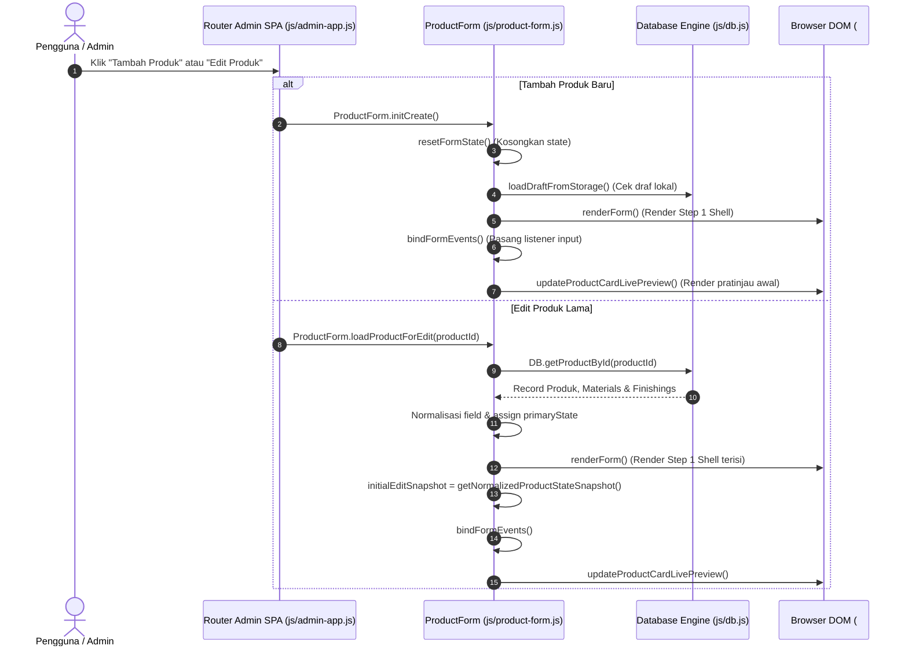
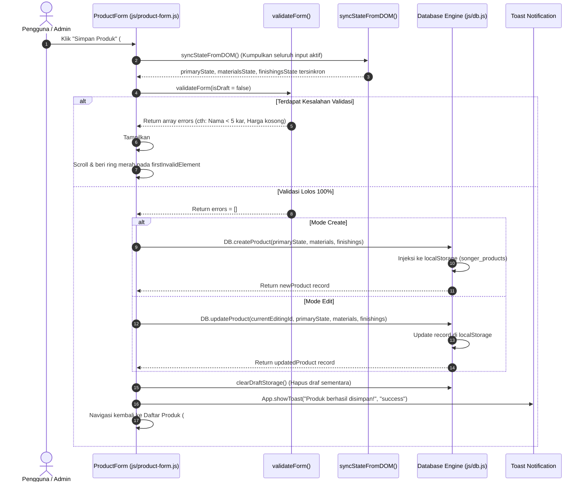

# PRODUCT MASTER — PRD & TECHNICAL DOCUMENTATION SONGER CREATIVE
**Single Source of Truth (SSOT) & Technical Architecture Compass: Modul Produk Terpadu**
**Dokumen Acuan**: `docs/PRD_PRODUCT_MASTER.md`
**Sistem**: Songer Creative Admin Panel, Buyer Store, POS Kasir, dan Ekosistem Multi-Tenant
**Status Audit**: Selesai Diverifikasi Berdasarkan Kode Aktual (Code Freeze / Audit Only)
**Terakhir Diperbarui**: 08 November 2026 (WIB)
**File Acuan Utama**: `js/product-form.js`, `js/db.js`, `admin.html`, `js/admin-app.js`, `js/buyer-store.js`, `js/pdp.js`, `js/pricing-calculator.js`, `js/category-manager.js`, `js/promo-manager.js`, `js/utils.js`, `prisma/schema.prisma`

---

> [!IMPORTANT]
> **STATUS AUDIT & KEBIJAKAN ARSITEKTUR:**
> Dokumen ini disusun sebagai hasil audit teknis mendalam terhadap implementasi kode aktual sistem produk Songer Creative. Dokumen ini menjadi **acuan mutlak (Master Reference)** bagi standardisasi, eliminasi duplikasi kode, integrasi modul, dan persiapan migrasi arsitektur di masa mendatang.
> **Tahap Saat Ini:** Audit, Dokumentasi, dan Pemetaan Arsitektur. Dilarang mengubah kode aplikasi, merefaktor, atau menggabungkan fungsi sebelum rencana konsolidasi disetujui.

---

> [!NOTE]
> ### DOKUMEN LAMPIRAN TEKNIS ARSITEKTUR LENGKAP (MASTER APPENDICES)
> Untuk pendalaman detail teknis tingkat kode, telah disusun 5 dokumen lampiran spesifik yang saling terhubung:
> 1. **[PRD_PRODUCT_MASTER_DATA_DICTIONARY.md](PRD_PRODUCT_MASTER_DATA_DICTIONARY.md)**: Kamus Data Lengkap 134 properti deklarasi awal, ~40 properti dinamis runtime, 10 objek bersarang, state variasi (`materialsState`, `finishingsState`), state transien, dan matriks redundansi alias.
> 2. **[PRD_PRODUCT_MASTER_FUNCTION_CATALOG.md](PRD_PRODUCT_MASTER_FUNCTION_CATALOG.md)**: Katalog Lengkap 447 fungsi `product-form.js`, 120 metode `db.js`, 3 metode inti `pricing-calculator.js`, signature parameter, return values, callers/callees, side effects, bukti baris kloning fungsi internal dan lintas modul, serta sequence call graphs.
> 3. **[PRD_PRODUCT_MASTER_UI_DOM_MAP.md](PRD_PRODUCT_MASTER_UI_DOM_MAP.md)**: Peta Arsitektur UI & DOM 832 selector ID, komponen Step 1 & 7 kartu Step 2, drawer mobile, modal sandbox PxL, popover combobox saran, container error, serta analisis kritis siklus hidup penghancuran & rekonstruksi `#step-pane-2.innerHTML = ''`.
> 4. **[PRD_PRODUCT_MASTER_INTEGRATION_CONTRACTS.md](PRD_PRODUCT_MASTER_INTEGRATION_CONTRACTS.md)**: Kontrak Integrasi 14 Modul Konsumen Data Produk (Admin Panel, Daftar Produk, Storefront, PDP, Kasir POS, Pricing Engine, Dashboard, Afiliasi, Promo, Gudang/Stok, CRM Pelanggan, Review Moderasi, DB Engine, dan Prisma ORM Multi-Tenant).
> 5. **[PRD_PRODUCT_MASTER_ARCHITECTURE_GAPS.md](PRD_PRODUCT_MASTER_ARCHITECTURE_GAPS.md)**: Analisis Gap Arsitektur AS-IS vs TO-BE, bukti empiris nomor baris duplikasi kode, celah alur inventaris (ketiadaan auto-decrement stok pada order/POS), dan roadmap standardisasi 5 fase.

---


## DAFTAR ISI
0. [DOKUMEN LAMPIRAN TEKNIS ARSITEKTUR LENGKAP](#dokumen-lampiran-teknis-arsitektur-lengkap-master-appendices)
1. [1. TUJUAN DAN RUANG LINGKUP](#1-tujuan-dan-ruang-lingkup)
2. [2. ARSITEKTUR SISTEM PRODUK](#2-arsitektur-sistem-produk)
3. [3. ALUR LENGKAP STEP 1 (IDENTITAS & KARAKTER PRODUK)](#3-alur-lengkap-step-1-identitas--karakter-produk)
4. [4. DETAIL FITUR STEP 1](#4-detail-fitur-step-1)
5. [5. ALUR LENGKAP STEP 2 (KONFIGURASI MENYELURUH PRODUK)](#5-alur-lengkap-step-2-konfigurasi-menyeluruh-produk)
6. [6. DETAIL SELURUH FITUR STEP 2](#6-detail-seluruh-fitur-step-2)
   - [6.A. Informasi Produk](#6a-informasi-produk)
   - [6.B. Harga dan HPP (Pricing Engine)](#6b-harga-dan-hpp-pricing-engine)
   - [6.C. Variasi Produk](#6c-variasi-produk)
   - [6.D. Ukuran dan Pemesanan (PxL & Panduan Ukuran)](#6d-ukuran-dan-pemesanan-pxl--panduan-ukuran)
   - [6.E. Stok dan Inventaris](#6e-stok-dan-inventaris)
   - [6.F. Konfigurasi Web](#6f-konfigurasi-web)
   - [6.G. Konfigurasi POS](#6g-konfigurasi-pos)
7. [7. SPESIFIKASI UI/UX SECARA DETAIL](#7-spesifikasi-uiux-secara-detail)
8. [8. KAMUS VARIABEL DAN STATE](#8-kamus-variabel-dan-state)
9. [9. KAMUS FUNGSI](#9-kamus-fungsi)
10. [10. PETA PEMANGGILAN FUNGSI (CALL GRAPHS)](#10-peta-pemanggilan-fungsi-call-graphs)
11. [11. EVENT LISTENER DAN MEKANISME INTERAKSI](#11-event-listener-dan-mekanisme-interaksi)
12. [12. STRUKTUR DATA PRODUK](#12-struktur-data-produk)
13. [13. DATABASE DAN PERSISTENSI](#13-database-dan-persistensi)
14. [14. VALIDASI DAN ATURAN BISNIS](#14-validasi-dan-aturan-bisnis)
15. [15. KONTRAK INTEGRASI ADMIN PANEL](#15-kontrak-integrasi-admin-panel)
16. [16. KONTRAK INTEGRASI BUYER STORE (STOREFRONT)](#16-kontrak-integrasi-buyer-store-storefront)
17. [17. KONTRAK INTEGRASI POS KASIR](#17-kontrak-integrasi-pos-kasir)
18. [18. KONTRAK INTEGRASI DASHBOARD](#18-kontrak-integrasi-dashboard)
19. [19. KONTRAK INTEGRASI AFILIASI](#19-kontrak-integrasi-afiliasi)
20. [20. KONTRAK INTEGRASI PROMO DAN DISKON](#20-kontrak-integrasi-promo-dan-diskon)
21. [21. KONTRAK INTEGRASI INVENTARIS DAN TRANSAKSI](#21-kontrak-integrasi-inventaris-dan-transaksi)
22. [22. MODUL LAINNYA YANG TERKAIT](#22-modul-lainnya-yang-terkait)
23. [23. AUDIT DUPLIKASI VARIABEL DAN FUNGSI](#23-audit-duplikasi-variabel-dan-fungsi)
24. [24. KETIDAKSESUAIAN ARSITEKTUR](#24-ketidaksesuaian-arsitektur)
25. [25. RISIKO TEKNIS](#25-risiko-teknis)
26. [26. REKOMENDASI STANDARDISASI](#26-rekomendasi-standardisasi)
27. [27. SUMBER DATA UTAMA (SINGLE SOURCE OF TRUTH)](#27-sumber-data-utama-single-source-of-truth)
28. [28. HAL YANG BELUM TERSEDIA ATAU BELUM TERVERIFIKASI](#28-hal-yang-belum-tersedia-atau-belum-terverifikasi)

---

## 1. TUJUAN DAN RUANG LINGKUP

### 1.1. Latar Belakang & Tujuan
Modul produk merupakan organ sentral dari seluruh ekosistem aplikasi Songer Creative. Data produk yang dikonfigurasi melalui Seller Center / Admin Panel tidak hanya dikonsumsi untuk etalase katalog, namun menjadi dasar kalkulasi harga produksi, pemotongan stok kasir fisik, pelacakan afiliasi, promosi belanja, hingga percetakan struk transaksi di toko fisik.

Tujuan penyusunan dokumen ini adalah:
1. **Memetakan 100% Arsitektur Berjalan**: Menyajikan kondisi nyata dari implementasi `js/product-form.js` (31.521 baris), `js/db.js` (5.221 baris), `admin.html`, `js/buyer-store.js` (6.709 baris), `js/admin-app.js` (6.887 baris), `js/pdp.js` (1.718 baris), dan `js/pricing-calculator.js` (489 baris).
2. **Menyediakan Inventaris Lengkap**: Mencatat setiap variabel state, fungsi pengendali, selector DOM, relasi database, dan kontrak antarmuka secara presisi dengan nomor baris aktual.
3. **Mengidentifikasi Fragmentasi & Duplikasi**: Menemukan redundansi state, fungsi ganda, event listener liar, alias variabel, dan ketidaksesuaian kontrak data antar-modul.
4. **Menjadi Kompas Standardisasi**: Menetapkan batas-batas tegas (*Single Source of Truth*) agar pengembangan modul baru (POS, CRM, Web Checkout, Afiliasi) tidak membuat aturan perhitungan atau struktur data tandingan.

### 1.2. Ruang Lingkup Audit
Audit teknis ini mencakup:
- **Alur Form Admin**: Tambah Produk Baru (`formMode = 'create'`) dan Edit Produk (`formMode = 'edit'`) yang terbagi dalam **Step 1 (Identitas & Karakter Produk)** dan **Step 2 (Konfigurasi Menyeluruh)**.
- **Komponen Interaktif Form**: 10-Slot Foto Grid, AI Description Generator, 7-Card Gated Step 2, Sticky Subnavbar dengan ScrollSpy, Custom Dimension ($P \times L$) Simulator, Panduan Ukuran Drawer, Tabel Spesifikasi, Komisi Afiliasi Grosir, dan Pengaturan Desain Kartu (Model A, B, C).
- **Konsumsi Data Eksternal**: Storefront Pembeli (`index.html` & `js/buyer-store.js`), Halaman Produk PDP (`product.html` & `js/pdp.js`), Kasir POS (`js/admin-app.js`), Manajemen Kategori (`js/category-manager.js`), Manajemen Promo (`js/promo-manager.js`), dan Skema Prisma PostgreSQL (`prisma/schema.prisma`).

---

## 2. ARSITEKTUR SISTEM PRODUK

### 2.1. Pola Desain (Design Pattern)
Sistem produk beroperasi di atas pola **Client-Side Reactive Monolith with LocalStorage Persistence**:
1. **In-Memory Reactive State Engine**: State form dikelola secara terpusat oleh closure `ProductForm` (`js/product-form.js` baris 11–31520) menggunakan 3 objek state primer:
   - `primaryState`: Menyimpan seluruh metadata produk, pengaturan kartu, diskon promo, afiliasi, dimensi paket, dan footer.
   - `materialsState`: Menyimpan daftar variasi tingkat 1 (Bahan Dasar / Varian Utama) beserta harga jual, modal HPP, dan kuota stok.
   - `finishingsState`: Objek bertingkat (`main`, `extra_1`, `extra_2`, `extra_3`) untuk variasi pendukung tingkat 2–4 dan layanan ekstra.
2. **DOM-Driven Dynamic Mounting**: Berbeda dengan SPA berbasis Virtual DOM, `ProductForm` me-render template HTML string secara langsung ke dalam wadah `<div id="form-container"></div>` pada `admin.html` (baris 507).
3. **Progressive Gating Mechanism**:
   - **Step 1 Sequential Gating**: Pilihan kontrol dibuka secara berjenjang (Jenis Produk $\rightarrow$ Toggle Etalase $\rightarrow$ Model Kartu $\rightarrow$ Foto, Nama & Label).
   - **Step 2 Card Gating**: 7 kartu utama dirender secara mandiri dan dapat diakses cepat menggunakan subnavbar sticky ber-anchoring.
4. **Two-Way Dual Dock Live Preview**:
   - **Desktop Preview**: Sidebar dock tetap di sisi kanan (`#desktop-preview-sidebar`, lebar 320–340px) dengan tab switcher *Pratinjau* dan *Desain Kartu*.
   - **Mobile Drawer Preview**: Bottom-sheet drawer (`#mobile-preview-drawer`) yang dapat dibuka via Floating Action Button (FAB) di layar `<1024px`.

### 2.2. Diagram Arsitektur Tingkat Tinggi

```mermaid
flowchart TD
    subgraph UI_Layer ["Lapisan Antarmuka (DOM Shell)"]
        AdminShell["admin.html (#view-product-form)"]
        FormContainer["#form-container"]
        Step1Pane["#step-pane-1 (Identitas & Karakter)"]
        Step2Pane["#step-pane-2 (7 Kartu Konfigurasi)"]
        SubnavSticky["#step2-subnav-fixed (Sticky Subnavbar)"]
        PreviewDock["#desktop-preview-sidebar (Live Preview Dock)"]
        MobileDrawer["#mobile-preview-drawer (Mobile Bottom Sheet)"]
    end

    subgraph State_Engine ["ProductForm Closure (js/product-form.js)"]
        Primary["primaryState (134 properties)"]
        Materials["materialsState (Variasi 1 / Bahan)"]
        Finishings["finishingsState (Variasi 2-4 & Extras)"]
        LivePreviewFn["updateProductCardLivePreview()"]
        PricingCalc["PricingCalculator.calculateProductPrice()"]
        SyncDOM["syncStateFromDOM()"]
        ValidateFn["validateForm()"]
    end

    subgraph Storage_Layer ["Persistensi Lokal (js/db.js)"]
        DBModule["DB Engine (localStorage)"]
        ProductsTable["songer_products"]
        MaterialsTable["songer_materials"]
        FinishingsTable["songer_finishings"]
        DraftKey["songer_add_product_draft"]
    end

    subgraph Downstream_Consumers ["Modul Konsumen Data Produk"]
        BuyerStore["Storefront Katalog (js/buyer-store.js)"]
        PDP["Detail Produk & Cart (js/pdp.js)"]
        POSCashier["Kasir POS (js/admin-app.js)"]
        ProductList["Tabel Admin Produk (js/product-list.js)"]
        PromoMgr["Promo & Diskon (js/promo-manager.js)"]
        Affiliate["Afiliasi & Komisi"]
    end

    AdminShell --> FormContainer
    FormContainer --> Step1Pane
    FormContainer --> Step2Pane
    FormContainer --> SubnavSticky
    FormContainer --> PreviewDock
    FormContainer --> MobileDrawer

    Step1Pane -- "Input & Selection" --> SyncDOM
    Step2Pane -- "Input & Repeaters" --> SyncDOM
    SyncDOM --> Primary
    SyncDOM --> Materials
    SyncDOM --> Finishings

    Primary -- "Reactive Trigger" --> LivePreviewFn
    Materials -- "Reactive Trigger" --> LivePreviewFn
    Finishings -- "Reactive Trigger" --> LivePreviewFn
    LivePreviewFn --> PricingCalc
    LivePreviewFn --> PreviewDock
    LivePreviewFn --> MobileDrawer

    ValidateFn -- "Lolos Validasi" --> DBModule
    Primary --> DBModule
    Materials --> DBModule
    Finishings --> DBModule

    DBModule --> ProductsTable
    DBModule --> MaterialsTable
    DBModule --> FinishingsTable
    Primary -. "Auto Save Draft" .-> DraftKey

    ProductsTable --> BuyerStore
    ProductsTable --> PDP
    ProductsTable --> POSCashier
    ProductsTable --> ProductList
    ProductsTable --> PromoMgr
    ProductsTable --> Affiliate
```


---

## 3. ALUR LENGKAP STEP 1 (IDENTITAS & KARAKTER PRODUK)

### 3.1. Inisialisasi & Pembukaan Form
Step 1 dimulai ketika admin membuka menu Tambah Produk atau Edit Produk:
1. **Router Invocation** (`js/admin-app.js` baris 729–744):
   - Jika route `create-product` atau `create`: memanggil `ProductForm.initCreate()` atau `ProductForm.init()`.
   - Jika route `edit-product` atau `edit`: memanggil `ProductForm.loadProductForEdit(productId)`.
2. **Pembersihan / Pengisian State Awal**:
   - **Mode Tambah (`create`)**:
     * `formMode = 'create'`; `currentEditingId = null`.
     * `resetFormState()` (`js/product-form.js` baris 1497): Mengosongkan seluruh properti `primaryState`, `materialsState`, dan `finishingsState`. Menetapkan default `order_category: 'Ctk'`, `is_active: true`, `min_order: 1`, `has_shipping: true`, dan `product_type: ''` (wajib dipilih seller).
     * `loadDraftFromStorage()` (`js/product-form.js` baris 2311): Memeriksa apakah ada draf tersimpan di `songer_add_product_draft`. Jika ada, menyalin isi draf ke `primaryState` dan mengembalikan posisi form.
     * `renderForm()` (`js/product-form.js` baris 2422): Menghasilkan markup Step 1 ke dalam `#form-container`.
   - **Mode Edit (`edit`)**:
     * `formMode = 'edit'`; `currentEditingId = id`.
     * Membaca produk dari database via `DB.getProductById(id)`.
     * Mengisi `primaryState` dengan seluruh field produk yang tersimpan, menormalkan format kurir ekspedisi, mendeteksi opsi garansi, memuat `materialsState` dari tabel `materials` dan `finishingsState` dari tabel `finishings`.
     * Mengambil snapshot pembanding: `initialEditSnapshot = getNormalizedProductStateSnapshot()` untuk mendeteksi perubahan data saat pembatalan.

### 3.2. Gerbang Sekuensial Step 1 (Sequential Gating Workflow)
Step 1 menerapkan pembukaan field bertahap (*progressive disclosure*) yang dikendalikan oleh fungsi `updateStep1SequentialGatingDOM()` (`js/product-form.js` baris 21933):
```mermaid
graph TD
    Start([Buka Form Step 1]) --> Step1_1[Pilih Jenis Produk / Layanan: Fisik vs Non Fisik]
    Step1_1 -- Belum Dipilih --> Gate1_Lock[Placeholder Terkunci: step1-gated-placeholder Aktif]
    Step1_1 -- Terpilih: physical / non_physical --> Step1_2[Buka Kontainer: step1-unlocked-fields]

    Step1_2 --> Step1_3[Pilihan: Tampilkan di Etalase Toko ON / OFF]
    Step1_3 -- Toggle ON (is_active: true) --> Step1_4[Wajib Memilih Model Kartu Produk: A, B, atau C]
    Step1_3 -- Toggle OFF (is_active: false) --> BypassCard[Bypass Pemilihan Model Kartu]

    Step1_4 -- Belum Dipilih --> Gate2_Lock[Placeholder Terkunci: step1-cardmodel-gated-placeholder Aktif]
    Step1_4 -- Model Terpilih (A / B / C) --> Step1_5[Buka Kontainer: step1-cardmodel-unlocked-fields]
    BypassCard --> Step1_5

    Step1_5 --> Step1_6[Upload Foto Produk: Minimal 1 Cover Image]
    Step1_5 --> Step1_7[Input Nama Produk: 5 s/d 150 Karakter]
    Step1_5 --> Step1_8[Konfigurasi Label Khusus 1 & 2: Datalist Combobox]

    Step1_6 & Step1_7 & Step1_8 --> S1_Next{Klik Tombol 'Lanjut ke Step 2'}
    S1_Next -- Ada Error Validasi --> ShowS1Errors[Tampilkan form-error-banner & Highlight Ring Merah]
    S1_Next -- Validasi Lolos --> GoStep2[Pindah ke Step 2 via goToStep(2)]
```

### 3.3. Transisi Step 1 ke Step 2
Ketika tombol `#btn-step-1-next` diklik:
1. Memanggil `goToStep(2)` (`js/product-form.js` baris 21736).
2. Mengeksekusi `syncStateFromDOM()` untuk memastikan nilai yang tertulis di input sinkron dengan `primaryState`.
3. Menjalankan validasi prasyarat Step 1:
   - `primaryState.product_type` wajib bernilai `'physical'` atau `'non_physical'`.
   - Jika `primaryState.is_active === true`, maka `primaryState.card_variant` tidak boleh kosong.
   - Jika `primaryState.is_active === true`, maka `primaryState.images` atau `image_url` wajib berisi minimal 1 foto.
   - `primaryState.name` wajib diisi minimal 5 karakter (whitespace diabaikan).
   - Jika Model Kartu bukan 'B' dan label khusus diaktifkan: Label 1 wajib diisi, dan Label 1 tidak boleh sama dengan Label 2.
4. Jika terdapat pelanggaran: memicu `showWizardErrorBanner(s1Errors)` dan melakukan *smooth scroll* serta *focus ring* merah pada elemen yang tidak valid.
5. Jika valid: menyembunyikan banner error, menetapkan `currentStep = 2`, memanggil `updateStepVisibility()`, me-render markup Step 2 ke dalam `#step-pane-2`, menginisialisasi listener interaktif Step 2 via `bindStep2InteractiveEvents()`, dan mengaktifkan `initStep2SubnavObserver()`.

---

## 4. DETAIL FITUR STEP 1

| No | Nama Fitur | Tujuan & Kegunaan | UI / UX Komponen | Selector ID / Class | Variabel State Terikat | Fungsi Pengelola | Event Pemicu | Validasi & Aturan Bisnis | Persistensi Data | Modul Dependensi |
|---|---|---|---|---|---|---|---|---|---|---|
| 1 | Jenis Produk / Layanan | Membedakan alur barang fisik (memerlukan pengiriman) vs non-fisik (jasa/digital tanpa ekspedisi). | 2 Tombol Radio Card interaktif (*Fisik* & *Non Fisik*) dengan ikon Lucide. | `#product-type-selector-group`, `.btn-select-product-type` | `primaryState.product_type` | `bindFormEvents()` (L21846) | `click` pada button | Wajib dipilih salah satu (`'physical'` / `'non_physical'`). Default kosong saat buat baru. | Kolom `product_type` di tabel `products`. | Pengiriman Step 2, Storefront, POS Kasir. |
| 2 | Tampilkan di Etalase | Mengatur visibilitas produk di katalog pembeli (Storefront). Jika nonaktif, produk hanya untuk kasir POS. | Toggle switch modern dengan warna brand primer. | `#toggle-is-active-form` | `primaryState.is_active` | `bindFormEvents()` (L21846) | `change` pada checkbox | Boolean. Jika OFF, pemilihan model kartu dan upload foto cover tidak diwajibkan. | Kolom `is_active` di tabel `products`. | `buyer-store.js`, POS Kasir, PDP. |
| 3 | Model Kartu Produk | Memilih layout pratinjau dan kartu etalase: Model A (Klasik/Cetak), Model B (Minimalis/Jasa), Model C (Detail/Retail). | 3 Radio Cards dengan preview thumbnail mini dan radio mark warna dinamis. | `#card-model-selector-group`, `input[name="card_variant_radio"]` | `primaryState.card_variant`, `primaryState.card_variant_override` | `bindFormEvents()`, `updateStep1DynamicDescriptions()` | `change` pada radio input | Wajib dipilih jika `is_active: true`. Model B otomatis menonaktifkan fitur label khusus. | Kolom `card_variant` di tabel `products`. | `buyer-store.js` (`renderCardVariantA/B/C`), Step 1 Live Preview. |
| 4 | Galeri Foto Produk (10 Slot) | Upload gambar produk dengan auto kompresi Canvas dan rasio adaptif. | 10 slot grid foto responsif (3 kolom mobile, 5 desktop) dengan badge Cover & aksi geser/hapus. | `#gallery-slots-container`, `#input-prod-images-hidden`, `#input-prod-image` | `primaryState.images` (array), `primaryState.image_url` | `compressProductImage()` (L94), `refreshGalleryDOM()` | `change` pada file input, drag-and-drop | Maksimal 10 foto (sebelumnya 9). Kompresi senyap canvas ke WebP/JPEG kualitas 0.8 (max 1200px). Minimal 1 foto jika etalase ON. | Kolom `images` (array JSON) dan `image_url` di tabel `products`. | PDP gallery, Storefront card preview, Kasir POS thumbnail. |
| 5 | Rasio Aspek Foto | Mengatur proporsi crop tampilan foto (1:1 Persegi, 4:3 Lanskap, atau 3:4 Potret). | Badge indikator rasio dinamis di atas slot foto. | `#gallery-ratio-badge`, `input[name="photo_aspect_ratio"]` | `primaryState.image_aspect_ratio` | `getActiveCardRatioInfo()` | `change` pada radio rasio | Model A: 1:1, Model B: 3:4, Model C: 4:3. Menyesuaikan CSS aspect ratio kontainer gambar. | Kolom `image_aspect_ratio` di tabel `products`. | `buyer-store.js`, Live Preview. |
| 6 | Nama Produk | Identitas utama judul produk dagang. | Input teks dengan indikator counter panjang karakter `(0 / 150)`. | `#input-prod-name`, `#name-char-count`, `#name-min-length-error` | `primaryState.name` | `handleProductNameValidation()` (L21710) | `input`, `blur` pada input teks | Wajib diisi. Minimal 5 karakter, maksimal 150 karakter. Whitespace awal/akhir dibersihkan. | Kolom `name` di tabel `products`. | Seluruh modul (POS, PDP, Invoice, SEO, Search). |
| 7 | Toggle Label Khusus | Mengaktifkan/menonaktifkan pita label promo pada kartu (cth: "Best Seller", "Free Ongkir"). | Toggle switch ON/OFF. Otomatis disabled dan terkunci jika memilih Model Kartu B. Teks bantuan: "Isi minimal 1 label, atau nonaktifkan jika tidak digunakan." | `#toggle-enable-custom-labels`, `#label-custom-disabled-notice` | `primaryState.show_badge`, `primaryState.has_custom_labels` | `bindFormEvents()` | `change` pada checkbox | Boolean. Disabled permanen pada Model B karena kartu minimalis tidak memiliki badge banner. | Kolom `has_custom_labels` dan `show_badge` di `products`. | Storefront badges (`buyer-store.js`), Live Preview. |
| 8 | Preset Label Khusus (Ditiadakan) | Bagian tombol pill chip preset instan (`#custom-labels-preset-group`, `.btn-preset-label-step1`) ditiadakan karena styling, radius, dan warna label khusus telah dikelola via Accordion Desain Kartu (Promo & Diskon), sedangkan saran teks label dikelola langsung melalui dropdown riwayat Combobox Datalist (`custom-labels-history-list`). | Dihapus / Tidak Diperlukan | - | `primaryState.custom_labels` | `updateCustomLabelsLockState()` | - | Pengisian teks label khusus dilakukan via input slot combobox 1 & 2. | Tersimpan ke dalam array `custom_labels` & riwayat datalist. | Accordion Desain Kartu, Live Preview badge. |
| 9 | Input Label Khusus 1 | Teks badge banner kiri atas kartu etalase. | Input/Pilih Combobox (`.clean-datalist-popover`) dengan panah dropdown dan tombol bersihkan (✕). | `#input-custom-label-1`, `#char-count-label-1`, `#error-custom-label-1` | `primaryState.custom_labels[0]` | `bindCleanDatalistPopovers()` (L787) | `focus`, `input`, `click`, `blur` | Maksimal 15 karakter grapheme. Wajib jika toggle label aktif. Tidak boleh sama dengan Label 2. | Disimpan ke array `custom_labels` & riwayat datalist. | Storefront badge 1. |
| 10 | Input Label Khusus 2 | Teks badge banner kedua di samping Label 1. | Input/Pilih Combobox (`.clean-datalist-popover`) kondisional (hanya muncul jika ruang kartu cukup). | `#input-custom-label-2`, `#wrapper-custom-label-2`, `#error-custom-label-2` | `primaryState.custom_labels[1]` | `bindCleanDatalistPopovers()`, `updateLabelCustomCapacityInfo()` | `focus`, `input`, `click`, `blur` | Maksimal 15 karakter. Opsional. Otomatis disembunyikan jika panjang teks Label 1 melebihi kapasitas baris. | Disimpan ke array `custom_labels` & riwayat datalist. | Storefront badge 2. |
| 11 | Tombol Batal Step 1 | Membatalkan pembuatan atau perubahan produk dan kembali ke menu sebelumnya. | Tombol sekunder berbingkai (*Kembali* / *Batal*). | `#btn-step-1-cancel` | Membaca `hasAnyNewProductData()` atau `hasEditProductChanged()` | `handleFormCancel()` (L1889) | `click` pada tombol | Jika ada data yang telah diubah/diisi, memunculkan modal konfirmasi `#modal-cancel-form-confirm`. | Tidak ada (membersihkan draft jika disetujui). | Router Admin SPA. |
| 12 | Tombol Lanjut Step 2 | Memvalidasi seluruh data Step 1 dan berpindah ke konfigurasi harga Step 2. | Tombol primer brand bertuliskan *Lanjut ke Step 2* dengan ikon panah. | `#btn-step-1-next` | `currentStep = 2` | `goToStep(2)` (L21736) | `click` pada tombol | Menjalankan validasi ketat prasyarat Step 1. Memblokir navigasi jika ada field wajib yang belum tuntas. | Memperbarui DOM form dan inisialisasi Step 2. | Step 2 Content & Subnav. |

---

## 5. ALUR LENGKAP STEP 2 (KONFIGURASI MENYELURUH PRODUK)

### 5.1. Mekanisme Render & Mount Step 2
Ketika user berpindah ke Step 2, terjadi proses rekonstruksi DOM dinamis:
1. **Destruksi & Render Ulang** (`js/product-form.js` baris 21672–21684):
   - Elemen `#step-pane-1` disembunyikan (`hidden`).
   - Elemen `#step-pane-2` dibuka (`block`) dan isinya di-generate ulang secara penuh melalui pemanggilan fungsi `renderStep2Content()` (`js/product-form.js` baris 14594).
   - **Catatan Kritis**: Jika user kembali ke Step 1, `#step-pane-2.innerHTML` dikosongkan (`p2.innerHTML = ''`). Oleh karena itu, seluruh nilai formulir wajib sudah tersinkronisasi ke dalam `primaryState`, `materialsState`, dan `finishingsState` via `syncStateFromDOM()`.
2. **Inisialisasi Event Interaktif Step 2**:
   - Menjalankan `bindStep2InteractiveEvents()` (`js/product-form.js` baris 22508) untuk mengikat listener harga, toggle variasi, input ukuran, kalkulator HPP, modal simulator, dan pengaturan pengiriman.
   - Mengaktifkan `initStep2SubnavObserver()` (`js/product-form.js` baris 21612) untuk mengikat mekanisme ScrollSpy pada subnavbar.

### 5.2. Navigasi Sticky Subnavbar (7 Seksi)
Di bagian atas Step 2, terpasang bilah subnav navigasi yang menempel rapat (*sticky*) persis di bawah topbar admin (`#step2-subnav-fixed`, baris 14636):
- **7 Tab Navigasi Horizontal**:
  1. `card-step2-info`: **Informasi Produk** (Kategori, Sub-Kategori, Media).
  2. `card-step2-sales`: **Informasi Penjualan** (Variasi 1–4, Extras, Harga, HPP, Stok, Wholesale, Kelipatan).
  3. `card-step2-shipping`: **Pengiriman** (Berat, Dimensi Paket, Kurir Toko & Ekspedisi).
  4. `card-step2-promo`: **Program Promo** (Diskon Harian & Auto Promo Bulanan).
  5. `card-step2-description`: **Deskripsi Produk** (AI Generator & Textarea).
  6. `card-step2-specs`: **Spesifikasi** (Tabel Spesifikasi Dinamis & Garansi).
  7. `card-step2-others`: **Lainnya** (Kondisi, Pre-Order, Footer Kartu Detail, Timer, Afiliasi).
- **Mekanisme ScrollSpy**: Menggunakan event listener scroll pada viewport `#admin-main-viewport` yang membandingkan koordinat vertikal (`getBoundingClientRect().top`) setiap kartu seksi dan memberikan class `.subnav-tab-active` (warna primer brand dan border-b-2) pada tab yang sedang aktif di layar.

---

## 6. DETAIL SELURUH FITUR STEP 2

### 6.A. Informasi Produk
- **Komponen**: Kartu putih mandiri `#card-step2-info` (baris 14673).
- **Fitur di dalamnya**:
  1. *Nama Produk*: Input teks duplikat tersinkronisasi (`#step2-input-name`) yang terikat dua arah dengan `#input-prod-name` Step 1.
  2. *Kategori Produk*: Komponen **Hybrid Dropdown Accordion** (`#wrapper-step2-cat-dropdown`, trigger `#btn-step2-cat-trigger`) dengan label tunggal `Kategori Produk *` (heading ganda ditiadakan).
     - Tidak ada pilihan default pada produk baru (placeholder `Pilih kategori produk`).
     - Pencarian instan compact (`#input-search-step2-cat`, tinggi 32px, `pl-8` / `padding-left: 2rem !important`) dengan ikon pencarian rapi di sisi kiri yang terpusat secara vertikal (`top-1/2 -translate-y-1/2`) dan terproteksi dari tabrakan placeholder di layar mobile maupun desktop.
     - Pengetikan pencarian menyaring daftar kategori aktif tanpa mengubah nilai terpilih.
     - Aksi `+ Tambah kategori baru` memunculkan formulir inline (dengan validasi nama kosong dan cek duplikasi case-insensitive/trimmed). Setelah disimpan via `DB.createCategory`, kategori baru langsung terpilih, subkategori direset, dan live preview diperbarui.
     - Terikat pada `primaryState.category_id`. Wajib dipilih; jika kosong, validasi menampilkan pesan `"Kategori produk wajib dipilih."`.
  3. *Sub-Kategori Produk*: Komponen **Hybrid Dropdown Accordion** (`#wrapper-step2-subcat-dropdown`, trigger `#btn-step2-subcat-trigger`) yang ditampilkan secara **kondisional tepat di bawah Kategori Produk**.
     - Ketika `category_id` belum valid/kosong, field Sub-Kategori tersembunyi sepenuhnya (kelas `hidden`).
     - Setelah Kategori Produk valid dipilih atau dibuat, field Sub-Kategori langsung muncul tepat di bawahnya.
     - Urutan konten dropdown: (1) Pencarian `Cari subkategori...` (tinggi compact 32px, ikon vertikal sejajar, anti-overlap); (2) Opsi khusus `Tanpa subkategori` (`#opt-step2-subcat-none`); (3) Pemisah visual; (4) Daftar subkategori milik kategori aktif (`DB.getSubCategories(catId)`); (5) Aksi `+ Tambah subkategori baru` (`#btn-step2-subcat-show-add`) yang otomatis mengaitkan anak ke parent aktif.
     - Seller wajib menentukan salah satu opsi (subkategori terdaftar atau `Tanpa subkategori`). Belum menentukan pilihan akan memicu pesan validasi `"Pilih subkategori atau pilih Tanpa subkategori."`.
     - Pilihan `Tanpa subkategori` tersimpan sebagai `sub_category_id: null` dengan status penentuan `sub_category_determined: true`. Tidak ada record palsu yang dibuat di database.
     - Mengganti Kategori Utama mereset subkategori (`sub_category_id = null`, `sub_category_determined = false`) dan mewajibkan seller menentukan ulang. Jika kategori dihapus/menjadi tidak valid, field kembali disembunyikan.
     - Mode Edit: Memulihkan kategori & subkategori tersimpan; jika kategori valid, field langsung terlihat; produk dengan `sub_category_id: null` otomatis tampil sebagai `Tanpa subkategori` yang sah tanpa memaksa memilih ulang.
     - **Syarat Aktivasi Form Step 2 (Card Gating 2..7)**: Bagian formulir Step 2 yang bergantung pada kategori (Card 2 Penjualan, Card 3 Pengiriman, Card 4 Promo, Card 5 Deskripsi, Card 6 Spesifikasi, Card 7 Lainnya) baru aktif setelah **Subkategori Produk sudah ditentukan** (`sub_category_determined === true`), baik dengan memilih subkategori terdaftar maupun memilih `Tanpa subkategori` secara eksplisit. Ketika masih OFF, kartu menampilkan pemberitahuan seragam dengan teks persis: `Tersedia setelah memilih kategori produk`. Jika Kategori diganti, status subkategori dievaluasi ulang (kembali OFF) hingga pilihan subkategori baru ditentukan.
  4. *Kategori Operasional Kasir*: Terikat pada `primaryState.order_category` (default `'Ctk'` untuk percetakan atau `'Non-Ctk'` untuk produk umum).
  5. *Label Khusus Step 2*: Menampilkan chip ringkasan label khusus yang telah diisi pada Step 1 (read-only). Notifikasi penguncian teks lama ditiadakan untuk menjaga tata letak tetap rapi, compact, dan langsung menyatu di bawah label heading.

### 6.B. Harga dan HPP (Pricing Engine)
Kalkulasi harga dan modal HPP produk dikendalikan oleh formula pada modul `js/pricing-calculator.js` (489 baris) dan konfigurasi di kartu `#card-step2-sales` (baris 14787):
- **Struktur Formula (`price_type` 1 s/d 7)**:
  - **Tipe 1 (`Meter` / $P \times L$)**:
    * Perhitungan berbasis luas meter persegi: $\text{Luas } (\text{m}^2) = (\text{Panjang cm} \times \text{Lebar cm}) \div 10.000$.
    * Berlaku aturan **Minimal 1.0 m²**: Jika hasil luas riil $< 1.0\text{ m}^2$, maka luas tagihan dibulatkan ke $1.0\text{ m}^2$ (`billedAreaM2 = 1.0`).
    * Rumus Harga: $\text{Harga Jual} = (\text{Luas Billed} \times \text{Harga V1}) + \sum \text{Harga Varian Pendukung}$.
    * Rumus Modal HPP: $\text{HPP} = (\text{Luas Billed} \times \text{HPP V1}) + \sum \text{HPP Varian Pendukung}$.
  - **Tipe 2 (`KombF` / Normal Kombinasi Tetap)**:
    * Penjumlahan langsung nilai seluruh varian yang dipilih: $\text{Harga} = \text{Harga V1} + \text{Harga V2} + \text{Harga V3} + \text{Harga V4}$.
    * HPP: $\text{HPP} = \text{HPP V1} + \text{HPP V2} + \text{HPP V3} + \text{HPP V4}$.
  - **Tipe 3 (`Fixed` / Harga Flat Tunggal)**:
    * Harga tetap terlepas dari kombinasi variasi (legacy fallback).
  - **Tipe 4 (`Paket` / Bundle Promo)**:
    * Harga dasar mengacu pada paket terpilih (V1). Opsi pendukung yang ditandai gratis (`is_included === true` atau `is_free === true`) tidak menambah harga jual pembeli, namun biaya HPP (`cost_price`) tetap dihitung ke dalam beban toko.
  - **Tipe 5 (`Kg` / Bobot Berat Riil)**:
    * Multiplier berbasis bobot kilogram: $\text{Harga} = (\text{Bobot Kg} \times \text{Harga V1}) + \text{Varian Pendukung}$. Mendukung konversi unit gram dan ons.
  - **Tipe 6 (`Lt` / Volume Cairan)**:
    * Multiplier berbasis volume liter: $\text{Harga} = (\text{Volume Liter} \times \text{Harga V1}) + \text{Varian Pendukung}$. Mendukung konversi ml dan galon.
  - **Tipe 7 (`KombStep` / Wajib Kelipatan Kuantitas)**:
    * Perhitungan berjenjang berdasarkan batch kelipatan (`stepQuantity` / `step_multiplier`).
    * Jumlah batch dihitung: $\text{Batches} = \lceil \text{Kuantitas} \div \text{StepQty} \rceil$.
    * Subtotal V1 dihitung per-batch, sedangkan variasi pendukung dihitung per-pcs kuantitas.
- **Harga Grosir Bertingkat (Wholesale Tiers)**:
  - Diatur pada seksi `#section-wholesale` (baris 14881).
  - Terikat pada array `primaryState.wholesale_tiers` dengan struktur: `[{ id, min_qty, max_qty, price }]`.
  - Mendukung dua mode: Mode Normal (berlaku seragam untuk seluruh produk) dan Mode Spesifik Per-Varian (`primaryState.wholesale_by_variant`).
- **Kelipatan Pesanan (Order Multiple)**:
  - Diatur pada seksi `#section-order-multiple` (baris 14933).
  - Mengunci pembelian pembeli agar wajib kelipatan tertentu (contoh: kelipatan 50 pcs untuk kartu nama). Terikat pada `primaryState.order_multiple_value` dan `primaryState.order_multiples_by_variant`.
  - **Penyederhanaan Tampilan Kondisional**:
    * **Produk Tanpa Variasi Aktif (`has_variants: false`)**: Pilihan mode radio `Umum (Semua Varian)` dan `Spesifik per Varian` disembunyikan. Tampilan langsung menyajikan input jumlah kelipatan pembelian produk tunggal (`#input-order-multiple-single`, minimal 2 pcs per transaksi) beserta contoh penjelasan.
    * **Produk Dengan Variasi Aktif (`has_variants: true`)**: Kedua opsi mode (`Umum` vs `Spesifik per Varian`) tetap ditampilkan secara penuh bersama tabel konfigurasi per-varian.
    * **Sinkronisasi Reaktif**: Penambahan atau penutupan seluruh variasi memperbarui tampilan seksi kelipatan secara dinamis tanpa menghapus nilai kelipatan yang sudah terisi. Mode Edit Produk memulihkan tampilan sesuai data produk yang tersimpan.

### 6.C. Variasi Produk
Struktur variasi pada Songer Creative mengadopsi sistem hirarki 4 tingkat + 1 seksi layanan independen:
1. **Variasi 1 (Varian Utama / Bahan Dasar)**:
   - Dikelola melalui array `materialsState` (`js/product-form.js` baris 577).
   - Label default: *"Jenis"* atau *"Bahan"*, dapat dikustomisasi melalui `primaryState.variation_labels.label_tier_1`.
   - Menampung opsi varian dengan properti: `id`, `name`, `price`, `cost_price`, `stock`, `step_multiplier`, dan status grosir.
2. **Variasi 2 (Finishing Utama)**:
   - Diaktifkan via tombol `#btn-trigger-variasi-2` $\rightarrow$ `primaryState.has_variation_2 = true`.
   - Dikelola melalui array `finishingsState.main`.
   - Terikat label `primaryState.variation_labels.label_tier_2`.
3. **Variasi 3 (Finishing Tambahan 1)**:
   - Diaktifkan via tombol `#btn-trigger-variasi-3` $\rightarrow$ `primaryState.has_variation_3 = true`.
   - Dikelola melalui array `finishingsState.extra_1`.
4. **Variasi 4 (Finishing Tambahan 2)**:
   - Diaktifkan via tombol `#btn-trigger-variasi-4` $\rightarrow$ `primaryState.has_variation_4 = true`.
   - Dikelola melalui array `finishingsState.extra_2`.
5. **Layanan Ekstra (Extra Services / Finishing Ekstra 3)**:
   - Diaktifkan via toggle `#toggle-extra-service` $\rightarrow$ `primaryState.has_extra_service = true`.
   - Dikelola melalui array `finishingsState.extra_3`.
   - Karakteristik khusus: Tidak mengikuti kombinasi perkalian matriks kuantitas utama. Mendukung tipe:
     * `direct` (Langsung proses / otomatis terhitung 1x flat).
     * `pilihan_ganda` (Checklist opsional oleh pembeli di PDP).
     * `qty` (Memiliki input kuantitas mandiri di luar kuantitas pesanan produk utama).
- **Cakupan Opsi (Scopes)**: Setiap variasi tingkat 2, 3, dan 4 dapat diatur cakupannya:
  - `umum`: Opsi berlaku untuk semua pilihan pada variasi sebelumnya.
  - `spesifik`: Opsi hanya muncul jika pembeli memilih varian bahan tertentu (pemetaan disimpan dalam objek `primaryState.specific_options_map`).
- **Ketentuan Batas Karakter Opsi & Tooltip Judul Variasi**:
  - **Batas Karakter Opsi Variasi 1 s/d 4**: Maksimal 20 karakter via validasi JavaScript murni (atribut HTML `maxlength="20"` dilepas agar browser mengizinkan pengetikan/paste karakter ke-21 ke atas untuk memicu pesan validasi). Ketika input melebihi 20 karakter, pesan kesalahan langsung muncul di bawah input dengan redaksi baku: *"Silakan masukkan antara 1–20 karakter."* dengan border merah (`border-red-500`) tanpa tampilan counter karakter (seperti `21/20`). Pesan kesalahan dan border merah otomatis hilang ketika input kembali `<= 20` karakter. Berlaku untuk pengetikan manual maupun paste. Form submit ditolak jika terdapat Nama Opsi melebihi 20 karakter. Karakter tidak dipotong otomatis dan data lama tidak diubah sepihak.
  - **Batas Karakter Opsi Layanan Extras**: Tetap maksimal 15 karakter (`maxlength="15"`, validasi 1–15 karakter; opsi default *"Tanpa ..."* dikecualikan).
  - **Konsistensi Tooltip Judul Variasi & Extras**: Seluruh ikon bantuan pada input Judul Variasi 1, 2, 3, 4 dan Judul Layanan Extras menggunakan redaksi standar: *"Judul merupakan nama pilihan yang ditampilkan kepada pembeli. Gunakan nama yang singkat dan jelas agar variasi atau layanan tambahan mudah dikenali."*
  - **Konsistensi Ikon Tooltip Layanan Extra**: Ikon bantuan pada tombol `+ Layanan Extra` dan kartu Layanan Extras menggunakan format transparan tanpa background lingkaran, border, maupun shadow, terintegrasi penuh ke sistem floating tooltip portal.

### 6.D. Ukuran dan Pemesanan (PxL & Panduan Ukuran)
- **Input Ukuran Kustom ($P \times L$)**:
  - Diatur pada seksi `#card-custom-dimension-pxl` dan modal simulator `#modal-sandbox-simulator` (baris 15970–16950).
  - Terikat pada flag `primaryState.has_custom_dimension`.
  - Dilengkapi kontrol:
    * `dimension_unit`: Pilihan satuan ukuran (`Cm`, `M`, `Dm`, `Mm`).
    * `custom_dimension_label`: Label input pada PDP (cth: *"Ukuran Spanduk"*).
    * `dim_min_one_price` & `dim_min_one_cost`: Pengaturan batas minimum tagihan per unit (luas minimal meter persegi) dan ambang batas modal HPP.
- **Panduan Ukuran (Size Guide)**:
  - Diatur pada drawer `#drawer-product-size-guide` dan seksi `#section-size-guide-wrapper` (baris 18788–19800).
  - Terikat pada objek `primaryState.size_guide` dengan dua tipe mode:
    * `table`: Menampilkan tabel dimensi ukuran (template bawaan: pakaian/kaos, sepatu, atau tabel manual custom) dengan baris & kolom yang dapat diedit bebas oleh penjual.
    * `image`: Upload gambar bagan ukuran (*size chart image*).
  - Dilengkapi fitur pengaitan ke variasi produk (*Linked Variation Tier*): menghubungkan baris ukuran pada tabel secara langsung dengan opsi pada Variasi 1 atau 2.

### 6.E. Stok dan Inventaris
- **Model Stok**:
  - Diatur melalui toggle `#toggle-unlimited-stock` dan input `#input-stock-qty`.
  - Jika `primaryState.is_unlimited_stock === true`: nilai `stock` diset `null` (di etalase dan kasir ditampilkan sebagai *"Tanpa Batas"* / *"Unlimited"*).
  - Jika stok terbatas aktif: nilai kuantitas fisik disimpan dalam integer `primaryState.stock`.
  - Pada produk dengan variasi bertingkat (`has_variants: true`), stok diatur per baris variasi pada `materialsState[i].stock`.
- **Status Alur Pengurangan Stok**:
  - **Temuan Kritis**: Berdasarkan penelusuran fungsi `DB.saveOrder()` (`js/db.js` baris 4736) dan transaksi kasir `handlePosCheckout()` (`js/admin-app.js` baris 2196), **TIDAK DITEMUKAN** fungsi pemotongan kuantitas stok otomatis saat pesanan disimpan atau dibayar. Stok saat ini berstatus statis dan hanya termutasi secara manual melalui form edit produk.

### 6.E.1. Maksimal Jumlah Pembelian (Produk Tunggal & Bervariasi)
- **Produk Tanpa Variasi (Tunggal)**:
  - Mengadopsi pola dropdown accordion `Input/Pilih` (`#wrapper-max-order-type` dengan trigger `#input-normal-max-order`, hidden native select `#select-max-order-type`, popover `#max-order-type-popover`, dan `#max-order-conditional-wrapper`).
  - **Tiga Mode Pengaturan**:
    1. `Tanpa Batas` (`unlimited`): Tidak mengaktifkan batas maksimal (`primaryState.is_unlimited_max_order = true`, `max_order = null`, `max_order_qty = null`). Tidak membutuhkan form input tambahan.
    2. `Per Pesanan` (`per_order`): Menampilkan input jumlah maksimal pembelian per pesanan (`#input-max-order-qty`), wajib diisi integer valid minimal 1 produk, dan divalidasi tidak boleh lebih kecil dari minimal pesanan (`min_order`).
    3. `Per Periode` (`per_period`): Menampilkan konfigurasi periode terpadu:
       - Tanggal Mulai (`#input-period-start-date`, input teks berformat `dd/mm/yyyy` dengan tombol kalender shadcn-style `#btn-calendar-period-start-date`, tanggal di masa lalu otomatis dinonaktifkan).
       - Maks. Jumlah Pembelian (`#input-period-max-qty`, min. 1 produk) dan Durasi Hari (`#input-period-days`, min. 1 hari).
       - Pilihan Tipe Periode: Radio button horizontal `[Berulang]` diikuti `[Tidak Berulang]` di bawah label `Pilihan Tipe Periode:`.
       - Kondisi `Berulang`: Menampilkan Tanggal Mulai, Maks. Qty, Days, Tanggal Berakhir, dan ringkasan dinamis berulang.
       - Kondisi `Tidak Berulang`: Menampilkan Tanggal Mulai, Maks. Qty, Days, ringkasan dinamis 1 siklus, serta menyembunyikan input Tanggal Berakhir tanpa auto-fill tanggal berakhir.
       - Input Tanggal Berakhir Terpadu: Komponen `[ikon kalender dekoratif | input dd/mm/yyyy | ikon chevron]`. Ikon kalender di kiri bersifat murni visual/dekoratif (`<span>`, bukan tombol pemicu kalender), input teks bebas dari border/ring/shadow ganda internal saat difokuskan sehingga hanya wrapper luar yang menampilkan indikator fokus keyboard, dan ikon chevron di kanan membuka dropdown accordion pilihan siklus cepat (2, 3, 4, 5, 6, 8, 12 siklus yang hanya mengisi tanggal `dd/mm/yyyy`).
       - Perilaku Popover Kalender (Tanggal Mulai): Membuka kalender popover interaktif. Ketika pengguna melakukan scroll pada halaman utama maupun area scroll konten modal Max. Order, kalender popover otomatis tertutup secara bersih tanpa mengubah nilai tanggal yang sudah dipilih dan tanpa meninggalkan event listener tersisa.
       - Catatan Dinamis (`#single-period-note-text`): Menampilkan ringkasan jadwal dan siklus batas pembelian secara real-time.
  - **Nilai Awal / Default**:
    - Pada pembuatan produk baru, nilai awal field periode dikosongkan (`start_date: ''`, `max_qty: ''`, `days: ''`, `end_date: ''`). Mode Edit memulihkan seluruh nilai tersimpan secara utuh.
  - **Pemberitahuan / Tooltip**:
    - Tooltip bantuan pada Maksimal Jumlah Pembelian produk tunggal, Berulang, dan Tidak Berulang telah ditiadakan sesuai instruksi desain agar informasi tersaji jelas melalui antarmuka dan catatan dinamis.

- **Produk Bervariasi (List Variasi Produk)**:
  - Input angka `Max. Order` pada tabel List Variasi Produk diubah menjadi tombol pemicu dropdown selektif per baris:
    - Default produk baru: Menampilkan teks `Pilih` dengan gaya placeholder abu-abu netral (`text-slate-400 font-normal`).
    - Pilihan 1: `Tanpa Batas` -> Mengosongkan batasan khusus variasi (`mat.max_order = null`, `mat.is_unlimited_max_order = true`), tidak membuka modal, label tombol berubah menjadi "Tanpa Batas" (`text-slate-700 font-semibold`).
    - Pilihan 2: `Per Pesanan` -> Membuka modal pengaturan khusus variasi tersebut dengan subjudul `Variasi: {mat.name}`, input integer >= 1 (kosong saat produk baru, terisi nilai tersimpan saat edit). Tombol Batal menutup modal tanpa perubahan, tombol Simpan memvalidasi angka >= 1 dan memperbarui `mat.max_order`. Label tombol baris variasi berubah menjadi "Per Pesanan".
    - Pilihan 3: `Per Periode` -> Membuka modal konfigurasi periode global dengan subjudul `Pengaturan Periode (Berlaku untuk seluruh variasi)`. Form periode identik dengan produk tunggal. Tombol Simpan memperbarui `primaryState.max_order_period` dan `primaryState.max_order_type = 'per_period'`, serta mengubah seluruh baris variasi pada tabel menjadi "Per Periode".
  - Kartu ringkasan lama `#section-variant-max-order` disembunyikan secara bersih dari halaman Step 2 karena seluruh konfigurasi variasi kini diakses langsung melalui tabel List Variasi Produk.
  - Menu pilihan dropdown dibuka sebagai floating dropdown (`fixed z-[99999]` yang ditempelkan ke `document.body` dengan posisi `getBoundingClientRect()`) agar tidak terpotong oleh overflow horizontal tabel matriks variasi.

- **Integritas Validasi, Sinkronisasi Data & Penyimpanan**:
  - Validasi Step 2 (`validateForm()`) memvalidasi kelengkapan periode saat `primaryState.max_order_type === 'per_period'` baik untuk produk tunggal maupun produk bervariasi.
  - Bidirectional helper `formatDisplayDateDDMMYYYY` dan `parseDisplayDateToISO` memastikan tanggal tampil strictly sebagai `dd/mm/yyyy` kepada pengguna, sementara penyimpanan internal di database tetap berstandar ISO (`YYYY-MM-DD`).
  - Mode Edit Produk memulihkan seluruh konfigurasi variasi dan periode tersimpan secara aman tanpa regresi data.
  - **Status Alur Transaksi / Checkout**:
    - Konfigurasi `max_order` dan `max_order_period` tersimpan persisten di database (`DB.createProduct` / `DB.updateProduct`), namun **BELUM DITERAPKAN** pada mesin validasi keranjang dan checkout pembeli (`buyer-store.js`). Modul transaksi tidak diubah pada lingkup perbaikan admin ini.

### 6.E.2. Pemulihan Tooltip Bantuan Interaktif (Mobile & Desktop)
- **5 Titik Tooltip Terverifikasi**:
  1. *Maksimal Jumlah Pembelian*: `#section-single-max-order` (produk tunggal) dan `#section-variant-max-order` (kartu produk bervariasi).
  2. *Berat Paket*: `#input-package-weight`.
  3. *Ukuran Paket*: Bagian dimensi volumetrik P x L x T (`#input-dim-length`, `#input-dim-width`, `#input-dim-height`).
  4. *Sistem COD*: Toggle bayar di tempat (`#toggle-is-cod`).
  5. *Dukungan Kurir / Ekspedisi*: Seksi pemilihan metode pengiriman toko (`input[name="courier_checkbox"]`).
- **Mekanisme Interaksi & Boundary Clamping**:
  - Seluruh trigger popover bantuan dibungkus elemen `.btn-help-popover` dengan `tabindex="0"`, memuat tooltip `.admin-help-tooltip`.
  - Mendukung hover pada desktop dan toggle buka/tutup saat diklik/ditap pada perangkat mobile (`pointer-events-auto` saat aktif, mencegah trigger klik ganda pada checkbox/label pembungkus).
  - Mekanisme viewport clamping menggunakan `clampTooltipToViewport()` dengan `getBoundingClientRect()` dan `requestAnimationFrame()` menghitung batasan layar secara dinamis (`shiftX`) sehingga tooltip tidak terpotong (clipping) keluar layar pada viewport sempit.
  - Menutup otomatis saat klik di luar area tooltip atau ketika tombol `Escape` ditekan.
- **Produk Bervariasi Aktif (`has_variants: true`)**:
  - Halaman utama seksi Informasi Penjualan (`#card-step2-sales`) menampilkan kartu ringkas `#section-variant-max-order` yang memuat label `Maks. Jumlah Pembelian`, badge ringkasan konfigurasi aktif (`#max-order-summary-text`), dan tombol `Atur Maks. Pembelian` (`#btn-open-max-order-modal`).
  - Form pengaturan panjang disembunyikan dari halaman utama dan dialihkan ke modal responsif `#modal-max-order-config` (mengikuti pola modal Songer Creative: `fixed inset-0 z-50 bg-slate-900/50`, `max-w-lg`, `max-h-[90vh] overflow-y-auto`).
  - **Tiga Mode Pengaturan**:
    1. `Tanpa Batas` (`unlimited`): Seluruh variasi tidak dibatasi kuantitas pemesanannya (`is_unlimited_max_order: true`, `max_order: null`, `max_order_qty: null`, per-variant `mat.max_order = null`).
    2. `Per Pesanan` (`per_order`):
       - Scope `Umum (Semua Varian)`: Mengatur kuantitas maksimal tingkat produk (`primaryState.max_order_qty`, minimal 1 pcs per checkout).
       - Scope `Spesifik per Varian`: Menyajikan tabel daftar opsi Variasi 1 dari `materialsState` dengan input kuantitas numerik individual (`mat.max_order`) atau placeholder "Tanpa Batas".
    3. `Per Periode` (`per_period`):
       - Beroperasi pada tingkat produk untuk seluruh varian secara umum.
       - Parameter: Tanggal Mulai (`#modal-input-period-start-date`, minimum hari ini), Maks. Jumlah Pembelian (`#modal-input-period-max-qty`, min. 1), Durasi Hari (`#modal-input-period-days`, min. 1).
       - Tipe Periode: `Tidak Berulang` (`non_recurring`, berakhir setelah 1 siklus) vs `Berulang` (`recurring`, dropdown tanggal berakhir dihitung otomatis berdasarkan kelipatan hari: 2, 3, 4, 5, 6, 8, 12 siklus).
       - Blok kalkulasi dinamis menghitung dan menampilkan teks catatan waktu mulai dan tanggal berakhir secara real-time.
  - **Siklus Hidup & Keamanan Data Modal**:
    - Snapshot backup `maxOrderModalBackup` dicatat saat modal dibuka.
    - Pembatalan melalui tombol `Batal`, tombol silang `✕`, tombol `Escape`, atau klik luar (backdrop) memulihkan snapshot tanpa menyimpan perubahan parsial.
    - Tombol `Simpan Pengaturan` melakukan validasi (banner `#modal-max-order-error-msg`), menerapkan nilai ke `primaryState` dan `materialsState`, menyinkronkan kolom input matriks kombinasi (`.combo-max-order-input`), memperbarui teks ringkasan utama, memperbarui live preview, dan menutup modal.
    - Mode Edit Produk memulihkan konfigurasi tersimpan (baik produk tunggal maupun variasi bertingkat).
    - Transisi Variasi: Mengaktifkan variasi mengganti input inline menjadi tombol modal dan ringkasan; menonaktifkan seluruh variasi mengembalikan input inline dengan mempertahankan nilai valid sebelumnya.

### 6.E.3. Standarisasi Maksimal Pembelian pada Drawer Preview & Reusable Resolver
- **Tujuan Arsitektur**:
  - Menyediakan resolver tunggal terpusat `resolveProductMaxOrderInfo(prodOrState, selections, opts)` yang membaca konfigurasi aktual produk dan mengembalikan status terstruktur beserta redaksi baku yang konsisten untuk Drawer Preview Detail Produk sekarang, Halaman Detail Produk Pembeli nantinya, dan guard validasi checkout.
- **Daftar Status Resolver (`resolveProductMaxOrderInfo`)**:
  - `unlimited`: Produk atau variasi tanpa batas kuantitas.
  - `per_order_general`: Batas per pesanan berlaku umum/global.
  - `per_order_specific`: Batas per pesanan spesifik pada kombinasi variasi terpilih.
  - `per_period_non_recurring`: Batas per periode 1 siklus tunggal (tidak berulang).
  - `per_period_recurring`: Batas per periode multi-siklus (berulang hingga batas tanggal tertentu).
  - `selection_required`: Pembeli belum memilih variasi atau pilihan belum lengkap sehingga aturan belum dapat dipastikan.
  - `configuration_invalid`: Konfigurasi tidak lengkap atau kombinasi tidak valid.
- **Standar Redaksi Teks & Perilaku Tampilan pada Drawer Preview (`#drawer-max-order-section`)**:
  - Judul Seksi: **Maksimal Pembelian** (`text-[11px] font-semibold text-slate-500 mb-0.5`).
  - Elemen Keterangan: `#drawer-max-order-text` (`text-xs text-slate-700 leading-snug font-normal`).
  - **Aturan Sembunyi / Tampil Dinamis**:
    * Jika status resolver adalah `unlimited` atau `configuration_invalid`, seluruh seksi `#drawer-max-order-section` disembunyikan sepenuhnya (`class="... hidden"`), tanpa menampilkan judul "Maksimal Pembelian", tanpa teks deskripsi, dan tanpa menyisakan ruang kosong atau border.
    * Jika status resolver menunjukkan pembatasan aktif (`per_order_general`, `per_order_specific`, `per_period_non_recurring`, `per_period_recurring`, `selection_required`), `#drawer-max-order-section` ditampilkan kembali secara otomatis.
    * Saat pembeli berpindah opsi variasi, seksi `#drawer-max-order-section` beralih secara live antara tampil dan sembunyi tanpa reload halaman.
  - **Redaksi Dinamis Standar Saat Pembatasan Aktif**:
    * **1. Per Pesanan** (Produk Tanpa Variasi, Variasi Mode Umum, maupun Variasi Mode Spesifik Terpilih):
      - `"Maksimal pembelian produk ini adalah [Jumlah] produk per pesanan."`
      - *Belum Memilih Variasi*: `"Pilih variasi untuk melihat batas maksimal pembelian."`
      - *Pilihan Belum Lengkap (Aturan Berbeda)*: `"Pilih variasi berikutnya untuk mengetahui batas maksimal pembelian."`
    * **2. Per Periode — Tidak Berulang** (Produk Tanpa Variasi & Produk Bervariasi Akumulatif):
      - `"Maksimal pembelian produk ini adalah [Jumlah] produk dalam periode [Durasi] hari."` (tidak menyertakan tanggal mulai atau selesai).
    * **3. Per Periode — Berulang** (Produk Tanpa Variasi & Produk Bervariasi Akumulatif):
      - `"Maksimal pembelian produk ini adalah [Jumlah] produk setiap periode [Durasi] hari, berlaku berulang hingga [Tanggal Akhir]."`
      - *Format Tanggal Akhir*: Menggunakan singkatan 3 huruf bulan bahasa Indonesia (contoh: `13 Des 2026`, bukan angka `13/12/2026`).
    * **4. Tanpa Batas**:
      - Ketika resolver menghasilkan status `unlimited`, seksi `#drawer-max-order-section` disembunyikan sepenuhnya tanpa teks dan tanpa menyisakan ruang kosong.
- **Pembaruan Dinamis & Integritas Relasi Variasi**:
  - Dijalankan secara reaktif pada `updateShopeeDrawerLivePricing()` dan `updateShopeeDrawerVariationOptionsAvailability()` melalui fungsi helper `updateDrawerMaxOrderDisplay()`.
  - Mengikuti dependency graph DAG v2 (`VariationEngine` / `getAllowedVariationOptions`): menghormati opsi skip dan reset pilihan anak saat opsi induk berubah tanpa reload halaman.
- **Temuan Audit Checkout Engine**:
  - Konfigurasi `max_order`, `max_order_type`, `max_order_qty`, `max_order_period`, dan per-variant `max_order` tersimpan persisten di `DB.createProduct()` dan `DB.updateProduct()`.
  - Pada Drawer Preview, stepper kuantitas dibatasi otomatis oleh `max_order` (`previewTestState.qty <= maxOrderQty`).
  - Namun, pada mesin kasir POS (`js/pos.js`) dan etalase pembeli (`js/buyer-store.js`), logika transaksi saat ini baru membaca batas minimum (`min_order`) dan belum membatasi penambahan ke keranjang berdasarkan `max_order`. Resolver `resolveProductMaxOrderInfo` dipersiapkan agar dapat digunakan langsung oleh modul transaksi saat pengembangan checkout pembeli dibuka.

### 6.E.4. Alur Pembelian Drawer Preview & Modal Simulasi Pembelian Berhasil
- **Alur Interaksi Tombol Beli Sekarang**:
  - Tombol `.btn-preview-buy-now` pada footer kartu pratinjau produk selalu membuka Drawer Preview (`openShopeeCheckoutDrawer('buy')`) terlebih dahulu tanpa memotong alur ke modal simulasi, baik untuk produk tanpa variasi maupun produk dengan variasi.
  - Nilai kuantitas awal pada Drawer Preview diinisialisasi ke default 1 (`previewTestState.qty = 1`) dan diproses sebagai kuantitas valid.
  - Perubahan kuantitas (menjadi 2, 3, dst.) melalui stepper atau pengetikan langsung diinputkan ke `previewTestState.qty` dan dievaluasi secara live terhadap batas `min_order`, `order_multiple`, dan `max_order`.
  - Pada produk bervariasi, kombinasi opsi variasi yang sedang dipilih tetap aktif dan menjadi dasar perhitungan kalkulasi harga, diskon grosir, dan batas maksimal pembelian.
- **Validasi Submit & Modal Keberhasilan Sederhana**:
  - Tombol `Beli Sekarang` di dalam Drawer (`#btn-shopee-drawer-confirm` / `.btn-shopee-submit`) membaca nilai kuantitas dan variasi terbaru sebelum memicu simulasi.
  - Jika kuantitas melanggar batas maksimal (`curQ > maxOrder`), submit diblokir.
  - Ketika simulasi pembelian berhasil dipicu (`showBuySimulationConfirmModal()`):
    * Modal menampilkan layout bersih dan profesional: Ikon keberhasilan (`bi-check2-circle`), judul persis **"Simulasi Pembelian Berhasil"**, tombol tutup **X** di sudut kanan atas, dan tombol **"Tutup"** di bagian bawah.
    * Badge `SIMULASI PRATINJAU` serta teks deskripsi lama (`"Contoh aksi Beli Sekarang berhasil..."` dan `"Tidak ada pesanan yang dibuat..."`) dihilangkan sepenuhnya.
    * Drawer Preview di lapisan bawah tetap terbuka (`isDrawerOpen: true`) dan tidak di-reset.
    * Saat modal ditutup melalui tombol Tutup, tombol X, atau klik latar belakang, pengguna kembali ke Drawer Preview dengan kuantitas dan pilihan variasi yang tetap utuh dan tersimpan.
    * Tidak ada pesanan, transaksi, atau mutasi data nyata yang dibuat oleh simulasi pratinjau.

### 6.E.3. Pengaturan Berat & Dimensi per Variasi & Auto-Scroll Horizontal (8.A - Koreksi Terfokus)
- **Posisi Tunggal Toggle Berat & Dimensi berbeda untuk tiap variasi**:
  - Ditetapkan **satu toggle saja** pada: **Step 2 → Pengiriman → Berat & Dimensi Paket** (`#card-step2-shipping`, switch `#toggle-variant-dimensions`).
  - Tampilan toggle dihilangkan sepenuhnya dari header tabel List Variasi Produk (`#combination-matrix-section`), sehingga List Variasi Produk murni menjadi tempat mengisi nilai opsi saat fitur aktif.
- **Kondisi Tampil Toggle**:
  - Toggle switch hanya muncul apabila:
    1. Produk merupakan produk fisik (`primaryState.product_type === 'physical'`).
    2. Produk memiliki variasi aktif (`primaryState.has_variants: true`).
    3. Pengiriman produk aktif dan digunakan (`primaryState.has_shipping: true`).
  - Jika pengiriman dinonaktifkan atau produk non-fisik, seller tidak diminta mengatur berat/dimensi variasi.
- **Perilaku Toggle ON / OFF**:
  - **OFF**:
    - Menampilkan input Berat Paket tingkat produk (`#input-package-weight`) dan Ukuran Paket (`#input-dim-length/width/height`).
    - Menyembunyikan kolom Berat dan Dimensi di tabel List Variasi Produk tanpa menghapus nilai data tersimpan di `materialsState` maupun `primaryState.variant_dimensions`.
    - Validasi pengiriman hanya memvalidasi berat tingkat produk.
  - **ON**:
    - Menyembunyikan input berat dan dimensi tingkat produk secara bersih tanpa banner notifikasi ekstra.
    - Menampilkan kolom **Berat** (`data-col="variant-weight"`) dan **Dimensi** (`data-col="variant-dim"`) di sisi paling kanan tabel matriks, tepat setelah kolom Kelipatan Order.
    - Validasi pengiriman mewajibkan setiap opsi variasi aktif memiliki nilai berat (> 0 gram).
- **Mekanisme Pemicu Auto-Scroll Tertunda (Deferred Auto-Scroll)**:
  - Karena toggle berada pada tab Pengiriman sedangkan tabel matriks berada pada tab Penjualan:
    - **Saat Toggle OFF → ON oleh User**: Sistem menandai penanda scroll tertunda (`pendingAutoScrollVariantDimensions = true`). Tabel matriks tidak langsung digulir saat masih tersembunyi dan sistem tidak memaksa perpindahan tab ke Penjualan.
    - **Saat Seller Membuka Tab Penjualan**: Ketika tab Penjualan (`card-step2-sales`) dibuka/dilihat oleh seller dan tabel sudah siap, kontainer horizontal `.variation-table-container` otomatis digulirkan ke kanan satu kali dengan animasi halus.
    - **Pembersihan Flag**: Setelah auto-scroll berjalan, penanda dibersihkan (`pendingAutoScrollVariantDimensions = false`) sehingga perpindahan atau render tab selanjutnya tidak memicu scroll berulang.
    - **Pembatalan**: Jika seller mematikan toggle kembali ke OFF sebelum membuka tab Penjualan, penanda auto-scroll langsung dibatalkan (`pendingAutoScrollVariantDimensions = false`).
    - **Edit Produk dengan Toggle Sudah ON**: Pemuatan awal halaman tidak memicu auto-scroll.
    - **Isolasi Scroll Penuh**: Hanya area scroll horizontal tabel yang bergerak (`.variation-table-container.scrollLeft`). Scroll vertikal halaman utama (`admin-main-viewport` & `window.scrollY`) dijaga strictly tidak bergeser.
    - **Kompatibilitas Mobile**: Mendukung touch-momentum scrolling (`-webkit-overflow-scrolling: touch`) dan fallback scrollLeft. Seller tetap leluasa melakukan scroll manual setelahnya.

### 6.E.5. Penyelarasan UI Pengiriman, Sistem COD Checkbox, dan Standarisasi Radius 6px Kurir
- **Penghapusan Notifikasi Berat & Dimensi Per Variasi**:
  - Elemen `#variant-dimensions-active-notice` berwarna hijau dihapus beserta ruang yang ditinggalkan untuk merapikan layout seksi Pengiriman.
  - Toggle switch `Berat & Dimensi berbeda untuk tiap variasi` di seksi Pengiriman tetap aktif, berfungsi, dan tersinkronisasi reaktif dengan tabel variasi.
- **Sistem COD Berbentuk Checkbox**:
  - `Sistem COD (Bayar di Tempat)` diubah dari toggle switch menjadi satu kotak pilihan checkbox (`[ ] Sistem COD (Bayar di Tempat)`) dengan gaya visual identik dengan kotak pilihan kurir.
  - Seluruh area kotak pilihan COD dapat diklik (`<label>` wrapper).
  - Tercentang = `is_cod: true`, tidak tercentang = `is_cod: false`.
  - State, kontrak penyimpanan (`primaryState.shipping_config.is_cod`), dan persistensi mode edit dipertahankan tanpa perubahan kontrak bisnis.
  - Tooltip bantuan COD dipertahankan dengan interaksi hover desktop dan tap mobile (`.btn-help-popover`).
  - Tidak ada label COD ganda.
- **Standarisasi Radius 6px dan Konsistensi Visual Kotak Pilihan**:
  - Radius seluruh kotak pilihan kurir dan COD distandarisasi menjadi **6px** (`rounded-[6px]` dan `border-radius: 6px;`), menggantikan `rounded-xl`.
  - Berlaku seragam untuk:
    1. Ambil di Toko (`pickup`)
    2. Kurir Toko / Lokal (`local_store`)
    3. Reguler Domestik (`reguler`)
    4. Kargo / Partai Besar (`cargo`)
    5. Luar Negeri (`international`)
    6. Sistem COD (`toggle-is-cod`)
  - Padding dan tinggi seluruh kotak dibuat seragam (`p-2 sm:p-2.5 min-h-[42px]`) dengan checkbox dan teks sejajar vertikal (`flex items-center gap-2`).
  - Tata letak grid dua kolom desktop (`grid grid-cols-2 gap-2`) dan layout responsif mobile tetap dipertahankan.

### 6.F. Konfigurasi Web (Storefront Presentation)
- **Model Kartu Etalase**:
  - `Model A` (Standard Cetak): Menampilkan rasio foto 1:1, badge kategori, kalkulator PxL cepat, tombol "+ Keranjang", dan harga mulai dari.
  - `Model B` (Portofolio & Jasa): Menampilkan rasio foto 3:4, tampilan minimalis tanpa badge label khusus, tombol aksi langsung, dan harga fixed/mulai dari.
  - `Model C` (Retail Shopee-Style): Menampilkan rasio foto 4:3, dual-footer badge strip di bagian bawah, countdown timer promo berjalan, dan badge penjualan terintegrasi.
- **Konfigurasi Desain Kartu & Dual Footer (Model A/B/C)**:
  - *Outline & Radius Sudut (Step 1 → Desain Kartu, SC-ADMIN-CARD-PRESET-DROPDOWNS-13B & 13B-R1)*: Kontrol `border_width` (`None 0 px`, `Tipis 1 px`, `Sedang 2 px`, `Tebal 3 px`), `border_radius` (`0/8/16/24 px`), serta `badge_radius`, `discount_badge_radius`, dan `countdown_radius` (`0/4/6/8/12 px`) menggunakan dropdown pilihan `role="listbox"` ber-portal (`document.body`, `z-index: 98` di atas drawer `95` namun di bawah modal `100`) tanpa input angka manual/spinner. Portal otomatis menutup saat klik luar, `Escape`, `Tab`, scroll luar, pindah tab, pindah step (`goToStep`), buka modal `Batal`, atau tutup drawer. Opsi `None (0 px)` menonaktifkan picker warna outline tanpa menghapus nilai warnanya. Nilai valid legacy di luar daftar (mis. `10px`) dipertahankan per-produk sebagai `${n} px (Tersimpan)` tanpa pembulatan diam-diam.
  - *Footer 1 (Model C)*: Wajib diisi untuk simpan desain & simpan produk final (kecuali draf/pengecualian legacy). Teks tersimpan di `primaryState.card_footer_text` dan `primaryState.custom_footer_1.text` (maksimal 32 karakter grapheme). Bila kosong di Pratinjau Step 1, ditampilkan teks contoh lokal `"Tersedia berbagai Variasi"` **tanpa ikon** disertai penanda `#preview-footer-sample-badge(-mob)` bertuliskan `"Label Footer 1 belum diisi; pratinjau menggunakan contoh."`. Pilihan ikon dari `FOOTER_ICONS_CATALOG` termasuk `'none'` (*Tanpa Ikon*).
  - *Footer 2 (Model C)*: Opsional. Nilai `null`/`undefined`/kosong/whitespace dianggap tanpa teks sehingga tidak diisi otomatis teks bawaan, dan pada **Pratinjau Step 1 Admin maupun etalase pembeli (`buyer-store.js`)** strip Footer 2, ikon, divider `border-b`, serta ruang kosongnya disembunyikan total (strip terbawah aktif mewarisi `border_radius` kartu); warna & ID ikon tersimpan tetap dipertahankan di `primaryState`.
  - *Keterikatan Ikon-Teks & Validasi Keunikan Antarfooter (`13B-R1`)*: Ikon hanya aktif saat teks footer bersangkutan terisi valid; saat teks kosong/invalid, kontrol picker Step 1 & `<select>` Step 2 dinonaktifkan dan divisualkan `'none'` tanpa menimpa state tersimpan. Jika kedua footer memiliki teks valid: teks yang identik setelah normalisasi (trim, collapse spasi, lowercase) memblokir simpan dengan error `"Label Footer 2 harus berbeda dari Label Footer 1."`; ikon aktif non-`'none'` milik footer lain dinonaktifkan (`"Digunakan pada footer lainnya."`), `'none'` diizinkan di kedua footer, dan data legacy berikon kembar memunculkan peringatan `"Pilih ikon berbeda atau gunakan Tanpa Ikon."` (hanya memblokir setelah `isFooterTouched`). Tombol `Batal` memulihkan teks, ikon, `isFooterTouched`, dan validasi dari `cardDesignSnapshot`.
  - *Persistensi & Warna Strip*: `DB.createProduct()` & `DB.updateProduct()` menyimpan `use_default_card_design`, `card_config`, dan `countdown_radius`. Warna default Footer 1/2 mengikuti `--color-primary` dan `--color-secondary`.
  - *Stabilitas Layer Drawer Preview Mobile (`13B-R2`)*: `#mobile-preview-sheet` tetap menjaga klip sudut atas 13A dengan `overflow: hidden !important; overflow: clip !important;`, membebaskan layer `transform` setelah animasi buka selesai via `.mobile-preview-settled:not(.translate-y-full)` (`transform: none !important`), menyingkirkan `-webkit-overflow-scrolling: touch` serta `transition-colors` pada `#mobile-preview-body` (dengan `min-height: 0`, `overflow-x: hidden`, `z-index: 2`/`1` antara header dan body), mengecualikan frame terluar `#mobile-preview-sheet` dari `scrollSelectors`, dan memakai `focus({ preventScroll: true })` pada pemulihan fokus dropdown/validasi footer.
- **Generator Deskripsi AI Interaktif**:
  - Terletak pada seksi `#card-step2-description` (baris 15401).
  - Membaca konteks nama produk, kategori, keunggulan bahan dari Variasi 1, dan finishing. Membangun draft deskripsi terstruktur (Keunggulan, Spesifikasi Bahan, Catatan Pemesanan) secara lokal di browser tanpa ketergantungan API eksternal yang lambat.

### 6.G. Konfigurasi POS Kasir
- **Parameter Transaksi Kasir**:
  - `order_category`: Kategori order kasir (`'Ctk'` untuk Cetak Antrean Mesin atau `'Non-Ctk'` untuk barang retail langsung jadi).
  - `barcode`: Barcode produk untuk pemindaian scanner barcode kasir (`primaryState.barcode`).
  - `sku`: Nomor identitas stok toko (`primaryState.sku`).
  - **Kalkulator Kasir Cepat**: Jika produk bertipe Meter ($P \times L$) dibuka di POS Kasir, kasir otomatis disajikan modal pop-up kalkulator PxL (`#modal-pos-calculator` pada `admin.html` baris 549) untuk menginput panjang dan lebar sebelum masuk ke keranjang belanja kasir (`posCart`).

### 6.H. Spesifikasi Produk (Accordion Input/Pilih & Penyelarasan Saran)
- **Transformasi Dropdown menjadi Accordion Input/Pilih**:
  1. *Kondisi Produk (`#wrapper-prod-condition`)*:
     - Menggantikan dropdown native dengan komponen Accordion Input/Pilih seragam: trigger `#input-prod-condition` (readonly, tinggi `h-9`, radius `rounded-md`, placeholder `Input`, chevron rotasi), hidden native select `#select-prod-condition`, dan floating popover `#prod-condition-popover` (`z-50`).
     - Seluruh pilihan kondisi produk dipertahankan: `Baru` (`new`) dan `Pernah Dipakai / Bekas` (`used`).
     - Nilai tersimpan dapat dimuat kembali secara utuh pada mode Edit Produk.
  2. *Masa Garansi (`#wrapper-warranty-unit`)*:
     - Menggunakan komponen Accordion Input/Pilih (`#input-warranty-unit`, hidden select `#select-warranty-unit`, popover `#warranty-unit-popover`) dengan placeholder `Input`.
     - Seluruh pilihan durasi garansi dipertahankan: `Tidak Ada Garansi`, `Hari`, `Bulan`, `Tahun`, dan `Seumur Hidup`.
     - Berdampingan dengan input angka durasi garansi `#input-warranty-duration` yang muncul kondisional pada satuan Hari, Bulan, dan Tahun.
  3. *Jenis Garansi (`#wrapper-warranty-type`)*:
     - Menggunakan komponen Accordion Input/Pilih (`#input-warranty-type`, hidden select `#select-warranty-type`, popover `#warranty-type-popover`) dengan placeholder `Input`.
     - Pilihan jenis garansi: `Garansi Toko`, `Garansi Resmi Produsen`, `Garansi Distributor`, dan `Garansi Internasional`.
     - Hubungan kondisional dengan Masa Garansi tetap terjaga (otomatis ditampilkan jika masa garansi bukan "Tidak Ada Garansi", dan disembunyikan saat "Tidak Ada Garansi").
  4. *Konsistensi Visual & Interaksi*:
     - Seluruh accordion spesifikasi memiliki border `border-slate-300`, sudut radius `rounded-md` (6px), tinggi `h-9`, ikon chevron rotasi `rotate-180`, penanda centang aktif (`bi-check2`), serta proteksi viewport flip-up agar popover tidak terpotong tepi layar pada mobile maupun desktop.
- **Pembaruan Saran Merek (`datalist-product-brands`)*:
  - Nilai saran `Songer Creative` dihilangkan dari autocomplete agar netral bagi toko multi-brand.
  - Nilai saran merek yang tersedia: `Tanpa Merek`, `Custom / Merk Sendiri`, dan `Lokal`. Field bersifat opsional dan seller tetap bebas mengetik merek manual.
  - Produk lama yang memiliki merek "Songer Creative" tetap termuat apa adanya pada mode Edit Produk.
- **Pembaruan Pilihan Asal Produk (`datalist-product-origins`)*:
  - Teks pilihan `Indonesia (Lokal)` diselaraskan menjadi `Dalam Negeri/Lokal`.
  - Teks pilihan `Lamongan` diselaraskan menjadi `Jakarta`.
  - Pilihan lain (`Impor`, `Jawa Timur`, `Surabaya`) dipertahankan. Data asal produk lama tetap kompatibel.
- **Pembersihan Saran Atribut Tambahan (`SPEC_TITLE_RECOMMENDATIONS` & `datalist-spec-titles`)*:
  - Opsi saran `SKU Induk` dihilangkan dari rekomendasi atribut spesifikasi tambahan manual untuk mencegah redundansi dengan field SKU utama (`#input-prod-sku`).
  - Rekomendasi atribut tambahan tersisa: `Dimensi (PxLxT)`, `Bahan`, `Berat Bersih`, `Finishing`, `Ketebalan`, `Isi per Paket`, dan `Asal Produk`. Field SKU utama tetap beroperasi normal.

### 6.I. Komisi Afiliasi (Penyelarasan Tooltip & Accordion Dropdown)
- **Penyelarasan Tooltip Bantuan Komisi Afiliasi**:
  1. *Komisi Afiliasi (`#btn-tooltip-affiliate`)*:
     - Menggunakan redaksi baku: `"Atur komisi yang diberikan kepada afiliasi atas penjualan produk melalui program afiliasi."`
  2. *Minimal Jumlah Pesanan (Qty) (`#btn-tooltip-min-qty`)*:
     - Menggunakan redaksi baku: `"Jumlah minimum produk dalam satu pesanan agar ketentuan komisi afiliasi berlaku."`
  3. *Min. Nilai Pesanan (Rp) (`#btn-tooltip-min-order`)*:
     - Menggunakan redaksi baku: `"Nilai minimum pesanan yang harus dipenuhi agar ketentuan komisi afiliasi berlaku."`
  4. *Arsitektur Tooltip & Interaksi*:
     - Terintegrasi penuh dengan floating tooltip portal global singleton (`#sc-floating-tooltip` pada `document.body`) dengan class trigger `.btn-help-popover` dan template `.admin-help-tooltip`.
     - Ikon bantuan seragam: `<i class="bi bi-question-circle text-xs"></i>` dengan warna `text-slate-400 hover:text-slate-600`, tanpa dekorasi button/border/shadow, sejajar horizontal dengan label (`flex items-center gap-1.5`).
     - Prioritas interaksi mobile: tap-to-toggle pada mobile, hover bridge (150ms) pada desktop, keyboard focus (`focusin`/`focusout`), dismiss via tombol Escape dan klik di luar.
     - Proteksi viewport: auto flip-up/down dan horizontal clamping dengan safe distance 12px dari tepi viewport tanpa terpotong container/drawer/modal atau memicu scrollbar horizontal.
     - Pembersihan listener klik manual lama di `initAffiliateGlobalListeners` untuk mencegah konflik delegasi ganda.
- **Transformasi Dropdown Bentuk Komisi menjadi Accordion Dropdown**:
  1. *Bentuk & Nilai Komisi Afiliasi (`#wrapper-affiliate-unit`)*:
     - Menggantikan dropdown select native dengan komponen Accordion Input/Pilih seragam: trigger display `#input-affiliate-unit` (readonly, tinggi `h-9`, radius `rounded-md` 6px, placeholder `Input`, chevron rotasi `rotate-180`), hidden native select `#select-affiliate-unit`, dan floating popover `#affiliate-unit-popover` (`z-50 max-h-48 overflow-y-auto`).
     - Pilihan bentuk komisi dipertahankan 100%: `[%] Persen` (`percentage`) dan `[IDR] Komisi Rp` (`fixed`), dilengkapi penanda centang aktif (`bi-check2`).
     - Input nilai komisi tunggal `#input-affiliate-single-value` memiliki tinggi `h-9` dan placeholder persis `Input`.
     - Seluruh validasi komisi (clamp maksimal 100% untuk persentase, kalkulasi konversi real-time, sinkronisasi `syncStateFromDOM()`, dan pemulihan data pada Edit Produk) dipertahankan utuh.
- **Penyelarasan Layout Mobile Komisi Afiliasi & Spacing Form**:
  1. *Perbaikan Placeholder `#input-affiliate-min-order`*:
     - Proteksi padding kiri input ber-prefix: Aturan mobile global `.step2-section-card input` yang sebelumnya membatasi padding menjadi `0.375rem 0.625rem` (10px) dioverride secara eksplisit untuk input ber-prefix `Rp` (`#input-affiliate-min-order` dan `.tier-comm-val.pl-8`) dengan `padding-left: 2.375rem !important` (38px).
     - Menghilangkan tumpang tindih antara teks/placeholder `Contoh: 50.000 (Opsional)` dengan elemen prefix `<span class="absolute left-3 ...">Rp</span>`, memberikan margin bersih 10px setelah prefix pada seluruh lebar layar mobile (320px–414px).
     - Proteksi placeholder mobile: Menetapkan `font-weight: 400 !important; text-overflow: ellipsis !important; overflow: hidden !important; white-space: nowrap !important;` pada seluruh selector placeholder form produk agar teks placeholder yang panjang (termasuk `#input-affiliate-min-qty` `Contoh: 10 (Kosongkan jika berlaku mulai 1 pcs)`) tidak pecah, tidak bertumpuk, dan terpotong secara rapi dengan elipsis tanpa memicu horizontal overflow.
  2. *Penyelarasan Spacing Mobile Compact (~50% Reduction)*:
     - Spacing antarkomponen internal Komisi Afiliasi diperketat di mobile: `#section-product-affiliate-commission` (`pt-2.5 sm:pt-4 space-y-2.5 sm:space-y-4`), `#affiliate-commission-config-box` (`space-y-2.5 sm:space-y-4`), `#affiliate-mode-single` (`space-y-2 sm:space-y-3`), dan `#affiliate-single-helper-box` (`mt-1.5 sm:mt-2`).
     - Eliminasi double margin: Menghapus utility class ganda `mt-3` pada container Syarat Tambahan (`pt-2 sm:pt-2.5 mt-0`), memanfaatkan container `space-y` untuk memisahkan garis pembatas secara proporsional.
     - Spacing kartu Lainnya (`#card-step2-others`): Dibuat seragam compact pada mobile (`p-3.5 sm:p-6 space-y-3 sm:space-y-6`).
     - Padding footer tindakan (`#step2-footer-actions`): Dibuat proporsional pada mobile (`py-2.5 px-3 sm:p-4 gap-2.5 sm:gap-3`), mengurangi tinggi berlebih tanpa mengurangi ukuran sentuh tombol aksi.
     - Menghilangkan padding-bottom ganda pada mobile (`#wizard-form-col` `padding-bottom: 0 !important;` dan `#step2-cards-container` `padding-bottom: 1rem !important;`), memangkas 64px trailing blank space berlebih di bawah form.
  3. *Penyelarasan Ruang Bawah Step 1 & Step 2, Tombol Flat Tanpa Shadow, dan Pembersihan Garis Berlebih*:
     - Menyamakan jarak bawah Step 1 dengan Step 2 pada desktop menjadi 0.75rem (12px): Menetapkan `padding-bottom: 0.75rem !important;` pada `#step-pane-1` dan `#step2-cards-container` dalam media query khusus desktop (`@media (min-width: 640px)`), serta menetralkan `padding-bottom: 0 !important;` pada `#product-form-wrapper` guna meniadakan `sm:pb-12` (48px).
     - Menghilangkan efek bayangan (shadow) pada seluruh tombol tindakan Step 1 (`#btn-step-1-cancel`, `#btn-step-1-next`) dan Step 2 (`#btn-step-2-prev`, `#btn-save-draft`, `#btn-submit-product`), menghasilkan tampilan tombol flat modern tanpa box-shadow/filter pada status normal, hover, maupun active.
     - Menghilangkan 2 garis horizontal berlebih pada Step 1 di bawah label "Model Kartu Produk *" dan "Foto Produk *" (menghapus wrapper `border-b border-slate-100 pb-2`), dengan tetap mempertahankan garis pemisah antarseksi (`<hr class="border-slate-100" />`).
     - Proteksi mobile: Seluruh media query mobile (`@media (max-width: 639px)` dan `@media (max-width: 640px)`) tetap dipertahankan utuh 100% tanpa regresi.

### 6.J. Deskripsi Produk (Rich Text Editor & Sanitasi HTML)
- **Komponen Rich Text Editor (`#rich-text-editor-wrapper`)**:
  - Menggantikan input textarea teks biasa menjadi Rich Text Editor berbasis WYSIWYG contenteditable modern dengan toolbar pemformatan teks di sisi atas.
  - Sisi penulisan (`#editor-prod-desc`): contenteditable dengan tinggi dinamis (min-height 140px, max-height 480px, overflow-y auto), font `text-sm`, line-height `1.6`, dan placeholder persis: `"Tulis deskripsi produk di sini..."`.
  - Hidden textarea (`#input-prod-desc`): Dipertahankan tersembunyi untuk kompatibilitas form, serialisasi payload, dan `syncStateFromDOM()`.
- **Format Teks Toolbar (Termasuk H1, H2, Aa)**:
  1. *Undo* (`bi-arrow-counterclockwise`): Membatalkan perubahan teks.
  2. *Redo* (`bi-arrow-clockwise`): Mengulangi perubahan yang dibatalkan.
  3. *H1* (`format-h1`): Teks berukuran besar untuk judul utama (semantik `<h1>` untuk blok utuh atau `<span class="text-h1">` untuk seleksi inline).
  4. *H2* (`format-h2`): Teks berukuran sedang untuk subjudul (semantik `<h2>` untuk blok utuh atau `<span class="text-h2">` untuk seleksi inline).
  5. *Aa* (`format-p`): Teks normal paragraf (mengembalikan format heading ke ukuran paragraf biasa `<p>` atau menghapus inline heading spans).
  6. *Bold / B* (`bi-type-bold`): Format teks tebal (`Ctrl+B`).
  7. *Italic / I* (`bi-type-italic`): Format teks miring (`Ctrl+I`).
  8. *Underline / U* (`bi-type-underline`): Format garis bawah (`Ctrl+U`).
  9. *Strikethrough / S* (`bi-type-strikethrough`): Format teks coret.
  10. *Align Left* (`bi-text-left`): Rata kiri teks.
  11. *Align Center* (`bi-text-center`): Rata tengah teks.
  12. *Align Right* (`bi-text-right`): Rata kanan teks.
  13. *Bullet List* (`bi-list-ul`): Daftar berpoin tidak berurutan (`<ul><li>`).
  14. *Numbered List* (`bi-list-ol`): Daftar bernomor berurutan (`<ol><li>`).
  15. *Link* (`bi-link-45deg`): Modal dialog interaktif (`#rte-link-modal`) untuk menambah/mengubah tautan web aman (`target="_blank" rel="noopener noreferrer"`).
  16. *Clear Format* (`bi-eraser`): Menghapus seluruh format gaya dan tautan pada teks terseleksi (`removeFormat` & `unlink`).
- **Aturan Hierarki & Perilaku Heading H1 | H2 | Aa**:
  - H1 berukuran lebih besar dari H2, dan Aa merupakan ukuran normal ($H1 > H2 > Aa$).
  - Seleksi sebagian teks dalam paragraf hanya mengubah bagian teks yang dipilih (menggunakan format inline aman tanpa memengaruhi bagian lain).
  - Format aktif ditandai secara visual pada tombol toolbar (`.is-active`).
  - Menekan tombol `Enter` pada posisi akhir heading H1/H2 secara otomatis membuat paragraf baru normal (`<p><br></p>`) sehingga seller dapat langsung mengetik teks normal tanpa merusak format heading sebelumnya.
  - Kompatibel penuh dengan Bold, Italic, Underline, List, Alignment, Link, serta riwayat Undo/Redo.
  - **Penyelarasan Warna Netral Heading (Tanpa Pewarisan Warna Brand)**: H1, H2, dan Aa hanya mengatur ukuran, bobot font, dan struktur heading, tanpa mengubah warna teks. Teks H1 terkunci pada warna netral dark slate `#0f172a`, H2 pada `#1e293b`, dan Aa (paragraf) pada `#1e293b` (dan `#334155` di PDP). Aturan styling card header brand color (`var(--color-primary)`) pada `css/admin.css` diisolasi secara ketat ke header kartu saja (`#card-step2-description > div:first-child > h2:not(.rich-text-editor-content *)`) sehingga tag `<h2>` di dalam editor deskripsi tidak pernah berubah warna menjadi hijau.
- **Tata Letak Toolbar Responsif & Grouping Mobile**:
  - Toolbar dikelompokkan ke dalam 6 grup fungsional (`.rte-group`) dengan pembatas separator rapi: Group 1 (Undo/Redo), Group 2 (H1/H2/Aa), Group 3 (Bold/Italic/Underline/Strikethrough), Group 4 (Align Left/Center/Right), Group 5 (Bullet/Numbered List), dan Group 6 (Link/Clear Format).
  - Setiap grup memiliki `flex-shrink: 0` sehingga tombol-tombol dalam grup tidak terpecah saat toolbar membungkus ke baris baru pada layar sempit (320px–414px) dan tidak menimbulkan horizontal overflow.
  - Ukuran tombol seragam: $28 \times 28\text{ px}$ pada mobile dan $30 \times 30\text{ px}$ pada desktop.
- **Batas Tinggi Area Penulisan Responsif (Mobile vs Desktop)**:
  - Mobile: Dibatasi pada tinggi minimum 140px dan tinggi maksimum 260px (`min-height: 140px; max-height: 260px; overflow-y: auto; overflow-x: hidden; word-break: break-word;`). Konten panjang digulir di dalam area editor, dengan toolbar tetap berada di luar area yang digulir. Kursor penulisan dipantau secara otomatis agar selalu berada di dalam viewport editor.
  - Desktop: Mempertahankan batas tinggi existing hingga 480px (`max-height: 480px`).
- **Pencegahan Overlap Tombol Floating Pratinjau**:
  - Tombol floating `Pratinjau` (`#btn-fab-live-preview`) otomatis disembunyikan (`opacity: 0; pointer-events: none; visibility: hidden;`) saat seller sedang berfokus/mengetik pada editor deskripsi (via CSS `:has(#editor-prod-desc:focus)`, `:has(.rich-text-editor-container:focus-within)`, kelas `.is-editor-typing`, serta event handler JS `focus`/`blur`).
  - `#card-step2-description` pada mobile memiliki safe clearance padding bawah (`padding-bottom: 3.5rem`) untuk menjamin ujung teks deskripsi dan kontainer editor tidak tertutup oleh tombol melayang saat dalam kondisi idle.
- **Preservasi Seleksi Teks & Shortcut**:
  - Seluruh tombol toolbar mengimplementasikan pencegahan pelepasan fokus (`mousedown` preventDefault), sehingga seleksi teks seller tidak hilang saat tombol format ditekan.
  - State aktif tombol toolbar disinkronkan secara visual (`.is-active`, warna `--color-primary`) melalui event `selectionchange`, `keyup`, dan `mouseup`.
  - Mendukung shortcut keyboard standar desktop: `Ctrl+B`, `Ctrl+I`, `Ctrl+U`, `Ctrl+Z`, `Ctrl+Y`.
- **Keamanan XSS & Sanitasi HTML (`sanitizeProductDescriptionHtml`)**:
  - Seluruh markup HTML disanitasi secara ketat sebelum disimpan ke `primaryState.description` dan database `DB.createProduct()`/`DB.updateProduct()`.
  - Menolak dan membuang tag berbahaya: `<script>`, `<style>`, `<iframe>`, `<object>`, `<embed>`, `<form>`, `<input>`, `<button>`, serta seluruh event handler HTML (`onclick`, `onerror`, `onload`, dll.).
  - Memfilter skema URL tautan: hanya mengizinkan `http://`, `https://`, dan `mailto:`. URL `javascript:` atau skema berbahaya lainnya otomatis diblokir.
- **Kompatibilitas Produk Lama & Tampilan PDP**:
  - Deskripsi produk lama berupa teks murni (plain text tanpa tag HTML) otomatis dikonversi dengan preservasi jeda baris (`\n\n` menjadi paragraf `<p>`, `\n` menjadi `<br>`).
  - PDP (`js/pdp.js` pada `#pdp-full-description`) dan Storefront Modal (`js/buyer-store.js`) menginjeksi HTML tersanitasi secara aman dengan dukungan typography CSS (list style disc/decimal, jarak paragraf, tautan bertema).
  - Generator Deskripsi AI (`btn-ai-desc-apply`) otomatis merangkai dan menerapkan teks deskripsi ke dalam Rich Text Editor.

---

## 7. SPESIFIKASI UI/UX SECARA DETAIL

### 7.1. Breakpoint Responsif & Layout Grid
- **Mobile (< 640px)**:
  - Form Wizard membentang 100% penuh tanpa nested card berbingkai ganda.
  - Slot galeri foto tersusun dalam 3 kolom (`grid-cols-3 gap-2.5`).
  - Tombol-tombol kontrol berukuran sentuh nyaman ($\ge 44 \times 44\text{ px}$).
  - Live Preview disajikan melalui bottom-sheet drawer (`#mobile-preview-drawer`) yang meluncur dari bawah.
- **Tablet (640px – 1023px)**:
  - Slot galeri foto berubah menjadi 5 kolom (`sm:grid-cols-5`).
  - Form input beralih ke grid 2 kolom pada seksi dimensi dan harga.
- **Desktop ( $\ge 1024$px / Layar Lebar)**:
  - Kolom Wizard form memberikan ruang padding kanan (`lg:pr-[320px] xl:pr-[340px]`) saat Desktop Preview Sidebar aktif.
  - Desktop Preview Sidebar (`#desktop-preview-sidebar`) mengunci posisi di dock kanan sejajar dengan topbar admin (`fixed right-0 top-16 h-[calc(100vh-4rem)]`).
  - **Pemicu Drawer Terpadu (`#btn-dock-toggle-preview`)**:
    - Satu tombol terpadu berwujud dock-tab (`desktop-preview-dock-trigger`) menempel di sisi luar kiri `#desktop-preview-sidebar` pada `left: -32px`, `width: 32px`, `height: 52px`, `border-radius: 8px 0 0 8px`, dan berposisi tengah vertikal presisi terhadap viewport (`top: calc(50vh - 4rem); transform: translateY(-50%)`).
    - **Saat Drawer Tertutup (`translate-x-full`)**: Tombol terparkir rapi di tengah tepi kanan viewport dengan ikon chevrons-left `<<` dan tooltip `Buka Pratinjau`.
    - **Saat Drawer Terbuka (`translate-x-0`)**: Tombol menempel di batas kiri drawer dengan ikon chevrons-right `>>` dan tooltip `Tutup Pratinjau`.
    - Bergerak sinkron dan mulus mengikuti transisi `transform` 300ms drawer tanpa drift.
    - Menggantikan pemicu desktop lama (`#btn-expand-preview-sidebar` FAB Step 1, `#btn-subnav-toggle-preview` Subnav Step 2, dan `#btn-toggle-preview-sidebar` Header Drawer) yang dinonaktifkan di layar $\ge 1024$px via CSS.
    - Pada layar mobile (`< 1024px`), tombol dock terpadu disembunyikan mutlak, mempertahankan FAB mobile `#btn-fab-live-preview` dan bottom-sheet `#mobile-preview-sheet`.
  - **Fixed Footer Action Bar Step 1 & Step 2 (`.product-form-footer-actions`, `#step1-footer-actions`, `#step2-footer-actions`)**:
    - **Posisi Fixed Bawah Desktop**: Pada breakpoint desktop ($\ge 1024\text{px}$), bilah aksi bawah Step 1 (`#step1-footer-actions`) dan Step 2 (`#step2-footer-actions`) diposisikan tetap di bagian bawah layar (`position: fixed !important; bottom: 0 !important; z-index: 30 !important; width: auto !important; max-width: none !important;`).
    - **Rentang Lebar Penuh Dinamis (Dynamic Offsets)**:
      - **Batas Kiri (Admin Sidebar)**: `left: 4.5rem !important;` (72px) saat sidebar ciut (collapsed), dan otomatis menyesuaikan menjadi `left: 16rem !important;` (256px) saat sidebar melebar (`body:has(#admin-main-sidebar.is-expanded)` atau `body:has(.admin-sidebar-hover-expand.is-expanded)`), dengan transisi halus `left 0.3s cubic-bezier(0.4, 0, 0.2, 1)`.
      - **Batas Kanan (Drawer Preview)**: `right: 0 !important;` saat drawer preview tertutup (`translate-x-full`), dan otomatis bergeser menjadi `right: 320px !important;` (atau `right: 340px !important;` pada $\ge 1280\text{px}$) saat drawer terbuka (`body:has(#desktop-preview-sidebar.translate-x-0)`), dengan transisi halus `right 0.3s ease-in-out`.
    - **Visual & Gaya Kontainer (Solid Brand Color & Harmonized Bar)**:
      - Background: `background-color: var(--color-primary) !important;` (nilai solid/opaque dari warna brand toko aktif) — seragam 100% identik antara Step 1 dan Step 2, bebas dari hardcoded HEX, dan otomatis berubah seketika tema brand diganti oleh pengguna.
      - Border & Radius Dihapus: `border: none !important; border-top: none !important; border-radius: 0 !important;` — membentuk satu bar horizontal bersih yang menyatu solid dengan tema toko di batas bawah viewport.
      - Shadow Elevasi Kondisional: Sangat tipis (`box-shadow: 0 -2px 8px rgba(0, 0, 0, 0.06) !important;` via class `.has-scroll-shadow`) yang aktif HANYA ketika masih terdapat konten formulir yang dapat digulir di bawah viewport (`#admin-main-viewport`). Ketika pengguna telah mencapai scroll paling bawah (tidak ada lagi konten di bawah), shadow otomatis dinolkan (`box-shadow: none !important;`). Mekanisme ini digerakkan secara efisien oleh event scroll ter-throttle `requestAnimationFrame`, `window resize`, dan `ResizeObserver` tanpa menduplikasi listener.
      - Penataan Flex & Tombol: Menggunakan `display: flex; align-items: center; justify-content: space-between; flex-wrap: wrap; gap: 0.5rem 0.75rem;`. Tombol aksi kanan dibungkus rapi dengan `margin-left: auto; flex-shrink: 0; white-space: nowrap;` sehingga seluruh tombol aksi (`Simpan Draf`, `Simpan Produk`, `Lanjutkan`, `Batal`, `Kembali`) selalu terlihat penuh sebelum batas drawer preview pada seluruh kombinasi sidebar dan drawer.
    - **Penyelarasan & Harmonisasi Tombol CTA (Step 1 & Step 2)**:
      - **A. Tombol Sekunder / Ghost (`#btn-step-1-cancel`, `#btn-step-2-prev`, `#btn-save-draft`)**:
        - Latar belakang transparan: `background-color: transparent !important;`.
        - Border kontras: `border: 1px solid var(--color-primary-contrast-border, rgba(255, 255, 255, 0.7)) !important;`.
        - Teks dan ikon: Menggunakan warna foreground kontras tinggi (`color: var(--color-primary-contrast, #ffffff) !important;`).
        - Hover & Active: Efek overlay transparan tipis (`background-color: var(--color-primary-contrast-hover, rgba(255, 255, 255, 0.12)) !important;`) dan active feedback `transform: scale(0.98)`, bebas efek shadow (`box-shadow: none !important;`).
      - **B. Tombol Primer / CTA (`#btn-step-1-next`, `#btn-submit-product`)**:
        - Latar belakang putih solid: `background-color: #ffffff !important;`.
        - Tanpa border: `border: none !important;`.
        - Teks dan ikon: Menggunakan warna brand aktif (`color: var(--color-primary) !important;`).
        - Spinner tombol Simpan Produk: Menggunakan aksen brand `border-color: var(--color-primary) !important; border-top-color: transparent !important;`.
        - Hover & Active: Warna putih sedikit teredup (`background-color: #f8fafc !important;`) dengan active feedback `scale(0.98)`, bebas efek shadow (`box-shadow: none !important;`).
    - **Kompensasi Padding Bawah Aman (Safe Bottom Spacing - Zero Overlap)**:
      - Kontainer kartu `#view-product-form #step-pane-1` dan `#view-product-form #step2-cards-container` dikunci menggunakan `padding-bottom: 5.5rem !important;` (88px) pada desktop ($\ge 1024\text{px}$), memberikan jarak aman +25px di atas bilah fixed footer sehingga seksi terakhir (seperti Komisi Afiliasi) tidak tertutup saat scroll maksimal.
    - **Proteksi Tampilan Mobile (< 1024px)**:
      - Pada mobile dan tablet (`< 1024px`), footer dikembalikan sepenuhnya ke alur normal dokumen (`position: static !important; bottom: auto; left: auto; right: auto; width: 100% !important; background-color: #ffffff !important; border-radius: 0.5rem !important; border-top: none !important; box-shadow: none !important;`).
      - Tombol aksi primer pada mobile tetap menggunakan background brand `var(--color-primary)` dengan teks putih, dan tombol sekunder menggunakan kartu putih dengan border slate standar.

  - **Penyempurnaan Live Preview Produk Desktop & Mobile (Task 2.3)**:
    - **Header Preview & Keterangan**:
      - Step 1: Judul **Preview Kartu Produk**, Keterangan: *"Hanya untuk referensi saja, tampilan di aplikasi mungkin akan sedikit berbeda."*
      - Step 2: Judul **Preview Detail Produk**, Keterangan: *"Hanya untuk referensi saja, tampilan di aplikasi mungkin akan sedikit berbeda."*
      - Layout vertikal compact dan rapi (`.preview-header-title`, `.preview-header-subtitle`), responsif tanpa terpotong di layar mobile 375px maupun desktop. Menghilangkan badge teks redundan "Detail Produk" lama di Step 2.
    - **Kontrol Simulasi Diskon (Ikon Mata Bootstrap Icons)**:
      - Menggantikan kontrol checkbox native secara total dengan tombol interaktif `[Ikon Mata] Simulasi Diskon` (`#btn-simulate-discount-preview` & `#btn-simulate-discount-preview-mob`).
      - Status Aktif: Ikon `<i class="bi bi-eye-fill"></i>`, warna tema brand aktif (`var(--color-primary)`), tooltip & `aria-label`: *"Sembunyikan simulasi diskon"*, `aria-pressed="true"`.
      - Status Nonaktif: Ikon `<i class="bi bi-eye-slash-fill"></i>`, warna netral sekunder (`#94a3b8`), tooltip & `aria-label`: *"Tampilkan simulasi diskon"*, `aria-pressed="false"`.
      - Area sentuh/klik nyaman $\ge 38\text{px}$, hover feedback halus (`hover:bg-slate-100/80`), event terisolasi (`stopPropagation()`).
      - Sinkronisasi instan dua arah antara desktop dan mobile, serta tetap sinkron saat form atau Preview mengalami re-render. Tidak memutasi harga asli, nilai diskon input pengguna, atau data produk yang disimpan ke database.
    - **Penyempurnaan Scrollbar Preview (Scoped Desktop)**:
      - Diterapkan secara scoped khusus pada area scroll Preview desktop (`#desktop-preview-sidebar`, `#desktop-preview-body`, `.mini-pdp-card .overflow-y-auto`, `.mini-pdp-drawer-sheet .overflow-y-auto`, `.preview-custom-scrollbar`).
      - Lebar scrollbar minimalis 5px, track transparan, thumb abu-abu netral `rgba(156, 163, 175, 0.4)` dengan radius penuh (`rounded-full`), dan hover `rgba(107, 114, 128, 0.65)`.
      - Kompatibel Chromium (`::-webkit-scrollbar`) dan Firefox (`scrollbar-width: thin; scrollbar-color: ...`). Mobile tetap mempertahankan scrolling sentuh native murni tanpa gangguan.
    - **Warna Harga Detail Produk Mengikuti Brand (Step 2)**:
      - Elemen harga utama Mini PDP Step 2 (`.mini-pdp-main-price`) dan Drawer Shopee (`.drawer-header-price`) mengadopsi token dinamis `var(--color-primary) !important;`.
      - Bebas dari warna hijau statis atau HEX tetap, sehingga otomatis langsung ter-update seketika tema brand toko diganti (`applyTheme()` / store settings).
      - Bekerja konsisten pada Mode Tambah Produk dan Edit Produk, saat preview pertama dibuka maupun pasca re-render. Harga coret sebelum diskon tetap berwarna netral sekunder (`text-slate-400`), dan badge diskon tetap merah menyala (`bg-red-500`).

  - **Fixed Footer Preview Detail & Penyesuaian Visual Tombol (Task 2.4)**:
    - **Footer Preview Detail Produk Tetap di Bawah (Tidak Ikut Scroll)**:
      - Tiga tombol CTA aksi pembeli pada Preview Detail Produk Step 2 (Chat WhatsApp `.btn-preview-chat-wa`, Keranjang `.btn-preview-add-cart`, dan Beli Sekarang `.btn-preview-buy-now`) dikunci secara fixed di bagian bawah drawer preview desktop dan sheet mobile (`.mini-pdp-bottom-bar`).
      - Scrolling hanya terjadi secara independen pada area konten produk (`.mini-pdp-card > .preview-custom-scrollbar`), sehingga saat pengguna menggulir rincian produk, deskripsi, maupun spesifikasi ke atas dan ke bawah, ketiga tombol CTA tetap diam di posisinya dan selalu dapat diakses.
      - Posisi footer tetap berada di dalam batas drawer/sheet (tidak terdorong keluar layar atau tertutup batas viewport), berlatar belakang solid `#ffffff`, dan seluruh fungsionalitas klik (simulasi WhatsApp, drawer variasi keranjang, drawer variasi checkout) tetap berjalan 100%.
    - **Penyelarasan Visual Tombol Sekunder di Fixed Footer Form**:
      - Tombol Batal Step 1 (`#btn-step-1-cancel`), Kembali Step 2 (`#btn-step-2-prev`), dan Simpan Draf Step 2 (`#btn-save-draft`) diubah dari ghost button (transparan dengan border tipis) menjadi tombol kartu putih solid (`background-color: #ffffff !important; border: none !important;`).
      - Warna teks dan ikon tombol otomatis mengikuti warna brand toko yang aktif (`color: var(--color-primary) !important;`), tanpa bayangan (`box-shadow: none !important;`), dan memiliki efek hover selaras brand yang lembut (`var(--color-primary-subtle)`).
      - Container fixed footer tetap mempertahankan background brand `var(--color-primary)` yang solid dan identik antara Step 1 dan Step 2, serta tombol primer (#btn-step-1-next dan #btn-submit-product) tetap mempertahankan styling utamanya.
    - **Penyesuaian Border Radius Tombol Preview**:
      - Mengurangi border radius tombol tab "Pratinjau", "Desain Kartu", dan "Uji Coba" dari pil bulat berlebih (`rounded-full`) menjadi modern medium radius yang tegas dan konsisten dengan sistem desain Songer Creative: kontainer tab menggunakan `rounded-lg` (8px / `0.5rem`), tombol tab menggunakan `rounded-md` (6px / `0.375rem`), dan tombol aksi FAB preview (`#btn-expand-preview-sidebar`, `#btn-fab-live-preview`) menggunakan `rounded-lg` (8px / `0.5rem`).

  - **Tooltip Informasi Preview & Compact Wrapper Simulasi Diskon (Task 2.5)**:
    - **Header Preview Ringkas & Tooltip Informasi**:
      - Teks keterangan "Hanya untuk referensi saja, tampilan di aplikasi mungkin akan sedikit berbeda." pada Step 1 (Preview Kartu Produk) dan Step 2 (Preview Detail Produk) diringkas dari subtitle teks langsung menjadi ikon informasi interaktif (`bi bi-info-circle`, 12px) di samping judul header preview (`#btn-tooltip-preview-info` dan `#btn-tooltip-preview-info-mob`).
      - Terintegrasi penuh dengan portal tooltip singleton sistem `#sc-floating-tooltip` yang menempel di `document.body` level:
        - **Desktop**: Muncul saat kursor mouse melakukan *hover* (pointerover/pointerout) dengan hover-bridge yang mulus, serta dapat diakses via keyboard focus (`tabindex="0"`, focusin/focusout).
        - **Mobile**: Muncul saat ikon ditekan/tap, dan dapat ditutup kembali dengan menekan ikon untuk kedua kalinya atau mengetuk sembarang area di luar tooltip.
        - **Anti-Clipping Viewport Clamping**: Tooltip selalu berada di dalam batas aman layar (12px safe margin) dan tidak akan pernah terpotong oleh batas sidebar drawer atau sheet mobile.
      - Menghilangkan ~28px tinggi vertikal redundan dari header preview di Step 1 maupun Step 2.
    - **Compact Wrapper Simulasi Diskon**:
      - Wrapper kontrol `#wrapper-simulate-discount-preview` dan `#wrapper-simulate-discount-preview-mob` dipadatkan: padding vertikal dinolkan (`padding-top: 0; padding-bottom: 0;`), margin atas dinolkan, dan margin bawah dipangkas menjadi 4px (`0.25rem`).
      - Spacing antar-elemen di body preview dipangkas dari 16px (`space-y-4`) menjadi 6px (`0.375rem`), serta padding vertikal body Step 2 diatur kompak menjadi 8px (`0.5rem`).
      - Tombol toggle `.btn-toggle-simulate-discount` dibuat compact: tinggi tombol 28px pada desktop dan tetap mempertahankan area sentuh minimal 36px yang nyaman pada mobile (`@media (max-width: 1023px)`).
      - Ikon mata (`.simulate-discount-icon-box`, 14px) dan label teks (`.simulate-discount-label`, 12px font-semibold) sejajar sempurna secara vertikal.
      - **Ekspansi Ruang Pratinjau**: Memberikan tambahan ruang vertikal sebesar +54px pada area scrollable detail produk desktop (dari 497px menjadi 551px) dan +37px pada mobile (dari 357px menjadi 394px), sehingga rincian produk tampil jauh lebih luas dan lega tanpa mengorbankan fungsionalitas fixed footer CTA atau status simulasi diskon.

  - **Pembersihan Helper Pre-Order & Border Footer Action Desktop (Task 2.7)**:
    - **Pembersihan Teks Helper Pre-Order**:
      - Menghapus teks helper statis `"Aktifkan jika produk memerlukan waktu pengerjaan / inden sebelum dikirim."` dari kartu toggle Sistem Pre-Order (PO) di Step 2 (`js/product-form.js`).
      - Tampilan baris Pre-Order menjadi lebih ringkas dan bersih tanpa teks pembantu berlebih, dengan tetap mempertahankan 100% fungsionalitas toggle `#toggle-is-preorder`, input durasi estimasi hari `#input-preorder-days`, validasi, sinkronisasi state `primaryState.is_preorder`, dan persistensi database.
    - **Border Brand Dinamis Tombol Footer Action Desktop**:
      - Menambahkan border tipis `1px solid var(--color-primary) !important;` pada tombol aksi sekunder di fixed footer desktop (`min-width: 1024px`): Batal Step 1 (`#btn-step-1-cancel`), Kembali Step 2 (`#btn-step-2-prev`), dan Simpan Draf Step 2 (`#btn-save-draft`).
      - Background tombol tetap putih solid (`#ffffff`), teks dan ikon tetap mengikuti warna brand aktif (`var(--color-primary)`), dan border tetap konsisten terlihat pada status normal, hover (`:hover`), dan active (`:active`).
      - Menjaga integritas ukuran tombol tanpa perubahan dimensi atau layout shift.

  - **Audit dan Perbaikan Footer Action Mobile & Desktop (Task 2.7A)**:
    - **Penyelarasan Border Brand Universal (Desktop & Mobile)**:
      - Menetapkan styling dasar global tombol aksi sekunder (#btn-step-1-cancel, #btn-step-2-prev, #btn-save-draft) dengan border `1px solid var(--color-primary) !important;`, background putih solid (`#ffffff !important;`), teks dan ikon mengikuti `var(--color-primary) !important;`, serta bebas bayangan (`box-shadow: none !important;`) pada seluruh breakpoint (Desktop 1366px/1280px/1024px, Tablet 768px, Mobile 390px/375px).
      - Mengeliminasi ketiadaan border brand di mobile yang sebelumnya tertimpa utility class Tailwind `border-0`.
    - **Pencegahan Disappearance Tombol saat Hover Desktop**:
      - Menyelesaikan masalah tombol menghilang saat hover di desktop yang diakibatkan oleh nilai runtime `--color-primary-subtle` berupa `rgba(..., 0.12)`. Nilai transparan tersebut sebelumnya membiarkan background bilah footer fixed desktop (`var(--color-primary)`) tembus hingga 88%, menyebabkan tombol tersamarkan menjadi sewarna dengan bilah footer.
      - Menetapkan background hover menggunakan formula solid opaque `color-mix(in srgb, var(--color-primary) 12%, #ffffff) !important;` dan melakukan scoping lokal `--color-primary-subtle` pada kontainer `.product-form-footer-actions`.
      - Menjamin tombol tetap tampil solid dengan kontras tinggi, border brand tetap tegas, serta teks dan ikon selalu terbaca 100% saat kursor diarahkan ke tombol.
    - **Interaksi Active & Focus-Visible**:
      - Active state: Background berubah ke `color-mix(in srgb, var(--color-primary) 18%, #ffffff) !important;` dengan efek tekan lembut `transform: scale(0.98);`.
      - Focus-visible state: Dilengkapi indikator ring tegas `outline: 2px solid var(--color-primary) !important; outline-offset: 2px !important;` untuk aksesibilitas keyboard.

  - **Penyempurnaan Redaksi dan Visual Tiga Modal Uji Coba Produk (Task 2.8B)**:
    - **Popup Simulasi Tambah ke Keranjang (`showCartSimulationConfirmModal`)**:
      - Redaksi disederhanakan dan diperjelas: Judul diubah menjadi **"Simulasi Berhasil"**, deskripsi diubah menjadi **"Produk Dimasukkan ke keranjang"**.
      - Radius kontainer modal diperkecil dari 16px (`rounded-2xl`) menjadi 12px (`rounded-xl`), radius tombol Tutup diselaraskan menjadi 8px (`rounded-lg`), dan spacing antar elemen dirapikan (`space-y-2.5`).
    - **Popup Simulasi Pembelian Berhasil (`showBuySimulationConfirmModal`)**:
      - Judul tetap konsisten **"Simulasi Pembelian Berhasil"**, deskripsi pesan berulang dihilangkan agar tampilan ringkas dan bersih.
      - Radius kontainer modal 12px (`rounded-xl`) dan radius tombol Tutup 8px (`rounded-lg`).
      - Mempertahankan alur drawer variasi di lapisan bawah tetap terbuka (`isDrawerOpen: true`), sehingga saat modal ditutup pengguna tidak kehilangan konteks pilihan produk.
    - **Popup Validasi Data Produk Belum Lengkap (`canActivateTestMode` & `showPreviewTestModeAlert`)**:
      - Judul diseragamkan menjadi ringkas dan to-the-point: **"Data Produk Belum Lengkap"** (menggantikan redaksi lama *"Silahkan Lengkapi Informasi Penjualan Terlebih Dahulu"*).
      - Tipografi judul dikunci pada ukuran 11px tebal (`font-size: 11px !important; font-weight: 700 !important;`) untuk mencegah layout shift dan override tipografi SaaS di perangkat mobile.
      - Teks keterangan lama *"Lengkapi data berikut untuk menguji pratinjau produk."* dihapus sepenuhnya.
      - Radius wadah dialog disesuaikan menjadi 8px (`rounded-lg`), radius tombol OK dikunci 8px (`rounded-lg`), dan kontainer daftar missing items dikunci dengan `max-height: 140px; overflow-y: auto;` agar tidak mengalami overflow vertikal pada viewport mobile ringkas (seperti 375x667).
    - **Integritas Sistem & Logika Bisnis**:
      - 100% mempertahankan logika validasi `canActivateTestMode()`, state DAG kalkulasi keranjang, navigasi, dan drawer spesifikasi produk tanpa refactoring liar.

  - **Sinkronisasi Penutupan Drawer Preview Mobile saat Konfirmasi Validasi Uji Coba (Task 2.8C)**:
    - **Penyelesaian Masalah Mobile Viewport**:
      - Ketika mode Uji Coba diaktifkan atau tombol aksi (Beli Sekarang / Tambah Keranjang) ditekan pada perangkat mobile dalam kondisi data produk belum lengkap, modal alert *"Data Produk Belum Lengkap"* muncul.
      - Sebelumnya, penanganan tombol *"OK / Mengerti"* hanya memanggil `hidePreviewTestModeAlert()`, sehingga drawer preview mobile (`#mobile-preview-sheet`) dan backdrop gelap (`#mobile-preview-backdrop`) tetap terbuka menutupi 88% layar, menghalangi pandangan seller terhadap field form yang perlu diperbaiki.
    - **Alur Penutupan Terpadu (`dismissAndNavigate`)**:
      - Menutup popup alert validasi via `hidePreviewTestModeAlert()`.
      - Menutup drawer preview mobile via `closeMobilePreview()` (atau `ProductForm.closeMobilePreview`) yang secara terpadu menambahkan kelas `translate-y-full`, menyembunyikan backdrop (`hidden`), dan memulihkan scroll halaman utama (`document.body.classList.remove('overflow-hidden')`).
      - Menyinkronkan waktu tunggu transisi animasi penutupan drawer mobile selama 320ms (melampaui durasi CSS transition 300ms) sebelum memicu auto-scroll dan auto-focus navigasi.
      - Memanggil `focusAndHighlightValidationTarget(targetEl)` untuk menggulirkan viewport ke elemen form pertama yang tidak valid dan memberikan aksentuasi visual ring tegas (`ring-2 ring-amber-400`).
      - Penanganan dismissal berlaku identik dan konsisten baik melalui klik tombol *"OK / Mengerti"* maupun klik pada area backdrop luar modal (`#preview-scoped-modal-root-mob`).
    - **Isolasi Desktop Preview**:
      - Pada viewport desktop (`width >= 1024px`), sidebar preview tetap aktif dan terlihat di sisi kanan tanpa tertutup, sementara form di sisi kiri langsung menggulirkan dan menyorot input yang tidak valid tanpa jeda transisi drawer mobile.

  - **Ketepatan Auto-Scroll, Pemilihan Field Teratas, dan Fokus Validasi Uji Coba (Task 2.8D)**:
    - **Penentuan Target Validasi Berdasarkan Urutan Visual Form (DOM Order Sorting)**:
      - Menggantikan penentuan target sekuensial prosedural lama (yang sebelumnya bergantung pada urutan kondisi `if (!firstInvalidEl)` di kode JavaScript) dengan pengumpulan seluruh target invalid (`invalidTargets = [{ el, label }, ...]`).
      - Menyaring elemen DOM yang valid dan mengurutkannya secara presisi berdasarkan posisi visual sebenarnya di dalam dokumen menggunakan `Node.compareDocumentPosition`:
        ```javascript
        resolvedList.sort((a, b) => {
          if (a === b) return 0;
          const pos = a.compareDocumentPosition(b);
          if (pos & Node.DOCUMENT_POSITION_FOLLOWING) return -1;
          if (pos & Node.DOCUMENT_POSITION_PRECEDING) return 1;
          return 0;
        });
        ```
      - Memilih elemen paling atas (`resolvedList[0]`) sebagai target utama fokus dan auto-scroll, menjamin konsistensi navigasi dari atas ke bawah terlepas dari urutan evaluasi validasi internal.
      - Pada Step 2, Nama Produk dipetakan secara akurat ke `#step2-input-name` di kartu `#card-step2-info`, mencegah loncatan navigasi yang salah sasaran ke `#input-prod-name` di Step 1 saat seller sudah berada di Step 2.
      - Untuk field pada tabel/repeater variasi atau matriks kombinasi (seperti harga atau stok per baris), target langsung menunjuk ke elemen `<input>` spesifik pada baris yang bermasalah (misal `input[data-field="price"]` baris terkait), bukan wadah kontainer tabel atau kartu induk.
    - **Ekspansi Otomatis Wadah Accordion & Layout Settling**:
      - Jika field target berada di dalam accordion atau seksi yang sedang tertutup (misal accordion kartu desain atau elemen `<details>`/collapsible), sistem otomatis membuka seksi tersebut terlebih dahulu (`cardAccordionState[key] = true; syncCardAccordionDOM()`).
      - Menggunakan mekanisme settling berbasis frame (`requestAnimationFrame`) untuk menunggu perhitungan ukuran dan posisi layout DOM selesai (`offsetHeight > 0` dan `offsetParent !== null`) sebelum koordinat scroll dihitung.
    - **Kalkulasi Offset Scroll Presisi pada Scroll Container `#admin-main-viewport`**:
      - Mengarahkan scroll langsung pada scroll container aktual dokumen admin (`#admin-main-viewport`), bukan `window` atau `document.body` (yang berstatus `overflow: hidden`).
      - Menghitung tinggi sticky subnavbar Step 2 (`#step2-subnav-fixed` / `#step2-subnav`, tinggi ~43px pada desktop dan ~35px pada mobile) dan menambahkan reading clearance aman sebesar 20px:
        $$\text{targetScrollTop} = \text{vp.scrollTop} + (\text{elRect.top} - \text{vpRect.top}) - (\text{subnavHeight} + 20)$$
      - Menjamin input target mendarat dengan nyaman di bawah sticky header/subnav (posisi visual $Y \approx 127\text{px}$ pada desktop dan $Y \approx 119\text{px}$ pada mobile, melebihi batas bawah subnav), bebas dari risiko tertutup subnavbar sticky.
      - Memanfaatkan proteksi padding bawah kontainer `#step2-cards-container` (`padding-bottom: 5.5rem` / 88px) sehingga input di bagian paling bawah halaman (seperti Pengiriman, Layanan Ekstra, SKU) tetap mendarat aman di atas fixed footer desktop (`#step2-footer-actions`).
    - **Fokus Tunggal & Aksentuasi Visual Tanpa Secondary Jump**:
      - Memanggil native focus dengan opsi `{ preventScroll: true }`, mencegah peramban melakukan loncatan scroll sekunder yang merusak offset perhitungan manual.
      - Memberikan aksentuasi visual selektif menggunakan kelas `ring-2 ring-amber-400` dan `outline-none` pada input (serta baris tabel terkait), yang otomatis dibersihkan setelah 3 detik.
    - **Verifikasi & Kompatibilitas Lintas Viewport**:
      - Lolos 100% pada 10 skenario pengujian komprehensif (136/136 test assertions PASS) di 4 ukuran viewport: Desktop 1366x768, Desktop 1024x768, Mobile 390x844, dan Mobile 375x667.
      - Mempertahankan integritas penuh regresi Task 2.8C terkait dismissal popup validasi dan penutupan drawer mobile.

  - **Auto-Reset Mode Uji Coba ke Pratinjau Ketika Data Produk Berubah (Task 2.8E)**:
    - **Prinsip & Rasionalitas**:
      - Ketika mode Uji Coba (*Preview Test Mode*) sedang aktif di Step 2, segala bentuk perubahan atau penyesuaian pada data produk (nama produk, harga jual, stok, kategori, subkategori, label variasi, harga/stok variasi, penambahan/penghapusan variasi, dimensi custom, status garansi, dsb.) akan **langsung menonaktifkan mode Uji Coba dan secara otomatis mengembalikan preview ke mode Pratinjau pasif**.
      - Aturan ini berlaku mutlak meskipun perubahan data yang dilakukan seller masih menghasilkan data yang valid, karena simulasi transaksi sebelumnya sudah tidak merepresentasikan kondisi aktual produk.
    - **Integritas Data Form & Eliminasi False Alert**:
      - Proses deaktifasi Uji Coba dilakukan secara hening (*silent reset*) melalui fungsi `resetTestModeToPreview()` tanpa memunculkan popup validasi yang mengganggu saat seller sedang mengetik atau mengedit form.
      - Seluruh data form yang diinput oleh seller tetap utuh dan tersimpan di `primaryState`, `materialsState`, dan `finishingsState` tanpa risiko ter-reset atau hilang.
    - **Arsitektur Deteksi Dua Lapis (Dual-Layer Detection)**:
      1. *Global Capture-Phase Event Delegation*: Mendengarkan event `input`, `change`, dan `click` pada fase tangkap (`addEventListener(..., true)`) di tingkat dokumen untuk menangkap seluruh mutasi input, dropdown, custom select, dan klik tombol aksi data (`.btn-delete-mat`, `.btn-delete-fin`, `.btn-delete-extra`, `#btn-enable-variants`, `#btn-disable-variants`, `#btn-close-var-tier-1..4`, `#btn-trigger-variasi-2..4`, `#btn-clear-stock-qty`, `.cat-option-item`, `.subcat-option-item`, `.custom-prod-condition-item`, `.btn-opt-combo-max`, dll.) sebelum event terblokir oleh `stopPropagation()`.
      2. *Direct Method Wiring*: Memasang pemanggilan eksplisit `resetTestModeToPreview()` pada fungsi mutasi inti seperti `selectCategory()`, `selectSubcategory()`, dan `closeAndShiftVariationTier()`.
    - **Isolasi Kontrol Simulasi & Non-Data Form**:
      - Event yang bersumber dari dalam kontainer preview (`#desktop-preview-sidebar`, `#mobile-preview-sheet`, `#mobile-preview-drawer`, `#preview-scoped-modal-root`, `#preview-scoped-modal-root-mob`) secara ketat diabaikan agar interaksi simulasi pembeli (seperti toggle ikon mata Simulasi Diskon, pembukaan drawer Beli Sekarang / Keranjang, penyesuaian quantity +/- di dalam drawer simulasi, pemilihan chip variasi di drawer) tetap mempertahankan status Uji Coba.
      - Input filter pencarian kategori (`#input-search-step2-cat`, `#input-search-step2-subcat`) dan interaksi non-data (accordion expand/collapse, scroll viewport) diisolasi sehingga tidak memicu reset prematur.
    - **Sinkronisasi Instan Desktop & Mobile**:
      - Status kedua header (`#desktop-preview-sidebar` dan `#mobile-preview-sheet`) selalu tersinkronisasi seketika: tombol "Pratinjau" aktif dan tombol "Uji Coba" kembali pasif tanpa desinkronisasi visual.
    - **Verifikasi Pengujian Lintas Viewport**:
      - Lolos 100% pada 12 skenario pengujian komprehensif (140/140 test assertions PASS, 0 FAIL) di 4 ukuran viewport: Desktop 1366x768, Desktop 1024x768, Mobile 390x844, dan Mobile 375x667 dengan 0 JavaScript console errors.

  - **Penutupan Seluruh Popup Preview saat Klik di Luar Drawer & Integrasi Lifecycle (Task 2.8F)**:
    - **Tujuan & Masalah yang Diselesaikan**:
      - Menyelesaikan masalah popup preview (Simulasi Keranjang, Simulasi Pembelian, dan Pemberitahuan Validasi Uji Coba) yang tertinggal dalam keadaan terbuka saat pengguna meninggalkan Drawer Preview (Mobile) atau berinteraksi di luar Sidebar Preview (Desktop).
      - Menghindari visual glitch di mana popup lama muncul kembali saat drawer/sidebar preview dibuka kembali.
    - **Mekanisme Terpusat Penutupan Popup (`hidePreviewTestModeAlert` / `closeAllPreviewModals`)**:
      - Menyembunyikan root popup scoped desktop (`#preview-scoped-modal-root`) dan mobile (`#preview-scoped-modal-root-mob`) secara non-destruktif dengan menambahkan class `.hidden`.
      - Menghilangkan penghapusan string class dan `innerHTML = ''` paksa yang berpotensi merusak transisi CSS atau lifecycle komponen.
      - Menghapus potensi backdrop transparan tertinggal (*invisible blocking backdrop*).
      - Diekspor secara publik pada modul `ProductForm.closeAllPreviewModals` untuk koordinasi lintas komponen.
    - **Integrasi Mobile Drawer (`closeMobilePreview`)**:
      - Ketika pengguna mengeklik backdrop mobile drawer (`#mobile-preview-backdrop`), menekan tombol silang X drawer (`#btn-close-mobile-preview`), atau memicu penutupan drawer mobile: seluruh popup preview yang aktif otomatis ditutup seketika.
      - Transisi penutupan drawer berjalan mulus (`translate-y-full`), backdrop drawer disembunyikan (`hidden`), overflow scrolling body dipulihkan, dan saat drawer dibuka kembali via FAB, kondisi preview selalu bersih tanpa popup sisa (*no stale modal*).
      - Klik pada backdrop drawer mobile secara tegas **TIDAK memicu auto-navigasi / scroll** ke input validasi (perilaku navigasi form hanya direservasi untuk tombol "OK / Mengerti").
    - **Integrasi Desktop Sidebar & Outside-Click Handling**:
      - Terintegrasi pada penciutan sidebar (`setSidebarState(false)`): popup ditutup bersih dan status mode Uji Coba tetap dipertahankan utuh saat sidebar dibuka kembali.
      - *Guarded Document Click Listener*: Memasang listener klik global yang hanya aktif di desktop (`window.innerWidth >= 1024`) ketika root modal preview sedang terbuka. Jika klik terjadi di luar `#desktop-preview-sidebar`, popup preview langsung tertutup tanpa menahan event (`tanpa e.preventDefault()` / `e.stopPropagation()`), sehingga form input, tab, atau tombol di halaman utama admin langsung menerima fokus dan aksi klik secara responsif.
      - Pengecualian selektif diberikan untuk tombol toggle sidebar preview (`#btn-dock-toggle-preview`, `#btn-subnav-toggle-preview`, `#btn-expand-preview-sidebar`) agar interaksi tombol kontrol sidebar tidak terganggu.
    - **Perlindungan Regresi Perilaku Existing**:
      - Tombol OK / Mengerti pada popup validasi tetap menjalankan pipeline navigasi otomatis, scroll container halus, pembukaan accordion, dan highlight fokus ke input invalid paling atas (Task 2.8C & Task 2.8D).
      - Klik langsung pada backdrop modal scoped (`root.onclick`) hanya menutup popup bersangkutan tanpa memicu navigasi atau menutup drawer preview.
      - Tombol X atau Tutup pada popup simulasi/validasi hanya menutup modal dan mempertahankan drawer variasi Shopee tetap terbuka jika sedang aktif.
      - Modal sistem lain di luar preview (seperti modal hapus variasi, modal konfirmasi keluar, dll.) tidak terpengaruh sama sekali.
    - **Verifikasi Pengujian Lintas Viewport**:
      - Lolos 100% pada seluruh skenario pengujian komprehensif (66/66 test assertions PASS, 0 FAIL) di 4 ukuran viewport: Desktop 1366x768, Desktop 1024x768, Mobile 390x844, dan Mobile 375x667 dengan 0 JavaScript console errors.
      - Lolos 100% pada regression suite Task 2.8E (140/140 test assertions PASS, 0 FAIL).

  - **Demonstrasi Dua Footer Contoh pada Preview Kartu Detail Step 1 (Task 2.9B)**:
    - **Tujuan & Rasionalitas**:
      - Memberikan demonstrasi visual langsung kepada seller pada saat pertama kali melihat Model Kartu Detail (Model C) di tab Pratinjau Step 1 bahwa kartu ini mendukung dua strip footer horizontal.
      - Membantu seller memahami potensi tata letak visual tanpa mengubah aturan desain, tanpa mengisi otomatis formulir input, dan tanpa mengubah state atau database produk.
    - **Spesifikasi Tampilan Awal (Tambah Produk Baru)**:
      - Menampilkan dua strip footer sekaligus:
        - **Footer 1 (Atas)**: Teks contoh `Tersedia berbagai Variasi`, background menggunakan warna tema utama toko (`var(--color-primary)`), dan teks berkontras tinggi (otomatis `#ffffff` atau `#0f172a` via kalkulasi luminance YIQ).
        - **Footer 2 (Bawah)**: Teks contoh `Pengiriman Cepat & Aman`, background menggunakan warna tema sekunder toko (`var(--color-secondary)`), dan teks berkontras tinggi.
      - *Dynamic Theme Color Derivation*: Apabila warna primer dan sekunder toko bernilai sama, background Footer 2 contoh secara dinamis diturunkan (lighten/darken 35%) agar kedua footer contoh tetap memiliki pembeda visual yang tegas dengan keterbacaan teks optimal.
      - *Strict State & Storage Insulation*: Kedua footer bersifat demonstrasi visual murni; input formulir (`#input-card-footer-text-side`, `#input-card-footer-2-text-side`, dan varian mobile) tetap kosong, `primaryState.card_footer_text` dan `card_footer_2_text` tidak diubah, dan tidak ada data contoh yang tersimpan ke database maupun localStorage.
    - **Penanda Sesi Transien (`hasEnteredCardDesignTab`)**:
      - Status awal bernilai `false` saat memulai sesi Tambah Produk baru (`formMode === 'create'`).
      - Berubah menjadi `true` secara instan ketika seller pertama kali membuka tab **Desain Kartu** (`#btn-step1-tab-design` desktop maupun `#btn-step1-tab-design-mob` mobile).
      - Bersifat ireversibel selama sesi berjalan: status tidak berubah kembali menjadi `false` saat seller kembali ke tab Pratinjau.
      - Diinisialisasi langsung ke `true` saat membuka mode Edit Produk Lama (`formMode === 'edit'` / `loadProductForEdit()`), sehingga produk lama tidak pernah menampilkan footer contoh.
      - Ter-reset bersih kembali ke `false` hanya saat seller memulai sesi Tambah Produk baru berikutnya via `resetFormState()`.
      - Tidak pernah disimpan ke database atau localStorage.
    - **Siklus Hidup Tampilan Pasca Desain Kartu**:
      - Begitu seller membuka tab Desain Kartu, demonstrasi dua footer contoh berhenti sepenuhnya.
      - Kartu Detail hanya menampilkan footer yang benar-benar dikonfigurasi / diisi oleh seller:
        - Footer 1 dan 2 belum diisi: Tidak ada footer yang ditampilkan pada kartu (kartu bersih).
        - Hanya Footer 1 diisi: Hanya strip Footer 1 yang muncul.
        - Hanya Footer 2 diisi: Hanya strip Footer 2 yang muncul.
        - Keduanya diisi: Kedua strip footer muncul dengan teks, ikon, dan warna kustom pilihan seller.
      - Aturan ini tetap bertahan saat seller kembali ke tab Pratinjau (contoh awal tidak pernah muncul kembali).
      - Integrasi countdown promo dan simulasi diskon pada area Footer 2 tetap berjalan sesuai spesifikasi existing.
    - **Verifikasi Pengujian Lintas Viewport**:
      - Lolos 100% pada 7 skenario pengujian menyeluruh (120/120 test assertions PASS, 0 FAIL) di 4 ukuran viewport: Desktop 1366x768, Desktop 1024x768, Mobile 390x844, dan Mobile 375x667 dengan 0 JavaScript console errors.
      - Lolos 100% pada test suite regresi Task 2.8F (66/66 test assertions PASS, 0 FAIL).

  - **Penambahan Pilihan Radius 4px dan Default Radius 0px pada Seluruh Model Kartu Produk (Task 2.9C)**:
    - **Tujuan & Ruang Lingkup**:
      - Menyempurnakan pengaturan radius sudut kartu produk pada seluruh model (Model A / Basic Grid, Model B / Minimalist List, dan Model C / Kartu Detail).
      - Menambahkan opsi radius `4px` pada dropdown kontrol desain kartu tanpa mengubah opsi yang sudah ada (`0px`, `8px`, `16px`, `24px`).
      - Menetapkan `0px` sebagai default radius global untuk produk baru maupun produk lama tanpa konfigurasi radius tersimpan.
    - **Spesifikasi Pilihan Radius & Arsitektur Kontrol**:
      - Dropdown preset radius (`CARD_PRESET_DROPDOWN_SPECS['border-radius']`) kini menyediakan 5 pilihan lengkap dan berurutan:
        - `0 px` (Tanpa lengkungan / Sudut tegas)
        - `4 px` (Lengkungan mikro / Halus)
        - `8 px` (Lengkungan kecil)
        - `16 px` (Lengkungan sedang)
        - `24 px` (Lengkungan besar)
      - *Centralized Dropdown Engine*: Menggunakan arsitektur dropdown terpusat di `product-form.js`, yang secara otomatis menangani render portal popover, penyesuaian z-index, aksesibilitas keyboard, sinkronisasi label terpilih (`#lbl-border-radius`, `#lbl-border-radius-mob`), input hidden (`#cfg-border-radius`, `#cfg-border-radius-mob`), dan penandaan status kustomisasi kartu.
    - **Kebijakan Default Radius 0px & Logika Fallback Konsisten**:
      - *Tambah Produk Baru*: Menggunakan default radius `0px` pada seluruh model kartu (Model A, B, dan C) sesuai `DEFAULT_CARD_VARIANTS_CONFIG` di `js/db.js` (`border_radius: '0px'`).
      - *Produk Lama / Fallback Null*: Jika nilai `border_radius` tidak didefinisikan, kosong, `null`, atau `undefined`, sistem secara deterministik menerapkan fallback `0px` (menggantikan fallback lama 16px) di:
        - Helper parsing form: `parseBorderRadius(val, defaultVal = 0)`
        - Pembacaan konfigurasi DOM: `getCardConfigFromDOM()`
        - Pemuatan konfigurasi kartu: `loadCardConfigInputs()`
        - Render live preview kartu: `updateProductCardLivePreview()`
        - Render etalase pembeli: `buyer-store.js` untuk Model A, Model B, dan Model C.
      - *Proteksi Konfigurasi Tersimpan*: Produk lama atau produk kustom dengan nilai radius tersimpan eksplisit (seperti `4px`, `8px`, `16px`, atau `24px`) tetap mempertahankan nilai tersimpan tanpa overwrite.
    - **Sinkronisasi Real-Time Desktop & Mobile**:
      - Pemilihan radius `4px` atau opsi lainnya langsung memperbarui elemen kartu live preview (`cardEl.style.borderRadius = '<val>px'`) seketika.
      - Kontrol desktop dan mobile tersinkronisasi 100% dua arah tanpa *flicker*.
      - Pergantian antar model kartu (Model A <-> Model B <-> Model C) dan navigasi antar Step 1 dan Step 2 mempertahankan pilihan radius yang aktif.
    - **Verifikasi Pengujian Lintas Viewport**:
      - Lolos 100% pada 10 skenario pengujian komprehensif (140/140 test assertions PASS, 0 FAIL) di 4 ukuran viewport: Desktop 1366x768, Desktop 1024x768, Mobile 390x844, dan Mobile 375x667 dengan 0 JavaScript console errors.
      - Lolos 100% pada regression suite Task 2.9B (120/120 test assertions PASS, 0 FAIL).

  - **Pemindahan Pengaturan Label Footer Model C ke Form Utama Step 1 (Task 2.9D-B)**:
    - **Tujuan & Ruang Lingkup**:
      - Memindahkan seluruh pengaturan Label Footer Model C (Kartu Detail) dari panel Desain Kartu di Sidebar/Drawer Preview ke form utama Step 1 (`#step-pane-1`).
      - Posisi baru ditempatkan tepat di bawah bagian Tambahkan Label Khusus (`#section-step1-input6-labels`) di dalam `#step1-cardmodel-unlocked-fields`.
      - Perubahan murni pemindahan lokasi antarmuka pengguna (UI placement) tanpa mengubah fungsi, skema data, validasi inline, maupun logika bisnis existing.
    - **Arsitektur Penempatan UI & Struktur Form**:
      - Pengaturan Footer 1 dan Footer 2 disatukan di dalam container `#section-step1-input7-footers` dengan accordion `#accordion-group-footer`.
      - Accordion footer di Step 1 diset terbuka secara default (`cardAccordionState.footer: true`) saat Model C dipilih.
      - Seluruh kontrol footer duplikat pada Drawer Desktop (`#card-customization-section`) dan Drawer Mobile (`#card-customization-section-mob`) dihapus tuntas, sehingga bebas dari duplikasi elemen DOM dan duplikasi event handler.
    - **Visibilitas Berdasarkan Model Kartu & Proteksi Retensi Nilai**:
      - Model A dan Model B: `#section-step1-input7-footers` disembunyikan (`hidden`).
      - Model C: `#section-step1-input7-footers` ditampilkan (`space-y-4`).
      - Pergantian model kartu (Model A <-> Model B <-> Model C) mempertahankan konfigurasi teks, warna latar, warna teks, dan ikon footer yang telah diisi tanpa menghapus state formulir (`primaryState`).
    - **Kelengkapan Fitur & Validasi yang Dipertahankan**:
      - Input teks, limit 32 karakter grafem, dan counter karakter real-time (`${len}/32`).
      - Validasi inline: Footer 1 wajib diisi pada Model C; Footer 2 opsional.
      - Validasi keunikan teks: Pesan error inline "Label Footer 2 harus berbeda dari Label Footer 1." apabila teks Footer 2 sama dengan Footer 1.
      - Icon picker 24 opsi ikon SVG Lucide dengan proteksi duplikasi: Ikon yang dipilih di Footer 1 otomatis dinonaktifkan (`disabled`, `aria-disabled="true"`, class `is-disabled-other`) di Footer 2 dengan pemberitahuan "Digunakan pada footer lainnya.".
      - Native color picker dan input HEX tersinkronisasi 2 arah untuk background dan teks pada kedua strip footer.
      - Popover riwayat teks datalist dari database toko (`#footer-texts-history-list`).
    - **Siklus Hidup Preview Demo 2 Footer (Task 2.9B) & Navigasi Validasi (Task 2.8C/2.8D)**:
      - *Demo Task 2.9B*: Pada produk baru Model C, live preview menampilkan 2 contoh footer awal sebelum diedit. Interaksi atau pengetikan pertama pada kontrol footer di Step 1 secara permanen mengakhiri status demo (`hasEnteredCardDesignTab = true`). Mengosongkan kembali input tidak akan membangkitkan demo lagi. Mode Edit produk tersimpan memuat konfigurasi asli tanpa memunculkan demo.
      - *Navigasi Validasi*: Fungsi `focusAndHighlightValidationTarget()` dan helper `getFooter1TargetEl()`, `getFooter2TargetEl()` memetakan target ke kontrol form Step 1 (`#input-card-footer-text-side`, `#input-card-footer-2-text-side`), mengarahkan scroll kontainer admin dan memfokuskan field input yang perlu diperbaiki.
    - **Verifikasi Pengujian Lintas Viewport**:
      - Lolos 100% pada 9 skenario pengujian komprehensif Playwright (132/132 test assertions PASS, 0 FAIL) di 4 ukuran viewport: Desktop 1366x768, Desktop 1024x768, Mobile 390x844, dan Mobile 375x667 dengan 0 JavaScript console errors.
      - Lolos 100% pada regression suite Task 2.9C (140/140 PASS, 0 FAIL) dan Task 2.8F (66/66 PASS, 0 FAIL).

  - **Penghapusan Ikon Peringatan dan Teks Contoh di Atas Preview Kartu Detail (Task 2.9E)**:
    - **Tujuan & Ruang Lingkup**:
      - Menghilangkan banner pemberitahuan contoh footer di atas Preview produk (`#preview-footer-sample-badge` dan `#preview-footer-sample-badge-mob`) yang memuat ikon info/seru (`bi-info-circle`) dan teks *"Label Footer 1 belum diisi; pratinjau menggunakan contoh."*.
      - Membersihkan antarmuka Preview kartu pada desktop dan mobile tanpa meninggalkan ruang kosong (*blank space/margin*) bekas elemen.
      - Menjaga demonstrasi dua footer contoh Task 2.9B di dalam kartu produk Model C tetap berfungsi normal.
    - **Pembersihan Markup & Referensi Logika**:
      - Elemen `#preview-footer-sample-badge` pada Desktop wrapper `#preview-card-outer-wrapper` dan `#preview-footer-sample-badge-mob` pada Mobile wrapper `#preview-card-outer-wrapper-mob` dihapus sepenuhnya dari DOM template `product-form.js`.
      - Menghapus referensi `hasSampleFooter` dan blok manipulasi class `badge.classList.remove('hidden')` di dalam `updateProductCardLivePreview()`.
      - Kartu produk pratinjau (`#product-card-preview-container` dan `#mobile-card-preview-container`) kini langsung mengisi area wrapper secara rapi dan presisi tanpa celah vertikal yang tidak wajar.
    - **Proteksi Fitur & Perilaku Tetap Utuh**:
      - Demonstrasi dua footer contoh (Task 2.9B) pada produk baru Model C tetap aktif menampilkan *"Tersedia berbagai Variasi"* dan *"Pengiriman Cepat & Aman"* dengan warna latar berbeda.
      - Status demo tetap berakhir secara deterministik begitu seller masuk ke tab Desain Kartu atau mengisi input footer di form Step 1 (`hasEnteredCardDesignTab = true`).
      - Validasi Footer 1 wajib dan Footer 2 opsional di form Step 1 tetap berjalan normal.
      - Badge, label khusus, ikon, dan teks di dalam kartu produk tidak ada yang terhapus atau terpengaruh.
    - **Verifikasi Pengujian Lintas Viewport**:
      - Lolos 100% pada 6 skenario pengujian komprehensif Playwright (60/60 test assertions PASS, 0 FAIL) di 4 ukuran viewport: Desktop 1366x768, Desktop 1024x768, Mobile 390x844, dan Mobile 375x667 dengan 0 JavaScript console errors.
      - Lolos 100% pada regression suite Task 2.9D-B (132/132 PASS), Task 2.9C (140/140 PASS), dan Task 2.9B (120/120 PASS).

  - **Perbaikan Interaksi Drawer Preview Mobile, Nested Overlay, dan UI Step 2 (Task 2.10A Tahap 1)**:
    - **Tujuan & Ruang Lingkup**:
      - **Task 1 (Drawer Preview Mobile Step 1 & Step 2)**: Menjamin drawer preview mobile dapat ditutup dengan mengetuk area luar / atas (backdrop area 12dvh teratas). Ketukan di dalam area drawer preview tidak menutup drawer. Tombol close (✕) tetap berfungsi normal.
      - **Task 2 (Modal Bertingkat Terisolasi / Scoped Modal Popup Step 2)**: Pengetukan di luar kotak modal (di area overlay backdrop di dalam sheet drawer preview) hanya menutup modal bertingkat tersebut. Sheet drawer preview utama tetap terbuka. Pengetukan di dalam kotak modal tidak menutup modal.
      - **Task 3 (Nested Drawer Step 2: Beli Sekarang, Tambah Keranjang, Spesifikasi, Tabel Ukuran)**: Pengetukan di luar sheet nested drawer hanya menutup nested drawer aktif. Sheet drawer preview utama tetap terbuka. Pengetukan di dalam nested drawer tidak menutupnya. Menerapkan hierarki penutupan bertingkat: nested drawer tutup lebih dahulu -> preview sheet tetap buka -> klik luar berikutnya menutup preview sheet. Spec sheet dan size guide sheet dikunci pada `max-w-[260px] mx-auto` agar sejajar presisi di tengah bingkai simulasi ponsel 260px.
      - **Task 4 (Atribut & Keterangan Spesifikasi Tambahan Step 2)**: Tabel spesifikasi dinamis (maksimal 10 baris). Penambahan dan penghapusan baris dengan ikon plus tunggal pada tombol `Tambah Baris Spesifikasi`. Header tabel otomatis disembunyikan jika baris = 0 dan ditampilkan jika baris >= 1. Validasi wajib isi (Judul & Keterangan) saat seller menekan Simpan Produk jika terdapat baris spesifikasi aktif (ditandai dengan border merah). Data `custom_specs` tersimpan akurat pada `primaryState` dan DB serta ter-load dengan benar pada mode edit. Input SKU Induk dipastikan unik dan tidak duplikat.
      - **Task 5 (Pembersihan Garis Pemisah Komisi Afiliasi)**: Garis pembatas `border-t border-slate-100` di atas `#section-product-affiliate-commission` dihilangkan pada tampilan Desktop maupun Mobile.
    - **Verifikasi Pengujian Lintas Viewport**:
      - Lolos 100% pada 14 skenario pengujian komprehensif Playwright di 4 ukuran viewport: Desktop 1366x768, Desktop 1024x768, Mobile 390x844 (iPhone 12/13/14), dan Mobile 375x667 (iPhone SE) dengan 0 failures dan 0 JavaScript console errors.

  - **Perbaikan Validasi Simulasi Diskon, Harga Produk, dan Promo Step 1–Step 2 (Task 2.10A Tahap 2)**:
    - **Tujuan & Ruang Lingkup**:
      - **Isolasi State Simulasi Step 1**: Mencegah kebocoran harga simulasi Step 1 (harga contoh Rp150.000 / Rp75.000 atau diskon buatan 50%) ke dalam pratinjau Detail Produk (Mini PDP) Step 2 saat seller berpindah langkah.
      - **Validasi Harga Produk Aktual**:
        - *Produk Tanpa Variasi*: Harga valid jika harga aktual > Rp0 (bersumber dari `#input-single-price`, `primaryState.price`, atau `materialsState[0].price`).
        - *Produk dengan Variasi*: Harga valid jika minimal terdapat **SATU** kombinasi variasi aktif yang menghasilkan harga total > Rp0. Kombinasi lain bernilai Rp0 tidak menggugurkan kelayakan. Tidak menggunakan `baseMin > 0` sebagai syarat tunggal.
      - **Validasi Promo Aktual**:
        - *Auto Promo Bulanan*: Valid jika `auto_monthly_promo === true`, `monthly_discount_value > 0`, dan persentase $\le 100\%$.
        - *Promo Harian*: Valid jika `has_daily_promo === true`, `discount_value > 0`, `monthly_promo_label` tidak kosong, dan persentase $\le 100\%$.
        - Mendukung kedua jenis promo secara setara dengan prioritas promo harian saat keduanya aktif.
      - **Aturan Render Step 2**: Diskon di Step 2 hanya ditampilkan jika harga produk valid DAN konfigurasi promo valid. Jika salah satu tidak terpenuhi, Step 2 menampilkan harga normal tanpa diskon palsu, tanpa harga coret palsu, dan tanpa badge diskon palsu.
      - **Pembersihan Fallback `effFinalPrice`**: Mengeliminasi fallback `displayBasePrice` ke `effFinalPrice` dan `finalUnitPrice` ke `effFinalPrice` pada Step 2.
      - **Perlindungan State Simulasi Step 1**: Nilai `previewSimulationState.isDiscountSimulated` tidak di-reset ke `false` saat berpindah ke Step 2. Saat seller kembali ke Step 1, simulasi tetap aktif sesuai pengaturan seller sebelumnya.
    - **Verifikasi Pengujian Lintas Viewport**:
      - Lolos 100% pada 12 skenario pengujian komprehensif Playwright (`tests/task210a-tahap2.spec.js`) mencakup seluruh 9 skenario wajib di viewport Desktop 1366x768 dan Mobile 390x844 dengan 0 failures dan 0 JavaScript console errors.
      - Lolos 100% pada regression suite Task 2.10A Tahap 1 (`tests/task210a-tahap1.spec.js` - 14 passed).
  - **Pemulihan Lokasi Atribut Spesifikasi Tambahan & SKU Induk ke Step 2 Card 6 (Revisi Task 2.10C-1)**:
    - **Tujuan & Ruang Lingkup**:
      - **Restorasi Komponen ke Posisi Semula (Step 2 → Card 6 Spesifikasi)**:
        - Membatalkan pemindahan Atribut & Keterangan Spesifikasi Tambahan serta SKU Induk ke Step 1.
        - Mengembalikan komponen penginputan *Atribut & Keterangan Spesifikasi Tambahan* dan *SKU Induk* ke posisi aslinya di **Step 2 → Card 6 Spesifikasi (`#card-step2-specs`)**.
        - Input SKU Induk (`#input-prod-sku`) diposisikan kembali berdampingan dengan Kondisi Produk dan Barcode/EAN dalam layout grid 3 kolom responsif (`grid grid-cols-1 sm:grid-cols-2 md:grid-cols-3`).
        - Tabel *Atribut & Keterangan Spesifikasi Tambahan* (`${renderCustomSpecsTableHtml()}`) diposisikan tepat di bawah seksi Sistem Pre-Order (PO) (`#container-preorder-days`).
        - Menghapus total Accordion "Lainnya" (`#section-step1-input8-others`) beserta state `cardAccordionState.others` di Step 1 tanpa mengubah komponen Step 1 lainnya.
      - **Pemulihan Event Binding & Logika Form**:
        - Memulihkan event listener input SKU (`inpSku.oninput`) dan inisialisasi tabel spesifikasi (`bindCustomSpecsEvents()`) di dalam `bindStep2InteractiveEvents()`.
        - Menghapus validasi baris spesifikasi dari tombol navigasi Lanjutkan Step 1 (`goToStep(2)`), sehingga validasi spesifikasi kembali berjalan pada saat penyimpanan formulir Step 2.
        - Memperbaiki `syncStateFromDOM()` agar hanya membaca `#custom-specs-tbody` saat elemen tersebut aktif di DOM (mencegah penghapusan tak sengaja `primaryState.custom_specs` saat berpindah dari Step 1 ke Step 2).
      - **Inisialisasi & Pencegahan Kebocoran State (*Zero State Leakage*)**:
        - `resetFormState()` secara eksplisit menginisialisasi `sku: ''`, `barcode: ''`, dan `custom_specs: []`. Menjamin pembukaan form produk baru setelah mengedit produk lama bersih 100% tanpa residu.
        - `getNormalizedProductStateSnapshot()` dan `hasAnyNewProductData()` mengikutsertakan `sku` dan `custom_specs` sehingga perubahan data spesifikasi dan SKU terdeteksi akurat saat konfirmasi navigasi keluar (*unsaved changes guard*).
        - Persistensi database `js/db.js` pada `DB.createProduct()` dan `DB.updateProduct()` menyimpan `sku` dan `barcode` ke penyimpanan lokal/state master.
        - Pratinjau Drawer Spesifikasi di Step 2 (Desktop & Mobile) membaca dan menampilkan data `primaryState.sku` dan `primaryState.custom_specs` secara interaktif dan dinamis.
    - **Verifikasi Pengujian Lintas Viewport**:
      - Lolos 100% (10/10 test cases) pada test suite Playwright komprehensif (`tests/task210c1.spec.js`) mencakup verifikasi Step 1 bersih, Step 2 Card 6, penambahan/penghapusan baris spesifikasi, drawer preview, penyimpanan DB, edit ulang, dan proteksi kebocoran data lintas Desktop 1366x768 dan Mobile 390x844 (iPhone 12/13/14).
      - Lolos 100% (6/6 test cases) pada regression suite Task 2.10A Tahap 2 (`tests/task210a-tahap2.spec.js`).

  - **Penyesuaian Default Outline dan Radius Kartu Produk Step 1 (Task 2.10C-2)**:
    - **Tujuan & Ruang Lingkup**:
      - Memperbaiki nilai default desain kartu produk pada Step 1 untuk seluruh jenis model kartu: Model A (`variant_a`), Model B (`variant_b`), dan Model C (`variant_c`).
      - Menyesuaikan nilai default bingkai Outline menjadi *Tanpa Garis* (`0px` / `border: none; border-width: 0px;`).
      - Menyederhanakan pilihan saran dropdown Outline menjadi teks bersih tanpa embel-embel satuan `px`.
      - Menyesuaikan nilai default Radius Sudut pada Label Diskon, Countdown, dan Label Khusus menjadi `4px`.
      - Menerapkan perlindungan ketat terhadap konfigurasi toko dan produk kustom tersimpan (*Seller Data Safety*).
    - **Perubahan Default Outline & Label Saran Dropdown**:
      - *Default Bingkai*: Mengubah nilai default `border_width` dari `1px` menjadi `0px` pada seluruh model kartu (`DEFAULT_CARD_VARIANTS_CONFIG` di `js/db.js`).
      - *Render Pratinjau*: Logika live preview pada `updateProductCardLivePreview()` dan render etalase pembeli pada `buyer-store.js` (`renderCardVariantA`, `renderCardVariantB`, `renderCardVariantC`) menerapkan `border: none; border-width: 0px;` ketika nilai lebar garis bernilai `0`.
      - *Pilihan Saran Bersih*: Menghapus embel-embel satuan `px` dari label saran dropdown Outline pada `CARD_PRESET_DROPDOWN_SPECS['border-width']`. Pilihan yang tersedia:
        1. `Tanpa Garis` (memetakan ke nilai internal `0` / `0px`)
        2. `Tipis` (memetakan ke nilai internal `1` / `1px`)
        3. `Sedang` (memetakan ke nilai internal `2` / `2px`)
        4. `Tebal` (memetakan ke nilai internal `3` / `3px`)
      - *Logika Fallback Deterministik*: Jika `border_width` tidak terdefinisi/null/kosong, parser `parseBorderWidth(val, defaultVal = 0)` dan pembaca DOM `getCardConfigFromDOM()` menggunakan fallback default `0`.
    - **Perubahan Default Radius Sudut (Diskon, Countdown, Label Khusus)**:
      - Mengubah nilai default ketiga komponen radius berikut menjadi **`4px`** pada seluruh model kartu (Model A, B, dan C):
        - *Label Diskon*: `discount_badge_radius: '4px'` (sebelumnya `8px`).
        - *Countdown*: `countdown_radius: '4px'` (sebelumnya `9999px` di seed DB dan `6px` di parser).
        - *Label Khusus*: `badge_radius: '4px'` (sebelumnya `6px`).
      - Radius sudut kontainer kartu produk (`border_radius: '0px'`) dipertahankan pada `0px` (sudut tegas) tanpa perubahan.
      - Logika fallback deterministik disinkronkan di:
        - `DEFAULT_CARD_VARIANTS_CONFIG` (`js/db.js`)
        - `CARD_PRESET_DROPDOWN_SPECS` (`badge-radius`, `discount-badge-radius`, `countdown-radius`)
        - Parser helper: `parseBadgeRadius(val, 4)`, `parseDiscountBadgeRadius(val, 4)`, `parseCountdownRadius(val, 4)`
        - Pembaca DOM: `getCardConfigFromDOM()`
        - Pemuatan input: `loadCardConfigInputs()`
        - Pembatalan konfigurasi: `handleCardCancel()`
        - Live preview kartu: `updateProductCardLivePreview()`
        - Persistensi produk: `createProduct` dan `updateProduct` di `js/db.js`
        - Render etalase pembeli: `buyer-store.js` (`renderCardVariantA`, `renderCardVariantB`, `renderCardVariantC`).
    - **Perlindungan Data Toko & Seller Safety**:
      - Nilai default baru hanya berlaku jika seller belum memiliki konfigurasi kustom tersimpan atau secara manual memilih saran default.
      - Konfigurasi preset default toko tersimpan milik seller (`sets.card_variants_config`) tidak di-overwrite.
      - Konfigurasi kartu per produk yang telah dikustomisasi seller (`prod.card_config`) tetap dipertahankan 100%.
      - Tidak ada pemaksaan migrasi sepihak pada data lama toko/produk yang sudah ada.
      - `DB.saveCardModelPreset()` mendukung penamaan variant fleksibel (`'A'`/`'variant_a'`, `'B'`/`'variant_b'`, `'C'`/`'variant_c'`) sehingga penyimpanan konfigurasi toko seller tersimpan presisi dan aman tanpa merusak model kartu lainnya.
    - **Verifikasi Pengujian Lintas Viewport**:
      - Lolos 100% (14/14 test cases PASS, 0 FAIL) pada test suite Playwright komprehensif (`tests/task210c2.spec.js`) mencakup seluruh 13 skenario wajib di viewport Desktop 1366x768 dan Mobile 390x844 (iPhone 12/13/14).
      - Lolos 100% (10/10 test cases PASS, 0 FAIL) pada regression suite Task 2.10C-1 (`tests/task210c1.spec.js` - Spesifikasi & SKU Step 2 aman).
      - Lolos 100% (6/6 test cases PASS, 0 FAIL) pada regression suite Task 2.10A Tahap 2 (`tests/task210a-tahap2.spec.js` - Simulasi Promo & PDP aman).

  - **Perbaikan Tampilan Awal Spesifikasi Tambahan & Relokasi Sistem Pre-Order (Task 2.10C-3)**:
    - **Tujuan & Ruang Lingkup**:
      - Menyempurnakan alur pengguna (UX) pada komponen Spesifikasi Tambahan di Step 2 Card 6 agar bersih dan tidak membebani ruang saat form pertama kali dibuka.
      - Memindahkan blok Sistem Pre-Order (PO) ke Step 2 Card 2 (Informasi Penjualan) tepat di bawah Kelipatan Pesanan.
      - Mempertahankan integritas fungsionalitas penambahan, pengeditan, penghapusan baris spesifikasi, batas maksimum 10 baris, validasi judul & nilai, sinkronisasi state `primaryState.custom_specs`, drawer preview, serta persistensi database/draf.
    - **Relokasi Sistem Pre-Order (PO) ke Step 2 Card 2**:
      - Memindahkan blok elemen Pre-Order (`#section-preorder`, `#toggle-is-preorder`, `#container-preorder-days`, `#input-preorder-days`) dari Step 2 Card 6 (`#card-step2-specs`) ke Step 2 Card 2 (`#card-step2-sales`), tepat berada di bawah seksi Kelipatan Pesanan (`#section-order-multiple`) dengan pemisah garis horizontal bersih.
      - Seluruh event binding, validasi durasi (1-90 hari), toggle on/off, sinkronisasi DOM (`syncStateFromDOM()`), dan persistensi database tetap utuh 100%.
    - **Penyempurnaan Tampilan Awal Spesifikasi Tambahan (Zero State)**:
      - Ketika form pertama kali dibuka dan belum ada baris spesifikasi yang ditambahkan (`custom_specs.length === 0`):
        - **Hanya menampilkan tombol aksi tunggal**: `+ Tambah Baris Spesifikasi` (`#btn-add-spec-row`).
        - **Menyembunyikan sepenuhnya**: Judul (`#custom-specs-title`), deskripsi petunjuk (`#custom-specs-desc`), header tabel (`#custom-specs-thead`), input judul & keterangan, serta counter kapasitas (`#custom-specs-counter`).
    - **Tampilan Interaktif Setelah Tombol Diklik (Active State)**:
      - Ketika tombol `+ Tambah Baris Spesifikasi` diklik:
        - Header spesifikasi ditampilkan (`#custom-specs-header` dengan `flex`):
          - Judul: **Spesifikasi Tambahan** (`#custom-specs-title`).
          - Deskripsi: *"Tambahkan spesifikasi khusus seperti bahan, dimensi cetak, SKU, dsb."* (`#custom-specs-desc`).
          - Counter kapasitas dinamis: `${rows.length} / 10` (`#custom-specs-counter`).
        - Tabel spesifikasi dan header kolom (Judul, Keterangan, Aksi) ditampilkan.
        - Baris input baru memiliki placeholder yang ringkas dan intuitif:
          - Input Judul: placeholder `"Input/Pilih"` (dengan dukungan datalist saran judul).
          - Input Keterangan: placeholder `"Masukkan Ket."`.
        - Tombol `+ Tambah Baris Spesifikasi` tetap berada di bawah tabel untuk menambahkan baris berikutnya hingga batas maksimum 10 baris.
        - Counter kapasitas terupdate secara otomatis dan akurat setiap kali baris ditambah atau dihapus.
      - Jika seluruh baris dihapus hingga tersisa 0 baris, tampilan secara elegan kolaps kembali ke kondisi awal (hanya tombol `+ Tambah Baris Spesifikasi` yang terlihat).
    - **Verifikasi Fungsionalitas**:
      - Struktur DOM dan interaksi dinamis (toggle PO, penambahan baris, placeholder, pembaruan counter `1 / 10` -> `2 / 10`, penghapusan baris hingga kolaps kembali ke tombol) telah terverifikasi sukses (100% PASS).

  - **Penyederhanaan Toolbar Deskripsi Produk (Task 2.10C-4)**:
    - **Tujuan & Ruang Lingkup**:
      - Menyederhanakan toolbar Rich Text Editor pada form Deskripsi Produk di Step 2 Card 5 (`#card-step2-description`) agar ringkas, bersih, dan fokus pada elemen format esensial.
      - Menghapus kontrol toolbar yang redundan: Undo, Redo, Aa (Format Normal), Rata Kiri, Rata Tengah, dan Rata Kanan.
      - Mengganti hierarki tombol heading dari H1/H2 menjadi H2/H3 (`format-h2` dan `format-h3`), dengan penerapan tag heading semantik aktual (`<h2>` dan `<h3>`).
    - **Perilaku Format Teks & Heading Toggle**:
      - Jika tombol H2 aktif, teks diformat menggunakan Heading 2 (`<h2>` untuk blok utuh atau `<span class="text-h2">` untuk seleksi inline).
      - Jika tombol H3 aktif, teks diformat menggunakan Heading 3 (`<h3>` untuk blok utuh atau `<span class="text-h3">` untuk seleksi inline).
      - Menonaktifkan heading: Mengklik kembali tombol heading yang sedang aktif akan otomatis mengembalikan teks ke format paragraf Normal (`<p>`) tanpa membutuhkan tombol Aa.
      - Jika H2 maupun H3 tidak aktif, teks secara default berstatus paragraf Normal.
      - Perataan teks: Seluruh teks pada editor Deskripsi Produk terkunci selalu rata kiri (`text-align: left !important;`), tanpa tombol pilihan perataan pada toolbar.
    - **Konsistensi Tombol & Konten yang Dipertahankan**:
      - Mempertahankan seluruh tombol format lainnya: Bold, Italic, Underline, Strikethrough, Bullet List, Numbered List, Link, dan Clear Format.
      - Mempertahankan fitur *Buat Deskripsi dengan AI*, mekanisme penyimpanan deskripsi (`#input-prod-desc`, state `primaryState.description`, dan database/draf).
      - Menjamin sanitasi HTML (`sanitizeProductDescriptionHtml`) mendukung tag `h2`, `h3`, dan kelas `text-h3`/`rte-h3` dengan aman (XSS safe).
    - **Verifikasi Fungsionalitas**:
      - Seluruh 6 poin verifikasi (tombol terhapus tidak tampil, H2/H3 aktif dan semantik benar, toggle off kembali ke Normal `<p>`, teks rata kiri, serta penyimpanan deskripsi) terverifikasi 100% PASS.

  - **Validasi Minimal Pesanan pada Mode Uji Coba (Task 2.10C-5B)**:
    - **Tujuan & Ruang Lingkup**:
      - Mengintegrasikan validasi input Minimal Pesanan (`#input-min-order`, `primaryState.min_order`) ke dalam mekanisme `canActivateTestMode()` untuk Uji Coba pratinjau produk di Step 2 Card 2 (`#card-step2-sales`).
      - Memastikan kelayakan data pembelian sebelum seller atau calon pembeli menguji alur interaksi checkout (keranjang dan beli sekarang).
    - **Aturan Validasi**:
      - Input Minimal Pesanan wajib memiliki nilai (tidak boleh kosong).
      - Wajib berupa angka bulat (integer, regex `/^\d+$/`).
      - Nilai minimal 1 (`min_order >= 1`). Nilai 0, negatif, desimal, teks, atau kosong ditolak.
      - Menambahkan informasi kesalahan ke `missingItems` (label `"Minimal Pesanan"`) dan `invalidTargets` (`#input-min-order`).
      - Memperbaiki sinkronisasi `syncStateFromDOM()` agar tidak lagi memaksakan fallback `1` secara prematur saat input kosong atau 0, sehingga status invalid di DOM dapat terdeteksi akurat oleh sistem validasi.
    - **Interaksi Pengguna & Auto-Scroll Terpadu**:
      - Memanfaatkan dialog popup peringatan terpadu `showPreviewTestModeAlert(check)` pada desktop (`#preview-scoped-modal-root`) dan mobile (`#preview-scoped-modal-root-mob`).
      - Ketika seller menekan tombol *"OK / Mengerti"*, sistem secara otomatis menutup lembar pratinjau mobile (jika terbuka) dan mengarahkan auto-scroll dengan kompensasi header sticky 64px, memberikan aksentuasi visual ring amber (`ring-2 ring-amber-400` selama 3 detik), serta memfokuskan kursor langsung ke `#input-min-order`.
    - **Komponen yang Dipertahankan**:
      - Validasi stok produk (stok 0 tetap valid, stok Unlimited tetap valid, stok kosong ditolak).
      - Kelipatan pesanan, harga produk dan variasi, promo bulanan dan harian, simulasi diskon Step 1, dan preview detail produk tetap utuh tanpa regresi.
    - **Verifikasi Fungsionalitas**:
      - Seluruh 17 test cases terfokus (desktop, mobile, batas input 0/negatif/desimal/kosong, stok produk, dismiss & focus) terverifikasi 100% PASS (`scratch/test_task210c5b_min_order.js`).

  - **Validasi Simulasi Diskon pada Preview Detail Produk Step 2 (Task 2.10C-5C)**:
    - **Tujuan & Ruang Lingkup**:
      - Menerapkan validasi ketat khusus saat seller mengaktifkan tombol *Simulasi Diskon* (`#btn-simulate-discount-preview` / `#btn-simulate-discount-preview-mob`) pada Preview Detail Produk (Mini PDP) Step 2.
      - Memastikan Simulasi Diskon Step 2 hanya dapat diaktifkan jika syarat dasar penjualan promo terpenuhi: harga produk valid dan minimal salah satu program promo (bulanan atau harian) aktif dan valid.
      - Berbeda dengan validasi Uji Coba menyeluruh (`canActivateTestMode()`), validasi Simulasi Diskon Step 2 (`canActivateStep2DiscountSimulation()`) secara independen dan terisolasi hanya mengevaluasi **Harga Produk** dan **Promo**.
    - **Syarat Kelayakan Simulasi Diskon Step 2**:
      - *Harga Produk Aktual* (`isActualProductPriceValid()`):
        - Produk tunggal: Harga aktual harus valid dan > Rp0 (bersumber dari `#input-single-price`, `primaryState.price`, atau `materialsState[0].price`).
        - Produk variasi: Minimal terdapat satu kombinasi variasi aktif yang menghasilkan harga total > Rp0.
      - *Promo Bulanan atau Promo Harian* (`getActivePromoValidationInfo()`):
        - Minimal salah satu promo harus aktif dan memiliki konfigurasi nilai diskon valid:
          - *Promo Bulanan*: Toggle aktif, nilai diskon > 0, dan persentase $\le 100\%$.
          - *Promo Harian*: Toggle aktif, label promo terisi, nilai diskon > 0, dan persentase $\le 100\%$.
        - Jika kedua promo aktif bersamaan, promo harian diprioritaskan sebagai contoh simulasi (diskon tidak pernah digabungkan).
        - Jika salah satu promo valid, simulasi diizinkan aktif meskipun promo lainnya tidak valid atau nonaktif.
    - **Perilaku Validasi, Alert Modal, dan Auto-Scroll**:
      - Jika syarat belum terpenuhi saat seller mengaktifkan Simulasi Diskon di Step 2:
        - Aktivasi simulasi dibatalkan (`previewSimulationState.isDiscountSimulatedStep2 = false`).
        - Memunculkan dialog modal peringatan terpadu `showPreviewTestModeAlert(check)` pada desktop (`#preview-scoped-modal-root`) dan mobile (`#preview-scoped-modal-root-mob`).
        - Menyajikan daftar bagian yang belum lengkap pada `missingItems`: `'Harga Jual'`, `'Promo Bulanan atau Promo Harian'`, atau keduanya.
        - Ketika seller menekan *"OK / Mengerti"*, sistem otomatis menutup modal, menutup lembar sheet mobile (jika di mobile), menjalankan auto-scroll menuju input yang belum valid dengan clearance header sticky 64px, membuka kartu/accordion tertutup, dan memberikan highlight ring amber (`ring-2 ring-amber-400` selama 3 detik) via `focusAndHighlightValidationTarget(targetEl)`.
        - Jika kedua syarat sama-sama tidak valid, target auto-scroll mengarah ke input harga (karena urutan DOM paling atas).
    - **Perlindungan Independensi Step 1 & Sinkronisasi Navigasi**:
      - Simulasi Diskon Step 1 tetap 100% demonstratif (`previewSimulationState.isDiscountSimulated`), bebas menggunakan data fallback (Rp150.000 / Rp75.000), dan tidak pernah diblokir oleh validasi harga/promo Step 2.
      - Saat seller berpindah langkah dari Step 2 kembali ke Step 1 via `goToStep(1)`:
        - Sinkronisasi DOM berjalan akurat sehingga preview kartu etalase Step 1 merefleksikan nama, harga, dan foto terbaru dari Step 2.
        - Status simulasi demonstrasi Step 1 tetap independen dan terjaga.
    - **Verifikasi Fungsionalitas**:
      - Seluruh 42 skenario pengujian terfokus (harga kosong, promo nonaktif, kedua syarat invalid, promo bulanan saja, promo harian saja, kedua promo aktif, desktop modal/ring, mobile modal/sheet auto-dismiss, Step 1 demonstratif independen, serta sinkronisasi navigasi Step 2 -> Step 1) terverifikasi 100% PASS (`scratch/test_task210c5c_simulate_discount.js`).

  - **Revisi Teks Modal Validasi Uji Coba & Simulasi Diskon (Task 2.10C-5D)**:
    - **Tujuan & Ruang Lingkup**:
      - Memperbarui redaksi judul dan struktur layout daftar item pada modal peringatan validasi (`showPreviewTestModeAlert`) yang digunakan bersama oleh fitur Uji Coba (`canActivateTestMode`) dan Simulasi Diskon Step 2 (`canActivateStep2DiscountSimulation`).
      - Menyederhanakan tampilan modal dengan menghapus label perantara agar daftar kekurangan tampil langsung secara bersih, ringkas, dan fokus.
    - **Perubahan Redaksi Judul Modal**:
      - Redaksi judul lama: *"Data Produk Belum Lengkap"*.
      - Redaksi judul baru: **"Mohon Lengkapi Bagian Berikut Untuk Mengaktifkan Simulasi Diskon"**.
      - Diterapkan secara seragam pada judul objek kembalian `canActivateTestMode()`, fallback `showPreviewTestModeAlert()`, dan `canActivateStep2DiscountSimulation()`.
    - **Penyederhanaan Tampilan Daftar Missing Items**:
      - Label header lama *"Bagian yang belum lengkap:"* dihapus sepenuhnya dari template HTML modal.
      - Elemen unordered list (`<ul>`) yang memuat missing items kini langsung dirender di dalam kontainer informasi berwarna amber (`bg-amber-50/90 border-amber-200/80 rounded-lg p-2.5 max-h-[140px] overflow-y-auto`).
    - **Dinamisme Item Validasi**:
      - Daftar missing items tetap 100% dinamis berdasarkan hasil evaluasi aktual:
        - *Uji Coba*: Hanya menampilkan bagian yang belum lengkap atau tidak valid (misal: *Harga Jual*, *Stok Produk*, *Minimal Pesanan*, *Maksimal Jumlah Pembelian*). Bagian yang sudah valid tidak pernah dimunculkan.
        - *Simulasi Diskon*: Hanya menampilkan *Harga Jual* (jika harga kosong/invalid) dan/atau *Promo Bulanan atau Promo Harian* (jika kedua promo nonaktif/invalid).
    - **Verifikasi Fungsionalitas**:
      - Terverifikasi 100% PASS melalui test suite terdedikasi (`scratch/test_task210c5d_modal_text.js` - 37/37 pass, `scratch/test_task210c5c_simulate_discount.js` - 42/42 pass, dan `scratch/test_task210c5b_min_order.js` - 17/17 pass) baik di desktop maupun mobile viewport.

  - **Pemisahan Card Step 1 Menjadi Dua Card Terpisah (Task 2.10C-6B)**:
    - **Tujuan & Ruang Lingkup**:
      - Memisahkan formulir Step 1 dari 1 card tunggal monolitik menjadi 2 card terpisah dengan gaya visual konsisten (`.step1-section-card bg-white rounded-lg p-3.5 sm:p-6 space-y-5 sm:space-y-6`).
      - Menata pengelompokan input secara modular antara Informasi Produk dan Informasi Kartu Produk etalase.
    - **Struktur Pembagian Card**:
      - **Card 1 — Informasi Produk (`#card-step1-product-info`)**:
        1. *Jenis Produk* (`#section-step1-input1-type`)
        2. *Tampilkan di Etalase Toko* (`#section-step1-input2-etalase`)
        3. *Model Kartu Produk \** (`#section-step1-input3-cardmodel`)
        4. *Foto Produk \** (`#section-step1-input4-photo`)
        5. *Nama Produk \** (`#section-step1-input5-name`)
      - **Card 2 — Informasi Kartu Produk (`#card-step1-card-info`)**:
        1. *Label Khusus* (`#section-step1-input6-labels`)
        2. *Footer Kartu* (`#section-step1-input7-footers`, khusus Model C)
        - *Teks Informasi*: `"Buka Tab Desain Kartu pada Preview Kartu Produk, Untuk Mengubah Gaya/Desain Kartu Produk."` di bagian bawah Card 2 dengan pemisah border halus.
    - **Sinkronisasi Gating Bertahap (Progressive Gating)**:
      - Diatur via `updateStep1SequentialGatingDOM()`: Card 2 tersembunyi (`hidden`) ketika Jenis Produk belum dipilih, atau ketika Etalase Toko aktif namun Model Kartu belum ditentukan. Card 2 otomatis terbuka saat syarat gating terpenuhi.
    - **Verifikasi Fungsionalitas**:
      - Terverifikasi 100% PASS (31/31 skenario) via test suite Playwright (`scratch/test_task210c6b_step1_cards.js`) mencakup struktur DOM hierarkis, sibling ordering, gating dinamis, interaktivitas toggle label & footer accordion, serta responsivitas desktop/mobile (375x812).

  - **Pemindahan Rating & Teks Terjual ke Card 2 Step 1 (Task 2.10C-6C)**:
    - **Tujuan & Ruang Lingkup**:
      - Memindahkan seluruh pengaturan dan kontrol interaktif Rating serta Teks Terjual dari Tab Desain Kartu ke Card 2 Step 1 (**Informasi Kartu Produk** / `#card-step1-card-info`).
      - Mengeliminasi duplikasi elemen kontrol pada Tab Desain Kartu (baik desktop `#accordion-body-text-info` maupun mobile drawer `#accordion-body-text-info-mob`).
    - **Susunan Komponen Card 2 Terpadu**:
      1. *Label Khusus* (`#section-step1-input6-labels`)
      2. *Footer Kartu* (`#section-step1-input7-footers`, khusus Model C)
      3. *Rating* (`#section-step1-card-rating`)
      4. *Teks Terjual* (`#section-step1-card-sales`)
      - *Keterangan Navigasi Desain*: `"Buka Tab Desain Kartu pada Preview Kartu Produk, Untuk Mengubah Gaya/Desain Kartu Produk."`
    - **Kontrol Pengaturan & Interaktivitas**:
      - **Rating**: Toggle switch tampil/sembunyikan (`#cfg-show-rating`), pemilih sumber data Otomatis/Manual (`.btn-rating-src`), input nilai manual (`#cfg-rating-manual-val`, 0.0 - 5.0), dan deskripsi penjelasan dinamis (`#cfg-rating-source-desc`).
      - **Teks Terjual**: Toggle switch tampil/sembunyikan (`#cfg-show-sales`), pemilih sumber data Otomatis/Manual (`.btn-sales-src`), input jumlah terjual manual (`#cfg-sales-manual-val`), dan deskripsi penjelasan dinamis (`#cfg-sales-source-desc`).
    - **Aturan Integritas Sumber Data (Tanpa Default Otomatis/Manual)**:
      - Untuk produk baru, `admin_card_preview_metrics.rating.source` dan `sales.source` bernilai `null` (tidak ada tombol Otomatis maupun Manual yang aktif secara baku).
      - Jika `source === null`: live preview kartu etalase **TIDAK** menampilkan rating bintang maupun teks terjual (tidak ada fallback paksa ke data toko sebelum seller menentukan pilihannya).
      - Sumber data Rating dan Teks Terjual bersifat 100% independen (misalnya: Rating Otomatis dan Terjual Manual dapat aktif berdampingan).
    - **Perlindungan Produk Lama (Backward Compatibility)**:
      - Produk tersimpan dengan konfigurasi `source: 'auto'` tetap mempertahankan pilihan Otomatis dan merender data toko aktual.
      - Produk dengan `source: 'manual'` tetap mempertahankan pilihan Manual beserta nilai manualnya (`manual_value`).
      - Produk legacy tanpa metrik eksplisit dialokasikan default aman `source: null` tanpa dipaksa otomatis.
    - **Mutual Exclusivity pada Model B (Kartu Minimalis)**:
      - Menampilkan notice informasi `#cfg-metric-model-b-notice` jika varian kartu adalah Model B.
      - Memastikan hanya salah satu metrik (Rating ATAU Terjual) yang dapat aktif secara bersamaan pada kartu minimalis.
    - **Verifikasi Fungsionalitas**:
      - Terverifikasi 100% PASS melalui test suite Playwright (`scratch/test_task210c6c_rating_sales.js` - 56/56 skenario lulus, 0 gagal), mencakup struktur hierarki DOM, ketiadaan ID duplikat di Tab Desain Kartu, independensi sumber data, toggle switch, validasi input manual realtime, serta responsivitas layar desktop & mobile.

  - **Otomatisasi Ketersediaan Card 2 Berdasarkan Etalase dan Model Kartu (Task 2.10C-6D)**:
    - **Tujuan & Ruang Lingkup**:
      - Menyempurnakan perilaku ketersediaan dan visibilitas komponen Card 2 (**Informasi Kartu Produk** / `#card-step1-card-info`) secara dinamis berdasarkan status *Tampilkan di Etalase Toko* (`#toggle-is-active-form`) dan *Model Kartu Produk* (Model A, B, C).
    - **Aturan Etalase Toko OFF**:
      - Card 2 tetap ditampilkan sebagai kartu terpisah apabila tahap pemilihan jenis produk (`product_type`) telah terpenuhi.
      - Seluruh kontrol di dalam Card 2 disembunyikan secara bersih (`#card2-active-content` diberi class `hidden`) tanpa merusak atau mereset data input.
      - Menampilkan kotak pesan informasi terkunci ringkas: `"Hanya Tersedia jika Kartu Ditampilkan di Etalase Toko."` (`#card2-etalase-off-notice`).
      - Saat Etalase diaktifkan kembali (ON), Card 2 otomatis kembali menampilkan komponen sesuai Model Kartu aktif dengan seluruh nilai input, pilihan sumber data, dan konfigurasi tersimpan tetap utuh.
    - **Aturan Ketersediaan Berdasarkan Model Kartu (Etalase ON)**:
      - **Model A (Kartu Klasik)**:
        - *Label Khusus*: Tersedia (`#label-custom-controls` tampil).
        - *Footer Kartu*: Tidak tersedia (`#section-step1-input7-footers` tersembunyi).
        - *Rating & Terjual*: Tersedia secara independen.
      - **Model B (Kartu Minimalis)**:
        - *Label Khusus*: Tidak tersedia. Kontrol input dan toggle disembunyikan, digantikan pesan ringkas: `"Label Khusus Tidak Tersedia Untuk Kartu Produk Versi Kartu Minimalis."` (`#label-custom-model-b-notice`).
        - *Footer Kartu*: Tidak tersedia (`#section-step1-input7-footers` tersembunyi).
        - *Rating & Terjual*: Tersedia dengan aturan *mutual exclusivity* (pilihan salah satu) dan peringatan `#cfg-metric-model-b-notice`.
      - **Model C (Kartu Detail)**:
        - *Label Khusus*: Tersedia.
        - *Footer Kartu*: Tersedia lengkap (Strip 1 dan Strip 2 beserta pemilihan ikon dan palet warna).
        - *Rating & Terjual*: Tersedia secara independen.
    - **Perlindungan Data Mutlak (Data Integrity Protection)**:
      - Pergantian model (misalnya Model C -> Model B -> Model C) tidak menghapus `custom_labels`, `card_footer_text`, `card_footer_2_text`, konfigurasi ikon, warna footer, maupun `admin_card_preview_metrics`.
      - Saat seller kembali ke model yang mendukung (misal kembali ke C atau A), seluruh data dan nilai input lama langsung muncul kembali utuh di formulir dan pratinjau kartu.
      - Mempertahankan integritas produk tersimpan saat dibuka kembali melalui `loadProductForEdit()`.
    - **Verifikasi Fungsionalitas**:
      - Terverifikasi 100% PASS melalui test suite Playwright (`scratch/test_task210c6d_card2_availability.js` - 51/51 skenario lulus, 0 gagal) dan bebas regresi pada test suite Task 6C (`scratch/test_task210c6c_rating_sales.js` - 56/56 lulus), mencakup pengujian peralihan Etalase ON/OFF, pergantian model A/B/C, retensi data input, mutual exclusivity Model B, pembaruan realtime pratinjau kartu, serta responsivitas layar desktop & mobile (375x812).

  - **Otomatisasi Preview Dua Footer dan Penyempurnaan Struktur Input Footer Kartu Detail (Task 2.10C-6E-1)**:
    - **Tujuan & Ruang Lingkup**:
      - Menyempurnakan Footer Kartu pada Model C (Kartu Detail), menghilangkan tampilan accordion yang tidak konsisten dengan gaya Card 2 lainnya, mengotomatisasi pratinjau dua footer secara realtime, serta menerapkan aturan penambahan dan pemindahan otomatis antarfooter.
    - **Otomatisasi Preview Dua Footer pada Model C**:
      - Pada Pratinjau Kartu Produk Model C (`#card-live-preview-box`), Footer 1 dan Footer 2 selalu terlihat tanpa menunggu seller mengisi formulir.
      - *Footer 1 kosong*: Pratinjau otomatis menampilkan teks contoh fallback `"Tersedia berbagai Variasi"` dengan warna tema toko.
      - *Footer 2 kosong*: Pratinjau otomatis menampilkan teks contoh fallback `"Pengiriman Cepat & Aman"` dengan warna tema sekunder toko (atau countdown diskon jika promo aktif).
      - *Seller mengisi teks*: Pratinjau otomatis beralih menampilkan teks dan ikon aktual secara realtime.
      - *Perlindungan Data*: Teks contoh semata-mata di-render oleh fungsi preview (`updateProductCardLivePreview`) dan **DILARANG KERAS** mengisi otomatis elemen input `#input-card-footer-text-side` / `#input-card-footer-2-text-side`, tersimpan ke `primaryState`, maupun masuk ke database draf/produk. Input tetap kosong secara default bagi produk baru.
    - **Struktur Antarmuka Flat & Non-Accordion pada Card 2**:
      - Menghapus pembungkus accordion lama (`#accordion-group-footer`, `#btn-accordion-footer`, `#accordion-body-footer`).
      - Footer Kartu menjadi seksi langsung di dalam Card 2 Step 1 (`#section-step1-input7-footers`), dengan header ringkas, subteks informasi, input Label Footer 1, dan slot Label Footer 2.
      - Placeholder input Footer 1 dan Footer 2 distandarisasi menjadi: `"Pilih/Input"`.
      - Tombol `+ Tambah Label Footer` (`#btn-add-card-footer-2`) ditampilkan saat Footer 2 belum aktif. Tombol dalam kondisi *disabled* apabila Footer 1 masih kosong/belum valid, dan menjadi aktif setelah Footer 1 valid.
      - Slot Footer 2 (`#container-card-footer-2`) dilengkapi tombol hapus (`#btn-remove-card-footer-2`) untuk mengosongkan dan menonaktifkan slot Footer 2 sewaktu-waktu.
    - **Otomatisasi Pemindahan Footer (Footer 2 -> Footer 1)**:
      - Jika Footer 1 dikosongkan sementara Footer 2 telah terisi valid:
        1. Teks Footer 2 otomatis dipindahkan menjadi teks Footer 1.
        2. Ikon Footer 2 otomatis dipindahkan menjadi ikon Footer 1.
        3. Warna latar Footer 2 otomatis dipindahkan menjadi warna latar Footer 1.
        4. Warna teks Footer 2 otomatis dipindahkan menjadi warna teks Footer 1.
        5. Konfigurasi Footer 2 dikosongkan dan slot Footer 2 kembali tidak aktif (container disembunyikan dan tombol tambah dimunculkan kembali).
        6. Seluruh perubahan disinkronkan ke DOM, `primaryState`, dan live preview tanpa memicu loop event berulang (dilindungi flag `isShiftingFooters`).
      - Jika Footer 1 dikosongkan saat Footer 2 juga kosong: Footer 1 tetap kosong, slot Footer 2 kembali tidak aktif, dan tombol `+ Tambah Label Footer` kembali dinonaktifkan (disabled).
    - **Perlindungan Data Produk Lama & Kompatibilitas**:
      - Membaca dan memuat seluruh data footer produk lama secara utuh pada mode edit (`loadProductForEdit()`). Jika produk lama memiliki Footer 2, slot Footer 2 otomatis terbuka aktif.
      - Peralihan Etalase OFF/ON tetap mempertahankan seluruh teks, ikon, dan warna footer yang telah dikonfigurasi.
      - Tidak mengubah batas karakter (32 karakter) maupun sumber saran riwayat teks (katalog saran dan mutual exclusion saran akan dikerjakan pada Task 6E-2).
    - **Verifikasi Fungsionalitas**:
      - Terverifikasi 100% PASS melalui test suite Playwright (`scratch/test_task210c6e1_footers.js` - 52/52 skenario lulus, 0 gagal) dan bebas regresi pada test suite Task 6C (`scratch/test_task210c6c_rating_sales.js` - 56/56 PASS) serta Task 6D (`scratch/test_task210c6d_card2_availability.js` - 51/51 PASS).

  - **Penyempurnaan Saran Teks, Validasi Karakter, dan Katalog Ikon Footer (Task 2.10C-6E-2)**:
    - **Tujuan & Ruang Lingkup**:
      - Menyempurnakan Footer Kartu Detail (Model C) dengan menerapkan mutual exclusion pada saran teks Footer 1 dan Footer 2, validasi panjang teks 1–32 grapheme Unicode dengan realtime counter dan informasi batas karakter, perluasan katalog ikon outline dan solid/filled berbasis pustaka Bootstrap Icons yang terverifikasi, otomatisasi status kontrol ikon dan warna sesuai validitas teks, serta kompatibilitas penuh pratinjau kartu dan etalase storefront.
    - **Mutual Exclusion Saran Footer 1 dan Footer 2**:
      - Saran teks pada daftar callout popover Footer 1 secara dinamis mengecualikan teks yang sedang digunakan oleh Footer 2.
      - Saran teks pada daftar callout popover Footer 2 secara dinamis mengecualikan teks yang sedang digunakan oleh Footer 1.
      - Perbandingan dilakukan secara case-insensitive dan trim whitespace (`normalizeFooterTextForComparison`).
      - Saat salah satu footer dikosongkan atau diubah teksnya, saran yang sebelumnya dipakai otomatis kembali tersedia pada footer lainnya.
      - Mekanisme auto-shift Footer 2 -> Footer 1 memperbarui saran secara realtime tanpa menghapus opsi dari riwayat global atau database.
      - Pembatasan berlaku pada daftar pilihan saran dan tidak membatasi input manual seller yang sah.
    - **Validasi Minimal & Maksimal Teks**:
      - Batas panjang: Minimal 1 karakter non-whitespace, Maksimal 32 karakter (grapheme clusters). Input kosong atau hanya whitespace tidak dianggap valid.
      - Dukungan penuh karakter multi-byte dan emoji Unicode (`Intl.Segmenter` / `truncateTo32Graphemes`).
      - Menampilkan informasi kecil `Minimal 1 – Maksimal 32 karakter` di dekat input dengan placeholder `Pilih/Input`.
      - Indikator counter `0/32` diperbarui secara realtime pada setiap pengetikan dan pemotongan teks secara aman jika melebihi 32 grapheme.
    - **Penambahan Katalog Ikon Outline dan Solid/Filled**:
      - Mempertahankan seluruh 24 ikon outline yang sudah ada sebelumnya.
      - Menambahkan ikon outline pelengkap (`heart`, `shield`, `patch-check`, `chat-dots`, `bag-check`) serta variasi solid/filled yang terverifikasi pada pustaka Bootstrap Icons: `star-fill`, `shield-fill-check`, `shield-fill`, `heart-fill`, `truck-front-fill`, `clock-fill`, `lightning-charge-fill`, `check-circle-fill`, `box-seam-fill`, `calendar-fill`, `gift-fill`, `tag-fill`, `geo-alt-fill`, `award-fill`, `patch-check-fill`, `chat-dots-fill`, `bag-check-fill`, `gear-fill`.
      - Tampilan icon picker dirancang rapi dengan pengelompokan jelas: seksi `Ikon Garis (Outline)` dan `Ikon Penuh (Solid)` dalam grid 6 kolom yang responsif tanpa horizontal overflow pada mobile.
      - Mendukung rendering seragam pada pratinjau live kartu admin (`#card-live-preview-box`) dan kartu etalase pembeli storefront (`js/buyer-store.js`) melalui helper `renderFooterBadgeIconHtml`.
    - **Otomatisasi Kontrol Ikon dan Warna**:
      - Ketika teks footer (Footer 1 atau Footer 2) belum valid atau kosong, tombol ikon dan input warna latar serta teks dinonaktifkan (`disabled`, `opacity-50 cursor-not-allowed bg-slate-100`).
      - Setelah teks footer valid, kontrol ikon dan warna otomatis aktif dan dapat dikonfigurasi.
      - Jika teks dikosongkan, kontrol kembali nonaktif namun nilai warna dan ikon yang sudah tersimpan tetap dipertahankan pada state untuk keperluan auto-shift maupun pemulihan data.
    - **Verifikasi Fungsionalitas**:
      - Terverifikasi 100% PASS melalui test suite Playwright (`scratch/test_task210c6e2_footers.js` - 70/70 skenario lulus, 0 gagal).
      - Lulus seluruh pengujian regresi: `scratch/test_task210c6e1_footers.js` (52/52 PASS), `scratch/test_task210c6d_card2_availability.js` (51/51 PASS), dan `scratch/test_task210c6c_rating_sales.js` (56/56 PASS).
      - Pengujian mencakup viewport Mobile 375x812, Mobile 390x844, Tablet 768x1024, dan Desktop 1280x800 dengan 0 console error dan 0 ID duplikat.

  - **Penyempurnaan Auto-Scroll Validasi Step 1 dan Layout Label Khusus (Task 2.10C-6F-1)**:
    - **Tujuan & Ruang Lingkup**:
      - Menghilangkan garis horizontal yang tidak diperlukan di bawah keterangan Label Khusus pada Card 2 (Informasi Kartu Produk) dengan mempertahankan teks keterangan resmi serta batas pemisah komponen lain.
      - Menyempurnakan mekanisme auto-scroll dan penyorotan validasi saat seller menekan tombol "Lanjutkan" pada Step 1 ketika terdapat informasi wajib yang belum lengkap atau belum valid, dengan memanfaatkan infrastruktur `focusAndHighlightValidationTarget`.
    - **Perbaikan Layout Label Khusus**:
      - Menghapus kelas `border-b border-slate-100` dan `pb-2` pada kontainer toggle dan keterangan Label Khusus (`#label-custom-controls > div`).
      - Memperbarui teks keterangan menjadi: `"Label Khusus untuk menampilkan informasi khusus pada kartu etalase (misal: Free Ongkir, Best Seller, Siap 1 Jam)."`
      - Mempertahankan garis pemisah komponen lain (`<hr class="border-slate-100" />` pada Footer Kartu, Rating, dan Teks Terjual).
      - Mempertahankan seluruh struktur Card 2, toggle Label Khusus, input label, aturan ketersediaan Model A, B, C, serta preview label.
    - **Penyempurnaan Mekanisme Auto-Scroll Validasi Step 1**:
      - Validasi komprehensif saat menekan tombol Lanjutkan (`#btn-step-1-next` / `goToStep(2)`):
        1. Jenis Produk (Fisik / Non Fisik).
        2. Model Kartu Produk (wajib jika Etalase ON).
        3. Foto Produk minimal 1 foto sebagai cover (wajib jika Etalase ON).
        4. Nama Produk minimal 5 karakter (wajib baik Etalase ON maupun OFF).
        5. Label Khusus (Label 1 wajib diisi dan Label 2 tidak boleh sama jika toggle Label Khusus aktif pada Model Non-B saat Etalase ON).
      - Seluruh elemen yang tidak valid dikumpulkan dan diurutkan berdasarkan posisi dokumen visual aktual dari atas ke bawah (`compareDocumentPosition`).
      - Seller langsung difokuskan pada elemen tidak valid pertama yang paling atas.
      - Memanfaatkan `focusAndHighlightValidationTarget(firstInvalidEl)`:
        - Menghitung offset scroll terhadap `admin-main-viewport` dengan memperhitungkan jarak pandang nyaman (*top clearance* 20px).
        - Menutup drawer atau sheet penghalang di mobile (`mobile-preview-sheet`, `closeProductSpecDrawer`) sebelum scroll dijalankan.
        - Membuka kontainer tertutup (`hidden`, `details`, atau accordion) sebelum fokus diarahkan.
        - Memberikan highlight ring amber (`ring-2 ring-amber-400 transition-all`) selama 3 detik.
        - Mengarahkan fokus (`.focus({ preventScroll: true })`) ke input atau tombol interaktif yang terlihat (`input`, `select`, `textarea`, `#btn-slot-add-photo`, radio) tanpa lonjakan layar.
    - **Verifikasi Fungsionalitas**:
      - Terverifikasi 100% PASS melalui test suite Playwright (`scratch/test_task210c6f1_validation_and_layout.js` - 30/30 skenario lulus, 0 gagal).
      - Lulus seluruh pengujian regresi: `scratch/test_task210c6e2_footers.js` (70/70 PASS), `scratch/test_task210c6e1_footers.js` (52/52 PASS), `scratch/test_task210c6d_card2_availability.js` (51/51 PASS), dan `scratch/test_task210c6c_rating_sales.js` (56/56 PASS).
      - Total lulus: 259 / 259 skenario pengujian lintas resolusi Desktop (1280x800) dan Mobile (375x812, 390x844).

  - **Penyempurnaan Layout Tombol Aksi Mobile Step 1 dan Step 2 (Task 2.10C-6F-2)**:
    - **Tujuan & Ruang Lingkup**:
      - Memperbaiki tata letak tombol aksi pada formulir Tambah/Edit Produk agar pada perangkat mobile (`< 640px`) seluruh tombol tersusun vertikal dalam 1 kolom tunggal, sejajar ke bawah, dengan lebar penuh (`100%`) dan tinggi konsisten (`42px` / `2.625rem`).
      - Menyempurnakan layout tombol pada Step 1: `#btn-step-1-cancel` (Batal) dan `#btn-step-1-next` (Lanjutkan).
      - Menyempurnakan layout tombol pada Step 2: `#btn-step-2-prev` (Kembali), `#btn-save-draft` (Simpan Draf), dan `#btn-submit-product` (Simpan Produk).
      - Menjaga tata letak horizontal pada tablet (`640px` s.d. `< 1024px`) dan desktop (`>= 1024px`) dengan fixed bottom action bar yang telah berjalan stabil.
    - **Implementasi Mobile Step 1 (`#step1-footer-actions`)**:
      - Kontainer aksi footer Step 1 disusun vertikal: `flex flex-col sm:flex-row sm:items-center sm:justify-between gap-2.5 sm:gap-3 p-3.5 sm:p-4`.
      - Tombol tersusun dari atas ke bawah dalam 1 kolom:
        1. `#btn-step-1-cancel` (Batal)
        2. `#btn-step-1-next` (Lanjutkan)
      - Kedua tombol memiliki lebar penuh `w-full sm:w-auto`, tinggi seragam `42px` (`2.625rem`), sudut melengkung `rounded-md` (`0.375rem`), teks dan ikon rata tengah (`justify-center`).
    - **Implementasi Mobile Step 2 (`#step2-footer-actions`)**:
      - Kontainer aksi footer Step 2 disusun vertikal: `flex flex-col sm:flex-row sm:items-center sm:justify-between gap-2.5 sm:gap-3`.
      - Kontainer pembungkus tombol aksi kanan (`#step2-footer-actions > div:last-child`) disusun `flex flex-col sm:flex-row items-center gap-2.5 sm:gap-3 w-full sm:w-auto`.
      - Tombol tersusun rapi dari atas ke bawah dalam 1 kolom:
        1. `#btn-step-2-prev` (Kembali)
        2. `#btn-save-draft` (Simpan Draf)
        3. `#btn-submit-product` (Simpan Produk)
      - Ketiga tombol berlebar penuh `100%`, tinggi `42px` (`2.625rem`), gap vertikal seragam `10px` (`0.625rem`), dengan penataan teks dan ikon rata tengah.
      - Menjaga hirarki visual: `#btn-submit-product` tetap sebagai tombol utama (`btn-primary-brand`), sedangkan tombol sekunder (`#btn-step-1-cancel`, `#btn-step-2-prev`, `#btn-save-draft`) mempertahankan border solid warna brand dengan latar belakang putih.
    - **Preservasi Layout Tablet dan Desktop**:
      - Tablet (`640px` s.d. `< 1024px`): Mempertahankan tata letak horizontal (`sm:flex-row`, `sm:w-auto`), jarak proporsional, dan bebas horizontal overflow.
      - Desktop (`>= 1024px`): Mempertahankan bottom action bar fixed (`position: fixed !important; bottom: 0;`), tata letak horizontal, fungsi preview desktop, dan seluruh perilaku yang sudah ada.
    - **Integritas Fungsional**:
      - Tidak ada perubahan pada event listener, fungsi navigasi form (`goToStep`, `handleFormCancel`, `handleStep2BackAction`, `handleSaveDraftAction`, `handleProductSubmit`), auto-scroll, validasi form, atau alur simpan produk.
    - **Verifikasi Fungsionalitas & Pengujian Multi-Viewport**:
      - Terverifikasi 100% PASS melalui test suite Playwright (`scratch/test_task210c6f2_mobile_buttons.js` - 53/53 skenario lulus, 0 gagal):
        - Mobile Viewports (375x812 iPhone SE/Mini, 390x844 iPhone 12/13/14, 412x915 Samsung Galaxy): Step 1 & Step 2 terverifikasi 1-kolom penuh, lebar 100%, tinggi 42px, urutan benar, teks/ikon rata tengah, zero overflow.
        - Tablet Viewport (768x1024 iPad): Step 1 & Step 2 mempertahankan tata letak horizontal dan tombol auto-width.
        - Desktop Viewports (1280x800, 1440x900): Step 1 & Step 2 mempertahankan fixed bottom bar horizontal dan tata letak asli.
      - Lulus seluruh pengujian regresi:
        - `scratch/test_task210c6f1_validation_and_layout.js` (30/30 PASS)
        - `scratch/test_task210c6e2_footers.js` (70/70 PASS)
        - `scratch/test_task210c6e1_footers.js` (52/52 PASS)
        - `scratch/test_task210c6d_card2_availability.js` (51/51 PASS)
        - `scratch/test_task210c6c_rating_sales.js` (56/56 PASS)
      - Total akumulasi: 312 / 312 skenario pengujian lulus (100% PASS, 0 FAIL) tanpa regresi.
  - **Perbaikan Visual Footer, Responsivitas Mobile, Brand Color, dan Highlight Foto Produk (Task 2.10C-7B)**:
    - **Tujuan & Ruang Lingkup**:
      - Melakukan pembersihan visual pada Header Footer Kartu (Card 2 Step 1).
      - Menyeragamkan tinggi kontrol Footer Kartu (Ikon, Warna Latar, Warna Teks) menjadi `28px` (`h-7`) pada perangkat mobile dan desktop dengan `box-sizing: border-box`.
      - Mengintegrasikan teks petunjuk Card 2 ke variabel warna brand dinamis (`var(--color-primary)`).
      - Memperbaiki target highlight validasi Foto Produk agar terfokus secara spesifik pada slot/kotak upload foto (`#btn-slot-add-photo`), meniadakan highlight ganda pada parent section (`#section-step1-input4-photo`).
    - **Penyempurnaan Header Footer Kartu**:
      - Menghilangkan ikon dekoratif (`bi-layers` / `bi-card-text`) dan badge status `Detail` pada header `#section-step1-input7-footers`.
      - Judul header distandarisasi menjadi teks bersih: `Footer Kartu`.
      - Mempertahankan ikon pilihan seller pada Footer 1 dan Footer 2, struktur input, logika mutual exclusion, dan penyimpanan data footer.
    - **Penyempurnaan Kontrol Footer pada Mobile (Keseragaman Ukuran & Responsivitas)**:
      - Menyeragamkan tinggi ketiga kontrol footer (Tombol Pemilih Ikon, Color Swatch, dan Input HEX) menjadi tepat `28px` (`h-7`) menggunakan `box-sizing: border-box` dan `min-w-0`.
      - Di `css/admin.css`, mengecualikan `.footer-hex-input` dari aturan umum input mobile 38px, dan menetapkan ukuran khusus `height: 28px !important; min-height: 28px !important; font-size: 11px !important;`.
      - Label field dirapikan dengan tipografi standar: `text-[10px] font-medium text-slate-500 uppercase tracking-wider mb-0.5`.
      - Teruji responsif dan bebas overflow pada resolusi mobile 375px, 390px, dan 412px, dengan lebar input HEX memadai (> 50px) sehingga nilai HEX tidak terpotong.
    - **Teks Petunjuk Menggunakan Warna Brand Dinamis**:
      - Mengubah styling paragraf petunjuk `#card2-design-tab-hint` ("Buka Tab Desain Kartu pada Preview Kartu Produk, Untuk Mengubah Gaya/Desain Kartu Produk.") menggunakan `style="color: var(--color-primary) !important;"`.
      - Warna otomatis menyesuaikan tema brand toko tanpa hardcoding kode warna HEX/RGB.
    - **Perbaikan Highlight Validasi Foto Produk**:
      - Memperbaiki penargetan elemen validasi foto pada `goToStep(2)` dan `handleProductSubmit()` dengan memprioritaskan `#btn-slot-add-photo` (atau `#gallery-slots-container`) daripada parent section `#section-step1-input4-photo`.
      - Menyempurnakan fungsi `focusAndHighlightValidationTarget()`:
        - Membersihkan highlight ring amber sebelumnya (`.ring-amber-400`) sebelum menerapkan highlight baru.
        - Membatasi pemberian ring highlight tepat ke 1 elemen target (`activeEl`), menghapus mekanisme highlight ganda pada parent dan child sekaligus.
        - Mempertahankan animasi, durasi 3 detik, auto-scroll dengan 20px reading clearance di bawah sticky header, penutupan mobile sheet sebelum scroll, dan fokus input dengan `preventScroll: true`.
    - **Verifikasi Fungsionalitas & Pengujian Multi-Viewport**:
      - Terverifikasi 100% PASS melalui test suite Playwright (`scratch/test_task210c7b_visual_photo.js` - 55/55 skenario lulus, 0 gagal):
        - Header Footer & Ikon Seller: Judul tepat, tanpa ikon dekoratif, tanpa badge detail, ikon seller tetap tampil & berfungsi.
        - Dynamic Brand Theme: Teruji inherit dan reaktif terhadap perubahan tema `:root`.
        - Mobile Viewports (375px, 390px, 412px): Tinggi kontrol seragam 28px, border-box, zero overflow, lebar hex memadai.
        - Validasi Highlight Foto: Tepat 1 ring amber pada `#btn-slot-add-photo`, zero ring pada `#section-step1-input4-photo`, pembersihan ring saat re-trigger, dan timeout 3 detik.
      - Lulus seluruh skenario relevan pada regression suite:
        - `scratch/test_task210c6f2_mobile_buttons.js` (53/53 PASS).
        - `scratch/test_task210c6f1_validation_and_layout.js` (29/30 PASS, dengan 1 penyesuaian yang disengaja: penolakan ring pada section parent foto yang telah diperbaiki pada Task 7B).
  - **Validasi Rating & Teks Terjual Step 1 (Task 2.10C-7C)**:
    - **Tujuan & Ruang Lingkup**:
      - Menyempurnakan tampilan kontrol tombol pilihan sumber data pada Card 2 Step 1 (Rating dan Teks Terjual).
      - Menerapkan validasi ketat pada alur navigasi Step 1 (`goToStep(2)`) dan penyimpanan produk (`handleProductSubmit()`).
      - Menerapkan mekanisme auto-scroll dan penargetan ring amber (`focusAndHighlightValidationTarget()`) pada input/kontrol yang tidak valid.
    - **Penyederhanaan Tampilan Tombol Sumber Data**:
      - Menghilangkan ikon CPU (`bi-cpu`) pada tombol `Otomatis` dan ikon pensil (`bi-pencil-square`) pada tombol `Manual` pada seksi Rating (`#section-step1-card-rating`) dan Teks Terjual (`#section-step1-card-sales`).
      - Tombol menampilkan teks bersih murni: `Otomatis` dan `Manual`.
      - Mempertahankan state pemilihan, styling aktif, dan reaktivitas terhadap preview kartu.
    - **Aturan Validasi Navigasi Step 1 (`goToStep(2)`) & Submit**:
      - **Rating**:
        - Jika Rating OFF (`!isRatingActive`): pemilihan sumber data tidak wajib.
        - Jika Rating ON (`isRatingActive`): wajib memilih sumber data (`'auto'` atau `'manual'`). Jika belum dipilih, blokir navigasi dengan pesan: *"Rating Kartu aktif: silakan pilih sumber data Otomatis atau Manual."* dan targetkan kontainer tombol `#rating-source-selector-group`.
        - Jika Manual (`source === 'manual'`): nilai rating wajib diisi dengan angka desimal antara 0 hingga 5 (`0 <= val <= 5`). Jika kosong/tidak valid, blokir navigasi dengan pesan: *"Nilai rating manual harus diisi antara 0.0 sampai 5.0."* dan targetkan input `#cfg-rating-manual-val`.
      - **Teks Terjual**:
        - Jika Teks Terjual OFF (`!isSalesActive`): pemilihan sumber data tidak wajib.
        - Jika Teks Terjual ON (`isSalesActive`): wajib memilih sumber data (`'auto'` atau `'manual'`). Jika belum dipilih, blokir navigasi dengan pesan: *"Teks Terjual aktif: silakan pilih sumber data Otomatis atau Manual."* dan targetkan kontainer tombol `#sales-source-selector-group`.
        - Jika Manual (`source === 'manual'`): jumlah terjual wajib diisi dengan bilangan bulat $\ge 0$ (tanpa desimal/negatif). Jika kosong/tidak valid, blokir navigasi dengan pesan: *"Jumlah terjual manual harus diisi dengan angka bulat positif (minimal 0)."* dan targetkan input `#cfg-sales-manual-val`.
      - **Produk Baru**: Default `source: null` tetap dipertahankan tanpa auto-select paksa.
      - **Model B (Kartu Minimalis)**: Aturan mutual exclusion (hanya 1 metrik yang boleh aktif) tetap terjaga.
      - **Produk Tersimpan**: Konfigurasi produk lama tidak diubah atau ditimpa.
    - **Prioritas Auto-Scroll & Highlighting Sesuai Urutan DOM**:
      - Menggunakan pengurutan `Node.compareDocumentPosition` pada array kesalahan validasi sehingga elemen paling atas di formulir selalu mendapat prioritas fokus dan auto-scroll pertama (Foto/Nama -> Rating -> Terjual).
      - Pemilihan target ring amber yang tepat dan bersih pada `#rating-source-selector-group` atau `#sales-source-selector-group` saat sumber data belum dipilih, memfokuskan tombol pertama secara mulus.
    - **Verifikasi Fungsionalitas & Pengujian**:
      - Seluruh 23 skenario pengujian Playwright pada `scratch/test_task210c7c_rating_sales_validation.js` lulus 100% (23/23 PASS, 0 FAIL):
        - Penolakan tombol berikon (0 icon present, label teks murni).
        - Pemblokiran navigasi ke Step 2 saat Rating / Terjual aktif tanpa sumber data.
        - Penolakan input manual rating di luar rentang 0-5 dan teks kosong.
        - Penolakan input manual terjual berkoma desimal, bernilai negatif, dan teks kosong.
        - Kelolosan navigasi ketika Rating/Terjual nonaktif atau valid (otomatis / manual valid).
        - Pemeliharaan mutual exclusion pada Model B.

  - **Default ON Label Khusus & Pembersihan Kontrol Ikon Mata Duplikat (Task 2.10C-7D)**:
    - **Tujuan & Ruang Lingkup**:
      - Mengatur perilaku default aktif (Default ON) pada toggle Label Khusus (`#toggle-enable-custom-labels`) untuk produk baru ketika seller memilih Model Kartu A (Kartu Klasik) atau Model Kartu C (Kartu Detail).
      - Mempertahankan ketidaktersediaan Label Khusus pada Model B (Kartu Minimalis) dengan kontrol disembunyikan dan pesan informatif tetap tampil tanpa merusak data yang telah diinput seller.
      - Menerapkan pelacakan interaksi manual seller (`primaryState.custom_labels_manually_toggled`) sehingga keputusan seller untuk mematikan atau menyalakan fitur selalu dihormati saat berpindah antar-model kartu.
      - Memastikan kompatibilitas penuh dengan produk lama (resolusi prioritas `has_custom_labels`, `custom_labels`, dan `show_badge`).
      - Menghapus kontrol ikon mata sakelar duplikat pada Tab Desain Kartu (Desktop `#cfg-show-badge`, `#cfg-show-strike` dan Mobile `#cfg-show-badge-mob`, `#cfg-show-strike-mob`) serta mengganti headernya dengan header label statis non-interaktif tanpa tombol mata.
      - Menjadikan Harga Coret tampil murni berdasarkan ada-tidaknya diskon aktif / simulasi diskon (`origStrikePrice > 0`), menghilangkan redundansi kontrol mata dan memastikan kustomisasi warna harga coret selalu tersedia.
      - Menghilangkan referensi elemen mati (`#cfg-show-badge-blok-a`) dan memisahkan perubahan status metrik Rating/Terjual di Step 1 agar tidak lagi memicu kustomisasi desain visual (`markCardDesignAsCustom()`).
    - **Aturan Default ON & Interaksi Manual Seller**:
      - **Produk Baru**: Saat form dibuka, `card_variant: ''` dan `custom_labels_manually_toggled: false`.
      - **Pemilihan Model A atau C**: Otomatis menyetel `#toggle-enable-custom-labels` menjadi checked (`ON`), membuka container input `#container-custom-labels-inputs`, dan mengaktifkan subpanel styling badge di Tab Desain jika `custom_labels_manually_toggled === false`.
      - **Pemilihan Model B**: Toggle dinonaktifkan (`OFF`), container input disembunyikan, subpanel styling disembunyikan, dan pesan keterangan `#label-custom-model-b-notice` ditampilkan. Data label yang sudah diisi seller tetap utuh tersimpan di `primaryState.custom_labels`.
      - **Perpindahan Antar-Model**:
        - Jika seller mematikan toggle manual di Model A (`custom_labels_manually_toggled = true`), beralih ke Model C tetap mempertahankan status `OFF`.
        - Jika seller menyalakan toggle manual di Model A, beralih ke Model C tetap mempertahankan status `ON`.
        - Jika dari Model B beralih ke Model A tanpa pernah mematikan manual sebelumnya, Model A otomatis kembali `ON`.
        - Input teks yang diisi seller di Model A ("Promo") tetap utuh saat beralih ke Model B lalu kembali ke Model A.
      - **Preset/Quick Label Chips**: Saat seller mengklik chip label cepat ketika Label Khusus dalam kondisi OFF, otomatis menyalakan `#toggle-enable-custom-labels`, menyetel `custom_labels_manually_toggled = true`, membuka container input, mengisi slot pertama, dan memperbarui live preview serta subpanel styling.
    - **Kompatibilitas Produk Lama**:
      - `loadProductForEdit()` mengevaluasi secara berjenjang:
        `const resolvedHasLabels = prod.has_custom_labels !== undefined ? Boolean(prod.has_custom_labels) : (Array.isArray(prod.custom_labels) && prod.custom_labels.length > 0 ? true : (prod.show_badge !== undefined ? Boolean(prod.show_badge) : false));`
      - Mengatur `has_custom_labels: resolvedHasLabels`, `show_badge: (prod.card_variant === 'B' ? false : resolvedHasLabels)`, dan `custom_labels_manually_toggled: true`.
      - Nilai styling lama (`badge_style`, `badge_radius`, warna background/border/teks) tetap terbaca dan terisi utuh di form tanpa tertimpa.
      - State penyimpanan draf (`loadDraftFromStorage`) menyertakan persistensi `custom_labels_manually_toggled`.
    - **Pembersihan Kontrol Duplikat & Penyesuaian Tab Desain**:
      - Header Label Khusus dan Harga Coret di Tab Desain Desktop dan Mobile Drawer digantikan dengan elemen informatif non-interaktif tanpa tombol mata sakelar.
      - Visibilitas subpanel styling Label Khusus (`#cfg-badge-panel-desk` dan `#cfg-badge-panel-mob`) diatur secara otomatis mengikuti status aktif Step 1 (`card_variant !== 'B' && show_badge !== false && has_custom_labels !== false`).
      - Panel warna Harga Coret (`#cfg-strike-panel-desk` dan `#cfg-strike-panel-mob`) selalu dapat diakses untuk kustomisasi, dengan petunjuk resmi: *"Tampil saat promo aktif atau Simulasi Diskon dinyalakan."*
      - Pada `updateProductCardLivePreview()`, Harga Coret ditampilkan ketika `origStrikePrice > 0`, tanpa dicegah oleh properti lama `show_strikethrough_price: false`.
    - **Verifikasi Fungsionalitas & Pengujian**:
      - Seluruh 26 skenario pengujian Playwright pada `scratch/test_task210c7d_default_on_eye_removal.js` lulus 100% (26/26 PASS, 0 FAIL):
        - Default ON pada produk baru Model A dan C, penonaktifan pada Model B.
        - Preservasi interaksi manual seller dan data teks saat perpindahan varian.
        - Kompatibilitas backwards produk lama dan persistensi draf/database.
        - Penghapusan tuntas kontrol sakelar/mata duplikat dari DOM dan pembersihan header.
        - Ketepatan perilaku Harga Coret (promo aktif, tanpa promo, simulasi diskon, override legacy false flag).
        - Sinkronisasi realtime toggle Step 1 ke live preview kartu dan panel styling desktop/mobile.
      - Pengujian regresi lulus 100%:
        - `scratch/test_task210c7c_rating_sales_validation.js` (23/23 PASS).
        - `scratch/test_task210c7b_visual_photo.js` (55/55 PASS).
        - `scratch/test_task210c6d_card2_availability.js` (51/51 PASS).
        - `scratch/test_task210c6f2_mobile_buttons.js` (53/53 PASS).

  - **Final Regression Alignment & Documentation Closure (Task 2.10C-7E)**:
    - **Tujuan & Ruang Lingkup**:
      - Menyelaraskan seluruh test suite Task 2.10C dengan aturan bisnis terbaru yang telah stabil pada Task 6C sampai 7D.
      - Memperbaiki assertion usang pada `scratch/test_task210c6f1_validation_and_layout.js` (Assertion D.2 dan H.1).
      - Menyelaraskan dan menutup checklist dokumentasi PRD (`docs/PRD_MASTER.md` dan `docs/PRD_PRODUCT_MASTER.md`).
      - Memverifikasi eksekusi penuh seluruh 9 test suite Playwright tanpa kegagalan (100% PASS).
    - **Penyelarasan Assertion Task 6F-1**:
      - **Assertion D.2 (Highlight Foto Produk)**:
        - Diperbarui mengikuti spesifikasi Task 7B: highlight `ring-amber-400` hanya diberikan kepada tombol upload foto (`#btn-slot-add-photo`).
        - Memastikan parent section (`#section-step1-input4-photo`) dan grid galeri (`#gallery-slots-container`) TIDAK ikut menerima ring amber.
        - Memverifikasi tidak terjadi highlight ganda (persis 1 elemen aktif menerima highlight).
        - Mempertahankan verifikasi scroll dan auto-fokus ke tombol tambah foto.
      - **Assertion H.1 (Seluruh Data Valid Menuju Step 2)**:
        - Diperbarui mengikuti aturan Task 7D: karena Model C memiliki Label Khusus Default ON, fixture dilengkapi dengan Label 1 valid (`'Poster Custom'`).
        - Memastikan prasyarat jenis produk fisik, nama produk ($\ge 5$ karakter), foto produk, serta kepatuhan status rating dan terjual (Task 7C) terpenuhi sebelum navigasi ke Step 2.
        - Navigasi berhasil menuju Step 2 (`curStep === 2 && isStep2Visible`).
    - **Hasil Pengujian Regresi Final (9 Test Suites / 419 Assertion Lulus 100%)**:
      - `scratch/test_task210c7d_default_on_eye_removal.js` (26/26 PASS, 0 FAIL)
      - `scratch/test_task210c7c_rating_sales_validation.js` (23/23 PASS, 0 FAIL)
      - `scratch/test_task210c7b_visual_photo.js` (55/55 PASS, 0 FAIL)
      - `scratch/test_task210c6f2_mobile_buttons.js` (53/53 PASS, 0 FAIL)
      - `scratch/test_task210c6f1_validation_and_layout.js` (33/33 PASS, 0 FAIL)
      - `scratch/test_task210c6e2_footers.js` (70/70 PASS, 0 FAIL)
      - `scratch/test_task210c6e1_footers.js` (52/52 PASS, 0 FAIL)
      - `scratch/test_task210c6d_card2_availability.js` (51/51 PASS, 0 FAIL)
      - `scratch/test_task210c6c_rating_sales.js` (56/56 PASS, 0 FAIL)

### 7.2. Sistem Desain, Radius & Variabel Warna
- **Radius Border Tegas**:
  - Seluruh kartu seksi Step 2: `border-radius: 0.5rem !important;` (`rounded-lg` / 8px).
  - Seluruh elemen kontrol input, tombol, select, chip pill: `border-radius: 0.375rem !important;` (`rounded-md` / 6px).
  - Menghilangkan *nested double borders* di seluruh panel.
  - Kartu Produk: Menggunakan default `0px` (sudut tegas) dengan opsi kustomisasi lengkap `0px`, `4px`, `8px`, `16px`, `24px` (Task 2.9C).
- **Variabel Warna Dinamis (Sistem Dual-Color Branding)**:
  - Warna Primer (`var(--color-primary)`): Navbar, tab subnav aktif, tombol aksi utama (#btn-step-1-next, #btn-submit-product), focus ring, dan background footer 1.
  - Warna Sekunder (`var(--color-secondary)`): Badge promo, bintang rating, background footer 2, tombol aksi beli cepat.
  - Warna Hover & Subtle: `var(--color-primary-hover)`, `var(--color-primary-subtle)` (background lembut elemen aktif/terpilih).
- **Tipografi Tools Desain Kartu (SC-ADMIN-CARD-TOOLS-UI-12A)**:
  - Seluruh teks antarmuka tools desain kartu pada panel desktop dan drawer mobile (judul accordion, label input, HEX code, counter karakter, petunjuk) dikunci menggunakan ketebalan normal: `font-weight: 400 !important;` (tanpa bold/semibold liar).
  - Ukuran teks label mobile dikunci pada 11px dengan line-height 16px.

---

## 8. KAMUS VARIABEL DAN STATE

Berikut adalah inventaris teknis seluruh variabel state yang bekerja pada formulir produk:

| Nama Variabel / Properti | File & Lokasi Deklarasi | Jenis Data | Nilai Awal / Default | Tujuan & Fungsi | Sumber Nilai | Pembaruan Oleh | Modul Pembaca | Karakter Persistensi |
|---|---|---|---|---|---|---|---|---|
| `formMode` | `js/product-form.js` (L12) | String | `'create'` | Menentukan mode form: pembuatan produk baru atau penyuntingan produk lama. | Router Admin / Parameter panggilan | `initCreate()`, `loadProductForEdit()` | `handleFormSubmit()`, `handleFormCancel()`, UI Titles | Sementara (In-Memory) |
| `currentEditingId` | `js/product-form.js` (L13) | String / UUID | `null` | Menyimpan ID produk yang sedang disunting dalam mode edit. | Parameter route edit | `loadProductForEdit(id)` | `handleFormSubmit()` (`DB.updateProduct`) | Sementara (In-Memory) |
| `currentStep` | `js/product-form.js` (L14) | Integer | `1` | Melacak langkah aktif formulir (1 = Identitas, 2 = Konfigurasi Lengkap). | Alur wizard internal | `goToStep(step)`, `updateStepVisibility()` | `renderForm()`, `updateStepVisibility()` | Disimpan di Draf (`songer_add_product_draft`) |
| `primaryState` | `js/product-form.js` (L408) | Object (134 properti) | Objek konfigurasi lengkap | State utama penampung seluruh data produk tingkat atas (master metadata). | Default form / Database record | `syncStateFromDOM()`, event handlers input | Live preview, validasi, save pipeline | Disimpan ke tabel `products` di `js/db.js` |
| `materialsState` | `js/product-form.js` (L577) | Array of Objects | `[{ id, name: 'Produk Standar', price: '', cost_price: '', step_multiplier: 1 }]` | Menyimpan daftar varian tingkat 1 (Bahan Dasar) beserta harga dan stok. | Input pengguna / Database materials | `syncStateFromDOM()`, row actions | Pricing calculator, combination matrix, save | Disimpan ke tabel `materials` di `js/db.js` |
| `finishingsState` | `js/product-form.js` (L578) | Object (`main`, `extra_1`, `extra_2`, `extra_3`) | `{ main: [], extra_1: [], extra_2: [], extra_3: [] }` | Menyimpan daftar varian tingkat 2–4 dan opsi layanan ekstra. | Input pengguna / Database finishings | `syncStateFromDOM()`, finishing rows | Pricing calculator, live preview drawer, save | Disimpan ke tabel `finishings` di `js/db.js` |
| `previewStep1Tab` | `js/product-form.js` (L27) | String | `'preview'` | Tab aktif pada sidebar preview dock Step 1 (`'preview'` atau `'design'`). | Klik pengguna pada tab dock | Klik header `#btn-tab-preview` / `#btn-tab-design` | `getPreviewHeaderHtml()`, `updateProductCardLivePreview()` | Sementara (In-Memory) |
| `cardDesignSnapshot` | `js/product-form.js` (L30) | Object | `null` | Snapshot backup konfigurasi desain kartu untuk fitur Batal Desain Kartu. | Konfigurasi aktif saat tab Desain dibuka | `captureCardDesignSnapshot()`, `handleCancelCardDesign()` | `handleCancelCardDesign()` | Sementara (In-Memory) |
| `cardLegacyOptionValues` | `js/product-form.js` (L32) | Object | `{}` | Peta nilai outline/radius legacy di luar preset untuk menampilkan opsi `(Tersimpan)` terisolasi per produk aktif. | `loadCardConfigInputs()` saat edit/restore | `loadCardConfigInputs()`, `resetFormState()` | `getCardPresetOptions()`, `syncCardPresetDropdownUI()` | Sementara (In-Memory) |
| `activeCardPresetDropdown` | `js/product-form.js` (L33) | String / `null` | `null` | ID kontrol dropdown preset (`border-width`, `border-radius`, dll.) yang menu portalnya sedang terbuka. | Interaksi buka dropdown Step 1 | `openCardPresetDropdown()`, `closeAllCardPresetDropdowns()` | Global keyboard/click/scroll/drawer close | Sementara (In-Memory) |
| `cardAccordionState` | `js/product-form.js` (L4166) | Object | `{ frame: true, 'text-info': false, badge: false, promo: false, footer: false }` | Status buka/tutup accordion panel tools Desain Kartu. | Interaksi klik pengguna | `toggleCardAccordion()` | `syncCardAccordionDOM()` | Sementara (In-Memory) |
| `sandboxPxlState` | `js/product-form.js` (L1745) | Object | `{ selectedMainOptionId: '', selectedFinishingIds: [], simLength: '', simWidth: '' }` | State sementara untuk simulasi perhitungan ukuran PxL di Step 2. | Input modal simulator | `updateSandboxCalculation()` | `renderSandboxCalculationResultsHtml()` | Sementara (In-Memory) |
| `initialEditSnapshot` | `js/product-form.js` (L1753) | String (Hash/JSON) | `null` | Snapshot serialized seluruh state saat produk pertama kali dimuat di mode edit. | `getNormalizedProductStateSnapshot()` | `loadProductForEdit()` | `hasEditProductChanged()` | Sementara (In-Memory) |
| `previewTestState` | `js/product-form.js` (L160) | Object | `{ selectedTier1Id, selectedTier2Id, qty: 1, ... }` | State pilihan simulasi interaktif pembeli saat menguji klik varian di pratinjau. | Klik pada chip pratinjau | Handler chip pratinjau live card | Drawer & PDP live simulation | Sementara (In-Memory) |
| `has_variant_dimensions` | `js/product-form.js` (L1044) | Boolean | `false` | Menandai apakah berat dan dimensi diatur berbeda untuk tiap variasi produk di List Variasi Produk. | Toggle `#toggle-variant-dimensions` (Step 2 Pengiriman) | `setVariantDimensionsState()` | `renderCombinationMatrixTable()`, validasi, shipping | Disimpan di `shipping_config` & `products` |
| `variant_dimensions` | `js/product-form.js` (L1045) | Object | `{}` | Menyimpan pemetaan data berat (gram) dan dimensi ($P \times L \times T$ cm) per varian berdasarkan `mat.id`. | Input kolom matriks `.combo-variant-weight-input` & `.combo-variant-dim-*` | `syncStateFromDOM()`, `oninput` | `renderCombinationMatrixTable()`, shipping calculation | Disimpan di tabel `products` di `js/db.js` |
| `has_variant_dimensions` | `js/product-form.js` (L1044) | Boolean | `false` | Menandai apakah berat dan dimensi diatur berbeda untuk tiap variasi produk di List Variasi Produk. | Toggle `#toggle-variant-dimensions` (Step 2 Pengiriman) | `setVariantDimensionsState()` | `renderCombinationMatrixTable()`, validasi, shipping | Disimpan di `shipping_config` & `products` |
| `variant_dimensions` | `js/product-form.js` (L1045) | Object | `{}` | Menyimpan pemetaan data berat (gram) dan dimensi ($P \times L \times T$ cm) per varian berdasarkan `mat.id`. | Input kolom matriks `.combo-variant-weight-input` & `.combo-variant-dim-*` | `syncStateFromDOM()`, `oninput` | `renderCombinationMatrixTable()`, shipping calculation | Disimpan di tabel `products` di `js/db.js` |

---

## 9. KAMUS FUNGSI

Berikut adalah fungsi-fungsi kunci yang membentuk alur kerja modul produk:

| Nama Fungsi | File & Nomor Baris | Parameter | Return Value | Tujuan & Tanggung Jawab | Pemanggil Utama | Fungsi yang Dipanggil |
|---|---|---|---|---|---|---|
| `initCreate()` | `js/product-form.js` (L31345) | Tidak ada | `void` | Menginisialisasi form dalam mode Tambah Produk Baru, mereset state, dan memuat draf jika ada. | `AdminApp.navigateTo('create-product')` | `resetFormState()`, `loadDraftFromStorage()`, `renderForm()` |
| `loadProductForEdit()` | `js/product-form.js` (L1924) | `idOrProduct` (String/Obj) | Boolean | Memuat data produk lama dari database, menormalkan format data, dan mengisi state formulir untuk disunting. | `AdminApp.navigateTo('edit-product', id)` | `syncThemeCSSVariables()`, `DB.getProductById()`, `renderForm()` |
| `renderForm()` | `js/product-form.js` (L2422) | Tidak ada | `void` | Menghasilkan seluruh struktur HTML shell Step 1, Step 2 placeholder, dan Desktop Preview Dock ke `#form-container`. | `initCreate()`, `loadProductForEdit()` | `renderFormErrorBannerHtml()`, `bindFormEvents()`, `updateProductCardLivePreview()` |
| `goToStep()` | `js/product-form.js` (L21736) | `step` (Integer: 1 / 2) | `void` | Mengendalikan perpindahan langkah wizard, memvalidasi prasyarat Step 1, dan mengatur visibilitas DOM. | Tombol `#btn-step-1-next`, tombol wizard bar | `syncStateFromDOM()`, `showWizardErrorBanner()`, `updateStepVisibility()` |
| `updateStepVisibility()` | `js/product-form.js` (L21640) | Tidak ada | `void` | Menampilkan atau menyembunyikan kontainer `#step-pane-1` dan `#step-pane-2` serta me-render ulang konten Step 2. | `goToStep()` | `renderStep2Content()`, `bindStep2InteractiveEvents()`, `initStep2SubnavObserver()` |
| `renderStep2Content()` | `js/product-form.js` (L14594) | Tidak ada | String (HTML) | Menghasilkan template HTML lengkap 7 kartu seksi Step 2 dan Sticky Subnavbar. | `updateStepVisibility()` saat masuk Step 2 | Fungsi-fungsi renderer seksi Step 2 |
| `syncStateFromDOM()` | `js/product-form.js` (L29875) | Tidak ada | `void` | Membaca seluruh nilai input aktif pada form DOM dan menyalinnya ke dalam `primaryState`, `materialsState`, dan `finishingsState`. | `goToStep()`, `handleFormCancel()`, `handleFormSubmit()` | Berbagai DOM query selectors |
| `validateForm()` | `js/product-form.js` (L30504) | `isDraft` (Boolean) | Array of Strings (Errors) | Memvalidasi seluruh aturan bisnis produk (nama, foto, variasi, harga, HPP, stok, footer) sebelum penyimpanan. | `handleFormSubmit()` | `checkAllVariationsSelected()`, query selectors |
| `handleFormSubmit()` | `js/product-form.js` (L31106) | `isDraft` (Boolean) | `void` | Mengeksekusi pipeline penyimpanan: validasi, normalisasi data, pemanggilan `DB.createProduct()` atau `DB.updateProduct()`, dan navigasi kembali. | Tombol `#btn-submit-product`, `#btn-save-draft` | `validateForm()`, `DB.createProduct()`, `DB.updateProduct()`, `clearDraftStorage()` |
| `handleFormCancel()` | `js/product-form.js` (L1889) | Tidak ada | `void` | Mengelola aksi pembatalan form dengan memeriksa perubahan data dan memunculkan modal konfirmasi jika diperlukan. | Tombol `#btn-step-1-cancel`, tombol header cancel | `hasAnyNewProductData()`, `hasEditProductChanged()`, `showCancelConfirmationModal()` |
| `updateProductCardLivePreview()` | `js/product-form.js` (L8893) | Tidak ada | `void` | Me-render ulang live preview kartu produk secara real-time pada dock desktop dan drawer mobile sesuai model kartu terpilih. | Seluruh event listener input form | `PricingCalculator.calculateProductPrice()`, `formatIDR()`, `formatSalesCount()` |
| `calculateProductPrice()` | `js/pricing-calculator.js` (L85) | `product` (Obj), `options` (Obj) | Object (Result) | Engine kalkulasi sentral: menghitung harga jual, modal HPP, margin keuntungan, subtotal, dan diskon untuk seluruh formula 1–7. | `updateProductCardLivePreview()`, `pdp.js`, `admin-app.js` (POS) | `calculateBilledArea()`, `formatIDR()` |
| `createProduct()` | `js/db.js` (L2685) | `productData`, `materialsList`, `finishingsList` | Object (New Product) | Menyimpan data produk baru ke dalam tabel localStorage `songer_products`, `songer_materials`, dan `songer_finishings`. | `ProductForm.handleFormSubmit()` | `generateUUID()`, `saveCustomLabelToHistory()`, `saveFooterTextToHistory()` |
| `updateProduct()` | `js/db.js` (L2903) | `id`, `productData`, `materialsList`, `finishingsList` | Object (Updated Product) | Memperbarui data produk lama yang ada di tabel localStorage secara menyeluruh. | `ProductForm.handleFormSubmit()` | `saveCustomLabelToHistory()`, `saveFooterTextToHistory()` |

---

## 10. PETA PEMANGGILAN FUNGSI (CALL GRAPHS)

### 10.1. Siklus Hidup Pembukaan & Penyuntingan Produk


### 10.2. Siklus Hidup Validasi & Penyimpanan Data


---

## 11. EVENT LISTENER DAN MEKANISME INTERAKSI

Audit terhadap `js/product-form.js` mencatat sebanyak **172 titik penanganan event listener**. Pola penanganan event terbagi ke dalam 3 mekanisme:

1. **Global Delegation Listener (`document.addEventListener`)**:
   - *Tooltip Popover*: Dipasang pada `document` untuk `pointerover`, `focusin`, dan `click` (baris 402–404) untuk mendeteksi elemen ber-atribut `data-tooltip`.
   - *Clean Datalist Combobox*: Listener `click` global pada `document` (baris 816) dan `scroll` (baris 804–809) untuk menutup popover saran saat pengguna mengklik di luar area input.
   - *Variation Label Mirroring*: Listener delegasi `document.addEventListener('input')` (baris 23043) yang dilindungi oleh flag `window._variationLabelInputListenerBound` agar tidak terpasang berulang kali saat Step 2 dirender ulang.
2. **Direct Element Event Handler (`.oninput`, `.onchange`, `.onclick`)**:
   - Sebagian besar interaksi kartu seksi Step 2 diikat menggunakan penetapan properti langsung (`element.oninput = ...` atau `element.onclick = ...`) pada fungsi `bindStep2InteractiveEvents()` (baris 22508).
   - **Keuntungan**: Pola ini secara inheren mencegah duplikasi listener ketika fungsi `bindStep2InteractiveEvents()` dieksekusi berulang kali (karena handler lama otomatis tertimpa oleh handler baru).
3. **ScrollSpy & Intersection Monitoring**:
   - Bilah subnavbar sticky Step 2 (`#step2-subnav-fixed`) memonitor posisi gulir melalui event listener scroll pada viewport `#admin-main-viewport` (baris 21626).

---

## 12. STRUKTUR DATA PRODUK

Objek produk final yang tersimpan ke dalam tabel database lokal (`songer_products`) memiliki struktur JSON komprehensif berikut:

```json
{
  "id": "e4f8b2a1-0000-4000-8000-000000000001",
  "name": "Spanduk Banner Fleksi 280gr Outdoor",
  "product_type": "physical",
  "status": "published",
  "is_active": true,
  "order_category": "Ctk",
  "category_id": "c1000000-0000-0000-0000-000000000001",
  "sub_category_id": "s1000000-0000-0000-0000-000000000001",
  "card_variant": "C",
  "card_variant_override": true,
  "price_type": 1,
  "pricing_model": "normal",
  "has_variants": true,
  "size_pricing_type": "custom",
  "size_unit": "Cm",
  "fixed_size_value": "S",
  "weight_unit": "Kg",
  "volume_unit": "Liter",
  "price": 25000,
  "cost_price": 15000,
  "stock": null,
  "is_unlimited_stock": true,
  "min_order": 1,
  "max_order": null,
  "max_order_type": "unlimited",
  "max_order_qty": null,
  "max_order_period": null,
  "has_wholesale": false,
  "wholesale_mode": "normal",
  "wholesale_tiers": [],
  "has_order_multiple": false,
  "order_multiple_type": "all",
  "order_multiple_value": 1,
  "order_multiples_by_variant": {},
  "has_variation_2": true,
  "has_variation_3": false,
  "has_variation_4": false,
  "has_extra_service": true,
  "variation_labels": {
    "label_product": "Produk",
    "label_tier_1": "Pilihan Bahan",
    "label_tier_2": "Finishing Pinggir",
    "label_extra_1": "",
    "label_extra_2": "",
    "label_extra_3": "Layanan Kilat"
  },
  "variation_scopes": {
    "main": "umum",
    "extra_1": "umum",
    "extra_2": "umum",
    "extra_3": "umum"
  },
  "specific_options_map": {},
  "variation_dependencies": null,
  "has_custom_dimension": true,
  "custom_dimension_label": "Ukuran Spanduk (P x L)",
  "dimension_main_component": "",
  "dimension_unit": "meter",
  "custom_dimension_unit": "meter",
  "dim_min_one_price": true,
  "min_area_threshold": 1.0,
  "min_area_charge_value": 1.0,
  "dim_min_one_cost": true,
  "min_cost_area_threshold": 1.0,
  "min_cost_area_charge_value": 1.0,
  "custom_dimension_suggestions": ["1 x 1 m", "2 x 1 m", "3 x 1 m"],
  "has_custom_labels": true,
  "custom_labels": ["Free Ongkir", "Siap 1 Jam"],
  "show_badge": true,
  "image_url": "data:image/webp;base64,UklGRi...",
  "images": [
    "data:image/webp;base64,UklGRi...",
    "data:image/webp;base64,UklGRj..."
  ],
  "image_aspect_ratio": "4:3",
  "description": "Spanduk outdoor kualitas tinggi tahan hujan dan panas.",
  "custom_footer_1": {
    "text": "Tersedia Berbagai Variasi",
    "icon": "truck",
    "bg_color": "#059669",
    "text_color": "#ffffff"
  },
  "custom_footer_2": {
    "text": "Pengiriman Cepat",
    "icon": "clock",
    "bg_color": "#d97706",
    "text_color": "#ffffff"
  },
  "card_footer_text": "Tersedia Berbagai Variasi",
  "footer_badge_icon": "truck",
  "footer_bg_color": "#059669",
  "footer_text_color": "#ffffff",
  "card_footer_2_text": "Pengiriman Cepat",
  "footer_2_badge_icon": "clock",
  "footer_2_bg_color": "#d97706",
  "footer_2_text_color": "#ffffff",
  "enable_countdown": true,
  "countdown_bg_color": "#059669",
  "countdown_text_color": "#ffffff",
  "countdown_border_color": "#059669",
  "has_monthly_discount": true,
  "discount_type": "percent",
  "discount_value": 10,
  "monthly_promo_label": "Promo Spesial",
  "has_affiliate_commission": true,
  "affiliate_commission_mode": "single",
  "affiliate_commission_type": "single",
  "affiliate_commission_unit": "percentage",
  "affiliate_commission_value": 5,
  "affiliate_min_qty": 1,
  "affiliate_effective_unit_commission": 1250,
  "affiliate_commission_tier_unit": "percentage",
  "affiliate_commission_tiers": [
    { "min_qty": 1, "max_qty": 49, "commission_val": 5 },
    { "min_qty": 50, "max_qty": "", "commission_val": 8 }
  ],
  "affiliate_min_order_amount": 0,
  "shipping_config": {
    "is_cod": true,
    "cod_local": true,
    "cod_expedition": true,
    "couriers": ["pickup", "local_store", "reguler"],
    "local_village_free": true,
    "local_village_fee": "",
    "local_district_free": false,
    "local_district_fee": "5000",
    "weight": 200,
    "weight_unit": "gram",
    "length": 30,
    "width": 20,
    "height": 5
  },
  "custom_specs": [
    { "title": "Bahan", "value": "Fleksi Korea 280gr" },
    { "title": "Ketahanan", "value": "Outdoor 6-12 Bulan" }
  ],
  "size_guide": null,
  "brand": "Songer Print",
  "product_origin": "Lokal",
  "warranty_unit": "Tidak Ada Garansi",
  "warranty_duration": "",
  "warranty_period": "Tidak Ada Garansi",
  "warranty_type": "",
  "is_preorder": false,
  "preorder_days": 7,
  "sales_count": 120,
  "rating_avg": 5.0,
  "review_count": 18,
  "admin_card_preview_metrics": {
    "rating": { "source": "auto", "manual_value": null },
    "sales": { "source": "auto", "manual_value": null }
  },
  "created_at": "2026-11-01T10:00:00.000Z",
  "updated_at": "2026-11-08T01:00:00.000Z"
}
```

---

## 13. DATABASE DAN PERSISTENSI

### 13.1. Arsitektur Client-Side DB (`js/db.js`)
Sistem persistensi aktif beroperasi 100% pada `localStorage` peramban web:
- **Tabel Kunci**:
  - `songer_products`: Array objek produk utama.
  - `songer_materials`: Array opsi bahan / variasi tingkat 1 (terhubung via `product_id`).
  - `songer_finishings`: Array opsi variasi tingkat 2–4 dan layanan ekstra (terhubung via `product_id` dan atribut `tier`).
  - `songer_categories` & `songer_sub_categories`: Taksonomi produk.
  - `songer_orders`: Transaksi pesanan web dan POS.
  - `songer_custom_labels_history`: Riwayat teks label khusus untuk combobox saran.
  - `songer_footer_texts_history`: Riwayat teks footer Model C untuk combobox saran.
  - `songer_add_product_draft`: Penyimpanan draf formulir produk belum selesai.
- **Isolasi Multi-Tenant**: Metode `DB.getProducts(tenantId)` memfilter data berdasarkan `currentTenant.tenant_id` (default: `'tenant-songer-001'`).
- **Demo Seeding Otomatis**: Jika `songer_products` kosong, fungsi `DB.getProducts()` secara otomatis menginjeksi data contoh dari `DEMO_PRODUCTS_MASTER` (baris 2498).
- **Operasi Kaskade (Cascade Delete)**: Menghapus produk via `DB.deleteProduct(id)` (baris 3203) secara otomatis menghapus seluruh entri relasional di `songer_materials` dan `songer_finishings`.

---

## 14. VALIDASI DAN ATURAN BISNIS

### 14.1. Matriks Validasi Step 1 & Step 2
Fungsi `validateForm(isDraft = false)` (`js/product-form.js` baris 30504) menerapkan aturan bisnis berikut:

1. **Aturan Draf vs Simpan Final**:
   - Jika `isDraft === true`: Validasi dilonggarkan. Produk draf diizinkan disimpan meskipun harga, foto cover, atau footer Model C belum lengkap.
   - Jika `isDraft === false` (Simpan Final): Seluruh aturan wajib diberlakukan secara ketat.
2. **Aturan Identitas Dasar**:
   - `Nama Produk`: Wajib diisi, minimal 5 karakter, maksimal 150 karakter.
   - `Kategori Utama`: Wajib dipilih dari daftar kategori aktif toko.
   - `Jenis Produk`: Wajib bernilai `'physical'` atau `'non_physical'`.
   - `Model Kartu`: Wajib dipilih jika `is_active === true`.
   - `Foto Produk`: Wajib minimal 1 foto sampul jika `is_active === true`.
3. **Aturan Harga & Modal HPP (Standarisasi SSOT)**:
   - **Kewajiban Pengisian (Mandatory)**: Seluruh komponen yang memiliki input HPP/Modal (Produk Tunggal `#input-single-cost`, Variasi 1 `materialsState`, Variasi 2–4 & Extras `finishingsState`) **wajib diisi**. Input kosong (`""`), spasi kosong, `null`, `undefined`, atau `NaN` ditolak saat validasi.
   - **Pesan Validasi Standar**: Jika HPP kosong atau tidak valid, sistem menampilkan pesan seragam: `"HPP/Modal wajib diisi. Jika tidak ada biaya, masukkan 0."`.
   - **Legalitas Angka 0**: Angka `0` adalah nilai modal yang sah (misalnya produk jasa, digital, atau barang tanpa modal produksi) dan **bukan** dianggap kosong. Nilai `0` disimpan secara eksplisit sebagai `0` ke database dan **dilarang keras** diubah menjadi estimasi fallback otomatis (seperti 50% atau 60% harga jual).
   - **Mode Edit**: Saat memuat produk untuk diedit, jika modal tersimpan `0`, input memuat `"0"`. Jika data lama belum pernah memiliki modal (`null`/`undefined`/`""`), input ditampilkan kosong agar pengguna mengisinya secara sadar sebelum menyimpan.
   - **Aturan Proteksi Margin**: Harga Jual tidak boleh lebih rendah dari Biaya Modal HPP (`price >= cost_price`). Jika melanggar, ditolak dengan pesan: `"Modal/HPP melebihi Harga Jual."` / `"Hpp melebihi Harga Jual."`.
   - **Eliminasi Fallback Database**: Fungsi penyimpanan `DB.createProduct()` dan `DB.updateProduct()` di `js/db.js` telah distandarisasi untuk menerima dan mempertahankan angka `0` tanpa mengonversinya ke persentase default $60\%$ (materials) maupun $50\%$ (finishings).
4. **Aturan Khusus Model C (Kartu Detail)**:
   - `Label Footer 1`: **Wajib diisi** untuk simpan final. Maksimal 32 karakter grapheme. Whitespace saja dianggap kosong.
   - `Label Footer 2`: Opsional. Maksimal 32 karakter grapheme.
   - *Pengecualian Data Legacy*: Produk lama yang tidak diedit bagian footernya tidak diblokir saat penyuntingan bagian lain.
5. **Aturan Komisi Afiliasi Grosir**:
   - Nilai komisi persen tidak boleh melebihi 100%. Nilai komisi nominal (Rp) tidak boleh melebihi harga produk.
   - Baris tingkat 1 terkunci `min_qty = 1`. Baris tingkat 2+ terkunci `min_qty = max_qty sebelumnya + 1`.

---

## 15. KONTRAK INTEGRASI ADMIN PANEL

- **Router Navigasi SPA** (`js/admin-app.js` baris 660–663):
  Admin App memetakan 4 route hash menuju view produk:
  * `#create-product` & `#create` $\rightarrow$ membuka view `#view-product-form` dan menjalankan `ProductForm.initCreate()`.
  * `#edit-product` & `#edit` $\rightarrow$ membuka view `#view-product-form` dan menjalankan `ProductForm.loadProductForEdit(productId)`.
  * `#products` $\rightarrow$ membuka katalog tabel admin `ProductList.render()`.
- **Manajemen State Menu Asal (`lastActiveMenuBeforeForm`)**:
  Sebelum masuk ke form produk, `admin-app.js` (baris 633) mencatat menu aktif sebelumnya (misal: `products` atau `dashboard`). Ketika tombol Batal diklik, form otomatis mengembalikan admin ke menu asal tersebut.

---

## 16. KONTRAK INTEGRASI BUYER STORE (STOREFRONT)

Modul `js/buyer-store.js` (6.709 baris) mengonsumsi data produk dari `DB.getActiveProducts()` untuk merender etalase toko pembeli:
- **Pencabangan Render Model Kartu** (`buyer-store.js` baris 3155–3167):
  - Jika `prod.card_variant === 'A'`: memanggil `renderCardVariantA(prod, rawConfig)`.
  - Jika `prod.card_variant === 'B'`: memanggil `renderCardVariantB(prod, rawConfig)`.
  - Jika `prod.card_variant === 'C'`: memanggil `renderCardVariantC(prod, rawConfig)`.
  - **Fungsi Alias**: Diekspor pula dengan nama `renderProductCardV1`, `renderProductCardV2`, dan `renderProductCardV3` (baris 6681–6683).
- **Format Teks Penjualan**: Menggunakan helper `formatSalesCount(count)` (`buyer-store.js` baris 3199):
  - Kuantitas $< 1.000$ ditampilkan angka mentah (cth: `"50"`, `"500"`).
  - Kuantitas tepat kelipatan ribuan: `"1RB"`, `"10RB"`.
  - Kuantitas di atas ribuan: `"1RB+"` (dari angka 1001), `"10RB+"` (dari angka 10001).
- **Isolasi Pratinjau**: Buyer Store **TIDAK PERNAH** membaca `admin_card_preview_metrics`. Metrik rating dan penjualan di etalase pembeli murni dihitung dari data transaksi riil (`rating_avg` dan `sales_count` riil).

---

## 17. KONTRAK INTEGRASI POS KASIR

Aplikasi Kasir POS (`#view-pos-cashier` pada `admin.html` dan `js/admin-app.js` baris 1190–2400):
- **Pemilihan Produk**: Menampilkan grid produk dengan filter kategori. Mengambil produk aktif via `DB.getProducts()`.
- **Deteksi Kalkulator PxL** (`admin-app.js` baris 1675):
  Jika kasir mengklik produk dengan `price_type === 1` atau `has_custom_dimension === true`, aplikasi tidak langsung memasukkannya ke keranjang, melainkan memicu modal pop-up `openPosCalculator(prod)` untuk menginput panjang dan lebar dalam satuan cm/meter.
- **Keranjang Kasir (`posCart`)**:
  Array item pesanan kasir menyimpan:
  `{ productId, name, unitPrice, cost_price, qty, subtotal, total_cost, isCustomMeter, lengthCm, widthCm }`.
- **Temuan HPP Fallback**: Pada baris 1728 dan 2041 `js/admin-app.js`, jika produk tidak memiliki `cost_price`, POS menggunakan kalkulasi fallback hardcoded 60%:
  `cost_price = Math.round(unitPrice * 0.6)`.

---

## 18. KONTRAK INTEGRASI DASHBOARD

Fungsi `DB.getDashboardMetrics()` (`js/db.js` baris 4783) dan antarmuka dashboard Admin (`js/admin-app.js` baris 2680–3100) membaca data produk dan pesanan:
- **Total Omzet & Pendapatan**: Dihitung dari akumulasi pesanan berstatus valid pada bulan berjalan.
- **Proporsi Kanal Penjualan**: Memisahkan transaksi berdasarkan `order.source` (*Web Checkout* vs *Kasir POS*).
- **Produk Terlaris (*Top Selling Products*)**: Mengagregasi item pesanan berdasarkan `productId` untuk menyajikan produk terlaris berdasarkan kuantitas terjual dan total revenue.

---

## 19. KONTRAK INTEGRASI AFILIASI

Konfigurasi komisi afiliasi beroperasi dengan sistem prioritas 3 lapis (*cascade fallback*):
1. **Prioritas 1: Komisi Khusus Produk** (`primaryState.has_affiliate_commission === true`):
   - Diatur pada menu Tambah/Edit Produk.
   - Mode Tunggal: Unit `%` atau `Rp` dengan syarat minimal kuantitas (`affiliate_min_qty`).
   - Mode Grosir: Tabel komisi bertingkat (`affiliate_commission_tiers`).
2. **Prioritas 2: Komisi Kategori** (Fallback):
   - Jika komisi khusus produk dinonaktifkan, sistem membaca persentase komisi pada kategori produk terkait (`category.affiliate_commission_rate` di `js/category-manager.js`).
3. **Prioritas 3: Komisi Global Toko** (Fallback Terakhir):
   - Membaca pengaturan komisi global di menu Pengaturan Toko / Afiliasi Admin.

---

## 20. KONTRAK INTEGRASI PROMO DAN DISKON

Interaksi promo pada produk melibatkan dua modul:
1. **Promo Internal Produk (`js/product-form.js`)**:
   - *Promo Harian / Diskon Langsung*: Terikat pada field `has_monthly_discount`, `discount_type`, dan `discount_value`. Memotong harga jual di etalase dan menampilkan harga coret.
   - *Auto Promo Bulanan*: Terikat pada toggle `auto_monthly_promo` (`include_in_monthly_promo`).
2. **Manajemen Promo Eksternal (`js/promo-manager.js`)**:
   - *Kupon Voucher*: Kode kupon belanja yang diinput pembeli saat checkout (potongan flat/persen dengan validasi minimal belanja).
   - *Flash Sale*: Event promo dengan batas waktu countdown dan kuota stok promosi.

---

## 21. KONTRAK INTEGRASI INVENTARIS DAN TRANSAKSI

- **Penyimpanan Transaksi**: Pesanan dari Web Checkout dan Kasir POS disimpan ke tabel `songer_orders` melalui `DB.saveOrder(orderData)` (`js/db.js` baris 4736).
- **Format Faktur Terpadu**: Menggunakan format `INV-YYYYMM-XXX` untuk Web dan `POS-YYYYMM-XXX` untuk Kasir.
- **Status Inventaris Teridentifikasi**:
  - Saat ini **belum tersedia tabel mutasi stok otomatis** (`StockMutation`).
  - Transaksi yang tersimpan di `songer_orders` tidak mengurangi nilai integer `stock` pada tabel `products` maupun `materials`.

---

## 22. MODUL LAINNYA YANG TERKAIT

1. **CRM & Manajemen Pelanggan (`js/customer-manager.js`)**:
   Mencatat profil pelanggan, nomor WhatsApp, alamat pengiriman, dan riwayat pesanan produk yang pernah dibeli.
2. **Moderasi Ulasan (`js/review-manager.js`)**:
   Mengelola ulasan bintang dan testimoni pembeli (`rating_avg` dan `review_count`) per produk dengan mekanisme approve/reject.
3. **Pencetakan Struk Thermal Kasir (`js/admin-app.js`)**:
   Menghasilkan template struk cetak 58mm/80mm yang mencantumkan nama produk, ukuran PxL, rincian variasi, dan subtotal harga.
4. **Generator Variabel Tema (`js/theme-editor.js` & `css/style.css`)**:
   Menyinkronkan variabel warna dual-color `--color-primary` dan `--color-secondary` yang menjadi acuan styling live card preview dan seluruh badge form produk.

---

## 23. AUDIT DUPLIKASI VARIABEL DAN FUNGSI

<badge color="danger">HASIL AUDIT FORENSIK KODE</badge>

Pemeriksaan baris demi baris pada seluruh basis kode menemukan sejumlah duplikasi yang terkonfirmasi:

### 23.1. Duplikasi Fungsi Internal di dalam `js/product-form.js`
Terdapat fungsi yang dideklarasikan dua kali di dalam berkas yang sama akibat penggabungan blok fungsi:

| Nama Fungsi | Lokasi Deklarasi 1 | Lokasi Deklarasi 2 | Bukti Perilaku & Dampak | Klasifikasi |
|---|---|---|---|---|
| `isStep1Complete()` | Baris 1448 (Scope Luar ProductForm) | Baris 27865 (Scope Dalam bindFormEvents) | Keduanya memiliki logika dan validasi identik terhadap kelengkapan Step 1. Deklarasi di baris 27865 menimpa/membayangi (*shadowing*) deklarasi baris 1448. | **Duplikasi Terkonfirmasi** |
| `getTodayDateString()` | Baris 1419 | Baris 27836 | Keduanya mengembalikan string tanggal hari ini format `YYYY-MM-DD`. | **Duplikasi Terkonfirmasi** |
| `formatDateDisplay()` | Baris 1427 | Baris 27844 | Keduanya memformat string tanggal ke format tampilan Indonesia. | **Duplikasi Terkonfirmasi** |
| `addDaysToDate()` | Baris 1436 | Baris 27853 | Keduanya menambahkan durasi hari ke tanggal target. | **Duplikasi Terkonfirmasi** |
| `getSuggestedCardVariantForCategory()` | Baris 1473 | Baris 27890 | Keduanya membaca kategori dan memberikan rekomendasi model kartu A/B/C. | **Duplikasi Terkonfirmasi** |
| `updateSandboxCalculation()` | Baris 16876 | Baris 23185 | Keduanya menghitung ulang simulasi PxL dan merender hasil markup. | **Duplikasi Terkonfirmasi** |
| `addError()` | Baris 21197 | Baris 30510 | Fungsi penampung pesan error validasi wizard form. | **Duplikasi Terkonfirmasi** |
| `init()` vs `initCreate()` | Baris 31337 | Baris 31345 | Baris 31337–31344 dan 31345–31352 memiliki blok kode **100% IDENTIK**: keduanya mereset form mode ke 'create', mengosongkan snapshot, memuat draf, dan memanggil `renderForm()`. | **Duplikasi Terkonfirmasi** |

### 23.2. Duplikasi Fungsi Lintas Berkas (Cross-File Duplication)
Meskipun file pustaka utilitas sentral `js/utils.js` telah dibuat, modul-modul lain masih mendefinisikan implementasi lokalnya sendiri:

| Nama Fungsi | Berkas-Berkas Penemu | Bukti Lokasi Kode | Catatan Arsitektur |
|---|---|---|---|
| `formatIDR()` | 4 Berkas: `product-form.js`, `admin-app.js`, `buyer-store.js`, `pricing-calculator.js` | `product-form.js` (L4110), `admin-app.js` (L6843), `buyer-store.js` (L34), `pricing-calculator.js` (L49) | Padahal `js/utils.js` (L60) sudah mengekspor `formatIDR` global. Setiap modul membuat fungsi lokal sendiri. |
| `escapeHtml()` | 4 Berkas: `product-form.js`, `admin-app.js`, `buyer-store.js`, `pdp.js` | `product-form.js` (L31323), `admin-app.js` (L6830), `buyer-store.js` (L6657), `pdp.js` (L1700) | Padahal `js/utils.js` (L28) mengekspor `escapeHtml`. Modul lokal membungkus fallback regex replacer berulang. |
| `formatSalesCount()` | 2 Berkas: `product-form.js`, `buyer-store.js` | `product-form.js` (L4138), `buyer-store.js` (L3199) | Logika format angka penjualan ribuan (`1RB+`, `10RB+`) dibuat ganda di form admin dan storefront pembeli. |
| `getSmartVisibleBadges()` | 2 Berkas: `product-form.js`, `buyer-store.js` | `product-form.js` (L5440), `buyer-store.js` (L3212) | Logika perhitungan kapasitas ruang badge kartu diimplementasikan terpisah di admin dan etalase. |
| `generateUUID()` | 2 Berkas: `db.js`, `admin-app.js` | `db.js` (L1101), `admin-app.js` (L6850) | Generator UUID berbasis Math.random / crypto terduplikasi di controller admin. |
| `showToast()` | 3 Berkas: `admin-app.js`, `buyer-store.js`, `pdp.js` | `admin-app.js` (L2669), `buyer-store.js` (L6372), `pdp.js` (L1677) | Fungsi pembuatan elemen floating toast notifikasi direplikasi di tiga modul berbeda. |
| Cart Drawer Helpers | 2 Berkas: `buyer-store.js`, `pdp.js` | `buyer-store.js` (L4718, L4735, L4754, L4880), `pdp.js` (L1451, L1460, L1516, L1611) | Fungsi `updateCartBadge`, `openCartDrawer`, `closeCartDrawer`, dan `checkoutWhatsAppCart` dibuat kembar. |

### 23.3. Duplikasi Variabel State & Alias Redundan
1. **Redundansi Flag Variasi (`has_layer_*` vs `has_variation_*`)**:
   Pada `primaryState` (baris 425–432), sistem menyimpan flag warisan arsitektur lama `has_layer_2`, `has_layer_3`, `has_layer_4`, `has_layer_5` berdampingan dengan flag modern `has_variation_2`, `has_variation_3`, `has_variation_4`, `has_extra_service`. Keduanya selalu disinkronkan secara kembar di 18 baris kode.
2. **Redundansi Cakupan Variasi (`variation_scopes` vs `scope_*`)**:
   `primaryState` menyimpan objek `variation_scopes: { main, extra_1, extra_2, extra_3 }` sekaligus properti flat `scope_main`, `scope_extra_1`, `scope_extra_2`, `scope_extra_3`. Fungsi `syncStateFromDOM()` mengupdate keduanya secara bersamaan (baris 29909–29910).
3. **Redundansi Tiga Alias Custom Dimension**:
   Pada `syncStateFromDOM()` (baris 29938–29945), toggle custom dimension mengupdate tiga properti boolean sekaligus dengan nilai identik:
   `primaryState.has_custom_dimension = customDimToggle.checked;`
   `primaryState.is_custom_dimension = customDimToggle.checked;`
   `primaryState.enable_custom_dimension = customDimToggle.checked;`
4. **Redundansi Promo Harian & Bulanan**:
   `has_daily_promo` dan `has_monthly_discount` diperlakukan sebagai alias ganda di `primaryState` (baris 526–527), begitu pula `auto_monthly_promo` dan `include_in_monthly_promo` (baris 523–528).
5. **Redundansi Format Footer Model C**:
   `newProduct` di database (`js/db.js` baris 2793–2822) menyimpan footer dalam bentuk objek terstruktur `custom_footer_1` & `custom_footer_2` (`{ text, icon, bg_color, text_color }`) DAN SEKALIGUS menyimpan properti flat warisan: `card_footer_text`, `footer_badge_icon`, `footer_bg_color`, `footer_text_color`.

---

## 24. KETIDAKSESUAIAN ARSITEKTUR

Perbandingan antara kondisi aktual kode saat ini dengan target arsitektur Songer Creative:

| Aspek Arsitektur | Implementasi Sekarang | Target Arsitektur Masa Depan | Ketidaksesuaian & Evaluasi |
|---|---|---|---|
| **Saluran Penjualan (Kanal Web & POS)** | Diatur via toggle `is_active` (Tampilkan di Etalase). Jika OFF, produk dianggap murni kasir POS. Belum ada toggle eksplisit *"Jual di POS Saja"* / *"Jual di Web Saja"* / *"Keduanya"*. | Produk memiliki konfigurasi saluran penjualan independen: Web Saja, POS Saja, atau Multi-Channel (Web & POS). | **Sebagian Sesuai**. Saat ini status POS masih bergantung secara implisit pada apakah produk ada di database, sedangkan status Web dikendalikan `is_active`. |
| **Sumber Konfigurasi Harga** | Murni membaca konfigurasi `price_type` (1–7) dari produk dan formula `PricingCalculator.calculateProductPrice()`. Namun POS memiliki fallback hardcoded HPP $60\%$ (`Math.round(unitPrice * 0.6)`). | Satu sumber kalkulasi harga mutlak. Web, POS, dan Invoice membaca formula harga dan HPP yang sama tanpa toleransi estimasi hardcoded. | **Ada Ketidaksesuaian**. POS kasir mengimplementasikan fallback kalkulasi modal darurat jika `cost_price` tidak tersedia, bukan membaca default produk secara terpusat. |
| **Sumber Data Stok Bersama** | Nilai `stock` disimpan statis di tabel `products` dan `materials`. Tidak ada pengurangan stok otomatis saat pesanan disimpan via `DB.saveOrder()`. | Satu inventaris bersama (*Shared Real-Time Inventory*). Setiap pesanan Web atau POS kasir langsung memotong stok dan mencatat mutasi di `StockMutation`. | **Belum Terhubung**. Mutasi stok transaksi belum diimplementasikan; stok saat ini bersifat pasif. |
| **Identitas Produk & Tenant** | Satu produk terikat ke `tenant_id` (`currentTenant.tenant_id`) di database lokal. Produk yang sama dipakai oleh Web dan POS. | Satu produk memiliki UUID tunggal di bawah Tenant pemiliknya dan tidak terduplikasi antar kanal. | **Sudah Sesuai**. Arsitektur identitas produk tunggal sudah stabil di `js/db.js`. |
| **Pemisahan Konfigurasi Data** | Data inti produk (nama, deskripsi, harga, variasi) masih bercampur dalam satu objek besar dengan konfigurasi etalase web (model kartu, footer, countdown) dan metadata kasir (`order_category`, `barcode`). | Pemisahan partisi data terstruktur: `ProductCore` (identitas & harga), `ProductWebConfig` (tampilan etalase), dan `ProductPosConfig` (konfigurasi kasir). | **Perlu Standardisasi**. Data tersimpan dalam satu struktur flat/gabungan di `songer_products`. |
| **Skema Database Relasional (Prisma)** | Model `Product` di `prisma/schema.prisma` belum memiliki kolom untuk `images` array, `shipping_config`, `custom_specs`, `size_guide`, `custom_footer_1`, dan `admin_card_preview_metrics`. | Skema Prisma PostgreSQL menjadi representasi 100% dari struktur data yang berjalan di front-end. | **Ketinggalan Versi**. Skema Prisma masih merupakan draft Stage 2 yang belum diperbarui ke spesifikasi terbaru formulir produk. |

---

## 25. RISIKO TEKNIS

1. **Risiko Hilangnya Input saat Berpindah Langkah (DOM Wipe on Step Switch)**:
   Pada `updateStepVisibility()` (`js/product-form.js` baris 21683), kontainer `#step-pane-2.innerHTML` dikosongkan saat kembali ke Step 1. Jika ada input baru yang ditambahkan developer tanpa didaftarkan ke `syncStateFromDOM()`, nilai input tersebut akan hilang permanen saat pengguna bolak-balik antara Step 1 dan Step 2.
2. **Risiko Kuota LocalStorage Terlampaui (Storage Quota Exceeded)**:
   Foto produk disimpan sebagai data URL Base64 langsung ke dalam `primaryState.images` dan disimpan ke `localStorage`. Meskipun telah dikompresi canvas ke resolusi 1200px kualitas 0.8, 10 foto Base64 dapat memakan ruang 1–3 MB. Dengan batas kuota standar peramban 5 MB untuk seluruh domain, penambahan beberapa produk bergambar dapat memicu `QuotaExceededError`.
3. **Risiko Kebocoran Memori (Event Listener Stacking)**:
   Terdapat listener yang dipasang pada level `document` tanpa fungsi pembersih (*cleanup/removeEventListener*). Jika modul form di-mount dan di-unmount berulang kali dalam sesi SPA yang panjang, listener global dapat menumpuk dan memperlambat kinerja peramban.
4. **Risiko Inkonsistensi Pembacaan Footer**:
   Penyimpanan ganda data footer (objek `custom_footer_1` vs string flat `card_footer_text`) menciptakan risiko divergensi di mana salah satu properti terupdate sementara properti lainnya tertinggal nilai lama.

---

## 26. REKOMENDASI STANDARDISASI

Untuk menjaga stabilitas sistem ke depan, langkah-langkah standardisasi berikut direkomendasikan pada tahap pengerjaan berikutnya:
1. **Konsolidasi Utilitas ke `js/utils.js`**:
   Hapus deklarasi lokal fungsi `formatIDR`, `escapeHtml`, `formatSalesCount`, dan `showToast` pada `product-form.js`, `admin-app.js`, `buyer-store.js`, dan `pdp.js`. Wajibkan seluruh berkas menggunakan namespace terpusat `Utils.*`.
2. **Pembersihan Fungsi Kembar Internal**:
   Hapus blok deklarasi ganda di dalam `js/product-form.js` (`isStep1Complete` baris 27865, `getTodayDateString` baris 27836, `formatDateDisplay` baris 27844, `addDaysToDate` baris 27853, `getSuggestedCardVariantForCategory` baris 27890, dan satukan `init` dengan `initCreate`).
3. **Deprecasi Properti Redundan**:
   Hapus flag legacy `has_layer_2..5` dan tetapkan `has_variation_2..4` serta `has_extra_service` sebagai standar tunggal. Hapus alias flat `scope_*` dan gunakan objek `variation_scopes`.
4. **Pembaruan Skema Prisma ORM**:
   Sinkronkan file `prisma/schema.prisma` agar mencakup kolom `images` (tipe JSONB / Text[]), `custom_specs` (JSONB), `shipping_config` (JSONB), `size_guide` (JSONB), dan relasi `custom_footers`.
5. **Pemisahan Penyimpanan Gambar dari LocalStorage**:
   Untuk jangka panjang, alihkan penyimpanan blob foto produk dari string Base64 di `localStorage` ke IndexedDB lokal (`src/lib/db-local/offline-db.js`) atau object storage backend, dengan hanya menyimpan URL/path referensi di objek produk.

---

## 27. SUMBER DATA UTAMA (SINGLE SOURCE OF TRUTH)

Berdasarkan audit teknis, otoritas data (*Single Source of Truth*) ditetapkan sebagai berikut:

| Domain Data / Bisnis | Otoritas Modul (SSOT) | Objek / Fungsi Acuan Mutlak | Keterangan & Larangan |
|---|---|---|---|
| **Identitas & Metadata Produk** | `js/product-form.js` & `js/db.js` | `primaryState` $\rightarrow$ tabel `songer_products` | Dilarang membuat metadata produk tandingan di luar tabel `songer_products`. |
| **Harga Jual & Kalkulasi HPP** | `js/pricing-calculator.js` | `PricingCalculator.calculateProductPrice()` | Seluruh modul (PDP, POS, Live Preview, Checkout) **WAJIB** memanggil fungsi ini. Dilarang menghitung rumus harga atau estimasi HPP mandiri di modul kasir/storefront. |
| **Variasi & Bahan Dasar** | `js/product-form.js` & `js/db.js` | `materialsState` $\rightarrow$ `songer_materials`, `finishingsState` $\rightarrow$ `songer_finishings` | Struktur variasi wajib berelasi via `product_id`. |
| **Format Utilitas Rupiah & String** | `js/utils.js` | `Utils.formatIDR()`, `Utils.escapeHtml()` | Seluruh format nominal wajib menggunakan `Utils.formatIDR()`. |
| **Format Angka Terjual (*Sales Count*)** | `js/utils.js` (Target) / `product-form.js` (Aktif) | `formatSalesCount(count)` | Otoritas pemformatan label ringkas ribuan (`1RB+`, `10RB+`). |
| **Pratinjau Etalase Pembeli** | `js/buyer-store.js` | `renderCardVariantA()`, `renderCardVariantB()`, `renderCardVariantC()` | Template representasi visual resmi kartu produk untuk pembeli. |

---

## 28. HAL YANG BELUM TERSEDIA ATAU BELUM TERVERIFIKASI

Berikut adalah modul atau fitur yang teridentifikasi dalam dokumen konsep/PRD lama namun **belum terimplementasi atau belum terhubung nyata** dalam kode saat ini:
1. **Pemotongan Stok Transaksi Otomatis**: Belum ada keterhubungan antara pesanan yang tersimpan di `DB.saveOrder()` dengan pengurangan kuantitas pada kolom `stock` produk atau variasi.
2. **Tabel Riwayat Mutasi Stok (`StockMutation`)**: View `#view-stock-mutation` dan pencatatan log masuk/keluar stok belum aktif di controller database.
3. **Pencairan Komisi Afiliasi Otomatis**: Mekanisme pemindahan status komisi dari *Pending* ke *Active* saat pesanan berstatus `COMPLETED` masih berupa konsep alur bisnis dan belum memiliki worker/trigger otomatis.
4. **Backend REST API / PostgreSQL Live**: Aplikasi saat ini beroperasi 100% pada client-side browser menggunakan `localStorage`. Prisma ORM (`prisma/schema.prisma`) dan client Prisma (`src/lib/prisma/client.js`) baru disiapkan sebagai cetak biru migrasi backend dan belum tersambung ke server Node.js aktif.

---
*Dokumen ini disusun secara independen dan akurat berdasarkan pembacaan menyeluruh terhadap seluruh berkas aktif proyek per 08 November 2026. Tidak ada kode aplikasi yang diubah selama proses audit ini berlangsung.*

