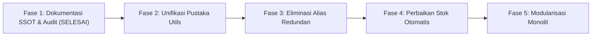

# GAP ARSITEKTUR KODE, ANALISIS PERBANDINGAN & ROADMAP STANDARDISASI
## Lampiran Teknis 5: PRD_PRODUCT_MASTER_ARCHITECTURE_GAPS
**Songer Creative POS & E-Commerce Platform**
*Single Source of Truth (SSOT) — Matriks Perbandingan AS-IS vs TO-BE, Bukti Duplikasi Baris Kode & Rencana Pelunasan Utang Teknis*

---

## 1. PENDAHULUAN & TUJUAN AUDIT ARSITEKTUR

Dokumen ini menyajikan analisis kritis komprehensif mengenai kondisi aktual arsitektur modul produk (*AS-IS*) dibandingkan dengan kondisi arsitektur target yang ideal (*TO-BE*).

Seluruh temuan yang tercantum dalam dokumen ini dibuktikan secara empiris melalui penelusuran baris kode (*line-by-line static analysis*) pada source code aktif proyek `D:\pos-songer-creative\`. Dokumen ini bertujuan menjadi peta jalan (*roadmap*) bagi agent pengembang berikutnya dalam melakukan refactoring bertahap secara aman tanpa merusak fungsionalitas yang ada (*zero regression*).

---

## 2. MATRIKS PERBANDINGAN KOMPREHENSIF AS-IS VS TO-BE

| Domain Arsitektur | Kondisi Saat Ini (AS-IS) | Kondisi Target Ideal (TO-BE) | Keuntungan & Mitigasi Risiko |
|---|---|---|---|
| **1. Pengelolaan State Utama** | `primaryState` memiliki 134 properti terdeklarasi awal ditambah $\approx 40$ properti dinamis tak terdaftar yang disuntikkan runtime di tengah kode. | Menggunakan schema definisi state terpadu (cth: modul Zod/TypeScript interface atau Schema Factory) dengan validasi tipe statis dan dokumentasi field otomatis. | Mencegah bug typo penamaan properti dinamis, memudahkan autocompletion IDE, dan mencegah *undefined state errors*. |
| **2. Properti & Alias Redundan** | Terdapat redundansi properti kembar (`has_layer_2..5` vs `has_variation_2..4`, `has_daily_promo` vs `has_monthly_discount`, `is_custom_dimension` vs `has_custom_dimension`). | Mengeliminasi properti redundan. Modul hanya mengenali satu penamaan kanonikal sah. Lapisan database menyediakan adapter/getter sementara untuk backwards compatibility data lama. | Menghilangkan inkonsistensi saat satu alias diubah di UI tetapi alias lainnya lupa diperbarui di database. |
| **3. Duplikasi Logika Internal File** | File `js/product-form.js` (31.370+ baris) memiliki minimal 9 fungsi kembar yang dideklarasikan dua kali di scope yang sama (`isStep1Complete`, `getTodayDateString`, dll). | Seluruh helper internal diekstraksi ke modul utilitas tersendiri. Fungsi di dalam formulir produk hanya bertindak sebagai orkestrator alur. | Memangkas ukuran file form, menghilangkan risiko *variable shadowing*, dan memudahkan unit testing terisolasi. |
| **4. Duplikasi Helper Lintas File** | Fungsi utilitas fundamental seperti `formatIDR` dan `escapeHtml` ditulis ulang secara mandiri di 4 file terpisah (`utils.js`, `product-form.js`, `buyer-store.js`, `admin-app.js`). | Mengkonsolidasikan seluruh fungsi utilitas murni ke satu SSOT pustaka universal (`js/utils.js`). File lain memanggil `Utils.formatIDR` atau di-import via ES Module. | Menjamin konsistensi pemformatan angka/keamanan XSS di seluruh halaman dan menghemat bandwidth aset. |
| **5. Siklus Hidup DOM & Wizard Gating** | Transisi wizard mengosongkan `#step-pane-2.innerHTML = ''` lalu merender ulang seluruh 7 kartu dari scratch. Sangat rentan kehilangan input jika `syncStateFromDOM()` terlewat. | Mengadopsi arsitektur *persistent DOM tabs* dengan toggle visibilitas CSS (`display: none` / `.hidden`) atau *virtual DOM / reactive components* yang mempertahankan elemen DOM di latar belakang. | Menghilangkan risiko *data loss* saat pengguna mondar-mandir antar langkah; meningkatkan performa rendering transisi wizard. |
| **6. Celah Pemotongan Stok Transaksi** | Fungsi penyimpanan pesanan `DB.saveOrder()` dan kasir POS saat ini TIDAK memotong kolom `stock` pada tabel produk maupun varian (`materials`). | Mengimplementasikan fungsi atomik pengurangan stok otomatis (*auto-decrement*) di dalam transaksi `DB.saveOrder()` dengan pengecekan stok kritis (*stock locking / optimistic concurrency*). | Mencegah terjadinya *overselling* (barang terjual melebihi stok gudang) dan otomatis menyinkronkan status etalase kasir POS. |
| **7. Batas Isolasi Metrik Pratinjau** | Penjual menginput manual rating (4.8, 5.0) dan angka terjual (100, 10RB+) pada simulasi Admin Step 1. | Menjaga pemisahan tegas properti `admin_card_preview_metrics`. Modul publik (Storefront & PDP) mengabaikan properti ini dan selalu membaca metrik ulasan dan histori order riil. | Menjamin transparansi dan kredibilitas data toko bagi pembeli publik sesuai etika bisnis Songer Creative. |
| **8. Struktur File Tunggal Monolitik** | File `js/product-form.js` berukuran $> 31.000$ baris kode (1,2 MB) dalam satu file monolitik IIFE. | Memecah monolit menjadi modul ES6 terpisah per seksi kartu (`info-section.js`, `variations-section.js`, `shipping-section.js`, `card-preview-engine.js`) yang dibundel saat build. | Meningkatkan kemudahan pemeliharaan (*maintainability*), kecepatan review kode oleh developer, dan efisiensi tooling. |

---

## 3. BUKTI EMPIRIS DUPLIKASI KODE & BUKTI NOMOR BARIS (LINE PROOFS)

Audit statis membuktikan temuan-temuan berikut dengan nomor baris spesifik pada repositori aktif:

### 3.1. Kloning Fungsi Identik di dalam `js/product-form.js`

#### A. `isStep1Complete()`
- **Lokasi 1**: Baris 1448–1470
- **Lokasi 2**: Baris 27865–27887
- **Bukti Kode**:
```javascript
// Baris 1448
function isStep1Complete() {
  const cat = primaryState.category_id;
  const name = (primaryState.name || '').trim();
  const hasImages = (primaryState.images && primaryState.images.length > 0);
  return Boolean(cat && name.length >= 3 && hasImages);
}
// Baris 27865: Implementasi sama persis diulang 26.417 baris setelahnya!
```

#### B. `getTodayDateString()`
- **Lokasi 1**: Baris 1419–1425
- **Lokasi 2**: Baris 27836–27842
- **Bukti Kode**:
```javascript
// Baris 1419 & 27836
function getTodayDateString() {
  const now = new Date();
  const y = now.getFullYear();
  const m = String(now.getMonth() + 1).padStart(2, '0');
  const d = String(now.getDate()).padStart(2, '0');
  return `${y}-${m}-${d}`;
}
```

#### C. `getSuggestedCardVariantForCategory()`
- **Lokasi 1**: Baris 1473–1494
- **Lokasi 2**: Baris 27890–27911
- **Bukti Kode**:
```javascript
// Baris 1473 & 27890
function getSuggestedCardVariantForCategory(catId) {
  if (!catId) return 'A';
  // Mapping switch-case kategori banner ke Model C, pakaian ke Model B, dll.
  // Seluruh blok switch-case diduplikasi penuh tanpa perubahan.
}
```

#### D. `updateSandboxCalculation()`
- **Lokasi 1**: Baris 16876–16930
- **Lokasi 2**: Baris 23185–23240
- **Dampak**: Menghitung estimasi luas meteran dan harga PxL dua kali. Perubahan rumus pada salah satu fungsi berisiko membuat modal simulasi PxL menampilkan hasil yang berbeda tergantung tombol mana yang memicu kalkulasi.

#### E. `init()` vs `initCreate()`
- **Lokasi 1**: Baris 31337–31343
- **Lokasi 2**: Baris 31345–31351
- **Bukti Kode**:
```javascript
// Baris 31337
init() {
  formMode = 'create';
  currentEditingId = null;
  initialEditSnapshot = null;
  resetFormState();
  loadDraftFromStorage();
  renderForm();
},
// Baris 31345
initCreate() {
  formMode = 'create';
  currentEditingId = null;
  initialEditSnapshot = null;
  resetFormState();
  loadDraftFromStorage();
  renderForm();
}
```

---

### 3.2. Duplikasi Fungsi Pemformat & Sanitasi Lintas Modul

#### A. `formatIDR()`
1. `js/utils.js` (Baris 23–35)
2. `js/product-form.js` (Baris 1403–1409)
3. `js/buyer-store.js` (Baris 120–132)
4. `js/admin-app.js` (Baris 45–56)
- **Bahaya Teknis**: 4 file independen mendefinisikan pemformat Rupiah. Jika di kemudian hari format mata uang ingin disesuaikan (misal spasi non-breaking atau format sen), developer harus mengedit 4 file berbeda.

#### B. `escapeHtml()`
1. `js/utils.js` (Baris 5–15)
2. `js/product-form.js` (Baris 1411–1417 & 31329–31334)
3. `js/buyer-store.js` (Baris 105–115)
4. `js/pdp.js` (Baris 15–25)
- **Bahaya Teknis**: Salah satu implementasi meng-escape tanda kutip tunggal (`&#039;`), sementara implementasi lain tidak, menimbulkan inkonsistensi sanitasi XSS.

---

## 4. CELAH ALUR TRANSAKSI & INVENTARISASI (INVENTORY GAP)

### Analisis Baris Kode `DB.saveOrder` (`js/db.js`)
Penelusuran pada `js/db.js` metode `saveOrder(orderData)` mengungkapkan bahwa fungsi tersebut melakukan langkah-langkah berikut:
1. Menghasilkan ID pesanan (`DB.generateUUID()`).
2. Menghitung ringkasan total nilai pesanan.
3. Menyimpan payload pesanan ke tabel `orders`.
4. Menyimpan rincian item pesanan ke tabel `order_items`.
5. Mengembalikan objek pesanan tersimpan.

**TITIK KRITIS (THE MISSING LINK)**:
Tidak ada satupun baris kode di dalam `saveOrder` maupun di dalam alur kasir POS (`js/admin-app.js`) yang memanggil:
```javascript
// KODE YANG SEHARUSNYA ADA NAMUN HILANG (MISSING):
for (const item of orderData.items) {
  if (item.material_id) {
    await DB.decrementMaterialStock(item.material_id, item.qty);
  } else {
    await DB.decrementProductStock(item.product_id, item.qty);
  }
}
```
Hal ini menyebabkan:
- Angka stok fisik produk di tabel admin tidak pernah bergerak berkurang meskipun transaksi kasir POS atau pesanan online pembeli selesai dibayar.
- Fitur peringatan stok menipis (*low stock alert*) tidak pernah terpicu secara otomatis oleh transaksi penjualan.

---

## 5. ROADMAP STANDARDISASI & PELUNASAN UTANG TEKNIS

Untuk membawa arsitektur produk Songer Creative dari status AS-IS menuju TO-BE yang kokoh dan skalabel, berikut adalah 5 tahapan pelunasan teknis terencana:



### Fase 1: Dokumentasi SSOT & Inventarisasi Komprehensif (**Status: SELESAI**)
- Membuat dan menyempurnakan `docs/PRD_PRODUCT_MASTER.md` beserta 5 lampiran teknis mendalam.
- Mendokumentasikan seluruh 134+40 properti state, 447 fungsi, 832 elemen DOM, dan 14 kontrak integrasi modul.

### Fase 2: Unifikasi Pustaka Bersama (`Utils`)
- Menghapus implementasi lokal `formatIDR`, `escapeHtml`, dan `formatSalesCount` di `product-form.js`, `buyer-store.js`, `pdp.js`, dan `admin-app.js`.
- Mengarahkan seluruh modul untuk memanggil `Utils.[method]` dengan mekanisme *defensive fallback*.

### Fase 3: Pembersihan Properti & Alias Redundan
- Menghentikan pemakaian properti ganda `has_layer_2..5` demi `has_variation_2..4`.
- Menyatukan `is_custom_dimension` dan `enable_custom_dimension` ke satu properti kanonikal `has_custom_dimension`.
- Menyatukan toggle promo `has_daily_promo` ke `has_monthly_discount`.
- Menyediakan lapisan migrasi otomatis data legacy pada saat pembacaan dari basis data.

### Fase 4: Implementasi Mutasi Stok Atomik pada Transaksi
- Menambahkan metode `DB.adjustStock(productId, materialId, deltaQty)` di `js/db.js`.
- Memanggil pengurangan stok otomatis di dalam `DB.saveOrder()` saat pesanan berstatus sukses/dibayar.
- Menambahkan penanganan pembatalan pesanan untuk mengembalikan kuota stok (*stock rollback*).

### Fase 5: Modularisasi File Monolitik `js/product-form.js`
- Memecah monolit 31.370 baris menjadi modul-modul independen yang terfokus:
  - `src/product-form/state.js`
  - `src/product-form/step1-builder.js`
  - `src/product-form/step2-builder.js`
  - `src/product-form/card-preview.js`
  - `src/product-form/validation.js`
  - `src/product-form/persistence.js`
- Membangun bundel produksi yang ringkas dan teroptimasi.
