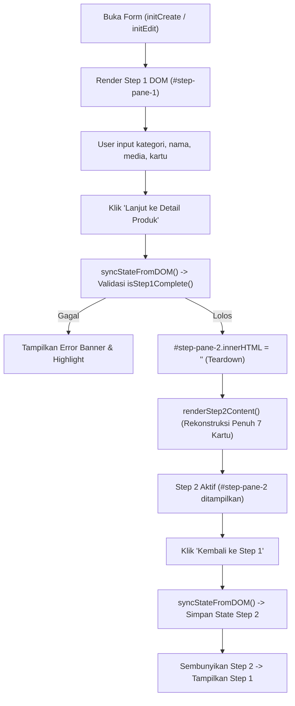

# PETA ARSITEKTUR ELEMEN UI & DOM MODUL PRODUK
## Lampiran Teknis 3: PRD_PRODUCT_MASTER_UI_DOM_MAP
**Songer Creative POS & E-Commerce Platform**
*Single Source of Truth (SSOT) — Hierarki DOM, Selector, Event Binding, State Binding & Lifecycle Rekonstruksi*

---

## 1. PETA ARSITEKTUR DOM & SIKLUS HIDUP REKONSTRUKSI WIZARD

Formulir produk Songer Creative dirancang dalam sistem **2-Step Wizard** yang memanfaatkan kontainer tunggal dengan mekanisme manipulasi DOM reaktif dinamis:
- Kontainer Utama: `#product-form-container`
- Pane Langkah 1: `#step-pane-1` (Informasi Dasar, Media Foto & Desain Kartu)
- Pane Langkah 2: `#step-pane-2` (Detail Penjualan, Variasi, Pengiriman, Spesifikasi & Pengaturan)

> [!CRITICAL]
> **Aturan Emas Siklus Hidup Rekonstruksi DOM Step 2**:
> Saat berpindah dari Step 1 ke Step 2, elemen `#step-pane-2` dikosongkan total (`innerHTML = ''`) lalu dibangun ulang dari nol oleh fungsi `renderStep2Content()`. Seluruh nilai input dibaca dari `primaryState`, `materialsState`, dan `finishingsState`.
> Oleh karena itu, **setiap perubahan nilai pada DOM Step 1 maupun Step 2 HARUS tersinkronisasi ke memori state via `syncStateFromDOM()` sebelum transisi terjadi**. Data apa pun yang ada di elemen input tetapi belum disinkronkan ke state akan musnah saat DOM direkonstruksi ulang.

---

## 2. PETA DOM STEP 1: FORM BUILDER & LIVE PREVIEW / TOOLS

### 2.1. Form Builder Step 1 (Sisi Kiri Desktop / Form Utama Mobile)

| ID / Selektor DOM | Tipe Komponen | Event Listener | State Terikat | Aturan Validasi & Kondisi Tampil |
|---|---|---|---|---|
| `#select-category` | `<select>` Dropdown | `change` | `primaryState.category_id` | **Wajib diisi**. Jika kategori memiliki saran varian kartu, memicu `getSuggestedCardVariantForCategory()`. |
| `#select-sub-category` | `<select>` Dropdown | `change` | `primaryState.sub_category_id` | Opsional. Dinonaktifkan jika kategori induk belum dipilih. |
| `#input-product-name` | `<input type="text">` | `input`, `blur` | `primaryState.name` | **Wajib diisi**. Minimal 3 karakter non-whitespace, maksimal 120 karakter. Menolak karakter script/HTML. |
| `#prod-name-char-count` | `` Text Counter | Dynamic Text | Relatif ke `name.length` | Menampilkan `0/120`. Berubah warna menjadi merah (`text-danger`) saat mencapai 120 karakter. |
| `#name-error-container` | `
` Inline Error | Dynamic Class | Relatif ke validasi nama | Tersembunyi secara default (`hidden`). Muncul dengan teks pesan error saat input blur jika $< 3$ karakter. |
| `#media-dropzone` | `
` Drag & Drop | `dragover`, `drop`, `click` | `primaryState.images` | Mengunggah foto produk baru. Mendukung format JPEG, PNG, WEBP, maks 5MB per berkas. |
| `#gallery-thumbnails-container` | `
` Grid Thumbnail | `click` (delegated) | `primaryState.images` | Menampilkan foto terunggah. Minimal 1 foto wajib diunggah. Foto indeks 0 ditandai sebagai "Foto Utama / Cover". |
| `#select-image-aspect-ratio` | `<select>` Dropdown | `change` | `primaryState.image_aspect_ratio` | Pilihan rasio crop: `'1:1'` (persegi), `'4:3'`, `'3:4'`, atau `'16:9'`. Memperbarui preview mockup secara instan. |
| `#radio-card-model-a` | `<input type="radio">` | `change` | `primaryState.card_variant = 'A'` | Memilih Model A (Kartu Klasik Simpel). Footer kustom disembunyikan. |
| `#radio-card-model-b` | `<input type="radio">` | `change` | `primaryState.card_variant = 'B'` | Memilih Model B (Kartu Banner Modern). Promo dan badge diutamakan. |
| `#radio-card-model-c` | `<input type="radio">` | `change` | `primaryState.card_variant = 'C'` | Memilih Model C (Kartu Detail Lengkap). Mengaktifkan seksi strip footer 1 & 2. |
| `#btn-proceed-to-step2` | `<button>` CTA Primer | `click` $\rightarrow$ `goToStep(2)` | Tidak ada | Tombol "Lanjut ke Detail Produk". Menjalankan `isStep1Complete()`. Gated: dinonaktifkan jika kategori/nama/foto kosong. |

### 2.2. Live Preview & Panel Desain Kartu (Sisi Kanan Desktop / Drawer Mobile)

| ID / Selektor DOM | Tipe Komponen | Event Listener | State Terikat | Deskripsi Fungsional |
|---|---|---|---|---|
| `#btn-tab-preview-mode` | `<button>` Tab Switch | `click` | `previewTestState.sidebarTab = 'preview'` | Menampilkan pratinjau kartu realistis seperti yang dilihat pembeli. |
| `#btn-tab-design-mode` | `<button>` Tab Switch | `click` | `previewTestState.sidebarTab = 'design'` | Menampilkan panel alat (*tools*) kustomisasi styling visual kartu. |
| `#accordion-header-frame` | `
` Accordion | `click` $\rightarrow$ `toggleCardAccordion('frame')` | `cardAccordionState.frame` | Buka/tutup alat konfigurasi border, warna latar, sudut radius, dan bayangan kartu. |
| `#accordion-header-text-info` | `
` Accordion | `click` $\rightarrow$ `toggleCardAccordion('text-info')` | `cardAccordionState['text-info']` | Buka/tutup pengaturan tipografi judul produk, ukuran font, dan warna harga. |
| `#accordion-header-badge` | `
` Accordion | `click` $\rightarrow$ `toggleCardAccordion('badge')` | `cardAccordionState.badge` | Buka/tutup pengaturan lencana pintar (Badge Promo, Terlaris, Produk Baru). |
| `#accordion-header-promo` | `
` Accordion | `click` $\rightarrow$ `toggleCardAccordion('promo')` | `cardAccordionState.promo` | Buka/tutup simulasi banner hitung mundur (*countdown timer*) dan banner diskon. |
| `#accordion-header-footer` | `
` Accordion | `click` $\rightarrow$ `toggleCardAccordion('footer')` | `cardAccordionState.footer` | Buka/tutup alat kustomisasi strip footer 1 & 2 (khusus Model C). |
| `#combobox-input-footer-1` | `<input type="text">` Combobox | `input`, `focus`, `blur`, `keydown` | `primaryState.custom_footer_1.text` | Input bebas / pilih saran teks Footer 1. Placeholder: "Tersedia berbagai Variasi". Maksimal 32 karakter. Wajib diisi untuk Model C. |
| `#combobox-input-footer-2` | `<input type="text">` Combobox | `input`, `focus`, `blur`, `keydown` | `primaryState.custom_footer_2.text` | Input bebas / pilih saran teks Footer 2. Placeholder: "Pengiriman Cepat". Maksimal 32 karakter. Opsional. |
| `#select-footer-1-icon` | `<select>` / Icon Picker | `change` | `primaryState.custom_footer_1.icon` | Pemilih ikon Lucide untuk Footer 1 (`truck`, `clock`, `shield`, `star`, `gift`, `package`, dll). |
| `#select-footer-2-icon` | `<select>` / Icon Picker | `change` | `primaryState.custom_footer_2.icon` | Pemilih ikon Lucide untuk Footer 2. |
| `#swatch-footer-1-bg` | `<input type="color">` Swatch | `input`, `change` | `primaryState.custom_footer_1.bg_color` | Pemilih warna background strip Footer 1 (default: hijau/tema toko). |
| `#swatch-footer-2-bg` | `<input type="color">` Swatch | `input`, `change` | `primaryState.custom_footer_2.bg_color` | Pemilih warna background strip Footer 2. |
| `#combobox-metric-rating` | `<input type="text">` Combobox | `input`, `change`, `focus` | `primaryState.admin_card_preview_metrics.rating` | Input/pilih manual nilai rating bintang (saran: 5.0, 4.9, 4.8) khusus simulasi Admin. |
| `#combobox-metric-sales` | `<input type="text">` Combobox | `input`, `change`, `focus` | `primaryState.admin_card_preview_metrics.sales` | Input/pilih manual angka penjualan (saran: 50, 100, 500, 1RB+, 10RB+) khusus simulasi Admin. |
| `#btn-cancel-card-design` | `<button>` Aksi Batal | `click` $\rightarrow$ `handleCancelCardDesign()` | Tidak ada | Memulihkan desain kartu ke snapshot sebelum diedit dan kembali ke tab preview. |
| `#btn-save-card-design` | `<button>` Aksi Simpan | `click` | `primaryState.card_config` | Mengonfirmasi perubahan desain kustom kartu untuk produk ini. |

---

## 3. PETA DOM STEP 2: 7 KARTU SEKSI LENGKAP

Seluruh elemen berikut dibangun secara dinamis di dalam `#step-pane-2` oleh fungsi `renderStep2Content()`:

### 3.1. Kartu 1: Informasi Produk (`#card-step2-info`)
- **`#step2-input-name`**: Input ringkasan nama produk (tersinkronisasi dua arah dengan `#input-product-name` Step 1).
- **`#select-step2-cat`**: Pilihan kategori produk (tersinkronisasi dengan Step 1).
- **`#select-step2-sub-cat`**: Pilihan sub-kategori produk.
- **`#step2-gallery-strip`**: Wadah thumbnail horizontal foto produk dengan tombol cepat `#btn-step2-upload-more`.

### 3.2. Kartu 2: Harga, Stok & Variasi (`#card-step2-sales`)
- **`#select-price-type`**: Pilihan 6 tipe penetapan harga:
  1. `1` $
ightarrow$ Harga Satuan / Flat.
  2. `2` $
ightarrow$ Hitungan Luas Meteran ($P \times L$ custom dimension).
  3. `4` $
ightarrow$ Paket Produk.
  4. `5` $
ightarrow$ Satuan Bobot (Kg).
  5. `6` $
ightarrow$ Satuan Volume Cairan (Liter).
  6. `7` $
ightarrow$ Kelipatan Kuantitas Batch (Kombinasi Step).
- **`#input-base-price`**: Harga jual dasar (untuk produk tunggal non-variasi).
- **`#input-base-cost`**: HPP modal dasar (untuk produk tunggal non-variasi).
- **`#input-base-stock`**: Kuota stok fisik dasar.
- **`#toggle-custom-dimension`**: Checkbox aktivasi input ukuran custom oleh pembeli.
- **`#card-custom-dimension-container`**: Kontainer opsi batas min/max panjang-lebar dan tombol buka simulator modal PxL (`#btn-open-pxl-sandbox`).
- **`#toggle-variation-tier1`**: Toggle wajib Variasi 1 (Bahan Dasar).
- **`#materials-container`**: Kontainer dinamis baris opsi bahan: `#mat-row-[id]`, input nama (`#mat-name-[id]`), harga (`#mat-price-[id]`), HPP (`#mat-cost-[id]`), stok (`#mat-stock-[id]`).
- **`#toggle-variation-tier2`**: Toggle Variasi 2 (Finishing Utama). Kontainer: `#finishing-main-container`.
- **`#toggle-variation-tier3`**: Toggle Variasi 3 (Finishing Tambahan 1). Kontainer: `#finishing-extra1-container`.
- **`#toggle-variation-tier4`**: Toggle Variasi 4 (Finishing Tambahan 2). Kontainer: `#finishing-extra2-container`.
- **`#toggle-extra-services`**: Toggle Layanan Ekstra (Extra Services). Kontainer: `#finishing-extra3-container`.
- **`#toggle-wholesale`**: Toggle Harga Grosir.
- **`#select-wholesale-mode`**: Mode grosir: `'normal'` (diskon berlaku ke seluruh qty) vs `'tiered'` (diskon bertingkat bertahap).
- **`#wholesale-rows-container`**: Kontainer baris tier grosir: input min kuantitas, max kuantitas, harga satuan grosir, label persentase diskon.

### 3.3. Kartu 3: Logistik & Pengiriman (`#card-step2-shipping`)
- **`#input-package-weight`**: Berat paket kemasan (wajib diisi, angka $> 0$).
- **`#select-weight-unit`**: Satuan berat (`'gram'` atau `'kg'`).
- **`#input-dim-length`**, **`#input-dim-width`**, **`#input-dim-height`**: Dimensi paket luar ($P \times L \times T$ dalam cm) untuk perhitungan berat volumetrik.
- **`#check-courier-pickup`**: Opsi Ambil Sendiri di Toko Fisik.
- **`#check-courier-local`**: Opsi Armada Kurir Toko Sendiri.
  - `#check-village-free`: Gratis ongkir satu desa.
  - `#input-village-fee`: Tarif flat pengantaran satu desa jika berbayar.
  - `#check-district-free`: Gratis ongkir satu kecamatan.
  - `#input-district-fee`: Tarif flat pengantaran satu kecamatan jika berbayar.
- **`#check-courier-reguler`**: Opsi Kurir Ekspedisi Reguler Nasional (JNE, J&T, SiCepat).
- **`#toggle-cod-allowed`**: Opsi pembayaran Bayar di Tempat (COD).
  - `#check-cod-local`: COD berlaku untuk kurir toko.
  - `#check-cod-expedition`: COD berlaku untuk ekspedisi reguler.

### 3.4. Kartu 4: Promo & Afiliasi (`#card-step2-promo`)
- **`#toggle-monthly-discount`**: Checkbox keikutsertaan dalam Promo Diskon Bulanan Toko.
- **`#select-monthly-discount-type`**: Jenis potongan diskon (`'percentage'` % atau `'nominal'` Rp).
- **`#input-monthly-discount-value`**: Besaran nilai potongan diskon promo.
- **`#toggle-affiliate-commission`**: Checkbox aktivasi komisi penjualan afiliasi.
- **`#select-affiliate-mode`**: Mode komisi: `'flat'` (satu nilai) vs `'tiered'` (bertingkat sesuai kuantitas penjualan).
- **`#affiliate-tiers-container`**: Kontainer tabel baris komisi bertingkat.

### 3.5. Kartu 5: Deskripsi Lengkap (`#card-step2-description`)
- **`#textarea-full-description`**: Area teks deskripsi produk lengkap (mendukung format paragraf, poin, dan formatting teks tebal).
- **`#textarea-care-instructions`**: Panduan instruksi perawatan atau instruksi file cetak (khusus produk custom printing).

### 3.6. Kartu 6: Spesifikasi Teknis & Panduan Ukuran (`#card-step2-specs`)
- **`#custom-specs-table-body`**: Kontainer baris spesifikasi kustom (`custom_specs`).
- **`#btn-add-spec-row`**: Tombol tambah baris spesifikasi manual (maksimal 10 baris).
- **`#input-spec-title-[i]`** & **`#input-spec-value-[i]`**: Input nama spesifikasi dan nilainya.
- **`#toggle-size-guide`**: Checkbox aktivasi panduan ukuran produk.
- **`#select-size-guide-type`**: Pilihan jenis panduan ukuran: `'table'` (matriks ukuran interaktif) atau `'image'` (gambar diagram ukuran).
- **`#size-guide-matrix-container`**: Kontainer tabel editor ukuran dinamis (kolom: Ukuran, Panjang, Lebar, dll).

### 3.7. Kartu 7: Pengaturan Lainnya (`#card-step2-others`)
- **`#select-prod-condition`**: Dropdown kondisi produk: `'Baru'` atau `'Bekas'`.
- **`#input-warranty-value`** & **`#select-warranty-unit`**: Durasi garansi produk (Hari / Bulan / Tahun).
- **`#input-prod-sku`**: Kode SKU induk untuk pencatatan gudang dan manajemen inventaris.
- **`#input-prod-barcode`**: Nomor barcode produk untuk pemindaian scanner barcode di kasir POS.
- **`#toggle-prod-is-active`**: Status tayang produk di buyer store: `true` (Aktif/Live) vs `false` (Diarsipkan/Draft).

---

## 4. PETA DOM KOMPONEN MENGAMBANG, MODAL & DRAWER

| Selektor DOM | Tipe Komponen | Induk Kontainer | Event & Handler | Deskripsi Fungsional |
|---|---|---|---|---|
| `#step2-subnav-fixed` | Sticky Subnav Bar | Viewport Top | `scroll` spy window | Subnavbar melayang di bagian atas layar desktop saat pengguna menggulir halaman Step 2. Berisi 7 tautan loncat cepat ke masing-masing kartu. |
| `#step2-subnav-links` | Navigation Links | `#step2-subnav-fixed` | `click` $\rightarrow$ smooth scroll | Tautan navigasi internal (cth: `href="#card-step2-shipping"`). Mengaktifkan indikator kartu aktif sesuai posisi scroll. |
| `#mobile-preview-drawer` | Slide-Up Drawer | Mobile Viewport | `touch`, `click` | Panel pratinjau kartu geser bawah untuk tampilan layar ponsel kecil. |
| `#modal-confirm-cancel` | Dialog Modal | `<body>` | `click` backdrop / tombol | Modal konfirmasi pengamanan data saat pengguna membatalkan form yang sudah memiliki perubahan terisi. |
| `#btn-confirm-cancel-exit` | Button Merah | `#modal-confirm-cancel` | `click` $\rightarrow$ reset & redirect | Mengonfirmasi pembuangan perubahan data, menghapus draf lokal, dan kembali ke tabel produk. |
| `#modal-sandbox-pxl` | Dialog Modal | `<body>` | Input PxL, Pilih Varian | Modal simulator hitung instan harga cetak meteran berdasarkan variasi panjang, lebar, bahan, dan finishing. |
| `#combobox-footer-1-popover` | Dropdown Popover | Dekat `#combobox-input-footer-1` | `click` item saran | Menampilkan daftar riwayat saran teks footer yang pernah berhasil disimpan penjual. |
| `#combobox-footer-2-popover` | Dropdown Popover | Dekat `#combobox-input-footer-2` | `click` item saran | Menampilkan daftar riwayat saran teks footer 2. |
| `#btn-step2-save-final` | Button Hijau CTA | `#step2-footer-actions` | `click` $\rightarrow$ `handleFormSubmit()` | Tombol submit eksekusi final untuk validasi dan penyimpanan produk ke basis data. |

---

## 5. MATRIKS VALIDASI DOM & CONTAINER ERROR

Daftar wadah penampung pesan kesalahan (*error containers*) dan elemen input yang diawasi:

| ID Error Container | Elemen Input yang Diawasi | Kriteria Pemicu Error | Teks Pesan Error Standar |
|---|---|---|---|
| `#name-error-container` | `#input-product-name` | Input kosong atau $< 3$ karakter | *"Nama produk wajib diisi minimal 3 karakter."* |
| `#category-error-container` | `#select-category` | Belum ada kategori yang dipilih | *"Kategori produk wajib dipilih."* |
| `#media-error-container` | `#gallery-thumbnails-container` | Tidak ada foto yang diunggah | *"Minimal 1 foto produk utama wajib diunggah."* |
| `#footer-1-error-container` | `#combobox-input-footer-1` | Model C dipilih, tetapi teks Footer 1 kosong | *"Label Footer 1 wajib diisi untuk Model C (maks 32 karakter)."* |
| `#footer-2-error-container` | `#combobox-input-footer-2` | Karakter teks $> 32$ karakter | *"Label Footer 2 tidak boleh melebihi 32 karakter."* |
| `#price-error-container` | `#input-base-price` | Harga jual $\le 0$ atau kosong | *"Harga jual produk wajib diisi angka valid lebih dari 0."* |
| `#weight-error-container` | `#input-package-weight` | Berat paket kosong atau $\le 0$ | *"Berat paket pengiriman wajib diisi untuk kalkulasi ongkos kirim."* |
| `#courier-error-container` | Checkbox Kurir | Tidak ada satupun kurir yang dicentang | *"Pilih minimal satu metode pengiriman atau kurir toko."* |
| `#var-name-error-[tier]-[id]` | Input Nama Varian | Nama varian kembar pada tier yang sama | *"Nama opsi varian ini sudah digunakan pada kelompok ini."* |
| `#wizard-summary-error-banner` | Global Form Form | Salah satu validasi gagal saat klik Simpan | Menampilkan daftar seluruh poin kesalahan di atas form. |
