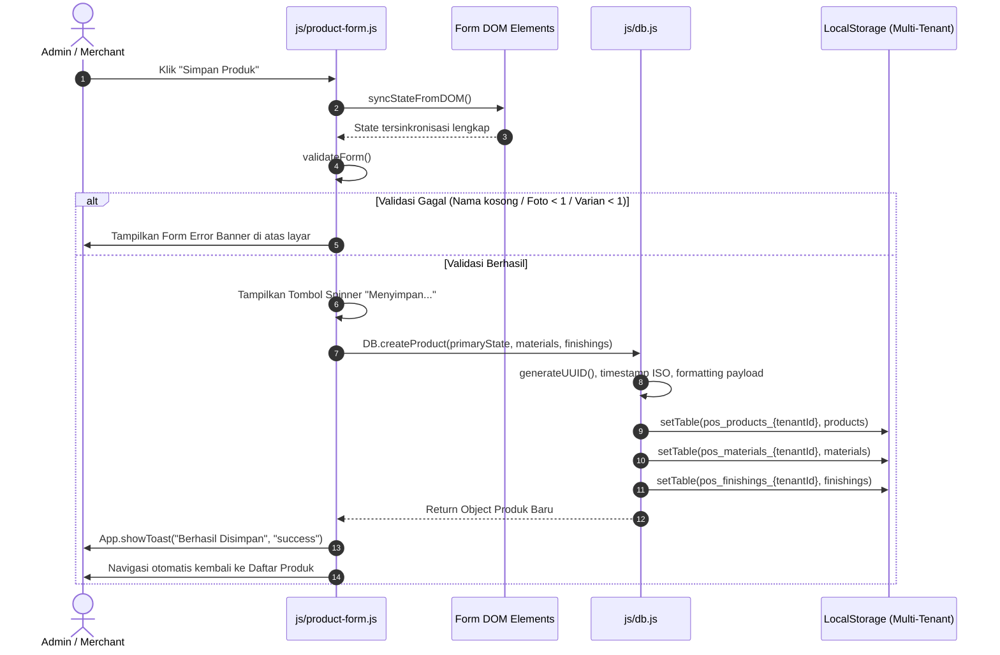

# DOKUMENTASI TEKNIS & ARSITEKTUR FORMULIR PRODUK
**Sistem**: Songer Creative Admin Panel & POS Kasir Multi-Tenant  
**File Acuan Utama**: `js/product-form.js`, `admin.html`, `js/db.js`, `js/pricing-calculator.js`  
**Versi Arsitektur**: v3.0 (Shopee-Style Photo Grid, Silent Canvas Compressor, AI Description Engine & Card Model Auto-Sync)

---

## DAFTAR ISI
1. [Ikhtisar Arsitektur & State Management](#1-ikhtisar-arsitektur--state-management)
2. [Alur Pengelolaan Media Foto Produk](#2-alur-pengelolaan-media-foto-produk)
3. [Alur Generator Deskripsi AI Interaktif](#3-alur-generator-deskripsi-ai-interaktif)
4. [Alur Taksonomi & Otomasi Model Kartu (Card Variant)](#4-alur-taksonomi--otomasi-model-kartu-card-variant)
5. [Alur Logika Varian, Add-ons & Kalkulasi HPP (Pricing Engine)](#5-alur-logika-varian-add-ons--kalkulasi-hpp-pricing-engine)
6. [Pipeline Validasi & Siklus Hidup Penyimpanan Data (Persistence)](#6-pipeline-validasi--siklus-hidup-penyimpanan-data-persistence)
7. [Konsumsi Data Lintas Modul: POS Kasir vs Storefront Pembeli](#7-konsumsi-data-lintas-modul-pos-kasir-vs-storefront-pembeli)

---

## 1. IKHTISAR ARSITEKTUR & STATE MANAGEMENT

Formulir Tambah/Edit Produk didesain dengan pola arsitektur **Single-Source-of-Truth (SSOT)** berbasis *Reactive In-Memory State* yang tersinkronisasi secara dua arah (*two-way reactive binding*) terhadap antarmuka DOM dan *Live Preview Card*.

### Tiga Pilar State Formulir
```
+-------------------------------------------------------------------------+
|                         PRODUCT FORM STATE ENGINE                       |
+-------------------------------------------------------------------------+
|  1. primaryState   -> Metadata pokok, media, kategori, model kartu,      |
|                       diskon promo, stok, footer kustom, & countdown    |
|  2. materialsState -> Array varian bahan dasar & HPP modal             |
|  3. finishingsState-> Objek terpartisi: main, extra_1, extra_2, extra_3|
+-------------------------------------------------------------------------+
```

```javascript
// Struktur State Utama (primaryState)
let primaryState = {
  name: '',
  order_category: 'Ctk',             // Kategori operasional internal kasir ('Ctk' | 'Non-Ctk')
  category_id: null,                 // Relasi UUID Kategori Utama Etalase
  sub_category_id: null,             // Relasi UUID Sub-Kategori Etalase
  card_variant: 'A',                 // 'A' (Model 1) | 'B' (Model 2) | 'C' (Model 3)
  card_variant_manual_override: false,// Flag perlindungan pilihan manual merchant
  price_type: 1,                     // Formula harga (1 s/d 7)
  stock: null,
  is_unlimited_stock: true,
  has_monthly_discount: false,
  discount_type: 'percent',          // 'percent' | 'nominal'
  discount_value: 0,
  monthly_promo_label: 'Promo Bulanan',
  min_order: 1,
  max_order: null,
  image_url: null,                   // Foto sampul utama (selalu sama dengan images[0])
  images: [],                        // Array Base64 Data URL (maksimal 9 item)
  image_aspect_ratio: '1:1',         // '1:1' (Persegi) | '4:3' (Lanskap)
  description: '',
  card_footer_text: 'Proses Hanya Dalam 1Jam',
  footer_badge_icon: 'truck',
  footer_bg_color: '#059669',
  footer_text_color: '#ffffff',
  card_footer_2_text: 'Variasi Paket Tersedia/tidak tersedia',
  footer_2_badge_icon: 'minus',
  footer_2_bg_color: '#047857',
  footer_2_text_color: '#ffffff',
  enable_countdown: true,
  countdown_bg_color: '#059669',
  countdown_text_color: '#ffffff',
  countdown_border_color: '#059669',
  is_active: true
};
```

---

## 2. ALUR PENGELOLAAN MEDIA FOTO PRODUK

Modul foto produk mengadopsi standar arsitektur **Shopee Seller Center** dengan antarmuka berbasis slot terurut (maksimal 9 foto), kompresi senyap (*silent background upload*), dan selektor rasio aspek reaktif.

```mermaid
graph TD
    A[Pengguna Memilih Berkas / Drag-and-Drop] --> B{Validasi Format Berkas}
    B -- Bukan Gambar --> C[Tampilkan Banner Kesalahan & Reset Input]
    B -- Berkas Gambar Valid --> D[Hitung Sisa Kuota Slot: 9 - images.length]
    D -- Kuota Penuh --> E[Peringatan: Maksimal 9 Foto Tercapai]
    D -- Sisa Kuota Tersedia --> F[Ambil Sejumlah Berkas: imageFiles.slice(0, remaining)]
    F --> G[Proses Silent Auto-Compress via HTML5 Canvas]
    G --> H[Konversi ke Base64 WebP / JPEG Quality 0.8]
    H --> I[Append ke primaryState.images]
    I --> J[Set primaryState.image_url = images[0]]
    J --> K[refreshGalleryDOM & updateProductCardLivePreview]
```

### 2.1. Kompresi Gambar Senyap Berbasis HTML5 Canvas
Fungsi `compressProductImage(file, maxWidth = 1200, maxHeight = 1200, quality = 0.8)` bekerja secara asinkron di latar belakang tanpa memunculkan alert atau toast notifikasi yang mengganggu:

1. **Pembacaan Berkas**: Menggunakan objek `FileReader` untuk membaca `File` menjadi buffer URL data.
2. **Kalkulasi Resolusi Proporsional**:
   ```javascript
   let width = img.naturalWidth || img.width;
   let height = img.naturalHeight || img.height;
   if (width > maxWidth || height > maxHeight) {
     const ratio = Math.min(maxWidth / width, maxHeight / height);
     width = Math.round(width * ratio);
     height = Math.round(height * ratio);
   }
   ```
3. **Penyusutan Skala & Anti-Aliasing**:
   - Canvas diinisialisasi sesuai dimensi baru.
   - Konfigurasi `ctx.imageSmoothingEnabled = true` dan `ctx.imageSmoothingQuality = 'high'` menjamin teks atau detail produk tidak pecah.
4. **Ekspor Base64 Teroptimasi**:
   - Diekspor ke format `image/webp` dengan kualitas `0.8` (reduksi ukuran hingga 70-85%).
   - Jika peramban lama tidak mendukung WebP, sistem otomatis *fallback* ke `image/jpeg`.

### 2.2. Mekanisme Selektor Rasio Aspek (1:1 vs 4:3)
Tepat di bawah judul *"Foto Produk"*, terpasang dua tombol radio:
- `Foto 1:1 (Persegi)`: Mengaktifkan kelas Tailwind `aspect-square`.
- `Foto 4:3 (Lanskap)`: Mengaktifkan kelas Tailwind `aspect-[4/3]`.

Perubahan rasio aspek bersifat instan melalui fungsi `setPhotoAspectRatio(ratio, isManual)`. Fungsi ini memutasi `primaryState.image_aspect_ratio`, memperbarui kelas aktif pada label radio, dan memicu `refreshGalleryDOM()`. Seluruh slot foto di formulir dan pratinjau kartu bertransisi serentak tanpa perlu memuat ulang berkas gambar.

### 2.3. Struktur Grid 9-Slot & Logika Reordering
Grid tersusun dinamis mengikuti jumlah foto saat ini:
- **Slot #1 (Cover Utama)**:
  - Diberi badge permanen tegas bertanda bintang: `Foto Utama` (`bg-emerald-600 text-white`).
  - Dilengkapi tombol hapus `[✕]` dan tombol geser ke kanan `[▶]`.
- **Slot #2 s/d #9 (Foto Pendukung)**:
  - Memiliki indikator counter `${idx+1}/9`.
  - Tombol **`[ Cover ]`**: Menukar foto terpilih langsung menjadi foto urutan pertama:
    ```javascript
    const targetImg = primaryState.images.splice(idx, 1)[0];
    primaryState.images.unshift(targetImg);
    primaryState.image_url = primaryState.images[0];
    ```
  - Tombol **`[◀]` (Geser Kiri)**: Menukar posisi dengan slot sebelumnya (`idx - 1`).
  - Tombol **`[▶]` (Geser Kanan)**: Menukar posisi dengan slot berikutnya (`idx + 1`).
  - Tombol **`[✕ Hapus]`**: Menghapus item dari array via `splice(idx, 1)`.
- **Slot Terakhir (jika `images.length < 9`)**:
  - Berfungsi sebagai tombol tambah / dropzone interaktif (`#btn-slot-add-photo`) dengan ikon kamera dan label counter dinamis `(${images.length}/9)`.
  - Saat kosong (`0/9`), slot berlabel `+ Foto Utama`.

### 2.4. Penegasan Tata Letak Responsif Lintas Perangkat
```
Resolusi Layar           Breakpoints Tailwind    Susunan Grid Slot Foto
-----------------------------------------------------------------------
Mobile (< 640px)         grid-cols-3             Touch target > 44x44px, tombol aksi selalu terlihat
Tablet (640px - 1023px)  sm:grid-cols-4 md:cols-5 Spasi proporsional gap-3
Desktop (>= 1024px)      lg:grid-cols-5          Presisi horizontal membentang rata
```

---

## 3. ALUR GENERATOR DESKRIPSI AI INTERAKTIF

Modul ini mengotomatiskan pembuatan narasi penjualan produk percetakan dan barang dagangan dengan memanfaatkan ekstraksi multi-parameter dari formulir.

```
+--------------------------------------------------------------------------+
|                     EKSTRAKSI KONTEKS PRODUK                             |
|  - Judul / Nama Produk      : document.getElementById('input-prod-name')  |
|  - Kategori Utama           : Resolusi ID ke nama kategori (DB.getCategories) |
|  - Sub-Kategori             : Teks opsi aktif pada select-prod-sub-cat   |
|  - Daftar Varian Bahan      : materialsState.map(m => m.name).join(', ') |
+--------------------------------------------------------------------------+
                                    │
                                    ▼
+--------------------------------------------------------------------------+
|                    GENERATOR ENGINE (generateAIDescription)               |
|  Menyusun struktur copywriting persuasif 5-bagian:                       |
|  1. Headline pemikat dengan emoji profesional                            |
|  2. Paragraf orientasi nilai (value proposition)                         |
|  3. Spesifikasi Teknis terstruktur (Kategori, Varian, Standar QC)        |
|  4. Poin-poin keunggulan material & hasil cetak tajam                    |
|  5. Panduan & ketentuan pemesanan (packaging aman & CTA konsultasi)      |
+--------------------------------------------------------------------------+
                                    │
                                    ▼
+--------------------------------------------------------------------------+
|                   KARTU PRATINJAU INTERAKTIF                             |
|  [ Gunakan Teks Ini ]  -> Mutasi textarea & primaryState.description     |
|  [ Batal ]             -> Tutup pratinjau, teks textarea aman            |
+--------------------------------------------------------------------------+
```

### Siklus Interaksi & State Tombol:
1. **Validasi Awal**: Jika nama produk kosong, proses dibatalkan dan sistem memunculkan toast peringatan serta memfokuskan kursor ke input nama.
2. **Indikator Loading**: Tombol `[ ✨ Buat Deskripsi dengan AI ]` berubah ke state disabled, menambahkan kelas `opacity-75 cursor-not-allowed`, dan menampilkan spinner animasi SVG `animate-spin` dengan label *"Sedang Merangkai Deskripsi..."*.
3. **Kartu Pratinjau**: Hasil ditampilkan pada kontainer khusus `#ai-description-preview-box` dengan animasi scroll halus (`scrollIntoView({ behavior: 'smooth' })`). Teks yang ada di textarea utama **tidak akan diubah** sebelum pengguna secara eksplisit menekan tombol `[ Gunakan Teks Ini ]`.

---

## 4. ALUR TAKSONOMI & OTOMASI MODEL KARTU (CARD VARIANT)

Sistem memiliki kemampuan menentukan visual kartu produk secara cerdas berdasarkan kategori etalase yang dipilih.

### 4.1. Hubungan Reaktif Kategori dan Sub-Kategori
Saat dropdown Kategori Utama (`#select-prod-cat`) berubah:
1. `primaryState.category_id` diperbarui.
2. `primaryState.sub_category_id` di-reset ke `null`.
3. Dropdown Sub-Kategori (`#select-prod-sub-cat`) membaca daftar anak kategori via `DB.getSubCategories(catId)` dan merender ulang opsi HTML secara reaktif.

### 4.2. Matriks Rekomendasi Model Kartu (`getSuggestedCardVariantForCategory`)
Algoritma memeriksa kesamaan kata kunci (*semantic keywords*) pada kombinasi `${cat.name} ${cat.slug} ${cat.description}`:

| Model Kartu | Kode Internal | Kata Kunci Pencocokan | Karakteristik Visual Etalase | Default Rasio Foto |
| :--- | :---: | :--- | :--- | :---: |
| **Model 3** | `'C'` | `ritel`, `retail`, `fashion`, `baju`, `kaos`, `pakaian`, `distro`, `hijab`, `merchandise`, `souvenir`, `kuliner`, `fnb`, `makanan`, `minuman`, `snack`, `kue`, `kopi`, `mug`, `ganci` | Kartu Kompak Showcase, Rasio Foto 4:3, Strip Garansi Footer 1 & Strip Countdown Diskon Footer 2 | **4:3 (Lanskap)** |
| **Model 2** | `'B'` | `jasa`, `layanan`, `desain`, `design`, `profesional`, `service`, `branding`, `logo`, `kursus`, `konsultasi` | Minimalis Bold, Judul Teks 1 Baris Tebal, Penekanan Layanan Jasa | **1:1 (Persegi)** |
| **Model 1** | `'A'` | *Default fallback* untuk produk cetak fisik, banner, spanduk, stiker, kartu nama, dimensi PxL | Modern Standard, Rasio Persegi 1:1, Badge Rating & Terjual Sejajar | **1:1 (Persegi)** |

### 4.3. Mekanisme `card_variant_manual_override`
Untuk mencegah sistem menimpa preferensi yang sengaja dipilih pengguna:
- Ketika formulir baru dibuka, `card_variant_manual_override = false`. Perubahan kategori akan otomatis mengubah model kartu.
- Namun jika merchant mengklik salah satu radio model kartu secara sadar, `applyCardVariant(code, true)` dieksekusi dengan parameter `isManual = true`. Nilai `card_variant_manual_override` diset ke `true`.
- Jika merchant kemudian mengganti kategori produk, sistem mendeteksi flag override tersebut dan **tidak akan mengubah** model kartu yang sudah ditentukan merchant.

---

## 5. ALUR LOGIKA VARIAN, ADD-ONS & KALKULASI HPP (PRICING ENGINE)

Untuk mengakomodasi bisnis percetakan dan ritel modern yang kompleks, struktur variasi produk dibagi menjadi 3 lapisan independen:

```
+-------------------------------------------------------------------------+
|                  ARSITEKTUR VARIASI PRODUK (3 LAPISAN)                   |
+-------------------------------------------------------------------------+
| 1. MATERIALS (Bahan / Varian Pokok)                                     |
|    - Mewakili substansi fisik utama produk (Vinyl, Albatros, Akrilik).   |
|    - Menentukan Harga Dasar (Price) dan Modal Pokok (HPP).               |
|    - Khusus Tipe 7 (KombStep): memiliki kolom step_multiplier kelipatan. |
+-------------------------------------------------------------------------+
| 2. FINISHINGS.MAIN (Opsi Utama / Pilihan Wajib)                         |
|    - Tier: 'main'. Sifat: Single-Choice (Radio Button di etalase pembeli). |
|    - Contoh: 'Tanpa Finishing', 'Laminasi Doff', 'Level Kepedasan Pedas'.|
|    - Memberikan biaya tambahan (+Rp) dan HPP ekstra (+HPP).              |
+-------------------------------------------------------------------------+
| 3. FINISHINGS.EXTRA_1 / 2 / 3 (Opsi Tambahan Bertingkat / Add-ons)      |
|    - Tier: 'extra_1', 'extra_2', 'extra_3'.                             |
|    - Sifat: Multi-Choice (Checkbox di etalase pembeli).                  |
|    - Contoh: 'Topping Keju', 'Kemasan Box Kado', 'Cutting Presisi'.     |
+-------------------------------------------------------------------------+
```

### 5.1. Formula Perhitungan Keuntungan & HPP (Pricing Engine)
Di setiap baris varian bahan dan opsi finishing, merchant memasukkan:
- **Harga Jual (Price)**: Nominal yang ditagihkan ke pelanggan.
- **Biaya Modal Pokok / HPP (Cost Price)**: Biaya riil produksi/kulakan.

Sistem menghitung margin keuntungan bersih secara seketika (*real-time live margin*):
$$\text{Margin Bersih (Rp)} = \text{Harga Jual} - \text{HPP}$$
$$\text{Persentase Laba (\%)} = \left( \frac{\text{Harga Jual} - \text{HPP}}{\text{Harga Jual}} \right) \times 100\%$$

Data HPP ini disimpan secara terenkapsulasi di tabel internal, sehingga laporan omzet pada Dashboard Admin dapat menampilkan **Laba Kotor Riil** vs **Total Omzet Penjualan**.

---

## 6. PIPELINE VALIDASI & SIKLUS HIDUP PENYIMPANAN DATA (PERSISTENCE)

Proses penyimpanan produk melewati pipeline validasi ketat sebelum disimpan ke media penyimpanan terisolasi *multi-tenant*.



### 6.1. Pipeline Validasi Sebelum Simpan (`validateForm()`)
1. **Nama Produk**: Tidak boleh kosong atau hanya berupa spasi putih.
2. **Deskripsi Produk**: Wajib terisi sebagai panduan spesifikasi bagi calon pembeli.
3. **Foto Produk**: Array `primaryState.images` wajib memiliki minimal 1 foto (`length >= 1`).
4. **Varian Bahan (`materialsState`)**: Wajib memiliki minimal 1 baris, dan seluruh baris harus memiliki nama varian yang jelas.
5. **Finishing Utama (`finishingsState.main`)**: Wajib memiliki minimal 1 opsi default (misal: "Tanpa Finishing").
6. **Validasi Stok & Diskon**: Jika batas stok fisik aktif, angka stok harus berupa bilangan valid. Jika diskon bulanan aktif, nominal persentase (1-100%) atau IDR harus bernilai positif.

### 6.2. Struktur Payload JSON Tersimpan di Database
Data dipecah dan dinormalisasi ke 3 tabel relasional dengan partisi tenant (`pos_{table}_{tenantId}`):

#### 1. Entitas Produk (`pos_products_{tenantId}`)
```json
{
  "id": "e8a93bc2-41d1-4bc1-9c3f-7e23a45e9821",
  "name": "Banner Spanduk Fleksi Korea 440gr Outdoor",
  "order_category": "Ctk",
  "category_id": "c1000000-0000-0000-0000-000000000001",
  "sub_category_id": "s1000000-0000-0000-0000-000000000001",
  "card_variant": "A",
  "card_variant_override": true,
  "price_type": 1,
  "stock": null,
  "is_unlimited_stock": true,
  "has_monthly_discount": true,
  "discount_type": "percent",
  "discount_value": 10,
  "monthly_promo_label": "Promo Gajian",
  "min_order": 1,
  "max_order": null,
  "image_url": "data:image/webp;base64,UklGRt4...",
  "images": [
    "data:image/webp;base64,UklGRt4...",
    "data:image/webp;base64,UklGRv8..."
  ],
  "image_aspect_ratio": "1:1",
  "description": "Spanduk outdoor tebal tahan air dan panas cuaca...",
  "card_footer_text": "Proses Hanya Dalam 1Jam",
  "footer_badge_icon": "truck",
  "footer_bg_color": "#059669",
  "footer_text_color": "#ffffff",
  "card_footer_2_text": "Variasi Paket Tersedia",
  "footer_2_badge_icon": "package",
  "footer_2_bg_color": "#047857",
  "footer_2_text_color": "#ffffff",
  "enable_countdown": true,
  "price": 35000,
  "cost_price": 20000,
  "is_active": true,
  "sales_count": 0,
  "rating_avg": 5.0,
  "review_count": 0,
  "created_at": "2026-10-17T13:00:00.000Z",
  "updated_at": "2026-10-17T13:00:00.000Z"
}
```

#### 2. Entitas Bahan / Varian (`pos_materials_{tenantId}`)
```json
[
  {
    "id": "mat-9912",
    "product_id": "e8a93bc2-41d1-4bc1-9c3f-7e23a45e9821",
    "name": "Fleksi Korea 440gr Doff",
    "price": 35000,
    "cost_price": 20000,
    "step_multiplier": 1,
    "created_at": "2026-10-17T13:00:00.000Z"
  }
]
```

#### 3. Entitas Finishing & Add-ons (`pos_finishings_{tenantId}`)
```json
[
  {
    "id": "fin-101",
    "product_id": "e8a93bc2-41d1-4bc1-9c3f-7e23a45e9821",
    "tier": "main",
    "name": "Mata Ayam Tiap Sudut",
    "price": 0,
    "cost_price": 0,
    "created_at": "2026-10-17T13:00:00.000Z"
  },
  {
    "id": "fin-102",
    "product_id": "e8a93bc2-41d1-4bc1-9c3f-7e23a45e9821",
    "tier": "extra_1",
    "name": "Keling Tambahan Tiap 50cm",
    "price": 5000,
    "cost_price": 2000,
    "created_at": "2026-10-17T13:00:00.000Z"
  }
]
```

---

## 7. KONSUMSI DATA LINTAS MODUL: POS KASIR VS STOREFRONT PEMBELI

Skema data terpadu yang dihasilkan oleh Formulir Produk dikonsumsi secara konsisten oleh dua antarmuka aplikasi yang berbeda:

### A. Modul POS Mesin Kasir Offline (`js/admin-app.js` & `pricing-calculator.js`)
1. **Pencarian Cepat**: Mengindeks `product.name`, `product.id`, dan `materials` untuk pencarian transaksi kasir via barcode scanner atau keyboard input.
2. **Kalkulator Dinamis**: Memanggil `PricingCalculator.calculatePrice(...)` dengan parameter input kasir:
   - Dimensi cetak $P \times L$ (khusus Tipe 1).
   - Bahan yang dipilih (`materials`).
   - Finishing yang ditambahkan (`finishings`).
   - Kuantitas order & kelipatan wajib.
3. **Pencetakan Struk Thermal**: Format pesanan dikonversi ke template cetak struk thermal 58mm/80mm mencantumkan nama varian bahan dan opsi finishing di bawah nama item utama.

### B. Storefront Pembeli Web (`index.html` & `js/buyer-store.js`)
1. **Etalase Grid**: Menampilkan kartu produk sesuai `card_variant` ('A', 'B', atau 'C') dengan rasio gambar yang sesuai (`image_aspect_ratio`). Jika diskon bulanan aktif, persentase potongan harga dan pita countdown ditampilkan secara visual.
2. **Modal PDP (Product Detail Page)**:
   - Menampilkan galeri foto dengan slider multi-gambar (`images`).
   - Merender chip pilihan bahan (`materials`) dengan penyesuaian harga live.
   - Merender radio button untuk opsi finishing wajib (`finishings.filter(f => f.tier === 'main')`).
   - Merender checkbox untuk add-ons bertingkat (`tier: extra_1, extra_2, extra_3`).
3. **Generator Pesanan WhatsApp**:
   - Pilihan pelanggan dikompilasi menjadi format pesan WhatsApp terstruktur, mencantumkan URL gambar foto utama, rincian varian bahan, dan total tagihan akurat.

---
*Dokumen ini merupakan referensi teknis arsitektur resmi modul produk pada Songer POS & E-Commerce System.*
