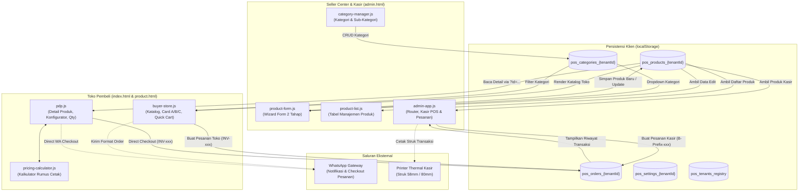

# AUDIT BASELINE & INVENTARISASI PROYEK (TAHAP 1/9)
**Proyek:** Songer Creative SaaS (POS & E-Commerce Percetakan Terpadu)  
**Root Direktori:** `D:\pos-songer-creative\`  
**Tanggal Audit:** 29 Oktober 2026  
**Status Dokumen:** Baseline Audit Resmi  

---

## 1. PETA MODUL & TANGGUNG JAWAB

Berdasarkan pemindaian fisik terhadap seluruh berkas di repositori, berikut adalah inventarisasi lengkap seluruh modul aktif yang benar-benar ada di dalam direktori kerja:

### A. Titik Masuk Antarmuka (HTML Entrypoints)

| Berkas | Ukuran | Tanggung Jawab & Fitur Utama | Modul / Skrip Pendukung Terkait |
| :--- | :--- | :--- | :--- |
| `admin.html` | ~43.7 KB | Shell Single Page Application (SPA) Seller Center & POS Kasir. Mengatur layout sidebar, topbar, subnavbar, dan wadah render dinamis. | `js/utils.js`, `src/lib/invoice/invoice-generator.js`, `js/db.js`, `js/pricing-calculator.js`, `js/category-manager.js`, `js/promo-manager.js`, `js/review-manager.js`, `js/product-form.js`, `js/product-list.js`, `js/customer-manager.js`, `js/admin-app.js` |
| `index.html` | ~45.6 KB | Storefront katalog belanja publik pembeli. Mendukung pencarian, filter kategori, 3 model kartu etalase (A/B/C), modal quick-view, keranjang belanja, dan floating kupon. | `css/storefront.css`, `css/style.css`, `js/utils.js`, `js/db.js`, `js/pricing-calculator.js`, `js/buyer-store.js` |
| `product.html` | ~37.0 KB | Dedicated Product Detail Page (PDP). Membaca ID produk dari URL query parameter (`?id=...`), galeri interaktif, konfigurator spesifikasi bahan/finishing/PxL, validasi kelipatan order, ulasan pelanggan, dan sticky checkout bar mobile. | `css/style.css`, `js/utils.js`, `js/db.js`, `js/pricing-calculator.js`, `js/pdp.js` |
| `settings.html` | ~31.1 KB | Halaman pengaturan mandiri identitas toko, tema dua warna (Dual-Color Theme Picker), logo/favicon, dan konfigurasi cetak struk printer thermal 58mm/80mm. | `js/utils.js`, `js/db.js`, `js/settings.js` |
| `theme-editor.html` | ~221.8 KB | Kustomizer tema visual gaya Shopify Theme Studio dengan iframe live preview dan generator variabel CSS. | `css/style.css`, `css/theme-editor.css`, `js/utils.js`, `js/db.js`, `js/theme-editor.js` |
| `superadmin/superadmin.html` | ~29.5 KB | Cockpit Superadmin Platform Multi-Tenant SaaS. Pengelolaan registry tenant toko, paket langganan (`PAKET_A_BASIC` vs `PAKET_B_PRO_CALCULATOR`), dan matriks aktivasi fitur per-tenant. | `superadmin/superadmin.css`, `js/db.js`, `superadmin/superadmin.js` |

---

### B. Modul Logika Inti & Kontroler Klien (`js/`)

| Berkas | Ukuran / Baris | Tanggung Jawab & Ruang Lingkup Logika |
| :--- | :--- | :--- |
| `js/utils.js` | 12.5 KB (281 baris) | Fungsi utilitas umum terpusat: pemformat mata uang `formatIDR()`, sanitasi string XSS `escapeHtml()`, konversi warna `hexToRgba()`, generator slug URL `generateSlug()`, penanggalan `formatDateID()`, dan notifikasi `showToast()`. |
| `js/db.js` | 228.6 KB (3.308 baris) | Lapisan abstraksi basis data lokal client-side 100% berbasis `localStorage`. Menangani multi-tenant client dengan pemisahan kunci `pos_{tabel}_{tenant_id}`, inisialisasi awal data percontohan (`DEMO_PRODUCTS_MASTER`), CRUD produk, kategori, promosi, voucher, pesanan, ulasan, pelanggan, dan pengaturan toko. |
| `js/pricing-calculator.js` | 21.2 KB (408 baris) | Mesin kalkulasi matematis berbasis UMD (CommonJS & Browser Global) yang mendukung 6 rumus harga cetak: Meter (1), KombF (2), Paket (4), Kg (5), Lt (6), dan KombStep (7). Mengimplementasikan `calculateProductPrice()` dan `calculateBilledArea()`. |
| `js/product-form.js` | 1.26 MB (24.238 baris) | Engine formulir produk 2 tahap (Step 1 & Step 2). Mengelola state reaktif form (`primaryState`, `materialsState`, `finishingsState`), kompresi senyap gambar HTML5 Canvas ke format WebP (kualitas 0.8), grid 9 foto Shopee-style, tabel matriks kombinasi variasi, modal aturan variasi 2–4 (`#modal-specific-options`), modal grosir (`#modal-wholesale-config`), input kelipatan order langsung, dan pratinjau Mini PDP / Shopee Drawer terintegrasi. |
| `js/product-list.js` | 41.0 KB (748 baris) | Modul tampilan daftar katalog produk pada Seller Center. Mengelola tabel produk, pencarian lokal, filter status aktif/nonaktif, aksi hapus dengan konfirmasi, dan navigasi edit menuju `ProductForm.initEdit(id)`. |
| `js/admin-app.js` | 402.2 KB (6.772 baris) | Koordinator utama antarmuka Admin SPA dan pengendali Kasir POS (`AdminApp`). Menyediakan router hash (#dashboard, #products, #pos-cashier, dll.), katalog grid sentuh kasir, kalkulator keranjang POS, kalkulasi kembalian tunai, modal bayar, integrasi `InvoiceGenerator`, riwayat pesanan, dan rekapitulasi penjualan. |
| `js/buyer-store.js` | 331.2 KB (5.578 baris) | Kontroler etalase belanja pembeli (`BuyerStore`). Menangani pencarian autocomplete instan, filter kategori, rendering 3 model kartu (A: Cetak PxL, B: Portofolio/Jasa, C: Retail Timer), modal quick-view, keranjang belanja, sesi pelanggan (manual & simulasi Google Auth), dan checkout pesanan via WhatsApp. |
| `js/pdp.js` | 65.1 KB (1.082 baris) | Kontroler halaman detail produk dedicated. Membaca data produk via URL parameter, mengendalikan galeri foto interaktif, konfigurator spesifikasi, pemanggilan `PricingCalculator.calculateProductPrice()`, validasi stepper kuantitas bertahap (+1/-1), teks peringatan kelipatan pesanan, penguncian tombol CTA (*Buy Now / Add to Cart*), dan tab ulasan/deskripsi. |
| `js/category-manager.js` | 93.9 KB (1.616 baris) | Modul manajemen taksonomi kategori dan sub-kategori produk pada Seller Center dengan proteksi cascade safety. |
| `js/promo-manager.js` | 273.9 KB (4.520 baris) | Pengelolaan program diskon toko, kupon voucher, banner promosi harian, dan saklar migrasi otomatis ke promo bulanan / tanggal kembar. |
| `js/customer-manager.js` | 38.0 KB (718 baris) | CRM direktori pelanggan, pencatatan histori transaksi per-pelanggan, dan pengelolaan saldo poin loyalitas pelanggan. |
| `js/review-manager.js` | 16.5 KB (338 baris) | Moderasi ulasan produk (persetujuan atau penolakan ulasan sebelum tampil di etalase/PDP). |
| `js/settings.js` | 17.2 KB (358 baris) | Pengendali sinkronisasi pengaturan profil toko, jam operasional, konfigurasi printer thermal (lebar kertas 58mm/80mm), dan footer nota. |
| `js/theme-editor.js` | 262.0 KB (4.450 baris) | Kontroler editor tema visual. Mengelola penyesuaian warna brand, tipografi, dan layout dengan injeksi variabel CSS ke dalam iframe live preview secara langsung. |
| `superadmin/superadmin.js` | 105.8 KB (1.812 baris) | Kontroler operasional platform superadmin untuk mendaftarkan merchant baru, memodifikasi paket lisensi, dan mengisolasi pengaturan fitur antar-tenant. |

---

### C. Modul Backend, Persistensi Lanjutan & Pustaka Pendukung (`src/`, `prisma/`)

| Berkas | Ukuran | Status Keberadaan & Tanggung Jawab |
| :--- | :--- | :--- |
| `src/lib/invoice/invoice-generator.js` | 13.7 KB (384 baris) | **Aktif Digunakan.** Standarisasi format faktur resmi `[A/B]-[PrefixLabel]-[Counter 5 Digit]-[MMYY]` dengan proteksi zero-collision counter. Saat ini dipanggil oleh `admin-app.js` pada transaksi kasir POS. |
| `src/lib/db-local/offline-db.js` | 13.7 KB (366 baris) | **Tersedia (Scaffolding).** Wrapper IndexedDB dengan object stores `orders`, `order_items`, `sync_queue`, dan `cached_products` untuk persiapan transaksi offline kasir. *Belum dimuat ke tag `<script>` berkas HTML aktif.* |
| `src/lib/prisma/client.js` | 446 B (21 baris) | **Tersedia (Scaffolding).** Inisialisasi singleton PrismaClient untuk Node.js backend. |
| `prisma/schema.prisma` | 22.6 KB (646 baris) | **Tersedia (Scaffolding).** Skema relasional PostgreSQL lengkap dengan 16 model entitas multi-tenant (`Tenant`, `TenantSettings`, `Category`, `SubCategory`, `Product`, `ProductMaterial`, `ProductFinishing`, `Order`, `OrderItem`, `Review`, `SyncQueue`, `InvoiceSequence`, dll.). |
| `prisma/seed.js` | 3.2 KB (96 baris) | **Tersedia (Scaffolding).** Skrip pengisian data awal tenant Songer Creative pada PostgreSQL via Prisma CLI. |
| `schema.sql` | 7.9 KB (218 baris) | **Tersedia (Scaffolding).** Skrip DDL PostgreSQL awal untuk inisialisasi basis data langsung. |
| `src/controllers/`, `src/routes/`, `src/services/`, `src/models/`, `src/database/` | 0 B (Direktori Kosong) | Direktori kosong hasil inisialisasi awal arsitektur backend Node.js. |

---

### D. Skrip Otomasi & Utilitas Sistem

| Berkas | Ukuran | Tanggung Jawab & Cara Kerja |
| :--- | :--- | :--- |
| `bump-version.js` | 3.9 KB (118 baris) | Automator cache busting global berbasis Node.js. Menyeragamkan 35 aset statis di 6 berkas HTML ke parameter versi timestamp waktu lokal Indonesia (WIB - UTC+7, format `?v=YYYYMMDDHHmm`) dalam satu perintah CLI sebelum commit Git. |
| `serve.ps1` | 4.4 KB (114 baris) | Server HTTP TCP ringan berbasis PowerShell murni untuk pengujian cross-device pada jaringan Wi-Fi lokal (default port: 8080). |
| `Buka-Aplikasi.bat` | 1.0 KB (38 baris) | Launcher 1-klik Windows untuk membuka storefront `index.html` langsung di browser bawaan. |
| `Buka-Preview-HP.bat` | 414 B (14 baris) | Launcher 1-klik Windows untuk menjalankan `serve.ps1`. |

---

## 2. TEKNOLOGI AKTUAL VERSUS TEKNOLOGI YANG BARU DIRENCANAKAN

Terdapat perbedaan mendasar antara **arsitektur aktual yang sedang berjalan saat ini** di lingkungan produksi/browser versus **arsitektur target yang dicantumkan dalam dokumentasi Roadmap/PRD**:

```
+---------------------------------------------------------------------------------------------------------+
|                                    PERBANDINGAN ARSITEKTUR TEKNOLOGI                                    |
+-----------------------------------+----------------------------------+----------------------------------+
| Dimensi Sistem                    | Implementasi Aktual (Saat Ini)   | Rencana / Target Roadmap         |
+-----------------------------------+----------------------------------+----------------------------------+
| Runtime Eksekusi                  | Browser Client-Side SPA murni    | Fullstack Node.js / Laravel 12   |
| Bahasa / Pola Pemrograman         | JavaScript Vanilla (DOM Native)  | React 18 + Inertia.js v2         |
| Styling & Desain                  | Tailwind CDN + Custom Scoped CSS | Tailwind CSS (Build Pipeline)    |
| Basis Data & Persistensi Data     | localStorage (Browser Storage)   | PostgreSQL / Supabase + Prisma   |
| Mode Multi-Tenant                 | Client-side key partitioning     | Server-side tenant_id isolation  |
| Mekanisme Autentikasi             | Hardcoded credentials di client  | JWT / OAuth2 / Laravel Sanctum   |
| Mesin Kalkulasi Harga             | Client-side (pdp.js, dll.)       | Centralized API Pricing Service  |
| Penomoran Faktur (Invoice)        | Campuran (InvoiceGen vs INV-xxx) | Shared-Counter Atomic Increment  |
| Gerbang Pembayaran                | Redirect WhatsApp Checkout       | Payment Gateway DOKU             |
| Integrasi Pengiriman              | Estimasi kurir manual            | Agregator Logistik KiriminAja    |
+-----------------------------------+----------------------------------+----------------------------------+
```

### Rincian Analisis Per Komponen:

1. **Sistem Autentikasi (Authentication)**:
   - **Aktual**: Diimplementasikan secara simulatif pada sisi klien di `js/db.js` (`authenticateAdmin`). Memeriksa kecocokan kredensial dengan nilai hardcoded (`admin123`, `admin`, `123456`) atau data tenant di `localStorage`. Autentikasi pelanggan di `buyer-store.js` menyediakan opsi input manual atau tombol simulasi "Login Google" yang langsung menyimpan profil dummy ke `pos_active_customer_{tenantId}`. Tidak ada enkripsi password (hash), tidak ada session cookie HTTP-only, dan tidak ada verifikasi token JWT/OAuth server.
   - **Target**: Autentikasi multi-tenant terpusat dengan Laravel Sanctum / JWT dan OAuth2 Google asli.

2. **Sistem Persistensi & Basis Data (Persistence & Database)**:
   - **Aktual**: 100% data operasional (katalog produk, kategori, stok, transaksi, ulasan, pengaturan) disimpan dalam `window.localStorage` peramban pengguna. Jika browser dibersihkan (*clear cache/cookies*) atau dibuka di mode Incognito, data aplikasi kembali ke seed awal `DEMO_PRODUCTS_MASTER`.
   - **Target**: Basis data relasional PostgreSQL / Supabase yang dipetakan oleh `prisma/schema.prisma` (terdapat 16 tabel relasional), didukung oleh IndexedDB lokal (`src/lib/db-local/offline-db.js`) untuk transaksi kasir offline.

3. **Mekanisme Multi-Tenant**:
   - **Aktual**: Partisi penyimpanan berbasis kunci awalan di `localStorage`: `pos_{tabel}_{tenant_id}`. Tenant aktif dikontrol oleh `pos_current_tenant_slug` (default: `songer-creative-01`). Superadmin (`superadmin.js`) mendaftarkan dan memodifikasi tenant di array `pos_tenants_registry`.
   - **Target**: Multi-tenancy tingkat server dengan isolasi `tenant_id` pada setiap query database dan sub-domain dinamis (`tenant.songercreative.id`).

4. **Pricing Engine**:
   - **Aktual**: Modul `js/pricing-calculator.js` tersedia untuk menghitung 6 rumus harga, namun secara aktual hanya dipanggil secara terikat oleh `js/pdp.js`. Modul lain seperti `js/product-form.js`, `js/buyer-store.js`, dan `js/admin-app.js` menggunakan implementasi fungsi kalkulasi internal masing-masing.
   - **Target**: Service layer terpadu (*Single Source of Truth*) yang dipanggil seragam oleh seluruh modul.

---

## 3. ALUR DATA UTAMA SISTEM (DATA FLOW)

Berikut adalah pemetaan alur perpindahan data antar-modul yang aktif saat ini:



### Penjelasan Rantai Interaksi Modul:
1. **Siklus Hidup Produk (Product Lifecycle)**:
   - Pengguna membuat atau mengubah produk di `product-form.js` $\rightarrow$ State divalidasi oleh `validateForm()` $\rightarrow$ Disimpan via `DB.saveProduct()` ke dalam `pos_products_{tenantId}`.
   - `product-list.js` membaca data tersebut via `DB.getProducts()` untuk ditampilkan di tabel admin. Klik "Edit" memanggil `ProductForm.initEdit(productId)` untuk memuat kembali snapshot data produk.
   - `buyer-store.js` membaca `DB.getProducts()` dan merender kartu etalase sesuai `card_variant` (Model A, B, atau C).
   - Saat pembeli mengklik salah satu produk di etalase, browser membuka `product.html?id={id}`, di mana `pdp.js` membaca data produk spesifik dari basis data lokal.

2. **Kalkulasi & Transaksi Pembeli**:
   - Di PDP (`pdp.js`), pemilihan bahan, finishing, dan dimensi memicu `recalculatePrice()`, yang mendelegasikan rumus ke `PricingCalculator.calculateProductPrice()`.
   - Stepper kuantitas bertambah/berkurang secara presisi (+1/-1). Jika nilai kuantitas tidak memenuhi kelipatan yang disyaratkan produk, notifikasi peringatan ditampilkan dan tombol CTA dinonaktifkan.
   - Saat checkout diklik, data disimpan via `DB.saveOrder()` dan ringkasan pesanan dialihkan ke WhatsApp dengan tautan `https://wa.me/...`.

3. **Operasional Kasir POS**:
   - Pada menu Kasir POS (`admin-app.js`), kasir memilih produk dari grid katalog yang bersumber dari `DB.getProducts()`.
   - Modul `admin-app.js` menghitung total tagihan dengan logikanya sendiri, memanggil `InvoiceGenerator.generateInvoiceNumber('B', prefix)` untuk nomor faktur resmi, memotong stok fisik via `DB.updateProductStock()`, dan mencetak struk thermal via dialog print peramban.

---

## 4. INFRASTRUKTUR TESTING YANG TERSEDIA

Pemeriksaan terhadap berkas konfigurasi dependensi dan perkakas pengujian menunjukkan kondisi berikut:

1. **Dependensi Framework Pengujian (Test Frameworks)**:
   - Berkas `package.json` **TIDAK MEMILIKI** dependensi testing apa pun (tidak ada Jest, Vitest, Mocha, Jasmine, Cypress, maupun Playwright).
   - Skrip pengujian `"test"` pada `package.json` **tidak terdefinisi**.

2. **Berkas Tes Otomatis**:
   - Tidak ditemukan berkas unit test (`*.test.js` atau `*.spec.js`) maupun direktori tes (`test/`, `tests/`, `__tests__/`) di seluruh repositori.

3. **Mekanisme Verifikasi yang Aktif Saat Ini**:
   - **Syntax Validation**: Menggunakan fasilitas bawaan Node.js:
     ```bash
     node --check js/utils.js; node --check js/db.js; node --check js/admin-app.js; node --check js/buyer-store.js; node --check js/product-form.js; node --check js/product-list.js; node --check js/pdp.js; node --check js/settings.js; node --check js/theme-editor.js
     ```
   - **Simulasi Runtime Headless**: Menjalankan skrip otomasi Node.js berbasis mock DOM (objek `document` & `window` tiruan) untuk memverifikasi eksekusi fungsi inisialisasi tanpa browser.
   - **Manual End-to-End**: Meluncurkan berkas HTML secara lokal melalui browser dengan bantuan peluncur batch (`Buka-Aplikasi.bat`) atau server TCP lokal (`serve.ps1`).

---

## 5. RISIKO AWAL, KETIDAKSESUAIAN & HAL YANG BELUM TERVERIFIKASI

Berdasarkan audit komparatif antara dokumentasi dan kode sumber aktual, berikut adalah temuan penting dan risiko teknis yang teridentifikasi:

### A. Ketidaksesuaian Penting (Discrepancies)

1. **Skrip `npm run dev` pada `package.json` Rusak (Broken Script)**:
   - Pada `package.json` baris 7, tertulis `"dev": "node src/services/app.js"`.
   - **Temuan Fisik**: Berkas `src/services/app.js` **tidak ada di disk** (direktori `src/services/` berstatus kosong). Menjalankan `npm run dev` akan langsung menghasilkan error fatal `Cannot find module`.

2. **Fragmentasi Logika Perhitungan Harga (Pricing Engine Fragmentation)**:
   - Dokumentasi menyatakan bahwa `js/pricing-calculator.js` adalah *Core Universal Pricing Engine* untuk seluruh sistem.
   - **Temuan Fisik**: Modul `js/pricing-calculator.js` **hanya dipakai oleh `js/pdp.js`**. Modul `js/product-form.js`, `js/buyer-store.js`, dan `js/admin-app.js` memiliki logika perhitungan harga dan kalkulasi variasinya sendiri-sendiri, yang berpotensi menghasilkan selisih pembulatan harga antar-halaman.

3. **Inkonsistensi Format Penomoran Faktur (Invoice Discrepancy)**:
   - Format resmi yang diatur dalam dokumentasi adalah `[A/B]-[PrefixLabel]-[Counter 5 Digit]-[MMYY]` via `src/lib/invoice/invoice-generator.js`.
   - **Temuan Fisik**: Modul `admin-app.js` (Kasir POS) sudah mengadopsi format ini (menghasilkan kode `B-xxx`), namun pesanan yang dibuat melalui `buyer-store.js` dan `pdp.js` (Web Storefront) masih menggunakan format acak sederhana `'INV-' + Date.now().toString().slice(-6)`.

4. **Klaim Direktori Backend pada README**:
   - `README.md` mencantumkan direktori `src/controllers/`, `src/routes/`, `src/services/`, `src/models/`, dan `src/database/` sebagai struktur aktif.
   - **Temuan Fisik**: Seluruh direktori tersebut merupakan direktori kosong tanpa ada satu pun berkas implementasi di dalamnya.

---

### B. Risiko Teknis Awal (Technical Risks)

1. **Kerapuhan Penyimpanan Data (Single-Point-of-Failure di `localStorage`)**:
   - Seluruh data transaksi, pelanggan, produk, dan pengaturan toko hanya berada di memori browser lokal perangkat yang sedang digunakan.
   - Batas kuota penyimpanan browser (`localStorage` umumnya 5 MB – 10 MB per origin) rentan terlampaui karena gambar produk disimpan dalam bentuk string Base64 langsung di dalam state produk.
   - Data tidak tersinkronisasi lintas perangkat (kasir di PC A tidak dapat melihat pesanan yang dibuat oleh pembeli di HP B).

2. **Ukuran Berkas Monolitik `js/product-form.js`**:
   - Berkas `js/product-form.js` berukuran ~1.26 MB dengan lebih dari 24.200 baris kode dalam satu file. Kompleksitas yang sangat tinggi ini meningkatkan risiko *regression bug* saat dilakukan perbaikan pada salah satu sub-fitur.

3. **Ketiadaan Proteksi Keamanan Autentikasi**:
   - Sandi admin tersimpan dalam teks terbuka (*plain text*) di `js/db.js` dan diverifikasi di sisi klien. Siapa pun yang membuka antarmuka peramban atau *Developer Tools Console* dapat mengakses data admin dan registry tenant dengan mudah.

4. **Ketiadaan Test Runner Otomatis**:
   - Setiap refactoring kode berisiko merusak alur bisnis tanpa terdeteksi segera, karena tidak tersedianya unit test otomatis.

---
*Dokumen inventarisasi ini dibuat secara objektif berdasarkan verifikasi berkas riil pada repositori `D:\pos-songer-creative\` tanpa ada manipulasi data.*

