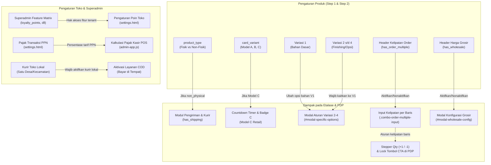

# FEATURE MATRIX & CAPABILITY AUDIT (TAHAP 2/9)
**Proyek:** Songer Creative SaaS (POS & E-Commerce Percetakan Terpadu)  
**Root Direktori:** `D:\pos-songer-creative\`  
**Dokumen Acuan:** `docs/qa/00-project-inventory.md`, `docs/PRD_MASTER.md`, `docs/ROADMAP.md`  
**Tanggal:** 29 Oktober 2026  
**Status:** Audit Resmi Baseline Tahap 2  

---

## 1. DEFINISI STATUS IMPLEMENTASI

Setiap kapabilitas bisnis diklasifikasikan ke dalam 6 status baku tanpa asumsi spekulatif:

- **`IMPLEMENTED`**: Fitur telah terwujud secara fisik dalam kode sumber, memiliki alur kerja logika lengkap, dan berfungsi normal pada antarmuka/runtime saat ini.
- **`PARTIAL`**: Fitur telah dibangun sebagian di UI atau logika, namun integrasi antar-komponen atau alur ujung-ke-ujung (end-to-end) belum tuntas.
- **`PLANNED`**: Fitur telah tercatat di dalam PRD/Roadmap, namun belum ada kode logika yang mengimplementasikannya pada berkas aktif.
- **`BROKEN`**: Fitur memiliki kode implementasi, namun mengalami error runtime, skrip terputus, atau fungsi tidak dapat dieksekusi.
- **`UNVERIFIED`**: Kode fitur tersedia, namun belum diuji perilakunya terhadap edge-case atau kondisi data ekstrim.
- **`NEEDS SPECIFICATION`**: Fitur disebut dalam dokumen bisnis, namun detail alur, validasi, pembagian komisi, atau model datanya belum didefinisikan secara konkret.

---

## 2. MATRIKS KAPABILITAS BISNIS PER DOMAIN

### A. Domain POS-Only (Aplikasi Kasir Walk-In)

| ID Fitur | Kapabilitas Bisnis | Status | Berkas Implementasi | Deskripsi & Bukti Kode Aktual |
| :--- | :--- | :---: | :--- | :--- |
| **POS-01** | Touch Grid Katalog & Filter Kategori | `IMPLEMENTED` | `js/admin-app.js#L1250` | Grid kartu produk touch-friendly, filter kategori dinamis, dan pencarian instan nama/SKU di `#view-pos-cashier`. |
| **POS-02** | Manajemen Keranjang Kasir | `IMPLEMENTED` | `js/admin-app.js#L1380` | Penambahan item, pengaturan kuantitas (+/-), penghapusan item keranjang, dan pembersihan keranjang (`clearCart`). |
| **POS-03** | Kalkulasi Subtotal, Diskon & Total | `IMPLEMENTED` | `js/admin-app.js#L1450` | Perhitungan subtotal belanja, diskon voucher belanja, dan kalkulasi PPN jika aktif di pengaturan toko. |
| **POS-04** | Modal Pembayaran Tunai & Kembalian | `IMPLEMENTED` | `js/admin-app.js#L1520` | Modal input uang diterima, tombol pecahan uang cepat (pas, 50rb, 100rb), dan perhitungan uang kembalian secara otomatis. |
| **POS-05** | Cetak Struk Thermal (58mm / 80mm) | `IMPLEMENTED` | `js/admin-app.js#L1680`, `settings.js` | Dialog print struk kasir dengan layout responsif sesuai setting lebar kertas, nama kasir, item PxL, dan footer toko. |
| **POS-06** | Penomoran Faktur Shared Counter (`B-...`) | `IMPLEMENTED` | `src/lib/invoice/invoice-generator.js`, `admin-app.js` | Memanggil `InvoiceGenerator.generateInvoiceNumber('B', prefix)` dengan format `B-[Prefix]-[00001]-[MMYY]`. |
| **POS-07** | Pembayaran Down Payment (DP) Kasir | `PLANNED` | - | Belum ada saklar/mode penerimaan uang muka di modal pembayaran kasir. Tercatat di PRD Menu 5 item 1. |
| **POS-08** | Tambah Pelanggan Cepat (*Quick Add Customer*) | `PLANNED` | - | Belum ada tombol modal tambah pelanggan langsung dari antarmuka kasir tanpa berpindah menu CRM. |
| **POS-09** | Transaksi Kasir Offline (IndexedDB) | `PARTIAL` | `src/lib/db-local/offline-db.js` | Modul `offline-db.js` telah ditulis, namun belum dimuat di tag `<script>` berkas `admin.html`. |
| **POS-10** | Cetak QR Code Verifikasi Nota | `PLANNED` | - | Disebutkan pada PRD Menu 5 item 2; implementasi canvas/SVG QR Code verifikasi pada nota fisik belum terpasang. |

---

### B. Domain Storefront-Only (Toko Web & Etalase Pembeli)

| ID Fitur | Kapabilitas Bisnis | Status | Berkas Implementasi | Deskripsi & Bukti Kode Aktual |
| :--- | :--- | :---: | :--- | :--- |
| **STR-01** | Rendering Katalog 3 Model Kartu (A/B/C) | `IMPLEMENTED` | `js/buyer-store.js#L780` | Model A (Standar Cetak PxL), Model B (Portofolio Jasa), Model C (Retail Shopee-style dengan timer & dual-badge). |
| **STR-02** | Pencarian Autocomplete & Filter Kategori | `IMPLEMENTED` | `js/buyer-store.js#L320` | Input pencarian dengan popover saran langsung, pemfilteran pill kategori utama dan sub-kategori. |
| **STR-03** | Modal Cepat Pratinjau (*Quick-View Modal*) | `IMPLEMENTED` | `js/buyer-store.js#L1450` | Pop-up ringkas detail produk, pemilih bahan/finishing, input dimensi PxL cm, dan tombol tambah ke keranjang. |
| **STR-04** | Keranjang Belanja & Drawer Checkout | `IMPLEMENTED` | `js/buyer-store.js#L1980` | Drawer keranjang belanja, kalkulasi total belanja, dan tombol checkout pemesanan. |
| **STR-05** | Checkout Pesanan via WhatsApp Direct | `PARTIAL` | `js/buyer-store.js#L2150`, `pdp.js` | Checkout menghasilkan nomor faktur `INV-xxx` dan mengalihkan ringkasan ke tautan WhatsApp API (`wa.me`). Belum terintegrasi ke payment gateway DOKU. |
| **STR-06** | Modal Popup Promosi Toko Interaktif | `PLANNED` | - | Disebutkan pada PRD Menu 1 item 1; komponen popup otomatis berbasis jeda waktu belum terpasang di `index.html`. |
| **STR-07** | Modul Flash Sale Real-Time dengan Countdown | `PARTIAL` | `js/buyer-store.js#L950` | Timer berjalan statis pada kartu Model C, namun sistem penjadwalan promo terpusat dan progress bar stok promo masih terencana. |
| **STR-08** | Wishlist & Recently Viewed Products | `PLANNED` | - | Disebutkan pada PRD Menu 1 item 3; belum ada penyimpanan array ID produk favorit/terakhir dilihat di `localStorage`. |
| **STR-09** | Portal Member Area Pelanggan | `PARTIAL` | `js/buyer-store.js#L2500` | Sesi pelanggan aktif tersimpan di `pos_active_customer_{tenantId}`, namun halaman mandiri riwayat unduhan digital & tracking resi belum ada. |
| **STR-10** | Multi-Alamat & Kalkulasi Ongkir Ekspedisi | `PLANNED` | - | Input alamat lengkap pembeli dan integrasi ongkos kirim KiriminAja otomatis belum diimplementasikan. |

---

### C. Domain POS + Storefront (Ekosistem Terpadu)

| ID Fitur | Kapabilitas Bisnis | Status | Berkas Implementasi | Deskripsi & Bukti Kode Aktual |
| :--- | :--- | :---: | :--- | :--- |
| **PS-01** | Katalog Produk Terpusat Bersama | `IMPLEMENTED` | `js/db.js#L18300` | POS dan Storefront membaca data produk yang sama secara real-time dari entitas `pos_products_{tenantId}`. |
| **PS-02** | Pengurangan Stok Otomatis Saat Penjualan | `PARTIAL` | `js/db.js#L18400`, `admin-app.js` | Kasir POS memotong stok fisik via `DB.updateProductStock()`. Storefront baru mencatat order tanpa otomatis memotong stok produk non-unlimited. |
| **PS-03** | Rekonsiliasi Nomor Faktur Terpadu | `PARTIAL` | `invoice-generator.js`, `buyer-store.js` | Kasir menggunakan format `B-[Prefix]-[Counter]-[MMYY]`, sedangkan Web masih menggunakan format `INV-Date.now()`. Penyatuan counter belum lengkap. |
| **PS-04** | Pelunasan Sisa DP Lintas Saluran (Web vs POS) | `PLANNED` | - | Alur di mana DP dibayar di Web lalu dilunasi di Kasir POS (atau sebaliknya) belum memiliki kode transaksi pelunasan. |
| **PS-05** | Sinkronisasi Riwayat Mutasi Stok | `PLANNED` | - | Modul pencatatan log mutasi (`#view-stock-mutation`) belum dibuat; pemotongan stok belum mencatat entri log tipe mutasi. |

---

### D. Model Produk (Fisik/Cetak, Digital, Jasa, Subscription)

| ID Fitur | Kapabilitas Bisnis | Status | Berkas Implementasi | Deskripsi & Bukti Kode Aktual |
| :--- | :--- | :---: | :--- | :--- |
| **PROD-01** | Produk Fisik Cetak (PxL, Bobot, Dimensi) | `IMPLEMENTED` | `js/product-form.js#L2900`, `pdp.js` | Formula Meter (1), KombF (2), Paket (4), Kg (5), Lt (6), KombStep (7), konfigurasi batas minimal ukuran, dan toleransi angka nol. |
| **PROD-02** | Produk Fisik Non-Cetak (Retail Barang Jadi) | `IMPLEMENTED` | `js/product-form.js#L3050` | Produk retail standar tanpa dimensi PxL, didukung variasi opsi bahan, stok terbatas/unlimited, dan harga jual normal. |
| **PROD-03** | Produk Digital (Download Tautan / File) | `PARTIAL` | `js/product-form.js#L2950` | Dapat dipilih via radio `non_physical`, namun kolom upload file master, link Google Drive aman, dan limitasi kuota download belum ada. |
| **PROD-04** | Layanan Jasa (Tanpa Pengiriman) | `PARTIAL` | `js/product-form.js#L2960` | Terwakili oleh radio `non_physical` yang menonaktifkan modul kurir pengiriman, namun field instruksi kerja kustom dari pembeli belum tersedia. |
| **PROD-05** | Langganan (*Subscription Recurring*) | `PLANNED` | - | Pilihan tipe produk langganan bulanan/tahunan dan sistem perpanjangan belum tersedia di form produk maupun checkout. |
| **PROD-06** | Pengaturan 4 Tipe Produk Terpisah di Step 1 | `PLANNED` | `js/product-form.js#L7500` | Form saat ini hanya memiliki 2 pilihan radio (`physical` vs `non_physical`). Upgrade ke 4 tombol tipe produk masih ada di checklist PRD. |
| **PROD-07** | Matriks Variasi 4 Tingkat & Layanan Extras | `IMPLEMENTED` | `js/product-form.js#L13000-L14100` | Variasi 1 (Bahan Dasar), Variasi 2–4 (Finishing/Atribut), dan Layanan Extras dengan modal scope independen per baris. |
| **PROD-08** | Harga Grosir (Normal & Bertingkat Tier) | `IMPLEMENTED` | `js/product-form.js#L18700` | Modal `#modal-wholesale-config` bersih tanpa nilai default paksa, mendukung potongan harga fixed per-pcs per rentang kuantitas. |
| **PROD-09** | Input Langsung Kelipatan Order | `IMPLEMENTED` | `js/product-form.js#L13700` | Input teks langsung per baris di tabel kombinasi, saran "Tanpa Kelipatan", validasi angka minimal 2, dan sinkronisasi stepper PDP. |

---

### E. Role & Hak Akses (RBAC)

| ID Fitur | Kapabilitas Bisnis | Status | Berkas Implementasi | Deskripsi & Bukti Kode Aktual |
| :--- | :--- | :---: | :--- | :--- |
| **ROLE-01** | Peran Superadmin Platform SaaS | `IMPLEMENTED` | `superadmin/superadmin.js#L1` | Pengendali platform independen di `superadmin.html`. Akses via PIN login, dapat menambah tenant, mengubah masa aktif, dan toggle fitur. |
| **ROLE-02** | Peran Pemilik Toko (Merchant Admin) | `IMPLEMENTED` | `js/db.js#L21950`, `admin-app.js` | Mengelola produk, kategori, promosi, melihat pesanan, dan mengatur identitas toko di `admin.html`. |
| **ROLE-03** | Peran Kasir Khusus (*Cashier Only Role*) | `PARTIAL` | `js/admin-app.js#L200` | Menu kasir dapat diakses, namun belum ada pemisahan akun/kredensial login kasir yang membatasi kasir agar tidak bisa mengakses menu Pengaturan/Laba. |
| **ROLE-04** | Peran Pelanggan / Pembeli (*Customer Role*) | `PARTIAL` | `js/buyer-store.js#L2400`, `db.js` | Profil pembeli tersimpan di `pos_customers_{tenantId}`, memiliki nama, email, nomor HP, dan poin, namun belum ada hak login password terenkripsi. |
| **ROLE-05** | Peran Afiliator (*Affiliate Member*) | `PLANNED` | - | Dashboard khusus member affiliate untuk tracking klik link dan penarikan komisi belum dibuat. |

---

### F. Paket Berlangganan SaaS & Multi-Tenant

| ID Fitur | Kapabilitas Bisnis | Status | Berkas Implementasi | Deskripsi & Bukti Kode Aktual |
| :--- | :--- | :---: | :--- | :--- |
| **TEN-01** | Multi-Tenancy Client-Side Storage | `IMPLEMENTED` | `js/db.js#L16757-L18200` | Isolasi data toko via prefix key `pos_{tabel}_{tenant_id}` pada `localStorage` dengan penanganan tenant default `tenant-songer-001`. |
| **TEN-02** | Registry Tenant & Slug Toko Dinamis | `IMPLEMENTED` | `js/db.js#L17050`, `superadmin.js` | Penyimpanan array `pos_tenants_registry` dengan resolusi slug toko unik (`songer-creative-01`, dll.). |
| **TEN-03** | Paket A: Basic Retail | `IMPLEMENTED` | `superadmin/superadmin.js#L350` | Konfigurasi paket langganan dasar untuk retail tanpa kalkulator PxL kustom. |
| **TEN-04** | Paket B: Pro Percetakan & Kalkulator | `IMPLEMENTED` | `superadmin/superadmin.js#L360` | Konfigurasi paket profesional dengan aktivasi kalkulator PxL, WhatsApp gateway, dan multi-variasi. |
| **TEN-05** | Multi-Tenant Database Relasional Cloud | `PLANNED` | `prisma/schema.prisma` | Skema PostgreSQL telah dirancang, namun koneksi cloud terpusat antar-tenant belum aktif. |

---

### G. Program Marketing, Promo, Kupon & Komisi Afiliasi

| ID Fitur | Kapabilitas Bisnis | Status | Berkas Implementasi | Deskripsi & Bukti Kode Aktual |
| :--- | :--- | :---: | :--- | :--- |
| **MKT-01** | Promo Harian & Konversi Diskon [% / IDR] | `IMPLEMENTED` | `js/product-form.js#L4800`, `promo-manager.js` | Toggle diskon pada produk, pemilih jenis diskon persen vs nominal, live preview badge harga promo coret. |
| **MKT-02** | Migrasi Otomatis ke Promo Bulanan | `IMPLEMENTED` | `js/product-form.js#L4950` | Saklar sertakan di promo bulanan otomatis mengalihkan badge saat tanggal kampanye aktif. |
| **MKT-03** | Kupon Diskon Belanja (Voucher Code) | `IMPLEMENTED` | `js/promo-manager.js#L850`, `buyer-store.js` | CRUD kode voucher, validasi masa berlaku, kuota pemakaian, dan potongan pada keranjang belanja. |
| **MKT-04** | Komisi Afiliasi Khusus Per-Produk | `NEEDS SPECIFICATION` | - | Disebutkan pada PRD Bagian 3 Menu 6 item 3 dengan 2 mode (Tunggal & Grosir), namun form input komisi di `product-form.js` belum ada. |
| **MKT-05** | Komisi Afiliasi Per-Kategori (Fallback) | `PLANNED` | `js/category-manager.js` | Belum ada input persentase komisi affiliate pada form tambah/edit kategori di `category-manager.js`. |
| **MKT-06** | Pengajuan Penarikan Saldo Afiliasi (*Withdrawal*) | `PLANNED` | - | Alur request pencairan saldo komisi member ke rekening bank/e-wallet belum diimplementasikan. |

---

### H. Pengaturan Toko, Pajak & Integrasi Pihak Ketiga

| ID Fitur | Kapabilitas Bisnis | Status | Berkas Implementasi | Deskripsi & Bukti Kode Aktual |
| :--- | :--- | :---: | :--- | :--- |
| **SET-01** | Pengaturan Identitas & Branding Toko | `IMPLEMENTED` | `settings.html`, `js/settings.js#L80` | Pengaturan nama toko web, nomor kontak WhatsApp, alamat fisik, dan footer nota cetak. |
| **SET-02** | Kustomisasi Dual-Color Theme Toko | `IMPLEMENTED` | `settings.html`, `theme-editor.js` | Color picker native untuk `--color-primary` dan `--color-secondary` dengan injeksi dinamis ke CSS `:root`. |
| **SET-03** | Konfigurasi Lebar Printer Thermal | `IMPLEMENTED` | `settings.html`, `js/settings.js#L150` | Pilihan lebar nota 58mm atau 80mm dan tombol pengujian cetak struk (*Test Print*). |
| **SET-04** | Integrasi Payment Gateway DOKU | `PLANNED` | - | Tab pengaturan API key DOKU dan modul pembayaran otomatis belum tersedia di `settings.html`. |
| **SET-05** | Integrasi Agregator Logistik KiriminAja | `PLANNED` | - | Tab pengaturan API key KiriminAja dan kalkulasi ongkos kirim otomatis per kecamatan belum tersedia. |
| **SET-06** | Integrasi WhatsApp Gateway Fonnte & Broadcast | `PLANNED` | - | Tab pengaturan token Fonnte dan antrean pengiriman pesan otomatis 6 status belum tersedia. |
| **SET-07** | Pajak Pertambahan Nilai (PPN %) | `PARTIAL` | `js/admin-app.js#L1480` | Perhitungan PPN ada di kasir POS, namun tab form pengaturan tarif PPN resmi di `settings.html` belum ada. |

---

## 3. IDENTIFIKASI PENGATURAN & MENU YANG SALING BERGANTUNG (INTER-DEPENDENCY MAP)

### Rincian Ketergantungan:
1. **Jenis Produk (`product_type`) $\rightarrow$ Pengiriman & Dimensi**:
   Jika produk berjenis `non_physical`, sistem formulir secara defensif mematikan `has_shipping`, menyembunyikan input kurir, bobot gram, dan dimensi volumetrik kemasan.
2. **Variasi 1 $\rightarrow$ Lingkup Variasi 2–4 (`#modal-specific-options`)**:
   Aturan `Spesifik` pada Variasi 2 s.d. 4 terikat langsung pada ID baris Variasi 1. Jika baris Variasi 1 dihapus dari form, pembersihan referensi pada `primaryState.variation_scopes` wajib terjadi untuk mencegah data yatim (*orphaned state*).
3. **Kelipatan Order $\rightarrow$ Interaksi Stepper Pembeli**:
   Nilai kelipatan order diatur di matriks produk $\rightarrow$ diinterpretasikan oleh `resolveActiveCombinationRule()` $\rightarrow$ mengunci tombol CTA dan memicu teks panduan kelipatan pada `updateShopeeDrawerSubmitButtonState` di drawer admin dan `recalculatePrice` di PDP.
4. **Kurir Lokal $\rightarrow$ Pembayaran COD**:
   Layanan Cash on Delivery (COD) tidak boleh aktif mandiri tanpa adanya kurir lokal armada toko (Satu Desa / Satu Kecamatan), guna mencegah risiko penolakan paket pada kurir nasional.
5. **Superadmin Feature Matrix $\rightarrow$ Form Pengaturan Tenant**:
   Jika Superadmin menonaktifkan fitur poin pelanggan (`features.loyalty_points = false`), tombol aktivasi sistem loyalitas di `settings.html` terkunci (`disabled`), dan modul poin pada kasir disembunyikan otomatis.

---

## 4. DAFTAR KEBUTUHAN YANG BERSTATUS `NEEDS SPECIFICATION`

Berikut adalah kebutuhan bisnis yang tercantum dalam dokumen atau instruksi, namun **belum memiliki spesifikasi teknis yang lengkap**, sehingga tidak boleh diimplementasikan secara tergesa-gesa tanpa arahan lebih lanjut dari pemilik produk:

1. **Struktur Data & Perhitungan Komisi Afiliasi Grosir**:
   - *Masalah*: PRD Bagian 3 Menu 6 item 3 menyebutkan "Komisi Afiliasi Grosir" dengan pembagian tier kuantitas dan rantai `Max. Qty + 1`. Namun, belum ada spesifikasi jelas mengenai: Apakah komisi grosir dihitung dari selisih harga jual atau dari total nilai transaksi belanja? Bagaimana perlakuan komisi jika pembeli menggunakan kupon diskon tambahan?
2. **Mekanisme Otentikasi dan Batas Unduhan Produk Digital**:
   - *Masalah*: PRD menyebutkan "Tautan unduhan instan aktif setelah pembayaran terverifikasi dengan pembatasan kuota unduhan". Namun, karena sistem saat ini tidak memiliki backend server dinamis (100% browser static), belum ada spesifikasi bagaimana URL unduhan dienkripsi agar tidak dapat disebarkan secara publik tanpa login.
3. **Rekonsiliasi Urutan Faktur Kasir Offline vs Cloud**:
   - *Masalah*: Modul `invoice-generator.js` menyebutkan alokasi prefix `OFF` (`B-DnC-OFF0001-1026`) untuk kasir offline. Belum ada spesifikasi algoritma bagaimana nomor offline ini digantikan oleh nomor urut resmi saat sinkronisasi internet pulih, tanpa memicu duplikasi atau kebingungan pada struk fisik yang telah telanjur dicetak dan dibawa oleh pelanggan.
4. **Aturan Down Payment (DP) untuk Keranjang Campuran (*Mixed Cart*)**:
   - *Masalah*: Belum ada spesifikasi apa yang terjadi jika pembeli memasukkan 2 barang ke keranjang: Barang A mendukung DP (minimal DP 50%), sedangkan Barang B wajib bayar Lunas (100%). Apakah seluruh keranjang dipaksa bayar lunas, atau nilai DP dihitung proporsional hanya untuk Barang A?

---
*Dokumen Feature Matrix ini sah dan menjadi acuan langsung penyusunan Dokumen Rencana Pengujian (Test Coverage Plan).*

